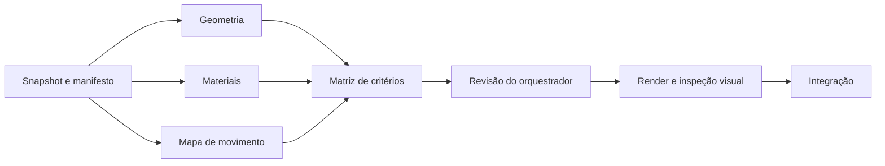

# Processo de melhoria do apresentador Pulso

Este processo divide melhorias do robô em entregas pequenas que modelos menores conseguem executar e que o orquestrador consegue verificar. Os trabalhadores recebem os arquivos e contratos necessários; devolvem apenas um resumo. Código, tabelas, evidências e logs ficam em disco. A decisão visual e a integração pertencem ao orquestrador.

## Arquivos e execução

- `scripts/improvement-fleet.py`: executor Python 3.10+, sem dependências Python externas.
- `config/robot-improvement-tasks.json`: tarefas, modelos explícitos, dependências, entradas e contratos de saída.
- `tests/improvement-fleet-test.py`: verificações locais com relay simulado, sem APIs.
- `utils/presenter-framing.js`: escolha determinística de posição e câmera.
- `experiments/hyperframes-pulso-pilot/src/presenter-robot-modern.js`: variante do modelo, com a interface do rig existente.
- `experiments/hyperframes-pulso-pilot/src/modern-preview.js`: estudo de 12 segundos com quatro enquadramentos.

Na raiz do repositório:

```bash
python3 scripts/improvement-fleet.py --dry-run
python3 tests/improvement-fleet-test.py
env -u DISPLAY -u XAUTHORITY node tests/presenter-framing.js
python3 scripts/improvement-fleet.py --run --parallel 2
```

O modo padrão é `--dry-run`: valida caminhos, contratos, modelo/provider e dependências, sem consultar APIs. `--run` usa o acesso NVIDIA autorizado nesta sessão. O executor consulta `opencode models nvidia`, exige que os modelos estejam no catálogo local e chama o relay existente em `~/.agents/skills/opencode-delegate/scripts/relay.mjs`. O OpenCode autentica pela própria configuração. O executor não abre nem copia arquivos de autenticação.

Para uma primeira avaliação, use `--parallel 1`. Depois de revisar uma entrega, use dois trabalhadores em tarefas independentes. O limite do executor é dois. Não aumente paralelismo antes de demonstrar que as tarefas produzem artefatos corretos.

## Responsabilidades

| Responsável | Faz | Entrega |
|---|---|---|
| Orquestrador | Define o problema, contratos, critérios e arquivos necessários | Manifesto e briefs completos |
| Trabalhador de geometria | Extrai medidas de chamadas específicas do código | `geometry.json` com valores e referências |
| Trabalhador de materiais | Extrai cor, metalness, roughness, clearcoat e iluminação | `materials.json` |
| Trabalhador de movimento | Extrai duração, origem do tempo, transformações e cortes | `motion.json` |
| Trabalhador de critérios | Organiza os três artefatos em verificações pendentes | `acceptance.json` |
| Orquestrador | Confere fontes, executa checks, inspeciona renders e integra | Mudança revisada e evidências reais |

Modelos menores funcionam melhor com extração, conversão de formatos e edição de um helper bem especificado. Anatomia, escolhas estéticas, diagnóstico ambíguo e aprovação visual exigem revisão do orquestrador. Um relatório que diz “sem problemas” não substitui essa revisão.

## 1. Registrar uma referência antes de melhorar

1. Capture `git status --short` e o diff dos arquivos envolvidos. Preserve alterações anteriores.
2. Identifique qual arquivo o render real carrega. Neste projeto, o bundle de produção nasce de `src/production-presenter.js`, que importa `src/presenter-robot.js`. A prévia moderna importa a variante `src/presenter-robot-modern.js`.
3. Registre duração, resolução, taxa de quadros, versão do Three.js/HyperFrames, câmera e seed.
4. Produza imagens do corpo inteiro, face e juntas. Use os mesmos tempos e a mesma câmera em comparações antes/depois.
5. Separe uma hipótese por rodada: proporções, material, expressão, movimento ou enquadramento. Corrigir tudo simultaneamente impede atribuir o resultado a uma mudança.

O executor congela as entradas declaradas em `snapshot/` antes de despachar os trabalhadores e registra SHA-256 em `snapshot-hashes.json`. Assim, um trabalhador que começa depois usa a mesma referência que os demais. O manifesto da rodada também fica salvo. Se a origem mudar durante o trabalho, compare os hashes antes de integrar; não trate a entrega antiga como auditoria do código novo.

## 2. Definir critérios mensuráveis

Para esta variante:

- Silhueta reconhecível em 1920×1080 e em miniatura; cabeça, braços, mãos e pés discerníveis.
- Casco claro, visor escuro, juntas metálicas e emissão ciano controlada. Preserve detalhe nas regiões claras.
- MeshPhysicalMaterial para casco/visor; materiais locais e ambiente gerado localmente. Nenhum recurso remoto necessário para renderizar.
- Expressão legível nos planos aberto e fechado. Piscada deve recuperar a mesma pose após seek para trás.
- Braços com pivots separados; o gesto de um braço pode diferir do outro. O movimento depende do tempo absoluto, sem acumular rotações.
- Câmera e posição mudam no corte entre cenas. Textos e legendas ocupam a região oposta ao robô.
- Imagens em painel dividido têm prioridade editorial: o robô sai desse plano para evitar sobreposição.
- Todas as palavras da legenda permanecem visíveis; o destaque muda com o áudio.
- MP4 final da prévia: 12 segundos, 1920×1080, 30 fps, 360 quadros.

Não fixe um orçamento de triângulos arbitrário sem medir o rig atual e o render no equipamento alvo. Meça chamadas de desenho, triângulos e tempo de captura. Uma melhoria deve caber no orçamento operacional do gerador existente.

## 3. Montar briefs completos

O contexto de entrada pode ser extenso. Inclua interfaces completas, arquivos relacionados, exemplos válidos, decisões já tomadas e evidências. O objetivo de economia é reduzir o retorno ao orquestrador e evitar redescoberta, não omitir informação necessária.

Contrato recomendado:

```text
Objetivo: produzir um único artefato verificável.
Leia somente: arquivos declarados e cópias das dependências.
Contexto: versão, interfaces, convenção de coordenadas, estado atual e exemplos.
Pode escrever: arquivos exclusivos listados no contrato.
Critério: conteúdo exato, formato, intervalos e referência às fontes.
Execute ferramentas e grave o artefato; não entregue só um plano.
Não faça commit, push, deploy, instalação, novas delegações ou chamadas a outros providers.
Retorno: STATUS; O QUE FEZ; ARQUIVOS; VALIDAÇÃO; PENDÊNCIA/BLOQUEIO.
No máximo cinco linhas curtas e 100 palavras. Não transcreva logs nem raciocínio.
```

Especifique a peça por chamada e parent, não só por um nome informal. Exemplo: o pé possui caixas em Y local −1.32 e −1.23 no grupo `leg`; a peça em −0.68 é do joelho. Isso evita uma classificação anatômica errada por um modelo pequeno.

Inclua a definição dos objetos usados. `arms` é um objeto com propriedades `-1` e `1`; `arms[-1]` é um acesso válido. Sem a definição, um trabalhador pode confundi-lo com indexação inválida de array.

## 4. Separar tarefas e dependências



As três extrações são independentes, mas só duas executam ao mesmo tempo. A matriz recebe apenas os artefatos explicitamente declarados em `dependency_artifacts`, sob `dependencies/<id>/`. Uma dependência que falha impede o despacho do consumidor. Critérios visuais ficam `pending` até o orquestrador verificá-los.

Para implementar alterações, mantenha cada tarefa em um checkout/worktree próprio e exija um patch sobre uma referência conhecida. O executor desta primeira versão aceita artefatos JSON/texto e não aplica patches. Ele é uma base de coleta e revisão; editar produção continua sendo trabalho do orquestrador.

## 5. Autenticação e modalidade NVIDIA

Use sempre um modelo explícito `nvidia/<id>`. A duplicação em `nvidia/nvidia/nemotron-3.5-lightning-30b-a3b` é parte do identificador correto no OpenCode.

O manifesto usa GPT-OSS 20B para extração de medidas e Nemotron Lightning para materiais, movimento e organização de critérios. Ambos foram chamados neste host em 12/10/2026. Isso não garante disponibilidade futura nem qualidade em toda tarefa.

Não imprima a configuração do OpenCode, chaves, headers ou variáveis. Não copie credenciais para o projeto, snapshot, brief ou relatório. Arquivos `.env*`, autenticação, chaves, dependências e links simbólicos são recusados como entradas. Há uma verificação adicional de padrões comuns de chaves dentro dos arquivos; ela não é uma classificação completa de segredos.

Não existe fallback automático para um provider pago. `cost: 0` no evento não comprova gratuidade. Use somente a modalidade NVIDIA já autorizada. Se houver 401/403, quota ou indisponibilidade, registre a falha e termine a tarefa localmente quando possível. Não compre créditos para concluir uma rodada.

## 6. Isolamento, prazo e recuperação

Cada rodada cria uma pasta privada temporária, com permissões 0700, fora do checkout. Cada trabalhador tem um repositório scratch e recebe apenas entradas permitidas. Um snapshot de arquivos antes do despacho permite detectar alterações fora das saídas declaradas.

Isso reduz conflitos e cópias acidentais de segredos; **não é um sandbox de sistema operacional**. O processo OpenCode ainda executa como o usuário do host e usa sua configuração global. Briefs e verificações posteriores não impedem acesso arbitrário. Para trabalhadores não confiáveis, use usuário/container isolado e montagem apenas dos arquivos necessários, com autenticação mediada e rede limitada ao endpoint autorizado.

Prazo padrão de quatro minutos, configurável entre 15 e 600 segundos. O watchdog do relay encerra o trabalhador específico. Há também prazo externo com margem de 30 segundos e grupo de processos dedicado. Nenhum comando encerra todas as sessões OpenCode do host.

Permita no máximo uma correção. Ela só ocorre quando o processo terminou, possui `sessionId` e deixou um problema de contrato corrigível. Use `--session` exato e envie o delta. Não use `--resume-last` em paralelo. Falha de autenticação, timeout, escrita fora do escopo ou possível segredo não provoca repetição automática.

Uma correção que continua falhando encerra a delegação. Guarde as evidências e implemente localmente. Não prolongue uma investigação pequena por inércia.

## 7. Ler pouco e verificar o necessário

Estrutura de uma rodada:

```text
pulso-fleet-.../
  manifest.json
  snapshot/ e snapshot-hashes.json
  summary.json          # retorno agregado, até 4 KiB
  results.json          # detalhes locais, não injetar automaticamente no contexto
  geometry/
    brief.txt, baseline.json, summary.json
    work/               # inputs e artefatos
    attempt-1/          # result.json, events.jsonl, final.txt, relay.log
    delta.txt, attempt-2/  # somente quando houver correção
```

O executor não devolve o `finalMessage` bruto. Cada resumo individual tem no máximo 1200 bytes de JSON; o agregado tem teto de 4096 bytes e contém status, tentativas, sessão e localização dos artefatos. Esses tetos não limitam os tokens consumidos pelo modelo nem o tamanho do contexto de entrada.

O status `candidate` significa apenas que o processo terminou e os arquivos passaram por existência, tamanho, escopo e contrato básico. Não significa aprovação semântica, visual ou de produção. Para JSON, verificam-se objeto, chaves requeridas, valores finitos e intervalos declarados. Isso não comprova que uma medida veio da peça correta.

Revisão do orquestrador:

1. Leia o resumo agregado.
2. Abra somente os artefatos necessários e confronte-os com as entradas congeladas.
3. Confira `baseline.json`, alterações e diff; `touchedFiles` do relay pode incluir todos os arquivos não rastreados do scratch e não prova autoria.
4. Rejeite referências inexistentes, valores inventados e testes alegados sem evidência.
5. Consulte eventos filtrados apenas quando precisar diagnosticar uma falha. Evite despejar logs completos no contexto.
6. Registre por artefato: aceito, parcialmente aceito ou rejeitado, com um motivo concreto.
7. Se arquivos do projeto mudaram, verifique o delta antes de aproveitar o resultado.

## 8. Enquadramentos por cena

`choosePresenterShot` alterna esquerda/direita de modo determinístico e usa plano médio em parte dos planos horizontais. Cenas com painel dividido ocultam o apresentador. No formato vertical, o enquadramento automático mantém o corpo inteiro para preservar espaço de leitura. Texto e legenda mudam de coluna quando o robô muda de lado.

Uma cena pode escolher explicitamente:

```json
{"presenter": true, "presenterShot": {"side": "left", "framing": "medium", "hidden": false}}
```

Valores: `side` = `left`, `right`, `center`; `framing` = `full`, `medium`, `close`. Centro e close precisam de composição editorial adequada, com pouco texto ou texto em uma faixa separada. A prévia central oculta o bloco de descrição para dar espaço à expressão. Não escolha centro sobre um gráfico, uma matéria ou uma legenda longa.

O runtime aplica posição/câmera no corte da cena e recalcula a pose pelo tempo absoluto. Ao voltar no tempo, deve recuperar o enquadramento anterior. Não faça o robô deslizar por cima do conteúdo apenas para variar a imagem.

## 9. Validar, renderizar e revisar

Na pasta `experiments/hyperframes-pulso-pilot`:

```bash
node scripts/build-modern-preview.js
env -u DISPLAY -u XAUTHORITY HYPERFRAMES_NO_TELEMETRY=1 \
  npx --yes hyperframes@0.8.149 check variants/robo-moderno --snapshots
HYPERFRAMES_NO_TELEMETRY=1 npx --yes hyperframes@0.8.149 preview variants/robo-moderno --background
env -u DISPLAY -u XAUTHORITY HYPERFRAMES_NO_TELEMETRY=1 \
  npx --yes hyperframes@0.8.149 render variants/robo-moderno \
  --output renders/pulso-robo-moderno-preview.mp4 --fps 30 --quality high \
  --workers 1 --gpu --browser-gpu
```

Verifique a disponibilidade da GPU antes de renderizações grandes. O preview persistente precisa responder HTTP e permanecer disponível durante revisão.

Inspecione quadros imediatamente antes/depois dos cortes em 3, 6 e 9 segundos. Em 30 fps: 2.9667/3, 5.9667/6 e 8.9667/9. Confira também 0, 1.5, 3.35, 5, 8 e 11.9. Execute a sequência 8 → 1.5 → 8 e compare o mesmo quadro: ela detecta estado acumulado.

Valide o MP4 com ffprobe e extraia frames do arquivo codificado. Observe face, mãos, juntas, pés, sombras, legibilidade e recortes intencionais. Checks automáticos podem detectar texto escondido e overflow, mas não julgam personalidade ou acabamento.

O teste `presenter-framing.js` usa a composição real do renderer em Chromium, nas resoluções horizontal e vertical. Ele verifica palavras visíveis, limites da tela, ausência de interseção entre legenda e canvas, troca de lado, plano com apresentador oculto e retorno no tempo. No vertical, a legenda usa tamanho menor e uma coluna de 40%; palavras extensas podem quebrar para caber nessa coluna.

Na validação final desta prévia, o MP4 teve 1920×1080, 30 fps, 12 segundos e 360 quadros. Os seis lados das fronteiras de corte foram conferidos. O seek 8 → 1.5 → 8 reproduziu PNGs idênticos. O modelo também foi exportado em `renders/pulso-robo-moderno.glb` e sua estrutura GLB 2 foi conferida: 101 nós, 91 meshes e 12 materiais. Esse arquivo conserva a hierarquia de pivots; não contém esqueleto humanoide ou clips de animação baked.

A prévia usa uma única cena editorial com quatro cortes de câmera; o linter sugere subcomposição para organizar os elementos no Studio. Esse aviso de organização foi revisado. Erros de runtime, layout ou palavras ausentes devem bloquear a entrega.

## 10. Integração e publicação

Integre somente os artefatos revisados e preserve a interface do rig. O modelo moderno fica como variante até a decisão sobre sua aparência. Para adotá-lo na produção, troque a importação do modelo no entrypoint, faça build, confira voz/legendas com um vídeo representativo e revise os formatos horizontal/vertical. A troca de modelo exige essa validação específica.

Mudanças de enquadramento já são consumidas pelo renderer quando ele gera uma nova composição. Vídeos existentes não são alterados. Um render de prévia não publica no canal.

Commit, push e deploy pertencem ao orquestrador e seguem a autorização da tarefa. Trabalhadores nunca os executam. Antes de selecionar arquivos para commit, inspecione o diff e evite incluir modificações anteriores sem relação com esta rodada.

## Evidências da primeira rodada — 12/10/2026

Foram usados trabalhadores externos OpenCode com o provider NVIDIA configurado no host. O primeiro endpoint Magistral respondeu HTTP 404; foi substituído explicitamente pelo Nemotron NVIDIA. O primeiro relatório GPT-OSS trouxe texto excessivo e números inválidos; a correção dirigida produziu retorno estruturado. Os materiais do Nemotron foram conferidos como JSON e por intervalos antes de uso no estudo.

O teste integrado do executor rodou quatro tarefas, com dois trabalhadores simultâneos. O resumo agregado foi de 656 bytes; todos produziram candidatos dentro dos contratos básicos. A geometria precisou de uma correção. Na revisão semântica, uma caixa do joelho veio rotulada como pé, e o mapa de movimento inventou problemas sobre `arms[-1]` e gestos compartilhados. Essas conclusões foram rejeitadas. O manifesto foi ajustado com referências exatas e extração mecânica, incluindo o arquivo que define `arms`.

Essa rodada usou a referência anterior de oito segundos. A prévia depois foi ampliada para doze segundos e quatro enquadramentos. Seus resultados não são uma auditoria da referência nova. Uma rodada futura usa o manifesto e snapshot atuais. Logs completos ficam nas pastas locais da execução; a documentação registra somente evidências compactas sem credenciais.
