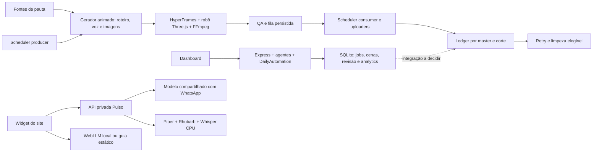

# plan.md — Planejamento auditado do YouTube AI / Pulso

**Atualização:** 16/10/2026, 13:03 BRT, America/Sao_Paulo. **Sessões preservadas:** AUD-20261013, IMP-20261013-01 a IMP-20261013-69, IMP-20261014-01 a IMP-20261014-64, IMP-20261015-68 a IMP-20261015-120, IMP-20261016-121 a IMP-20261016-169 e AUD-20261013-CONT.

**Autorização ativa:** o usuário autorizou manter a produção automática por código, acelerar renders pela GPU, recuperar o serviço após reinício e publicar material novo pelo fluxo normal após as verificações; confirmar evidência por destino antes de declarar postagem. Não republicar vídeos antigos nem trocar contas. Kwai tem sessão Android validada e outro material novo confirmado em 16/10; o job `726d60f5-2ab8-4e23-b216-56baf101fdfb` segue sem publicação confirmada após onze tentativas `confirmed_no_send`. O emulador foi recuperado às 13:03 BRT e está bootado/logado; o retry está elegível às 13:23:42 e a varredura periódica do scheduler está prevista por volta de 13:30:32. YouTube exige reautorização Google interativa; Instagram/TikTok/X não têm handler/sessão Android validados e Telegram não está configurado. O catálogo tem 63 objetivos; YAI-062 cobre capas temáticas e YAI-063 formatos próprios por plataforma e partes narrativas. Não fazer commit ou push.

**Registro paralelo preservado (IMP-20261013-03, 12h42):** em 13/10, a etapa então registrada tratava login social e envio real como fora do escopo. A autorização explícita posterior de 16/10 atualizou esse limite para publicação normal de material novo. Os envios sociais suportados migram para o emulador Android; não houve troca de contas, reboot físico, commit ou push.

Este documento substitui as instruções de retomada contraditórias do plano anterior. Seu conteúdo integral está preservado no apêndice. O histórico de trabalho continua em [resumo.md](resumo.md); as seções datadas distinguem a auditoria inicial, implementações de outra sessão e esta consolidação.

## Checkpoint operacional atual — 16/10/2026, 13:03 BRT

O scheduler `channel-scheduler.js` está ativo no PID 3006567, sem processo filho de upload/render no momento da consulta. A geração falha por `budget_exhausted` (limite NVIDIA diário 200/200) e `no_fresh_topic_candidates`; a fila de geração está sem vídeo. Portanto, nenhum vídeo está sendo enviado agora. A tentativa 11 do job aprovado de Fitness encerrou às 12:53:42 BRT antes do toque em publicar (`confirmed_no_send`); o erro era tratar `getResumedActivity()` síncrono como Promise. Corrigi a leitura para aceitar retorno síncrono ou assíncrono e, ao retomar com Kwai já em primeiro plano, preservar a atividade atual em vez de relançar o app.

O retry Kwai permanece vinculado ao mesmo arquivo, SHA-256, duração e legenda completa; `nextAttemptAt` é 13:23:42 BRT. O worker de publicação periódica, reiniciado às 13:00:32 BRT junto com o scheduler, deve varrer a pendência por volta de 13:30:32. Antes disso, não há tentativa ativa nem evidência de publicação pública. O contêiner do emulador estava parado após a limpeza de RAM; a recuperação controlada `node scripts/kwai-emulator.js up` concluiu com ADB `device`, Android `booted`, Kwai instalado e sessão logada. Após a checagem inicial no launcher, abri o Kwai e confirmei `HomeActivity` com árvore de acessibilidade de 39 nós, incluindo o controle `id_record_layout` para iniciar uma publicação. Não selecionei mídia nem toquei em publicar.

Depois da recuperação, confirmei em leitura que `/sdcard/Movies/Pulso_7eedb1a56dcd/treino_e_resist_ncia_insulina_por_que_exerc_cio__parte1-de-1.mp4` ainda existe no Android. O SHA-256 remoto é idêntico ao aprovado localmente: `0ef90e4cd8832750c814f62749ed718e4fc308dfd36d55f16a035861aaaf4869`; a retomada poderá reutilizar a mídia sem nova transferência.

A linha correspondente também sobreviveu no MediaStore, uma única vez, no álbum esperado, com duração `293955` ms; a retomada não depende de uma retransferência ou reindexação manual. Com o Kwai aberto em `HomeActivity`, a próxima retomada deve preservar essa atividade e seguir pelo controle de criação validado.

Regressões focadas do fluxo Kwai passaram **29/29**; `npm run lint` e `npm run test:ci` passaram após a correção. O preflight neural segue parcial (37 checks OK, 35 dependências/modelos ausentes); YAI-038 segue parcial sem Safari/iOS, leitor de tela ou aparelho real. Próximo gate: acompanhar a varredura automática e confirmar o resultado no perfil público antes de classificar o job.

## Checkpoint operacional histórico — 16/10/2026, 12:38 BRT

A tentativa 10 do job aprovado de Fitness terminou às 12:16:26 BRT antes de tocar `Post`: ledger `failed/pre_submit_ui_error`, `confirmed_no_send`, próxima janela em 12:46:26 BRT. A árvore de acessibilidade Android permaneceu vazia. A captura `kwai_01_aberto_1792163762399.png` confirma o mesmo editor e overlay `loading...`; `dumpsys activity` ainda aponta `EditorActivity`. A captura anterior de seleção segue confirmando o álbum isolado `Pulso_7eedb1a56dcd`, um único vídeo e duração `4:53`. O MP4 continua com o SHA-256 aprovado `0ef90e4cd8832750c814f62749ed718e4fc308dfd36d55f16a035861aaaf4869`.

O marcador `data/state/kwai-upload-resume.json` permanece atômico em modo `0600`, vinculado ao caminho/SHA-256 do vídeo, legenda completa, duração e álbum. Corrigi o hash da legenda para corresponder ao caption real (título, fonte e hashtags) depois de revalidar aprovação, artefato, duração, estágio e editor ativo; `matchesKwaiUploadResume` voltou a confirmar o marcador. Agora qualquer marcador persistido que divergir do novo job interrompe antes de enviar arquivo ao Android. Na retomada válida, o fluxo reusa a mídia sem nova transferência, reconhece a `EditorActivity` e aguarda o compositor sem repetir `Next`. A interface continua presa em `loading...`; o marcador só será removido após confirmação positiva de publicação.

Validação final: fluxo Android/Kwai/UI/marcador **26/26**; backoff de geração/erros **6/6**; `npm run lint`; `npm run test:ci` completa passou após as alterações; `node --check` e `git diff --check`. Às 12:04, o contador local da NVIDIA atingiu **200/200**; mantive esse teto e o retry após renovação diária UTC. `ai-video-scheduler.service` foi recarregado às 12:22:40 BRT após confirmar fila vazia, sem checkpoint de geração e sem filhos de geração/upload; está ativo no PID 2834662, `NRestarts=0`. O produtor percorreu “Economize”, Psicologia, Relacionamentos e Fitness: as três primeiras tentativas falharam `no_fresh_topic_candidates`; Fitness falhou `budget_exhausted` às 12:24:21 e o produtor aguardará a renovação UTC (cerca de 8,6 h no log). Não houve novo render; fila sem vídeo. O consumer está previsto para 12:44:43; o worker social periódico, para aproximadamente 12:52.

O gate restante de acessibilidade local de YAI-038 avançou: adicionei `tests/dashboard-accessibility-browser.js`, que serve os assets do dashboard com fixture API local e bloqueia requisições externas. Chromium verificou skip link/foco, navegação e histórico SPA, foco/trap/restauração do command palette e ausência de overflow a 390 px. O teste isolado, ESLint direcionado e CI completa passaram. YAI-038 continua Parcial: Safari, leitor de tela e aparelho físico não estão disponíveis nesta máquina.

A checagem de acessibilidade consulta `Accessibility.getFullAXTree` no Chromium e falha se algum botão, link, input ou outro controle interativo exposto ficar sem nome acessível. A CI completa foi repetida depois dessa cobertura; sistema, pipeline, Node, framing, Python, QA visual do apresentador/Instagram e browser dashboard concluíram sem falhas. ESLint completo, `node --check`, `bash -n` e `git diff --check` também passaram.

YAI-001 foi reavaliado somente em leitura com `node scripts/preflight-runtime.js --neural --json`: perfil `/usr/bin/python3` (Python 3.14.4), 37 checks OK e 35 erros. Falta Rhubarb, módulos Piper/Faster-Whisper, modelos Piper/Whisper e diversas dependências do lock; o runtime presente também diverge em pins. Não instalei nem ajustei o Python persistente porque ele é o perfil do serviço e o rollback/janela operacional não estão aprovados. O preflight e sua suíte `runtime-preflight` 7/7 foram executados; YAI-001 continua Parcial.

Próximo: deixar o worker periódico retomar o job Kwai quando atingir o vencimento 12:46:26 (varredura prevista por volta de 12:52), usando o marcador `transcoding` já corrigido. Confirmar resultado no perfil antes de declarar postagem; se o editor permanecer travado, conservar `confirmed_no_send` e não tocar em `Post` sem caption/compositor verificado. YAI-021 segue adiado (`VIDEOS_PER_DAY=60`); OAuth YouTube, sessões/handlers sociais ausentes, Telegram, backup cifrado e retenção continuam dependentes de credenciais ou decisão externa.

## 1. Visão geral

**Nome e finalidade.** O workspace `youtube_ai` reúne a produtora automatizada Pulso, o projeto upstream Lumen/YouTube Automation Agent e experimentos de apresentação. O produto transforma pautas em roteiro em português, narração, vídeo com apresentador 3D, thumbnail e cortes verticais, distribui conteúdo e preserva o estado de publicação. O mesmo robô é reutilizado como mascote de ajuda no site_corp.

**Problema resolvido e público.** Reduz trabalho repetitivo de pesquisa, composição e distribuição para o operador dos canais; atende espectadores de notícias/explicações temáticas e visitantes que precisam de orientação no site. O operador e o visitante do site usam interfaces e serviços diferentes.

**Objetivo principal.** Operar uma produção contínua, verificável e com identidade própria, com voz legível, fontes identificadas, custo controlado, confirmações de publicação e aprendizado baseado nas métricas das próprias contas. A visão de longo prazo documentada é uma produtora com múltiplas séries/temas e assistência interativa, sem presumir que dez temas já correspondem a dez contas.

**Snapshot histórico — 16/10, 04:34 BRT (preservado).** Os erros factuais estão reproduzidos: data de vaga passada narrada como futura; nomes/requisitos inventados e detalhes trocados; 93% de consumidores transformados em 93% das compras; números 18%/100% sem fonte; causalidade extraída de associação; US$15 milhões conjuntos atribuídos a uma entidade; pontuações visuais inventadas; e, no job de 04:27, investimento municipal, portal/formulário para candidatura, garantias de transparência/agilidade e candidatura “a qualquer momento” sem apoio na matéria do G1. Esses roteiros ficaram inelegíveis antes do render. A v15 filtra gráficos numéricos antes da revisão, exige duas aprovações independentes do escritor e registra o feedback. O job G1 terminou `source_claims_unverified`; dois revisores expiraram e o terceiro apontou os detalhes sem suporte. Corrigi também a classificação: erros factuais e revisão indisponível eram convertidos em `no_fresh_topic_candidates`, ocultando o motivo e provocando retry de 30 s. Agora o código real é preservado e os erros de API/fato usam o ciclo normal de 5 min. Testes direcionados passaram 3/3, além de `node --check` e `git diff --check`. O serviço carregou a correção às 04:33:53 BRT; `ai-video-scheduler.service` active/enabled (PID 33898, NRestarts=0), `Linger=yes`, e `kwai-emulator` running (`unless-stopped`). Job IA `dd867b25-06de-4569-aee2-bb87cf8ec658` iniciou às 04:33:57; ainda sem resultado, MP4 ou post. O último post público confirmado é Kwai job `9ae89137-88b0-46e8-a47a-6e55b206690d`, às 02:55 BRT. YouTube aguarda OAuth `invalid_grant`; Instagram/TikTok/X sem sessão validada; Telegram sem configuração. As correções estão carregadas na produção deste host, sem commit/push remoto nem reboot físico. Consulte IMP-20261016-145 e IMP-20261016-146.

## Checkpoint operacional — 16/10/2026, 07:26 BRT

Este é o estado mais recente conferido nesta retomada. Os detalhes de cada alteração continuam no histórico IMP-20261016-147 a IMP-20261016-154 e no novo registro IMP-20261016-155 ao fim deste arquivo.

### Objetivos desta etapa

- Corrigir a origem de roteiros “não verificáveis” sem publicar fatos não apoiados pela fonte.
- Manter cenas legíveis, sem microcortes, com o robô 3D em posição estável e formatos/durações próprios por rede.
- Manter o produtor vivo após reinício do host e gerar pelo fluxo automático de código, usando GPU quando disponível.
- Produzir e publicar um vídeo novo; só contar publicação após evidência do destino.

### Concluído com evidência

- Causa dos roteiros rejeitados identificada em exemplos reais: percentuais foram reinterpretados; urgência, expansão de mercado, garantias e detalhes de vagas foram adicionados sem fonte; uma história de ouro recebeu detalhes não confirmados pela própria matéria; e duas pautas diferentes foram associadas por compartilharem apenas a palavra genérica “eleições”. O feedback por roteiro está preservado no ledger/metadados.
- A correspondência entre pauta e título usa comparação estrita de matéria (`sameStoryTitle`); a revisão é ligada ao hash do contexto da fonte e exige duas aprovações distintas. Rejeição ou falta de revisão válida continua bloqueando publicação.
- A revisão v22 (`retention-emotions-v22-early-consensus`) consulta quatro revisores em paralelo e cancela as chamadas restantes quando há duas aprovações independentes ou uma rejeição. O cancelamento alcança o POST e o polling de estado. A v22 está no checkout de produção; o filho atual carregou v21 antes da edição, portanto a próxima execução carregará v22.
- `ai-video-scheduler.service` está active no checkout `/home/servidor/Git/youtube_ai/youtube-automation-agent`, PID 376325 e `NRestarts=0`; `Linger=yes` e o timer de guarda já estavam confirmados. O scheduler não foi interrompido para atualizar código durante o render.
- Master do job `726d60f5-2ab8-4e23-b216-56baf101fdfb`: `data/videos/auto_2026-10-16T09-47-34-562Z.mp4`, 1920×1080/24 fps, H.264/AAC, 293,958 s, aproximadamente 109 MB; inspeção de saúde passou. Tem 28 cenas de 9,053 a 14,667 s, sem cortes de 2 s, e 2.071 cues de visemas cobrindo a narração. Revisões de conteúdo GLM e Nemotron Super aprovaram a matéria Fitness da Webrun com 6.527 caracteres extraídos.
- Foi renderizada a parte 1/2 comum a Instagram/Shorts/TikTok, 175,367 s (2m55s), 1080×1920/30 fps, H.264/AAC, 58,65 MB; `probeVideoHealth` passou. A parte 2/2 foi renderizada em 118,584 s (1m58,6s), aproximadamente 40,1 MB. A parte 1 tem 16 cenas, mínimo 9,063 s e máximo 13,787 s. QA técnico/visual final da parte 2 ainda está pendente.
- HyperFrames informou GPU de hardware nos renders. A codificação usa VAAPI Radeon em `/dev/dri/renderD128`; a placa disponível é AMD Radeon RX 6750 XT, não NVIDIA. A captura foi pelo caminho screenshot porque o fast path BeginFrame não iniciou; portanto o render funcionou em hardware, mas a captura ainda é lenta.
- Testes já executados: 51/51 em revisão NVIDIA/parser/notícias; 33/33 em políticas/partes sociais/limites/framing; 9/9 em visemas; 32/32 em evidência de fonte/contexto/revisão retida; `node tests/instagram-video-framing.js` passou. `node --check`, ESLint direcionado e `git diff --check` passaram. A checagem HyperFrames do master passou.

### Pendências do fluxo em andamento

- No snapshot mais recente (07:26:17 BRT), o filho PID 986847 e o serviço estavam ativos. O render vertical próprio do Kwai ainda capturava quadros: 4.177 de 8.818. A variante X, segmentada pela política configurada em partes de até 139 s, ainda não começou.
- Depois que as variantes acabarem, verificar duração, codec, proporção, fps, áudio, cenas, robô, legendas, selo e conteúdo de cada arquivo; conferir que o registro da pauta foi gravado e que o scheduler colocou o master/partes elegíveis na fila.
- `data/state/publish-queue.json` estava com `pending: []` e `inFlight: null`; não havia novo post confirmado nesta execução. O último post público ainda confirmado é o AI-DLC anterior no Kwai.
- Depois da fila, publicar pelo fluxo normal no Kwai e conferir o post no perfil público. YouTube pode falhar por OAuth `invalid_grant`; Instagram/TikTok/X geram variantes, mas não têm sessão Android validada; Telegram não está configurado. Não declarar esses destinos publicados.
- A thumbnail desta execução parece incompleta no texto (“EXERCÍCIO NÃO DEVE SER”, com acento isolado); ela precisa ser inspecionada e corrigida antes de servir como capa editorial aprovada. Não foi alterada nesta etapa.

### Melhorias futuras e bloqueios externos

- Reduzir o tempo da captura HyperFrames e restaurar o caminho BeginFrame em teste isolado, sem mudar o render que já está ativo.
- Avaliar publicação enfileirada por destino assim que cada artefato passar no QA, para uma variante ainda pendente não atrasar destinos prontos; manter ledger e deduplicação para não publicar em duplicidade.
- Reautorizar YouTube OAuth de forma interativa; validar login/handler Android para Instagram, TikTok e X; configurar Telegram só se permanecer no escopo. Esses acessos não podem ser resolvidos sem autenticação da conta.
- Corrigir e validar a thumbnail; concluir QA de todas as variantes e a confirmação pública do post Kwai.
- A configuração de cadência `VIDEOS_PER_DAY=60` continua sendo configuração, não taxa realizada; a decisão de capacidade/orçamento permanece em YAI-021. Não reiniciar fisicamente o host durante render ativo. Nenhum commit ou push foi feito.

## Checkpoint operacional — 16/10/2026, 09:55 BRT

Este checkpoint atualiza o snapshot histórico das 07:26 acima. O registro detalhado é IMP-20261016-156; o resultado do retry que vencerá às 10:05:45 BRT será registrado em novo adendo.

- O job Fitness `726d60f5-2ab8-4e23-b216-56baf101fdfb` foi gerado, revisado por GLM e Nemotron Super, e teve master, seis variantes narrativas e thumbnail corrigida inspecionados. A thumbnail preserva a negação “não apenas pelas calorias”.
- A tentativa Kwai mais recente não publicou: a interface manteve o compositor aberto, ofereceu “Save as drafts”, criou `Drafts (1)` e não mostrou a legenda/horário no perfil. O ledger está `failed/pre_submit_ui_error`, `confirmed_no_send`, tentativa 5, com screenshot `logs/snaps/kwai_11_draft_saved_1792154463993.png` e retry seguro às 10:05:45 BRT. Não tratar esse job como postado.
- Corrigida a correspondência da galeria para os segundos truncados mostrados pelo Kwai; a legenda agora fecha o teclado e as sugestões de hashtag e verifica o compositor limpo antes do toque em Post. A espera trata árvores de acessibilidade temporariamente vazias. O orçamento total do uploader Kwai passou a 15 min por padrão via `KWAI_UPLOAD_TIMEOUT_MS`, cobrindo transcodificação local e confirmação.
- O scheduler foi reiniciado às 09:55:27 BRT para carregar a correção; ficou ativo no checkout de produção, PID 2095986, `NRestarts=0`. No momento da reinicialização, fila vazia (`pending: 0`, `inFlight: null`) e nenhum processo de geração ou upload ativo. Não houve reboot do host, troca de conta, stage, commit ou push.
- Verificações: Kwai focado 10/10; `npm run lint` passou; `npm run test:ci` passou com 49 testes de sistema, 12 smoke, 302 testes Node, 5 de framing, 35 Python e duas verificações visuais adicionais. O teste de confirmação em perfil usa dispositivo simulado; a produção segue sem publicação deste job.
- Revalidação documental: Kwai publica dicas de gravação até 5 min, mas o Help Center não informa um limite para arquivo enviado; X confirma 140 s sem Premium e 10 min no Android Premium; Instagram não permitiu fetch do Help Center (429). YouTube Shorts continua até 3 min em formato vertical/quadrado, porém páginas oficiais atuais divergem sobre reivindicações ativas em Shorts acima de 1 min; aplicar a leitura conservadora até a documentação convergir. Nenhuma regra pública substitui teste de conta/compositor.
- Permanecem externos: OAuth YouTube (`invalid_grant`), sessões/handlers Android de Instagram/TikTok/X, configuração Telegram, destino externo criptografado e política de retenção, decisões de cadência e os objetivos de validação real. YAI-021 continua adiado pelo usuário; não alterar `VIDEOS_PER_DAY=60`.

## Checkpoint operacional — 16/10/2026, 10:20 BRT

Este checkpoint atualiza o resultado de 09:55. O registro detalhado está em IMP-20261016-157; a tentativa 6 do Kwai segue sem envio e a próxima janela vence às 10:37:06 BRT.

- A inspeção somente de leitura da interface após a tentativa 6 encontrou o compositor com a bandeja de sugestões de hashtag aberta e teclado fechado. O primeiro `BACK` dispensava só o teclado. O fluxo agora fecha/verifica ambas as camadas; uma retomada com legenda já preenchida também fecha a bandeja residual. Navegação inesperada ou sugestão persistente mantém o envio bloqueado. Um timeout de hierarquia não vazia também captura screenshot de diagnóstico.
- Tentativa 6: ledger `failed/pre_submit_ui_error`, `confirmed_no_send`, tentativa 6, próxima janela `2026-10-16T13:37:06.566Z`. Nenhum toque em Post ocorreu. A captura de leitura posterior foi `logs/snaps/kwai_attempt6_readonly_1792156158344.png`.
- `ai-video-scheduler.service` está ativo no checkout de produção, PID 2228942, `NRestarts=0`, iniciado às 10:14:19 BRT para carregar o fluxo social corrigido. Antes do restart: apenas o scheduler estava ativo, a fila tinha zero itens e nenhum `inFlight`, e não existia `generation-in-flight.json`. O emulador Kwai permaneceu ligado.
- A suíte direcionada Kwai/UI/SFX passou **20/20**; `npm run lint` passou. `npm run test:ci` passou com 49 testes de sistema, 12 smoke, 305 testes Node, 5 de framing, 35 Python e verificações visuais de framing e Instagram. `node --check` e `git diff --check` passaram.
- YAI-028 avançou: o master real de `logs/gen_2026-10-16T09-47-34-562Z.log` confirma oito efeitos SFX incorporados. As partes verticais foram renderizadas separadamente e registraram zero eventos: o seletor agrupava todas as seções pelo tipo genérico `section`. Corrigi a chave para diferenciar tipo e título e adicionei regressão de transições esparsas em partes minimalistas. Ainda falta nova saída após a correção e revisão auditiva humana, portanto YAI-028 continua Parcial.
- `VIDEOS_PER_DAY=60` permanece inalterado. Sem mudança de autenticação, conta, política de retenção ou cadência; sem reboot do host, stage, commit ou push. Permanecem os gates externos já registrados.

## Checkpoint operacional — 16/10/2026, 10:28 BRT

- A tentativa 6 permanece `confirmed_no_send` e a próxima janela segura é 10:37:06 BRT. A sessão Kwai foi validada pelo marcador Android; o emulador está ligado. A tela estava em outro app na última inspeção somente de leitura, sem interação.
- `uploadKwaiOnDevice` agora reconhece se `openApp()` retoma um compositor já deixado pelo retry. Só continua automaticamente quando a legenda visível corresponde ao job; compositor diferente interrompe antes do envio. Isso cobre a retomada de tela separadamente da volta normal ao feed.
- Novos testes direcionados passaram **21/21**. `npm run test:ci` passou com 49 testes de sistema, 12 smoke, 306 Node, 5 de framing, 35 Python e verificações visuais de framing/Instagram; `npm run lint`, `node --check` e `git diff --check` passaram.
- O serviço foi reiniciado às 10:28:31 BRT depois de confirmar scheduler ocioso, fila vazia e ausência de checkpoint de geração; está ativo, PID 2295232, `NRestarts=0`. Não houve reboot do host, render interrompido, mudança de sessão/conta, stage, commit ou push.

## Checkpoint operacional — 16/10/2026, 10:45 BRT

- Tentativa 7 do job `726d60f5-2ab8-4e23-b216-56baf101fdfb` terminou antes de abrir o fluxo Kwai: a pré-checagem Android classificou como `unknown` a tela do compositor que já estava aberto. A captura de leitura posterior mostrou a legenda correta do job e sugestões de hashtag; nenhum toque em Post ocorreu. O ledger continua `failed/pre_submit_ui_error`, `confirmed_no_send`, tentativa 7; retry seguro às 11:08:37 BRT. Nenhuma publicação do job foi confirmada.
- Corrigido o gate em `utils/android-social-publisher.js`: sessão desconhecida continua bloqueada por padrão e só pode prosseguir com opt-in explícito do handler. `scripts/upload-to-socials.js` concede opt-in somente ao Kwai; o handler exige compositor com legenda exatamente correspondente antes de fechar teclado/sugestões e seguir. Login obrigatório, app ausente, tela inesperada ou outro rascunho continuam bloqueando.
- Regressões verificadas em `tests/android-social-publisher.test.js`, junto com fluxo Kwai, espera de UI e SFX: **24/24**. `npm run lint` passou. `npm run test:ci` passou com **49** testes de sistema, **12** smoke, **306** Node, **5** de framing e **35** Python; framing do apresentador e corte do Instagram passaram. `node --check` e `git diff --check` passaram.
- Antes do restart, a fila estava vazia (`pending: 0`, `inFlight: null`), não havia `generation-in-flight.json`, processo de geração ou upload. `ai-video-scheduler.service` foi reiniciado às 10:44:59 BRT para carregar o opt-in restrito; está ativo, PID 2376830, `NRestarts=0`. Mantidos o emulador e o marcador de sessão Kwai.
- Próxima ação: depois de vencer 11:08:37 BRT, repetir somente se a aprovação e o hash da fonte continuarem iguais, o artefato existir, a sessão Kwai permanecer validada e a fila/geração estiverem ociosas. A tela do compositor será retomada somente se contiver a legenda exata; confirmar o perfil público após sucesso antes de declarar postagem.
- Nenhum vídeo antigo foi republicado; sem troca de conta, alteração de `VIDEOS_PER_DAY=60`, reboot do host, stage, commit ou push. OAuth YouTube, sessões/handlers Android dos outros destinos, Telegram e armazenamento externo permanecem bloqueios externos já registrados.

## Checkpoint operacional — 16/10/2026, 11:20 BRT

- Tentativa 8 foi executada pontualmente só para Kwai depois do retry elegível. O estado persistiu `failed/pre_submit_ui_error`, `confirmed_no_send`, tentativa 8, próxima janela `2026-10-16T14:40:17.010Z` (11:40:17 BRT). Nenhuma publicação foi confirmada.
- O erro específico foi `spawnSync /home/servidor/.local/bin/adb ETIMEDOUT` durante preparação antes de abrir o Kwai. A tela lida somente depois permaneceu no launcher. O diretório isolado do job no Android já continha um arquivo do mesmo nome/tamanho, mas com mtime anterior; não considerei isso confirmação da transferência da tentativa 8. O emulador segue bootado/container ativo. A varredura ADB direta do MediaScanner também retornou `Broken pipe`; consulta isolada ao MediaStore excedeu 15 s. Nenhuma tela foi tocada.
- `scripts/kwai-emulator.js` agora informa a etapa exata de falha ADB, amplia o timeout do `mkdir` para 60 s e do MediaScanner para 120 s, preservando 300 s para `adb push`. Depois que um push retorna sucesso, timeout/broken pipe apenas no broadcast do MediaScanner pode seguir para o app; o fluxo exige que Gallery reconheça um vídeo único no álbum isolado com duração correspondente, antes de selecionar ou chegar ao compositor. Timeout do `push` continua abortando sem envio.
- Novas regressões simulam o broken pipe do MediaScanner e um timeout do `push`: o primeiro caminho só deixa a validação da Gallery prosseguir; o segundo para antes do MediaScanner. Conjunto Android/Kwai/UI **24/24**; `npm run lint` e `npm run test:ci` passaram. CI: 49 sistema, 12 smoke, **308** Node, 5 framing, 35 Python e duas verificações visuais; `node --check` e `git diff --check` passaram.
- Antes do restart às 11:20:05 BRT, fila vazia (`pending: 0`, `inFlight: null`), sem `generation-in-flight.json` e sem processo de upload/render. `ai-video-scheduler.service` ativo no PID 2538529, `NRestarts=0`, carregando a recuperação de MediaScanner. O próximo retry elegível é às 11:40:17 BRT; conferir hash e gates novamente. Nenhum envio a outro destino, alteração de conta/cadência, repostagem, reboot, stage, commit ou push.

## Checkpoint operacional — 16/10/2026, 11:26 BRT

- A inspeção posterior à tentativa 8 detectou transporte ADB `offline`; o container seguia `Up` e a fila de publicação estava vazia. Rodei `node scripts/kwai-emulator.js up`, que aguardou o timeout controlado do `ensureAndroidBooted` e reiniciou somente o container após quatro minutos sem reconexão.
- A recuperação concluiu: ADB `device`, `sys.boot_completed=1`; `node scripts/kwai-emulator.js status` confirmou container `UP`, ADB conectado, Android booted, Kwai instalado e login ativo. O volume persistente conservou a sessão. Nenhuma navegação, seleção de mídia ou ação de publicação ocorreu nesta recuperação.
- `ai-video-scheduler.service` permanece ativo (PID 2538529, `NRestarts=0`). A fila continua sem itens e não existe render/checkpoint; a próxima tentativa segura do Kwai é 11:40:17 BRT com o runner da tentativa 9 e a nova recuperação MediaScanner. O estado atual será revalidado no vencimento.
- Nenhuma postagem do job foi confirmada. Sem reboot do host, troca de conta/cadência, repostagem de mídia antiga, stage, commit ou push.

**Cadência e escopo.** Meta antiga: cinco vídeos/dia, três cortes por master, dez temas em rodízio. Ambiente da unit: `VIDEOS_PER_DAY=60`, `IMAGES_PER_GROUP=4`, `DELETE_AFTER_UPLOAD=0`; isso é configuração, não throughput comprovado. Não se recuperou a autorização que estabeleceu 60 como meta definitiva: decidir em YAI-021. `config/themes.json` habilita IA, curiosidades, dinheiro, saúde, economize, psicologia, relacionamentos, fitness, mistérios e carreira. A lista anterior de nichos é preservada em `CONTAS-E-TEMAS.md`, e a diferença precisa de confirmação, não de reversão automática.

### 1.1 Evidência, origem e estados

- **U:** pedido do usuário recuperado de `plan.md`, `resumo.md` ou documentação que o identifica. Não se dispõe da transcrição completa das sessões anteriores.
- **D:** objetivo/decisão registrado em documentação; não equivale automaticamente a aprovação final de produto.
- **C:** comportamento ou lacuna conferido no código/configuração desta auditoria.
- **R:** recomendação técnica derivada da auditoria, separada dos pedidos U. O histórico IMP registra autorização de implementação em outro trabalho para seu catálogo anterior; as dez adições desta consolidação mantêm origem e gates próprios. Nenhuma recomendação passa automaticamente a requisito aprovado.
- **Pendente:** trabalho ainda não demonstrado. **Parcial:** existe uma parte e o restante está descrito. **Validação pendente:** há implementação, falta o gate indicado. **Decisão pendente:** requer escolha/avaliação antes da implementação. **Concluído:** somente com evidência citada; dezessete objetivos têm conclusão local validada: quatro de IMP-20261013-01, YAI-005, YAI-009, YAI-060, YAI-011, YAI-012, YAI-015, YAI-016, YAI-043, YAI-049, YAI-050, YAI-051, YAI-057 e YAI-058.

P0 significa impedimento crítico comprovado ou risco direto a dados; P1, confiabilidade/segurança/requisito central; P2, evolução pertinente; P3, expansão condicionada. YAI-009 passou o gate com a fonte real recuperada e HyperFrames oficial em 16:9/9:16; a composição atual reconstrói o conteúdo, mas não reproduz a antiga contagem de cenas preservada no log. YAI-060 teve a oclusão reproduzida em fixture e na composição atual da fonte real; o layout passou o checker nos dois formatos. A validação foi local, sem renderizar/publicar MP4. Prioridades novas são recomendações técnicas; não se afirmou incidente de invasão ou perda de dados nem se alterou prioridade explicitamente determinada pelo usuário.

## 2. Arquitetura e tecnologias

### 2.1 Diretórios, processos e persistência

| Área | Implementação e papel comprovado | Limites |
|---|---|---|
| Workspace | `plan.md`, `resumo.md`, `CONTAS-E-TEMAS.md`, `remotion-pilot/` | A pasta pai continua sem `.git`; os documentos canônicos residem na raiz do checkout `youtube-automation-agent`, mas `git status` ainda os mostra como não rastreados neste checkpoint. Os caminhos antigos são symlinks relativos. Nenhum commit/stage foi feito. |
| Checkout principal | `youtube-automation-agent/`, pacote 2.11.0, HEAD `4003c40` | Checkout com muitas alterações e arquivos não rastreados anteriores à auditoria. |
| Produção animada | `scripts/channel-scheduler.js` → `generate-animated-video.js` → `utils/hyperframes-video-renderer.js` | Serviço systemd do usuário; não é `npm run scheduler`. |
| Estado da produção | `data/state/topics.json`, `scheduler.json`, `publish-queue.json`, `theme-rotation.json`, `yt-quota.json`, `api-usage.json` | Ledger tem lock e escrita atômica; fila tem snapshots serializados; cursor de temas persiste atomicamente no `STATE_DIR`; contador reserva chamadas com lock e gravação atômica; runtime instalado ainda precisa de implantação coordenada. |
| Painel e operador | `index.js`, `dashboard/`, sete agentes em `agents/`, `schedules/daily-automation.js` | Express e frontend HTML/CSS/JS sem build; fluxos de edição/aprovação/analytics não foram comprovados no serviço animado. |
| Banco do painel | `database/db.js`, SQLite em `data/youtube_automation.db` | 37 declarações de criação de tabelas, migrações de colunas e alguns índices/transações; nenhum gargalo de consulta foi medido aqui. |
| Runtime audiovisual | Piloto HyperFrames, Three.js, GSAP, esbuild, fontes/GLBs e variantes | Renderer de produção fixado em 0.8.149; scripts do piloto atualizados a 0.8.155 em IMP-35. GLB depende do runtime para movimentos, não possui clips baked. |
| Piloto alternativo | `remotion-pilot/`, React/TypeScript/Remotion | Há composição e MP4 local; não há chamada ao piloto no scheduler de produção. Não trocar renderer por inferência. |
| Music AI relacionado | `/home/servidor/Git/site_corp/ai_video_automation/` | Python/ComfyUI/ACE-Step 1.5, SQLite e painel Node/Socket.io; LoRA e clipes existem. Contrato de arquivo versionado/fixture sintética em `docs/contracts/`; uso de produto e geração real seguem pendentes. |
| Site relacionado | `/home/servidor/Git/site_corp/services/pulso/`, `src/components/Pulso/` | Fora do checkout principal; somente arquivos pertinentes foram consultados, não uma auditoria completa do site. |
| Infra relacionada | `/home/servidor/Git/base_fundation/caddy/Caddyfile` e rede Docker existente | Referência operacional recuperada; nenhuma configuração foi alterada. |

### 2.2 Dependências e integrações

Node declarado 22+; observado `v22.22.1`, npm `9.2.0`, Python `3.14.4`, FFmpeg/ffprobe no PATH. CommonJS no aplicativo principal e módulos ESM no piloto. Dependências principais: Express, sqlite3, Winston, node-cron, googleapis/local-auth, Playwright, sharp, axios, OpenAI SDK, Google GenAI, Replicate e SDK de fala Azure. Sua presença indica suporte de código, não que o serviço esteja usando ou tenha credencial para todos.

O gerador animado usa NVIDIA para roteiro/crítico/SEO com orçamento e retries; notícias têm queries/feeds por tema; imagens usam Gemini web com perfil persistente e prints de artigos com Playwright. Narração tenta edge-tts e cai para gTTS; `writeSyntheticSrt` cria cue de duração total e distribui palavras estimadas. Portanto **não chamar todo timing do pipeline de alinhamento real por palavra**. Piper/alinhador neural são comprovados na demo e no mascote, sem evidência de substituição universal do narrador da produção.

YouTube usa API OAuth para longo, Shorts e thumbnail; TikTok/Instagram/X/Telegram ainda usam browser no código atual; Kwai usa Redroid Android 14/ADB/UIAutomator, on-demand, porta 5555 limitada a loopback, volume persistente e container privilegiado. O registro paralelo IMP-20261013-03 informa que o usuário aprovou migrar os envios hoje feitos via Playwright para Android, sem abrir navegador visível, e validar login/envio depois do restante das melhorias. O compose Kwai não empacota a aplicação completa; a disponibilidade/certificação de cada app é uma dependência a resolver. Se uma plataforma não funcionar no emulador, o fluxo deve parar com diagnóstico e sem fallback automático ao browser.

Mascote: React 19/TypeScript/Vite no site, Three.js 0.185.x e Fiber/Drei já declarados, API Node privada, modelo compartilhado com persona separada, Piper/Rhubarb/Whisper CPU e Worker WebLLM/Qwen 0.5B como fallback de texto. O piloto de vídeo usa Three.js 0.186.1; harmonizar versão/fronteira no pacote reutilizável em YAI-057. Biblioteca/prompt/pesos no browser são públicos. Não há ASR local no navegador. Inferência indisponível não deve provocar outro llama ou reinício do treinamento.

### 2.3 Segurança e configuração observadas

Arquivos `.env`, `config/credentials.json` e `tokens.json` estavam em modo 0600; CredentialManager contém diretório 0700 e escrita privada/atômica. A auditoria registrou a política de API anterior como aberta sem chave. IMP-20261013-01 alterou o código para bind loopback por padrão, exigir chave em bind remoto e proteger leituras/escritas privadas; isso ainda não foi implantado em serviço. `/health` e assets estáticos continuam públicos. A porta 3456 não apareceu escutando no snapshot de auditoria; isso não prova ausência em outros ambientes nem incidente ativo.

Renderer aceita imagens locais confinadas/data URIs e aplica limites, sem fetch HTTP arbitrário; limpeza valida realpath/symlinks e artefatos; ledger inválido não vira lista vazia. Essas correções preexistentes devem permanecer. `modern-auth.js`/`oauth-server.js` oferecem caminhos adicionais: consolidar contrato de OAuth/escopos/permissões ao validar o fluxo Express, sem declarar que todo assistente foi autenticado aqui.

CI: GitHub Actions em Ubuntu 24.04, Node 22/24, `npm ci`, audit e lint. IMP-20261013-01 adicionou instalação explícita do piloto/Chromium e `npm run test:ci`, que isola DB/estado/segredos e executa a suíte legada, smoke, testes concorrentes, Python e framing; o workflow remoto ainda não rodou. Biblioteca instalada: sqlite3 5.1.7 e sharp 0.33.5, enquanto pacote/lock declaram 6.0.1 e 0.35.5. Não executar `npm ci` sobre a produção ativa.

O lock original auditado em 13/10 apontava três avisos moderados (uuid, gaxios e node-cron). Às 16h24 apareceu no checkout uma mudança compartilhada de manifest/lock com `node-cron` 4.6.0 e override restrito de Google Auth; a autoria dessa mudança não foi atribuída nesta sessão. Às 16h26, `npm audit --json` sobre o lock atual retornou zero vulnerabilidades. Isso não certifica a árvore instalada: o checkout ainda carrega `node-cron` 3.0.3, Google Auth 9.15.1 e sqlite3 5.1.7 enquanto o lock declara versões diferentes. O advisory original afeta chamadas uuid v3/v5/v6 com buffer externo. Fonte: [GitHub Advisory GHSA-w5hq-g745-h8pq](https://github.com/advisories/GHSA-w5hq-h8pq). Pilotos e site possuem árvores próprias.

## 3. Funcionalidades existentes e validação

`[x]` abaixo significa implementação acompanhada de validação atual indicada ou evidência histórica recuperável indicada; não significa que foi reexecutada toda a integração nesta sessão. `[ ]` mantém gate pendente explícito.

| Estado | Funcionalidade | Evidência e alcance |
|---|---|---|
| [x] | Pipeline pauta→roteiro PT-BR→crítico→SEO→narração→imagens→render | Código do gerador e logs com Check passed/Render complete em 13/10; falhas/quotas continuam possíveis. |
| [x] | HyperFrames oficial para longos e cortes com robô 3D | Renderer, clip-maker e runtime bonito; QA e publicações anteriores em resumo/variantes. |
| [x] | Rig mecânico de 17 joints, rosto, piscadas, sorriso e gestos independentes | Rig serializado/animation-qa/arm-edge-audit em robo-bonito-temas; zero clips baked; não certifica qualquer pose extrema. |
| [x] | Dez identidades de cores v3 | Config, palette-audit e galeria com provas DNS anteriores; aprovação em todo fundo ainda YAI-036. |
| [x] | Legenda completa com destaque da palavra atual | Runtime preserva todas as palavras e karaokê; YAI-009 agora divide blocos acima de oito palavras sem perder temporização. Fixtures Chromium passaram em 16:9/9:16; o caso histórico real continua pendente. |
| [x] | Ducking, masterização e banco BGM | audio-mix usa sidechaincompress/loudnorm; dez MP3s e ATTRIBUTION.md encontrados; não baixar novamente por plano antigo. |
| [x] | Thumbnail e upload YouTube | `renderThumbnail`/`thumbnails.set`; o novo layout usa o título real e a imagem contextual da abertura, com alto contraste. A validação em vídeos/temas reais e CTR próprio fica em YAI-062; cota ainda pode bloquear. |
| [x] | Rodízio entre dez temas | Producer/config e registros no ledger; cursor persistente em `STATE_DIR/theme-rotation.json`; metadados por tema continuam parciais. |
| [x] | Fila durável, ledger com lock, retomada e dedup | Código/JSON válidos; snapshot durante a auditoria tinha 61 entradas e fila sem pending/inFlight; estado é mutável. |
| [x] | Retry de YouTube longo e Shorts e bloqueio por dia Pacific | Código confirmado; resumo relata drenagem/publicações; não interpretar o reset como horário local fixo ao longo do ano. |
| [x] | Limpeza conservadora por artefato com realpath | Código e histórico de execução; confiança da confirmação social deve melhorar em YAI-006. |
| [x] | Crop Original com gate 9:16 no Instagram | Helper/teste e prova de interface anteriores; QA autenticado parou antes de Compartilhar. |
| [ ] | Distribuição social com confirmação pública confiável | Parcial: URLs e registros tipados com evidência são aceitos; `ok`, clique ou submissão incerta não liberam limpeza. Kwai/Telegram seguem sem prova de conclusão; YAI-006–008. |
| [ ] | Idempotência social após interrupção | Parcial: intenção e resultado agora são gravados por destino antes/depois do envio; estados incertos bloqueiam retry automático, inclusive YouTube/Shorts. Replay operacional e reconciliação permanecem YAI-007/008. |
| [ ] | Alertas entregues | Parcial: HTTP 2xx é exigido e fixtures 200/400/500/timeout passam; canal real ausente no .env consultado; YAI-044. |
| [x] | Demo neural publicada para avaliação | README e QA recuperados em phonetic-robo-bonito: Piper/Rhubarb, 15,375s, horizontal/vertical; publicação não foi novamente testada aqui. |
| [ ] | Aprovação visual final da demo | Pendente de decisão do usuário; YAI-033. |
| [x] | Mascote com chat/voz/gravação/tutorial FranRadar | Código e QA histórico; o corpo 3D permanece com o chat fechado. QA neural real continua YAI-013/014; presença em páginas estáticas e validação completa seguem em YAI-053–056. |
| [ ] | Assistente virtual 3D flutuante sempre visível | Crash React corrigido em IMP-17. QA Chromium público desktop/mobile confirmou GLB `ready`, clique/toque, chat, posição fixa e fallback quando `--disable-webgl`; E2E local 10/10 e hashes públicos passaram. A matriz pública atual passou 25/30 páginas desktop, mas encontrou `emulacao-local` sem mount: HTML local e público têm o mesmo SHA-256 e nenhum link `widget.js`/`widget.css`. Permanecem warnings Three/Clock, confirmação no perfil do usuário, integração dessa rota, revisão estética/hardware real e matriz completa; YAI-053/056 seguem parciais. |
| [x] | Código/modelos copiáveis para outros projetos | Kit portátil com quatro fontes, cinco peer dependencies, README, exemplo e dois GLBs de geometrias distintas; catálogo verifica tamanho/SHA-256/rig/licença. Consumidor React/Vite e interação Chromium passaram em viewport mobile e desktop. Direitos de redistribuição dos GLBs não foram estabelecidos; o pacote inclui aviso explícito. YAI-057 concluído localmente em IMP-20261013-40. |
| [ ] | Vínculo Music AI ↔ Pulso | Parcial: schema Draft 2020-12, exemplo sintético e fronteira documentada; fluxo de produto e integração em runtime ainda não escolhidos. YAI-058/059. |
| [x] | Limites e persona separada do atendimento | API do site verifica payload/IP/sessão/concorrência, 429 e Retry-After; parâmetros reais/serviço compartilhado a medir em YAI-041. |
| [x] | WebLLM em Worker e guia estático | Código e QA GPU histórico; versão final com cancelamento depende de YAI-014. |
| [ ] | ASR/TTS integralmente locais no browser | Não implementado; voz genérica pode usar SpeechSynthesis, ASR exige serviço; apenas avaliação YAI-040. |
| [x] | Pesquisa YouTube: catálogo, três fichas, relatório e storyboard | 15 IDs, três observados por amostras/legendas; arquivos conferidos; não confundir com observação integral ou pesquisa multirrede. |
| [x] | Helpers de transcrição e alinhamento de palavras | Testes atuais: 12/12 e 19/19 aprovados. Contrato preserva anotações não vazias. |
| [ ] | Pesquisa multirrede e experimentos próprios | Parcial: cobertura extra e resultados faltam; YAI-024/048. |
| [ ] | Painel, jobs, edição/revisão de cenas, Shorts Studio e operator | CI integral local 49/49 e os testes isolados de provider/Shorts passaram; UI/E2E e serviços externos reais continuam pendentes; ver YAI-051. |
| [ ] | YouTube analytics/retention, engagement, learning, ROI e Growth Experiments | Implementados no fluxo Express; presença real/mocks marcada pelo código; integração à produção animada YAI-023/025/026. Não recriar do zero. |
| [ ] | Providers externos de vídeo e discoverability | Adaptadores/preflight existem; provider pago não foi exercitado nem disponibilidade atual comprovada; ver YAI-051. |
| [ ] | Resumo semanal por tema | Parcial: helper existe, producer usa recap:false; YAI-047. |
| [ ] | SFX e bumper de marca; componentes visuais extras | YAI-028 está integrado localmente e aguarda geração/audição; YAI-029 segue como decisão/protótipo. Os quatro componentes YAI-030 passaram QA sintético, mas um corte 9:16 real revelou highlight duplicado; a correção aguarda uma saída posterior. |

### 3.1 Entregas anteriores recuperadas e que não devem ser refeitas

| Referência histórica | Entrega e evidência | Gate ainda aberto |
|---|---|---|
| HIST-01 | Legendas completas, commit 4003c40 e correções base 40b9974 | Paginação e fontes reais reconstruídas foram validadas em YAI-009; execução remota de CI continua fora da evidência local de YAI-010. |
| HIST-02 | Rig rígido corrigido, GLBs de vídeo/web e cores v3 com auditorias | Novos gestos/contraste contextual, YAI-035/036. |
| HIST-03 | Integração renderer e mascote com tutorial/fallback | QA final de voz/ASR/Worker e capacidade, YAI-012–016/041. |
| HIST-04 | Demo neural, READMEs e página de avaliação publicados segundo provas anteriores | Aprovação visual e disponibilidade atual do link, YAI-033. |
| HIST-05 | Teste de transcrição corrigido; catálogo, três análises, relatório e storyboard entregues | Pesquisa multirrede e experimentos, YAI-048/024. |
| HIST-06 | Canvas hidden alterado para display:none e reproduções positivas históricas | Longas legendas/topo da watermark, YAI-009; não reabrir o bug como se nada tivesse sido feito. |
| HIST-07 | Uploader X ajustado e flag YouTube por dia Pacific | Reconciliação/catch-up e confirmação pública, YAI-006–008. |
| AUD-20261013 | Auditoria e documentação anteriores preservadas | Não atribuir essa execução à consolidação AUD-CONT. |
| IMP-20261013-01 | Correções validadas de lint, orçamento atômico, API local/autenticada e CI isolada | Trabalho externo; código/testes locais concluídos, implantação/CI remota pendentes. |
| IMP-20261013-02 | Paginação de legendas acima de oito palavras, preservação de tempo/duração e watermark vertical; fixtures aprovadas | Trabalho externo; a composição real reconstruída passou o check oficial em IMP-06 e YAI-009 está concluído localmente, sem render de MP4. |
| IMP-20261013-03 | Preflight runtime e requisito Android recuperados; fontes scripts/preflight-runtime.js e tests/runtime-preflight.test.js existem | YAI-001 parcial; sete divergências relatadas, sem reexecução por este auditor. YAI-045 agora P1/Parcial; adaptadores e QA real ainda pendentes. |
| AUD-20261013-CONT | Inventário, prompts 3D/reuso/Music AI, 54 testes dirigidos e consolidação destes documentos | Sem implementação durante a auditoria; a autorização posterior reabriu o backlog. |
| IMP-20261013-04 | Contrato de publicação tipado e regras de confirmação mais estritas implementadas nesta continuação | YAI-006 parcial; cobertura local passa, faltam provas nos perfis/apps reais, em especial Kwai e Telegram. |
| IMP-20261013-05 | Checkpoints de upload por destino e novo design editorial de thumbnail implementados com cobertura local | YAI-007 parcial até replay/validação operacional; YAI-062 parcial até validar temas reais e métricas próprias. |
| IMP-20261013-07 | Corpo 3D integrado a três frontends com smoke local; close-up de thumbnail revisado em pauta existente | YAI-053/056 parciais sem jogos/demos; YAI-062 parcial até revisar os demais temas/vídeos e medir CTR próprio. |
| IMP-20261013-08 | Rota matrix expandida, build/smoke do Dolfim isolado, kit copiável compilado fora do checkout e contrato de manifest Music AI validado | YAI-053/056 seguem parciais para jogos/demos e revisão estética; YAI-057 parcial até validar modelos alternativos; YAI-058 parcial até escolha do uso de produto/runtime. |
| IMP-20261013-09 | Lock Python neural criado e reproduzido em venv limpo; `npm ci`, preflight e smoke Piper/alinhamento/Whisper em CPU validados | YAI-001 parcial: o runtime ativo ainda tem sete divergências Node e não foi atualizado/reiniciado. |
| IMP-20261013-40 | YAI-057: exportador SiteCorp autocontido, duas geometrias GLB, build de consumidor e smoke visual/interativo Chromium mobile/desktop | Kit portátil completo; YAI-054–056, gates YAI-001/041 e direitos externos dos modelos continuam separados. |
| IMP-20261013-41 | YAI-054/056: foco sem caixa, escala mobile e câmera inicial refinados; build + E2E 9/9 + QA tutorial/cooldown 2/2. YAI-058: validador portátil com hash, MIME, caminhos e duração | YAI-058 concluído localmente; YAI-054/055/056 mantêm gates de hardware/serviços reais e revisão visual humana; YAI-059 aguarda liberação do treinamento/GPU. |
| IMP-20261013-42 | Revalidação offline de publicação (YAI-006–008: 27/27), cancelamento bounded (YAI-014: 6/6) e backup/arquivo isolado (YAI-017: 9/9) | Estados P1 permanecem parciais/validação pendente: perfis reais, replay de scheduler, confirmação X, WebGPU e recuperação de dados ainda têm gates separados. |
| IMP-20261013-43 | YAI-054/056: suíte completa do mascote no build isolado passou 10/10, incluindo toque direto no robô em emulação mobile; plano e resumo passaram a ser versionados no checkout principal com links compatíveis na pasta de trabalho | Toque físico, voz/ASR reais, aceite visual humano e desempenho em aparelho continuam pendentes. |
| IMP-20261013-44 | YAI-048: acrescentada pista documentada de referência multirrede sobre paródia brasileira de IA e um resultado do Kwai; publicação/contagem datadas vêm de imprensa e conteúdo original não abriu | Pista de desk research, sem promoção ao catálogo de vídeos observados; TikTok/Instagram/X/Kwai ainda não têm inspeção direta suficiente. |
| IMP-20261013-45 | YAI-022: matriz datada de limites oficiais por rede e teste novo da regra de full X/limpeza; 8/8 fixtures passaram | Limites de app/conta permanecem incertos em Instagram, Kwai e TikTok; tier X e decisão de novos formatos aguardam confirmação, sem alteração da produção. |
| IMP-20261013-46 | YAI-020: fallbacks de hashtags/tags passam a usar os metadados do tema no envio e nas retentativas; regressão selecionada passou 11/11 | Os dez temas foram cobertos localmente; feeds ao vivo, fontes primárias e confirmação dos canais por tema continuam pendentes. |
| IMP-20261013-47 | YAI-027: contrato de tipografia/fundo/área segura/dimensões consumido pelo kit HyperFrames e thumbnails; testes específicos 14/14 e regressão combinada 25/25 | Valores existentes foram preservados; a matriz visual dez temas × dois aspectos, contraste sobre imagens e integração no apresentador seguem pendentes. |
| IMP-20261013-48 | YAI-020: auditor somente de leitura e relatório datado; 10/13 feeds retornaram XML, dois 404 e um 204; candidato oficial para ScienceDaily documentado | YAI-020 permanece Parcial; feeds inválidos, relevância temática, fontes primárias e idioma editorial ainda exigem decisão/validação. Configuração em uso não foi alterada. |
| IMP-20261013-49 | YAI-054: teste E2E agora cobre abertura do chat também pela tecla Espaço; o cenário selecionado passou 1/1 no Chromium/SwiftShader | YAI-054 permanece Parcial; a suíte completa não foi repetida e voz/ASR reais, toque físico e teste integral do player seguem pendentes. |
| IMP-20261013-50 | YAI-020: normalização da identidade de veículos impede contar o mesmo publisher Google News + RSS como duas fontes; 5 fixtures novas e regressão 11/11 | Corroboração por título ainda pode não detectar sindicância entre marcas distintas; feeds/idioma/contas permanecem parciais e nenhuma fonte operacional foi alterada. |
| IMP-20261013-51 | YAI-006–008: revalidação offline de confirmação, cleanup, checkpoints, deduplicação, retry seletivo e publisher Android; 29/29 no conjunto focado e 25/25 na regressão complementar | Os objetivos seguem Parciais: nenhuma autenticação, envio, replay do scheduler ou reconciliação do lote X foi feita. |
| IMP-20261013-52 | YAI-043: observabilidade revalidada em fixtures; correlação, rotação, sanitização e IDs passaram 11/11 | Implementação local coberta sem dados operacionais; correlação end-to-end no runtime e retenção operacional continuam pendentes. |
| IMP-20261013-53 | YAI-001: preflight read-only com caminho de Rhubarb configurado (19 OK/4 avisos/8 erros); testes do preflight 4/4 | Os oito erros são divergências de dependências instaladas; o Rhubarb configurado em `.env` existe e respondeu à verificação. |
| IMP-20261013-54 | YAI-017: inventário somente leitura de destinos; testes isolados de SQLite/projeto passaram 6/6 | Nenhum device `crypt`/`crypto_LUKS` detectado; os mounts `Backup` e `nvme_data` são ext4. Nenhum snapshot operacional foi criado. |
| IMP-20261013-55 | YAI-048: reconsulta direta de página pública Kwai para o candidato TechOnDay | Texto e três contadores sem rótulos; sem data do post ou reprodução. Lead segue fora do catálogo observado. |
| IMP-20261013-56 | YAI-043: conferência sanitizada do runtime ativo e das datas de carregamento do código | Scheduler/geração iniciaram antes das alterações atuais; nenhum evento estruturado do PipelineObserve aparece para a execução ativa. Não houve restart. |
| IMP-20261013-57 | YAI-048: lead crossplatform de Letícia Cancio com links de Instagram/TikTok e métrica reportada por imprensa | >10M no Instagram segundo reportagem de 24/04/2026; TikTok sem métrica; posts inacessíveis para playback. Ficha fora do catálogo observado. |
| IMP-20261013-58 | YAI-001/002/010, YAI-017/018 e YAI-054/055/056: CI isolada completa; lint; fixtures de backup/arquivo; rechecagem do mascote e integração da página `emulacao-local` | `lint` aprovado; `test:ci` 49/49 + 12/12 + 105/105 + Python 32/32 + dois checks de framing; backup/arquivo/retenção 10/10; preflight neural 32/32 e áudio CPU transcrito; QA do app 10/10, widget 2/2, API 24/24 e estáticos 60/60 com 291 controles. Runtime compartilhado e aceite físico/estético seguem pendentes. |
| IMP-20261013-59 | YAI-030 concluído localmente; YAI-031 avançou com fixture editorial sintética; iniciou render para evidência final | Checker HyperFrames passou sem issues de layout e 59/59 contrastes; o MP4 ainda não havia terminado neste marco. |
| IMP-20261013-60 | Retomada autorizada do backlog; trava concorrente do SiteCorp conferida; observabilidade ativa comparada aos mtimes do processo | E2E selecionado 1/1; nenhum restart ou nova geração manual; decisões de cadência e destino criptografado continuam pendentes. |
| IMP-20261013-61 | Matriz visual dos dez temas preparada para 16:9 e 9:16 | Lint/sintaxe passaram; execução aguarda liberação de Chromium/GPU. |
| IMP-20261013-62 | Render de 22:32 UTC terminou; fallback vetorial temático de capa implementado e revisado em uma pauta | MP4 e dois cortes passaram metadata; arte nova ainda aguarda geração automática completa; outro job do scheduler iniciou. |
| IMP-20261013-63 | YAI-044 alertas revalidados 4/4 e YAI-018 arquivo/retenção 4/4, com ESLint e sintaxe locais aprovados | Nenhum canal real, backup operacional ou remoção foi acionado; itens parciais e render automático continua ativo. |
| IMP-20261013-64 | YAI-032: cinco formatos de gancho determinísticos e proveniência explícita dos timings de narração; seis testes passaram | Rate/pitch/voz preservados; geração real posterior precisa confirmar os novos metadados. |
| IMP-20261013-65 | YAI-044: painel registra estado de entrega do webhook (entregue/falha/não configurado) e logs omitem URL privada; 7/7 testes focados passaram | Sem canal real; resultado HTTP persistido só foi testado em fixtures. |
| IMP-20261013-66 | YAI-062: headline da capa preserva conectores e evita cortar a oração após “mas”; 12/12 testes focados passaram e a prévia 1280×720 foi inspecionada | PNG/MP4 de produção não foram substituídos; amostras de outros temas e CTR seguem pendentes. |
| IMP-20261013-67 | YAI-027/036: matriz HyperFrames 10 temas × 2 aspectos passou 20/20; YAI-062 ganhou dez prévias de capa a 320×180; CI/lint completos passaram; preflight neural reavaliado | Matriz é sintética; faltam fundos fotográficos/telas pequenas, geração integral/CTR e alinhamento seguro do runtime. |
| IMP-20261014-01 | YAI-062: headline/capa preservam a abertura no fallback e as chamadas opcionais de roteiro/SEO agora têm timeout; 16/16 testes de timeout e thumbnail passaram | O job atual começou antes destes limites e permanece ativo; sua conclusão visual ainda está pendente. |
| IMP-20261014-02 | YAI-031/034/043: gate de screenshots rejeitou capturas vazias em geração real; auditorias repetíveis de Rhubarb/Whisper e correlação de eventos do render | Três prints vazios foram descartados; o job registrou `generation_started` e `render_started` com `jobId`/destino; Rhubarb cobriu A–F/X; Whisper em locução Piper reconheceu FranRadar com dica (WER 10,2%→8,16%). Crop/MP4 final, eventos de publicação/conclusão, voz ao vivo, integração no site e revisão visual seguem pendentes. |
| IMP-20261014-03 | Render integral e CI ampla concluídos; inspeção real revelou duplicação de texto em corte vertical, corrigida no gerador para próximas saídas | MP4 16:9 e thumbnail foram inspecionados; três cortes 9:16 existem, mas um exibe texto duplicado/estourado. O código já evita essa camada redundante e passou regressões/lint; ainda falta um corte regenerado para aceite. Uma tentativa Kwai ficou em `attempting`, sem confirmação final. |
| IMP-20261014-04 | Diagnóstico do erro do mascote na homepage de produção: incompatibilidade de URL do módulo React confirmada; YAI-053 e YAI-056 reabertos como parciais | A homepage carrega `widget.js?v=20261012`; o chunk 3D importa `../widget.js` sem query, criando identidades de módulo/React distintas e explicando `useState` com dispatcher nulo. A página também carrega Three no bundle principal e no chunk do widget. Sem alteração no SiteCorp enquanto a trava de outro processo estiver ativa; correção e QA de produção pendentes. |
| IMP-20261014-05 | YAI-051 concluído localmente: Shorts Studio e provider FFmpeg executados com fixtures isoladas | Os dois testes passaram separadamente, além da suíte completa `npm test` 49/49 no `test:ci`; clientes de provider/YouTube foram simulados e arquivos foram temporários. Sem custo, credencial, comentário, publicação, chamada real ou deploy. |
| IMP-20261014-06 | YAI-020: rechecagem de feeds problemáticos e de candidatos oficiais | ScienceDaily Health e Strange & Offbeat responderam HTTP 206/XML, mas os termos restringem edição/armazenamento; Gov.br declara CC BY-ND 3.0. Não trocar fontes. YAI-020 segue Parcial enquanto não há fonte com permissão apropriada e política de idioma definida. |
| IMP-20261014-22 | YAI-030: render de um corte real pós-correção iniciado em saída temporária, mas interrompido a 130/258 quadros após o usuário relatar travadas e atraso no áudio | HyperFrames check passou em software (`llvmpipe`), com cinco warnings de WebGL/ReadPixels; nenhum MP4 foi finalizado, os temporários foram limpos e não repetirei render pesado enquanto o usuário usa a máquina. |
| IMP-20261014-23 | Encerramento documental e esclarecimento da arquitetura do mascote | Código SiteCorp confirma render WebGL do GLB no navegador e endpoints de conversa/áudio no backend; o usuário fará o teste do robô depois. Não houve mudança de código ou teste funcional nesta tranche; sintomas de travamento/áudio não foram reproduzidos e ficam sem diagnóstico. |
| IMP-20261014-24 | Retomada documental do QA Pulso preço/voz | Fixture local de preços atualizada em qa-widget.mjs antes do pedido de encerramento; QA/lint ainda não repetidos. Nenhum objetivo YAI foi concluído ou reclassificado. |
| IMP-20261014-25 | YAI-001 rechecado em modo read-only; helpers de cooldown/lint Pulso validados e QA browser avançou até uma falha de visibilidade do pacote | YAI-001 permanece Parcial (Python neural configurado sem Piper/Faster-Whisper; venv isolado passou 32/32). Em SiteCorp, testes focados 29/29, ESLint direcionado e build de staging passaram; QA segue aberto porque o pacote sintético ficou parcialmente fora da viewport após fechar Spotlight. Nenhum objetivo YAI concluído/reclassificado. |
| IMP-20261014-26 | QA local do Pulso concluiu o fluxo preço/spotlight/voz simulada em desktop e mobile; scroll centralizado até preços | QA fixture-only passou 2/2 após atualizar o scroll do título e aguardar a rolagem suave; suíte Pulso 26/26 e ESLint direcionado passaram. Voz real/ASR, checkout real, publicação e validação de aparelho não foram testados; nenhum objetivo YAI foi reclassificado. |
| IMP-20261014-27 | Auditoria somente leitura dos limites do Pulso e do caminho de cadastro a partir dos planos | `/api/pulso/chat` pertence ao serviço Pulso, com quotas próprias e compartilhadas entre chat/transcrição/fala; o cadastro do portal tem limitador Express separado. A página de planos navega para `/register?plan=...`; nenhum checkout de pagamento foi encontrado nos arquivos examinados. Sem headers/body do 429 real ou configuração ativa do proxy, não há nexo comprovado entre o erro do console e uma compra bloqueada. Nenhum código, limite ou serviço alterado; nenhum YAI reclassificado. |
| IMP-20261014-28 | Revalidação fresca do QA Pulso após build de staging atualizado | Build temporário passou; testes focados 29/29; ESLint direcionado passou; QA Playwright terminou com código 0 nos dois viewports. Preço sem chamada chat, card visível após Escape, replay 1 chamada speech, pergunta comum 1 chamada chat, modelo `ready`, zero page errors/requests falhas/overflow. Capturas inspecionadas; nenhum objetivo YAI alterado. |
| IMP-20261014-29 | YAI-063: cobertura de integração simulada para `makeInstagramParts` | Duas regressões verificam montagem das partes, áudio/ordem/imagens/legendas, rota Instagram-only e rejeição/limpeza acima do alvo. Suíte combinada passou 8/8; ESLint focado e checks de sintaxe/diff passaram. Sem render audiovisual, login ou envio Android; YAI-063 permanece Parcial. |
| IMP-20261014-30 | YAI-001: tornar configurável a pasta de saída do smoke neural; transferência de sessão | `scripts/prepare-pulso-neural-audio.py` usa `PULSO_NEURAL_AUDIO_OUTPUT_DIR` com o destino original como default; o runbook descreve o uso em `/tmp`. O novo caminho ainda não foi exercitado, portanto YAI-001 segue Parcial e o runtime persistente não foi alterado. |
| IMP-20261014-31 | YAI-001: smoke isolado Piper/alinhamento/Whisper com saída temporária | Piper gerou WAV em saídas temporárias isoladas; na reexecução, 15,453 s, 49 palavras/50 grupos fonéticos, SHA do WAV igual ao manifesto e hashes/mtime dos 11 assets de `variants/phonetic-robo-bonito/assets` inalterados. Faster-Whisper offline/CPU reconheceu português e conteúdo geral, mas errou nomes próprios; qualidade editorial segue sem aprovação. Runtime persistente/rollback continuam pendentes; YAI-001 fica Parcial. |
| IMP-20261014-32 | YAI-006: risco de confirmação associada a arquivo/plataforma divergentes | Reprodução read-only mostrou que confirmações estruturadas divergentes podiam satisfazer consumidores de limpeza; nenhum arquivo foi removido. |
| IMP-20261014-33 | YAI-006: validação da identidade entre destino, plataforma e artefato | Guardas/regressões locais passaram 27/27; a validação real por perfil/dispositivo continua pendente. |
| IMP-20261014-34 | YAI-007: proteger a fronteira da gravação do ledger | Eventos desconhecidos ou divergentes são rejeitados; suíte focada passou 28/28. Replay operacional e confirmação por perfil seguem pendentes. |
| IMP-20261014-35 | YAI-063: corrigir colisão do selo de parte e explicitar o modo de render por software | Testes focados passaram 12/12; check do piloto passou. O render draft em software foi interrompido em 24/245 quadros para evitar disputa com o treinamento Qwen; sem MP4 final ou revisão visual. |
| IMP-20261014-36 | YAI-008: endurecer retry automático para validar plataforma/artefato e rejeição de API | Handoff registrou uma fixture inválida porque a validação de proveniência antecede a validação temporal; ver correção e suíte verde em IMP-37. |
| IMP-20261014-37 | YAI-007/008/032: testar recuperação da fila, corrigir fixture de retry e incluir testes de timing/gancho na CI | Snapshot ambíguo não é reenviado; timestamp inválido é validado após proveniência; os testes de gancho e timing foram integrados à lista explícita de CI. Suíte final passou 38/38; scheduler/perfis reais não foram iniciados. |
| IMP-20261014-55 | YAI-048: ficha de imprensa sobre Reel de João Brasio e trend hiper-realista | Instagram throttled, sem reprodução, data original ou métrica; pista permanece fora do catálogo observado. |
| IMP-20261014-56 | YAI-001: preflight comparou o Python efetivo com o venv neural temporário | Python efetivo 41 OK/32 erros; venv isolado 73/73; teste de runtime 7/7. Sem instalação ou alteração de `.env`. |
| IMP-20261014-57 | YAI-017/018: revalidar backup, restauração de master sintético e retenção | Quatro suítes passaram 12/12 em fixtures; nenhum backup real ou exclusão. |
| IMP-20261014-58 | YAI-043: revalidar correlação, redaction, rotação, retry e estado social | Seis suítes passaram 27/27; observabilidade de runtime real continua pendente. |
| IMP-20261014-59 | YAI-022: limites conferidos pelo caminho Android/API/web; guard X e tamanho de Telegram implementados | Matriz integrada passou 49/49 e ESLint/sintaxe passaram; X Android limita Premium a 600 s, Telegram recusa arquivo acima do cap. Contas e fluxos reais seguem sem QA. |
| IMP-20261014-60 | YAI-063: usar o teto de 20 min do Instagram para manter contexto; 3 min passa a ser alvo opcional de descoberta | Matriz integrada passou 51/51; seis minutos ficam em um Reel por padrão, alvo de 180 s pode ser configurado e valor acima do teto é limitado a 1200 s. Upload real segue bloqueado: sem handler Android Instagram e sem dispositivo conectado (YAI-045). |
| IMP-20261014-61 | YAI-022/063: ampliar a matriz multirrede e validar duração do YouTube antes de upload/retry | Limite do YouTube longo passa a 900 s por padrão, com override limitado a 43.200 s; Shorts continua em 180 s também no retry. Matriz abrange Stories, TikTok, Kwai, X, Facebook, Snap, Pinterest, Threads, LinkedIn e WhatsApp; 19 testes focados passaram. |
| IMP-20261014-65 | YAI-030 validado em corte real renderizado pela GPU; marca duplicada em cortes minimal corrigida com regressão; YAI-045 avançou com emulador ativo e Telegram instalado/detectado (`login_required`); YAI-021 registrado como adiado pelo usuário | Corte 1080×1920/30 fps inspectado quadro a quadro sem duplicação de legenda; re-render confirmou marca única. Telegram via APK oficial; TikTok/Instagram/X seguem sem app oficial instalável. Sem login, envio, restart, commit ou publicação. |
| IMP-20261014-66 | YAI-001: venv neural durável fora do checkout + preflight neural 73/73 + smoke com proveniência e assets intactos | `/home/servidor/Git/youtube_ai/.venv-neural` (Python 3.14.4, lock instalado). Ativação em produção (`PYTHON_PATH`) condicionada a YAI-033; rollback documentado. Nenhuma alteração no `.env` de produção, nenhum restart. |
| IMP-20261014-67 | YAI-062: duas prévias de capa da pauta Fundat (fallback vetorial e foto contextual) com headline fiel "Fundat divulga novas vagas", legíveis a 320×180 | Render local sem API; avaliação editorial do usuário, geração integral e CTR seguem pendentes. |

## 4. Objetivos futuros — catálogo único com critérios de conclusão

Cada ID representa um objetivo e sua tarefa de entrega, sem um segundo catálogo paralelo. Origens e critérios ficam abaixo; roadmap e backlog referenciam os mesmos IDs. Os objetivos concluídos permanecem no catálogo para rastreabilidade, com limites de implantação/validação explícitos.

### YAI-001 — Alinhar dependências e preparar áudio reproduzível

- **Descrição:** Preparar uma instalação isolada com o lock vigente, runtime do piloto, FFmpeg, Rhubarb, Python/gTTS e modelos Piper/Whisper; registrar versões, hashes, caminhos configuráveis e preflight antes de qualquer implantação. `npm ci` isolado e lock neural Python agora foram testados; o perfil CPU gerou voz/alinhamentos e transcreveu um WAV local.
- **Origem:** C/D. **Justificativa:** sqlite3 e sharp instalados divergem do pacote; Rhubarb usa caminho absoluto fora do clone.
- **Benefício esperado:** Reproduzir a produção e detectar ausência de ferramentas antes de gastar chamadas ou iniciar render.
- **Prioridade:** P1. **Complexidade:** média. **Dependências:** —. **Estado:** Parcial — `npm ci` em cópia temporária e lock Python foram reproduzidos; o venv neural temporário anterior passou 32 checks e sintetizou/transcreveu em CPU. Na IMP-67, o perfil neural apontava oito divergências Node e ausência de Piper/faster-whisper no Python selecionado. A rechecagem IMP-45 não encontrou divergências Node no checkout atual: audit zero vulnerabilidades, preflight 26 OK, quatro avisos neurais opcionais e Rhubarb obrigatório ausente no PATH. O runtime persistente não foi trocado; alinhar a configuração neural efetiva, Rhubarb e rollback ainda depende de janela segura. `tests/runtime-preflight.test.js` passou 4/4. O runbook de staging/rollback está em `youtube-automation-agent/docs/runtime-audio-neural.md`. **IMP-20261014-65:** venv neural **durável** criado fora do checkout em `/home/servidor/Git/youtube_ai/.venv-neural` (Python 3.14.4, `requirements-neural.lock` instalado); preflight neural completo retornou **73/73 OK** (Node, FFmpeg, Rhubarb 1.14.0 no caminho do `.env`, Piper/Faster-Whisper/modelos); smoke isolado produziu WAV 15,3 s + `voice-manifest.json` com provenância (49 palavras, versões, SHA do modelo e do áudio) e os 11 assets da variante `phonetic-robo-bonito` permaneceram com hashes idênticos. A ativação na produção (`PYTHON_PATH` no `.env`) continua deliberadamente não aplicada porque a aprovação da voz neural é gate do usuário em YAI-033; rollback = não configurar `PYTHON_PATH` ou remover o diretório do venv.
- **Conclusão objetiva:** Clone limpo em Node 22+ e venv neural reproduzem módulos, ferramentas e modelos; smoke valida voz/alinhamentos/transcrição em CPU; rollback fica documentado antes da implantação coordenada, fora de geração/upload. Divergência do runtime ativo só fecha depois de alinhar o ambiente persistente sem interromper trabalhos.

**Rechecagem IMP-58:** `npm ci` em `/tmp` usando cópia de `package.json`/lock concluiu e eliminou divergências JavaScript; `tests/local-auth-compat.test.js` passou com o pacote limpo. O primeiro preflight neural usou o Python global e, corretamente, apontou ausência de Piper/Faster-Whisper; em seguida, com o venv neural já existente em `/tmp/yai-neural-lock-1tBa7f/.venv`, todos os 32 checks passaram. Piper sintetizou WAV PT-BR de 2,53 s com 56 unidades de alinhamento e Faster-Whisper transcreveu o áudio em CPU `int8`. O `node_modules` compartilhado continua divergente e não foi substituído, pois scheduler e gerador estavam ativos. YAI-001 segue Parcial somente até alinhar o runtime persistente e confirmar o rollback em janela segura.

**Rechecagem IMP-67:** forneci ao preflight neural read-only os caminhos autorizados de ferramentas/modelos já presentes em `.env` (sem expor valores). O perfil retornou 22 OK/10 erros: oito dependências JavaScript fora das versões do lock e ausência de Piper/Faster-Whisper no Python indicado; FFmpeg, Rhubarb e modelos locais foram encontrados. A instalação limpa em `/tmp` confirma que o lock pode ser reproduzido. Não substituí `node_modules` nem Python persistente porque o scheduler residente segue ativo; manter o runtime em Parcial até janela sem escritores, troca com rollback e smoke no ambiente persistente.

**Rechecagem IMP-20261014-19 (13/10, 23h33 BRT):** o preflight neural com apenas caminhos/hash permitidos do `.env` encontrou 30 OK e dois erros quando usa o Python configurado, que não tem Piper/Faster-Whisper instalados. Com o venv neural temporário já existente, os mesmos modelos/configuração passaram 32/32, inclusive o hash SHA-256 esperado do Piper. Não instalei nada nem alterei o runtime persistente; o resultado confirma o venv de validação, não o ambiente de produção.

**CI ampla IMP-15 e rechecagem IMP-17:** a primeira execução de `npm run test:ci` passou 49/49 sistema e 12/12 smoke, mas deu 139/140 Node porque `node_modules` continha `google-auth-library@9.15.1` onde o lock exige v10. Depois rodei `npm ci` no checkout do agente (424 pacotes, auditoria npm sem vulnerabilidades) e a CI completa saiu com código 0: 49/49 sistema, 12/12 pipeline, 140/140 Node, 35/35 Python e ambos os checks de framing. `npm run lint` passou. Este checkout agora corresponde ao lock; YAI-001 continua Parcial para validar/trocar o runtime persistente e a cadeia neural em janela segura.

**Rechecagem IMP-20261014-25:** `node --test tests/runtime-preflight.test.js` passou 4/4. O preflight read-only do checkout, sem imprimir valores do `.env`, reportou Node 22.22.1, 29 verificações OK, duas advertências opcionais de Piper/Faster-Whisper no perfil não neural e zero erros; os pacotes Node deste checkout correspondem ao lockfile. No perfil neural, o Python configurado passou 30 verificações e falhou duas pela ausência de Piper/Faster-Whisper; o venv temporário já existente passou 32/32, incluindo o hash do modelo. Nada foi instalado ou trocado no runtime persistente. O comando/flags exatos do preflight não ficaram preservados no registro da execução; YAI-001 segue Parcial até validar o ambiente configurado/persistente e seu rollback em janela segura.

**Rechecagem IMP-20261014-30:** o preflight read-only confirmou Node 22.22.1; no perfil neural, o Python padrão teve 30 verificações OK e dois erros por Piper/Faster-Whisper ausentes, enquanto o venv temporário existente `/tmp/yai-neural-lock-1tBa7f/.venv/bin/python` passou 32/32. `node --test tests/runtime-preflight.test.js` passou 4/4. O processo relevante observado foi `python3 train.py`; nenhum scheduler, gerador, uploader ou renderizador de áudio foi encontrado na checagem filtrada. Para evitar sobrescrever assets do experimento, o script agora permite definir `PULSO_NEURAL_AUDIO_OUTPUT_DIR` e mantém a pasta atual como padrão; `docs/runtime-audio-neural.md` orienta usar `/tmp` em smoke. Ainda não executei Piper/Whisper com esse override. Nenhum pacote, modelo, runtime persistente ou serviço foi alterado; concluir o smoke isolado e verificar que os assets do projeto ficaram intactos antes de atualizar o status de YAI-001.

**Rechecagem IMP-20261014-31:** o venv neural existente passou `node scripts/preflight-runtime.js --neural --json` com 32 verificações OK, zero avisos/erros. `scripts/prepare-pulso-neural-audio.py`, apontado por `PULSO_NEURAL_AUDIO_OUTPUT_DIR` para uma pasta temporária fora do checkout, gerou WAV mono 22.050 Hz/16-bit e manifesto. Na reexecução, Piper/alinhamento terminou com código 0: 15,453 s, 49 palavras e 50 grupos fonéticos; o hash SHA-256 do WAV confere com o manifesto. A comparação antes/depois cobriu os 11 arquivos de `experiments/hyperframes-pulso-pilot/variants/phonetic-robo-bonito/assets` e confirmou hashes e `mtime` idênticos. Faster-Whisper foi carregado com `local_files_only=True`, CPU `int8`, uma thread e modo offline; identificou português e retornou texto não vazio. A transcrição independente de 15,23 s reconheceu o conteúdo geral, mas trocou “Pulso” por “Pulse”, “comparar preços” por “comprar preços”, “FranRadar” por “fanradar” e “certo” por “SETO”; isso prova decodificação, não qualidade editorial. `node --test tests/runtime-preflight.test.js` passou 4/4. A checagem inicial de assets foi refeita no diretório correto do script após detectar que ele protege a variante `phonetic-robo-bonito`, não a pasta geral `assets`. Nenhuma dependência, modelo, serviço ou runtime persistente foi alterado; alinhamento e rollback do runtime continuam pendentes, portanto YAI-001 permanece Parcial.

**Rechecagem IMP-20261014-45:** o `npm audit --json` atual terminou sem vulnerabilidades e o preflight padrão verificou 26 itens OK, quatro avisos de módulos/modelos neurais opcionais e um erro para Rhubarb ausente no PATH. Manifest, lock e versões Node instaladas estão alinhados nesta fotografia; os oito desvios JavaScript registrados em IMP-67 são históricos e não descrevem o checkout atual. Não instalei pacotes nem alterei o runtime persistente. YAI-001 continua Parcial pelos gates de Rhubarb/perfil neural configurado e pela janela de alinhamento/rollback do runtime.

**Rechecagem IMP-20261014-49:** `scripts/preflight-runtime.js --neural` agora confere as versões de todas as distribuições fixadas em `requirements-neural.lock`. No Python padrão do shell, a verificação somente leitura encontrou 41 pins: 11 coincidentes e 30 divergentes/ausentes; também sinalizou Rhubarb, Piper/Faster-Whisper e modelos indisponíveis nesse perfil. O resultado não foi atribuído ao venv nem ao runtime configurado. Quatro regressões novas cobrem pins exatos, nomes normalizados, drift/ausência e execução injetável sem instalação. YAI-001 permanece Parcial; não alterei Python, pacotes, modelos ou serviço.

**Rechecagem IMP-20261014-56:** `node scripts/preflight-runtime.js --neural --json` foi executado sem segredos. No ambiente padrão, o relatório encontrou 37 OK/35 erros: FFmpeg/Node estavam corretos, mas Rhubarb, modelos e a cadeia neural não estavam nos caminhos padrão, e o Python global divergira dos pins. Repeti o preflight usando somente os caminhos de mídia permitidos do `.env` e sem expor valores; com o Python efetivo (sem `PYTHON_PATH` configurado), houve 41 OK/32 erros de dependências do Python/piper-whisper. O venv isolado já existente em `/tmp/yai-neural-lock-1tBa7f/.venv/bin/python`, combinado com os mesmos caminhos privados de mídia, passou 73/73, incluindo hash/modelos e Rhubarb. `node --test tests/runtime-preflight.test.js` passou 7/7. Isso valida o venv de QA, mas não o runtime configurado: não persisti esse caminho temporário, instalei pacotes ou alterei serviço. YAI-001 continua Parcial até existir ambiente durável e alinhamento/rollback em janela segura.

### YAI-002 — Corrigir escopo e erros próprios do ESLint

- **Descrição:** Excluir bundles/minificados gerados das variantes e declarar globais de browser somente nos contextos adequados; corrigir os blocos vazios do uploader e avisos próprios sem ocultar erros.
- **Origem:** C/R. **Justificativa:** Na auditoria, lint falhou com 1.106 erros/384 avisos; as regras alcançavam bundles gerados e fontes próprias.
- **Benefício esperado:** Restaurar um gate útil para mudanças do implementador.
- **Prioridade:** P1. **Complexidade:** baixa. **Dependências:** —. **Estado:** Concluído em IMP-20261013-01.
- **Conclusão objetiva:** `npm run lint` termina com zero erros e avisos; código próprio continua coberto e as variantes excluem somente bundles gerados.

### YAI-003 — Fechar configuração insegura da API do painel

- **Descrição:** Usar loopback como modo local padrão e bind configurável; exigir `API_KEY` fora do loopback e autenticar leituras/mutações privadas; validar tipos, limites e timezone de configurações/perfil.
- **Origem:** C/R. **Justificativa:** A auditoria encontrou autenticação opcional e bind sem restrição; o painel não foi observado escutando na porta 3456.
- **Benefício esperado:** Evitar exposição ao ativar o painel em outro ambiente e tornar configuração previsível.
- **Prioridade:** P1. **Complexidade:** média. **Dependências:** —. **Estado:** Concluído no código e validado em IMP-20261013-01; deployment não observado.
- **Conclusão objetiva:** Bind remoto sem chave falha antes da inicialização e rotas privadas retornam 401/503 conforme configuração; loopback sem chave continua local; teste verifica leitura autenticada, health público e rejeição de configurações/perfis inválidos antes de persistir.

### YAI-004 — Tornar orçamento de chamadas atômico

- **Descrição:** Separar armazenamento via `STATE_DIR`, reservar antes de cada tentativa/retry de geração, revisão e SEO e serializar gravações entre processos; falhar fechado em JSON corrompido e manter dia UTC.
- **Origem:** C/R. **Justificativa:** Na auditoria `api-usage.js` usava read-modify-write sem lock, caminho fixo e tratava qualquer erro como contagem zero.
- **Benefício esperado:** Impedir perda de contagens e gasto além do teto em concorrência.
- **Prioridade:** P1. **Complexidade:** média. **Dependências:** —. **Estado:** Concluído e validado em IMP-20261013-01.
- **Conclusão objetiva:** Concorrência entre processos não passa do limite; reserva antecede HTTP e conta tentativas; corrupção bloqueia uso e preserva o arquivo; testes usam estado temporário e verificam UTC/permissão privada.

### YAI-005 — Validar scheduler e persistir posição dos temas

- **Descrição:** Validar números finitos, cadência, limites e lista de temas habilitados; persistir o próximo tema junto do estado e retomar a sequência após reinício.
- **Origem:** C/R. **Justificativa:** themeCursor inicia em zero a cada producer; lista vazia e VIDEOS_PER_DAY inválido não possuem gate específico.
- **Benefício esperado:** Evitar favorecimento do tema IA e falhas de agenda difíceis de diagnosticar.
- **Prioridade:** P1. **Complexidade:** média. **Dependências:** —. **Estado:** Concluído em IMP-20261013-10.
- **Conclusão objetiva:** Reinício mantém o tema seguinte; zero temas e valores não finitos/fora de faixa falham com mensagem clara antes de gerar; estado corrompido cancela a execução e tema salvo desativado retorna ao primeiro ativo; fixture offline cobre retomada. Valores aceitos: 1–1.440 vídeos/dia (mínimo de um minuto por slot), 1–3.650 dias de recap e fase de 0–1.439 minutos. A validação preserva 60/dia e não muda a meta operacional.

### YAI-006 — Persistir confirmação verificável por plataforma

- **Descrição:** Evoluir results.long/results.clips para registrar conta, artefato, status, horário e ID/URL quando disponíveis; distinguir enviado, processando, publicado e desconhecido; reforçar especialmente Kwai e Telegram.
- **Origem:** U/D/C. **Justificativa:** clique/submissão não provam publicação e controlam a limpeza. O schema agora aceita URL de API ou registro estruturado com status confirmado, plataforma, artefato, horário e evidência observada; Instagram/X coletam sinais de interface, enquanto Kwai/Telegram permanecem em submitted sem confirmação.
- **Benefício esperado:** Preservar mídia enquanto a publicação não estiver comprovada e permitir reconciliação.
- **Prioridade:** P1. **Complexidade:** média. **Dependências:** —. **Estado:** Parcial — schema, regra da limpeza e fixtures implementados; a suíte de publicação/recovery passou 27/27 em IMP-42 e o conjunto focado passou 29/29 em IMP-51, além de 25/25 em regressão complementar. IMP-07 autenticou no Kwai Lite e confirmou no perfil privado um vídeo sintético com legenda e horário observáveis; a captura está em `logs/snaps/kwai_qa_private_profile_confirmed_1791941305770.png`. Isso valida somente o sinal privado desse fluxo, não confirmação pública nem Telegram. Tentativas legadas continuam `unknown` e não foram repetidas. Falta validar cada destino em perfil real e obter confirmação pública verificável.
- **Conclusão objetiva:** `ok`, clique, envio iniciado e status desconhecido não liberam limpeza; registro confirmado exige plataforma, artefato, horário e evidência observada; URL/ID são guardados quando disponíveis; teste de perfil real documenta o alcance dos sinais.

### YAI-007 — Evitar duplicação após publicação interrompida

- **Descrição:** Persistir intenção e resultado por artefato/destino antes e depois do envio; reconciliar estado inFlight recuperado e só reenviar o destino cuja ausência foi comprovada.
- **Origem:** C/R. **Justificativa:** restoreQueue registra que recuperação pode repetir publicação e não há idempotência distribuída nos uploaders.
- **Benefício esperado:** Retomar após queda sem inundar contas nem perder o master.
- **Prioridade:** P1. **Complexidade:** alta. **Dependências:** YAI-006. **Estado:** Parcial — checkpoint por destino integrado a vídeos longos, Shorts e redes sociais; intenção, resultado e rejeições recuperáveis persistem; estados incertos bloqueiam retry automático. IMP-37 extraiu a leitura/reconciliação do snapshot para `utils/publish-queue-recovery.js`; fixtures verificam retomada do item em voo antes dos pendentes, transformação de intents interrompidas em `unknown`, preservação de confirmações e ausência de reenvio automático. A suíte de recuperação/publicação/retry/limpeza/observabilidade passou 32/32. O scheduler real não foi iniciado; replay operacional e confirmação por perfil continuam pendentes.
- **Conclusão objetiva:** Fixtures de queda antes/depois da confirmação resultam em no máximo uma postagem por destino; ambiguidade gera revisão; destinos já confirmados não são reenviados; códigos de cota/limite só ficam retryable quando a API comprova rejeição do pedido.
- **Evidência em IMP-07:** o upload privado usou artefato sintético novo, sem reprocessar tentativas históricas `unknown`; portanto, o teste comprova o caminho controlado no Kwai, mas não reconcilia nem autoriza retry de publicações anteriores.

### YAI-008 — Recuperar falhas das redes além do YouTube

- **Descrição:** Criar retry seletivo com backoff e limite por destino social; inventariar o catch-up histórico do X antes de enviar qualquer item e manter a decisão humana para o lote antigo. O retry de background exige `publicationEligible: true`; registros legados sem esse marcador não entram automaticamente na fila.
- **Origem:** U/D/C. **Justificativa:** retryPendingYouTube cobre longo/Shorts; nove cortes de 12/10 estavam reservados para envio espaçado sob demanda. IMP-20261013-18/19 adicionou opt-in de ledger, retries de TikTok/Kwai/Instagram/X e backoff.
- **Benefício esperado:** Eliminar pendências persistentes sem duplicar publicações existentes.
- **Prioridade:** P1. **Complexidade:** média. **Dependências:** YAI-006, YAI-007. **Estado:** Parcial — geração nova declara elegibilidade; retry periódico retoma somente o destino social com `não logado` ou rejeição retryable conhecida, no máximo um destino por ciclo. Cota/limite têm backoff exponencial de 1 minuto a 6 horas; estados `submitted`/`unknown` e erro genérico não são repetidos. Auditoria somente leitura do ledger padrão encontrou 67 entradas (46 explicitamente ineligíveis, 21 legadas), 170 cortes (45 estados textuais `ok`, 17 `ERRO`, 108 sem registro; nenhum URL/objeto de confirmação X) e nenhum estado confirma publicação X. A suíte histórica passou 27/27 em IMP-42; a revalidação local passou 29/29 focados e 25/25 complementares em IMP-51. IMP-37 corrigiu a fixture que não chegava à validação de `nextAttemptAt`; suíte focada combinada passou 32/32. Ainda falta identificar o lote histórico exato e reconciliá-lo no perfil; nenhum envio foi feito.
- **Conclusão objetiva:** Um corte falho é retomado apenas na rede pendente; cota/login/ambiguidade têm estados distintos; lote antigo tem inventário agregado e continua fora da fila automática até novo pedido específico.
- **Evidência em IMP-20261014-15:** retry `skipped` marcado como retryable exige `nextAttemptAt` válido; timestamps ausentes ou inválidos não são tratados como vencidos pela política automática. Testes de estado, construtor de resultado, retry e scheduler passaram 20/20. A reconciliação do lote histórico e o perfil real continuam pendentes.
- **Inventário local somente leitura em IMP-20261014-16:** `data/state/topics.json` tinha mtime 13/10, 21h58 BRT; 74 entradas e 190 cortes. Há 11 resultados `unknown` em cortes, todos Kwai, cada tentativa ligada a um artefato distinto existente, sem URL de confirmação e com `submittedAt` nas últimas 24 horas. Isso descreve o ledger do checkout, não comprova que ele seja o estado do scheduler ativo nem que os envios foram publicados. Não reenviar; reconciliar pelo perfil correto quando houver dispositivo e autorização específica.

### YAI-009 — Limitar e paginar legendas longas com QA

- **Descrição:** Fixar limite de oito palavras por bloco e dividir frases preservando ordem, destaque, alinhamento, duração e zona segura do apresentador; validar a fonte real e os dois aspectos com o HyperFrames oficial.
- **Origem:** D/C/R. **Justificativa:** Logs de 13/10 registraram colisões de legendas e frases longas. O runtime pagina blocos acima de oito palavras; fixture Chromium e composição real Economia/mesada passaram em 16:9/9:16.
- **Benefício esperado:** Desbloquear roteiros longos e manter leitura e marca consistentes.
- **Prioridade:** P1. **Complexidade:** média. **Dependências:** —. **Estado:** Concluído localmente.
- **Conclusão objetiva:** Ordem, palavras, limite por bloco, timing e duração são preservados; a fonte real com seed/áudio/imagens recuperáveis passou no HyperFrames 0.8.149 em 16:9 e 9:16. A execução foi `validateOnly`, sem render de MP4.

### YAI-010 — Executar testes do pipeline real na CI com isolamento

- **Descrição:** Separar suites por fluxo; isolar banco/STATE_DIR, credenciais e alertas; incluir smoke, testes Python e framing Chromium na CI, com ferramentas/fixtures explícitas.
- **Origem:** C/R. **Justificativa:** No snapshot inicial, a CI cobria principalmente o fluxo Express e o smoke podia tocar contador/alertas reais. IMP-20261013-01 isolou estado, DB, credenciais e alertas e ampliou a suíte; a execução remota permanece pendente.
- **Benefício esperado:** Detectar regressões no fluxo efetivamente usado sem afetar produção.
- **Prioridade:** P1. **Complexidade:** média. **Dependências:** YAI-002. **Estado:** Concluído localmente e validado em IMP-20261013-01; workflow remoto pendente.
- **Conclusão objetiva:** `test:ci` isola DB/estado, suprime dotenv e credenciais, executa testes de aplicação, smoke, concorrência, 31 testes Python e dois testes Chromium; não escreve no estado real nem envia notificações. CI remota requer execução no push/PR.

### YAI-011 — Cobrir cues, silêncio e seeks dos visemas

- **Descrição:** Fixtures para cues inválidos/vazios/sobrepostos, silêncio, limites de duração, cancelamento e seeks fora de ordem foram adicionadas em `utils/speech-visemes.js` e `tests/speech-visemes.test.js`; seis testes offline cobrem sampler, hash de origem e aborto.
- **Origem:** D/C. **Justificativa:** Helper rejeita entradas e amostra por tempo absoluto, mas a cobertura adicional solicitada ainda falta.
- **Benefício esperado:** Preservar boca determinística e impedir falha tardia do renderer.
- **Prioridade:** P1. **Complexidade:** baixa. **Dependências:** YAI-001. **Estado:** Concluído localmente (13/10/2026).
- **Conclusão objetiva:** Casos válidos/inválidos, silêncio e seeks repetidos são cobertos offline; aborto encerra helper da tarefa; áudio-fonte e cues continuam rastreáveis por hash.

### YAI-012 — Ampliar testes da API de voz do mascote

- **Descrição:** No site_corp, a suite cobre /speech, chat voice:true, quota compartilhada, payload inválido, timeout, aborto e falha de TTS com texto preservado.
- **Origem:** U/D/C. **Justificativa:** Nove testes anteriores não validavam integralmente os contratos da API; os novos testes permanecem offline/mockados.
- **Benefício esperado:** Dar confiança à API sem exigir inferência paga ou reinício de llama.
- **Prioridade:** P1. **Complexidade:** média. **Dependências:** —. **Estado:** Concluído localmente (24/24 testes; sem inferência real).
- **Conclusão objetiva:** Fixtures demonstram 429/Retry-After entre rotas, preservação da resposta textual e término dos processos próprios; limites de áudio/texto são verificados.

### YAI-013 — Revalidar conversa e gravação reais da versão neural

- **Descrição:** Validar chat real no modelo compartilhado, resposta Piper e visemas, gravação/transcrição Whisper base, edição do texto e recusa/interrupção do microfone.
- **Origem:** U/D. **Justificativa:** Último chat real da continuação antiga retornou unavailable; QA de voz interceptou respostas e gravação completa anterior usava tiny.
- **Benefício esperado:** Confirmar a experiência que o visitante recebe na versão atual.
- **Prioridade:** P1. **Complexidade:** média. **Dependências:** YAI-012, YAI-041. **Estado:** Validação pendente.
- **Conclusão objetiva:** Evidência sem interceptação inclui conversa, reprodução e pausa/fechamento em desktop/mobile e gravação com base; indisponibilidade é registrada sem reiniciar treinamento.

### YAI-014 — Revalidar WebLLM após reforço de cancelamento

- **Descrição:** Repetir QA em WebGPU real com runBounded, duas respostas locais, fechamento durante download/geração, falha de shader e respeito a Retry-After.
- **Origem:** U/D. **Justificativa:** Prova GPU anterior antecede os limites 180s/90s e controle de versões de worker.
- **Benefício esperado:** Demonstrar continuidade local sem retry excessivo ou worker ressuscitado.
- **Prioridade:** P1. **Complexidade:** média. **Dependências:** —. **Estado:** Validação pendente. `runBounded` passou 6/6 testes locais em IMP-42; isso não cobre inferência WebGPU real nem ciclo do worker com modelo carregado.
- **Conclusão objetiva:** Duas respostas locais verificadas; nenhuma nova chamada bloqueada; cancelamento libera worker; incompatibilidade aparece como guia identificado, com cooldown.

### YAI-015 — Incorporar QA portátil de voz e tutorial

- **Descrição:** QA portátil em `scripts/pulso/qa-widget.mjs`, com servidor local e caminhos parametrizados; os casos simulados são separados da inferência real.
- **Origem:** D. **Justificativa:** Último QA passou quatro casos, mas seu código depende de scratch e as respostas eram fixtures.
- **Benefício esperado:** Permitir que o próximo agente reproduza validações úteis.
- **Prioridade:** P1. **Complexidade:** baixa. **Dependências:** YAI-012. **Estado:** Concluído localmente (`npm run pulso:assistant:qa`; desktop e mobile).
- **Conclusão objetiva:** Um comando documentado executa os quatro casos sem caminhos pessoais fixos; relatório separa fixture de inferência real e guarda screenshots no destino configurado.

### YAI-016 — Atualizar runbooks de produção e mascote

- **Descrição:** README do serviço, plano do mascote, docs/llms e guia de QA agora descrevem Piper, Whisper base, Rhubarb, cancelamento, builds e limites de prova real.
- **Origem:** U/D/C. **Justificativa:** Documentos do site ainda falam tiny/RMS e parte dos planos antigos manda refazer entregas concluídas.
- **Benefício esperado:** Evitar configuração errada e reinvenção pelo modelo implementador.
- **Prioridade:** P1. **Complexidade:** baixa. **Dependências:** YAI-001. **Estado:** Concluído localmente; inferência e deploy continuam gates separados.
- **Conclusão objetiva:** Caminhos e comandos correspondem ao código; diferenças vídeo/site/voz local estão explícitas; disponibilidade e validações pendentes não são declaradas concluídas.

### YAI-017 — Preparar backup, restauração e rollback

- **Descrição:** Gerar backup consistente de SQLite, ledger/fila JSON, configuração privada e fontes; restaurar em diretório isolado; documentar rollback do widget usando a homepage da imagem instalada e assets compatíveis. O snapshot composto e a restauração de fixtures estão implementados; 9/9 testes de backup/restauração/arquivo em diretórios temporários passaram em IMP-42. A execução com estado real, volume externo criptografado e rollback SiteCorp permanecem abertos.
- **Origem:** D/R. **Justificativa:** JSON/DB são estados operacionais; houve quebra histórica por HTML apontando para hash inexistente. Não foi demonstrado ensaio de recuperação.
- **Benefício esperado:** Recuperar operação e contexto sem perder pautas ou autenticação.
- **Prioridade:** P1. **Complexidade:** média. **Dependências:** —. **Estado:** Parcial.
- **Conclusão objetiva:** Restauração em diretório/ambiente separado valida DB/JSON e assets; backup protege segredos e possui retenção; não restaura cegamente frontend-index-before.html.
- **Inspeção IMP-20261013-54:** nenhum dispositivo de bloco `crypt` ou `crypto_LUKS` foi detectado; `/media/servidor/Backup` e `/media/servidor/nvme_data` estão em ext4. Nenhum backup operacional foi criado, pois o perfil inclui `.env`/credenciais e não há destino criptografado demonstrado. O SiteCorp continua fora do escopo de backup padrão e sujeito à trava concorrente documentada. Os testes `project-backup` + `database-backup` passaram 6/6 em fixtures temporárias, sem ler estado operacional.
- **Hardening em IMP-20261014-46:** cada payload copiado agora é re-hasheado contra o manifesto após a cópia e antes do rename atômico da restauração. Se o snapshot mudar depois da validação inicial, a restauração falha e remove o arquivo parcial. O teste representa essa troca entre validação e cópia e verifica que nenhum payload divergente fica no destino. Em conjunto com IMP-42, os JSON do estado operacional também são classificados como privados no manifesto. YAI-017 continua Parcial até existir destino criptografado e janela sem escritores; nenhum backup real foi criado.
- **Revalidação IMP-20261014-57:** `node --test tests/project-backup.test.js tests/database-backup.test.js tests/media-archive.test.js tests/disk-cleanup-retention.test.js` passou 12/12 em fixtures temporárias. Cobre backup/restauração de SQLite e JSON em pasta separada, permissões privadas, preservação do ledger sob lock, restore de master arquivado, hash/corrupção e prévia sem exclusão. Não usei estado real, destino externo nem modo `--apply`; YAI-017/018 permanecem Parciais.
- **Revalidação IMP-20261015-112:** o mesmo conjunto de quatro suítes passou novamente **12/12**. `lsblk`/`findmnt` atuais mostram somente ext4 nos destinos `Backup` e `nvme_data`, sem volume LUKS/`crypt`; o snapshot padrão inclui `.env`, credenciais e ledger privado. Nenhum backup operacional foi criado nesse armazenamento sem criptografia e nenhuma retenção foi aplicada; YAI-017 segue Parcial pelo gate de armazenamento protegido.

### YAI-018 — Formalizar retenção e arquivo de masters/fontes

- **Descrição:** Definir período de guarda por artefato, fonte/manifest e evidência; conciliar arquivo com limpeza por confirmação; limitar crescimento de logs e experimentos sem apagar retries.
- **Origem:** U/D/C. **Justificativa:** Limpeza conservadora existe, mas fontes, QA e masters não têm política única; vídeos/logs/variantes ocupavam 1,8G/602M/701M.
- **Benefício esperado:** Controlar disco mantendo reprodutibilidade e pendências.
- **Prioridade:** P2. **Complexidade:** média. **Dependências:** YAI-006, YAI-007, YAI-017. **Estado:** Parcial.
- **Conclusão objetiva:** Simulação da política preserva tudo pendente, fontes necessárias e provas; remove apenas elegíveis após carência; restauração de um master arquivado é demonstrada.
- **Evidência em 13/10 (IMP-20261013-33/37):** inventário agregado e prévia somente leitura em `youtube-automation-agent/docs/inventario-retencao-2026-10-13.md`; runbook copiável `youtube-automation-agent/docs/media-archive-runbook.md`; `utils/media-archive.js` arquiva por SHA-256 fora do workspace, deduplica cópia já íntegra, protege `objects/` e cada objeto com modo 0700, verifica e restaura para caminho novo sem excluir a origem. Quatro testes isolados passaram, incluindo prévia que preserva pendentes, idempotência, corrupção, symlink, restauração sintética e permissões. Nenhuma mídia operacional foi copiada ou removida. Prazo oficial, volume externo comprovadamente criptografado e reconciliação real de ledger/fontes seguem pendentes.
- **Revalidação em IMP-20261013-63:** `node --test tests/media-archive.test.js tests/disk-cleanup-retention.test.js` passou 4/4 em fixtures temporárias; ESLint dos três arquivos e `git diff --check` passaram. A validação não acessou mídia operacional nem aplicou remoção.
- **Revalidação IMP-20261014-57:** a suíte combinada de backup, SQLite, arquivo e retenção passou 12/12; restore do master sintético confirmou hash/bytes sem excluir nem sobrescrever a origem. A prévia manteve em disco pendentes, desconhecidos, dentro da carência e com evidência incompatível. Nenhum master operacional foi copiado e nenhuma limpeza foi aplicada; continuam pendentes destino criptografado e reconciliação real de ledger/fontes.

### YAI-019 — Consolidar marca e mapa real de contas

- **Descrição:** Inventariar conta/canal por rede e tema, resolver nome provisório versus Pulso e documentar branding/handles existentes; manter tarefas humanas de TikTok/Kwai/YouTube separadas.
- **Origem:** U/D. **Justificativa:** CONTAS-E-TEMAS mistura login pendente com sucesso posterior; dez temas não significam dez contas; há divergência de nome.
- **Benefício esperado:** Aplicar identidade correta sem alterar conta errada.
- **Prioridade:** P2. **Complexidade:** média. **Dependências:** —. **Estado:** Parcial.
- **Conclusão objetiva:** Mapa datado identifica conta por destino e temas atendidos; nomes/bios aprovados; handles preservados; alterações públicas ficam para execução autorizada.
- **Evidência em 13/10:** `CONTAS-E-TEMAS.md` agora separa fatos do código, último dado histórico e itens não verificados; o pipeline usa destinos compartilhados, sem mapa de uma conta por tema. Nome/bio finais e handles atuais continuam sem aprovação/verificação.

### YAI-020 — Auditar fontes e metadados por tema

- **Descrição:** Verificar queries/feeds, credibilidade, idioma, voz, branding, tags e descrição para os dez temas atuais; confrontar a lista histórica de nichos com a configuração vigente.
- **Origem:** U/D/C. **Justificativa:** Rodízio já existe, mas uploads têm fallbacks/tags de IA; nichos atuais incluem saúde/fitness/carreira e divergem da lista antiga.
- **Benefício esperado:** Evitar notícia e metadados fora do tema em uma operação multissérie.
- **Prioridade:** P2. **Complexidade:** média. **Dependências:** YAI-019. **Estado:** Parcial.
- **Conclusão objetiva:** Fixture por tema seleciona fonte e metadados coerentes; não depende de uma única conta presumida; mudança de nichos fica registrada como decisão a confirmar.
- **Evidência em 13/10 (IMP-20261013-46/48/50 e IMP-20261014-06/08):** `youtube-automation-agent/docs/auditoria-temas-e-metadados.md` registra inventário, implementação e consultas datadas. `utils/theme-metadata.js` fornece hashtags/tags por tema quando SEO dinâmico não entrega valores; envio longo, Shorts e retentativas usam o mesmo fallback e preservam SEO específico. `tests/theme-metadata.test.js` percorre configuração de query/feeds dos dez temas, fallback desconhecido, precedência de SEO e retentativa fitness sem tags de IA. A auditoria HTTP somente de leitura verificou 13 URLs configuradas: 10 retornaram XML (incluindo G1 HTTP 206), BBC Offbeat e a URL antiga de ScienceDaily retornaram 404, e TecMundo retornou 204 sem corpo. O feed BBC rotulado “Work” é geral, não uma confirmação de fonte de carreira. A [página oficial de RSS do ScienceDaily](https://www.sciencedaily.com/newsfeeds.htm) lista `top/health.xml` e `strange_offbeat.xml`, que responderam HTTP 206/XML/en-us na rechecagem IMP-06 (relatório `youtube-automation-agent/docs/evidencias/theme-feeds-candidate-recheck-2026-10-14.json`), mas os [termos do serviço](https://www.sciencedaily.com/terms.htm) proíbem modificar o material do feed e armazená-lo em banco sem consentimento escrito. A página de RSS do [Gov.br](https://www.gov.br/pt-br/rss) declara CC BY-ND 3.0. Esses candidatos não serão usados em roteiros adaptados nem configurados sem fonte e permissão compatíveis. A [Agência Brasil](https://agenciabrasil.ebc.com.br/feed/) oferece feeds Economia e Saúde; ambos responderam HTTP 206/XML `pt-br` na rechecagem documentada em `youtube-automation-agent/docs/evidencias/ebc-theme-feed-candidates-2026-10-14.json`. A [Carta de Serviços](https://www.gov.br/pt-br/servicos/acessar-noticias-em-tempo-real-gratuitamente?id=10223&origem=servico) permite reprodução de conteúdo EBC com crédito e exclui parceiros internacionais, mas não esclarece roteiros adaptados/tradução/ledger; os feeds permanecem candidatos, sem aprovação de uso. A NASA lista fontes RSS de tecnologia, porém sua [orientação de IA e mídia](https://www.nasa.gov/nasa-brand-center/images-and-media/?linkId=112714229) veta atribuir diretamente a NASA saídas geradas por IA; não foi validado endpoint. IMP-50 extrai publisher URL de Google News, normaliza rótulos de seção para evitar dupla contagem, só concede o bônus para um publisher realmente distinto e nomeia corretamente o sinal no log; cinco fixtures específicas e regressão combinada passaram 11/11, além de lint e sintaxe. O relatório bruto anterior está em `youtube-automation-agent/docs/evidencias/theme-feeds-2026-10-13.json`. YAI-020 permanece Parcial: a heurística não resolve sindicação entre marcas; direitos para conteúdo derivado, relevância editorial, política de idioma/tradução, filtros vazios e mapa aprovado de contas ainda requerem validação/decisão; nenhuma URL operacional foi alterada.
- **Hardening offline em IMP-20261014-46:** `utils/theme-feed-audit.js` elimina fragmentos, mascara valores de parâmetros de credenciais no relatório, rejeita URLs com usuário/senha antes do fetch e omite mensagens brutas de erro de rede. `tests/theme-feed-audit.test.js` cobre URL com tokens/query, erro que ecoa segredos, credenciais no userinfo e URL malformada; o teste do auditor foi incluído no runner CI. A configuração `config/themes.json` e as URLs operacionais não mudaram. Testes focados passaram 13/13 e a suíte CI completa passou 49 sistema, 12 smoke, 175 Node, 35 Python e dois checks Chromium antes das alterações compartilhadas IMP-41–43; após elas, a matriz focada atual passou 21/21. YAI-020 segue Parcial pelas decisões de licenciamento, relevância, idioma/tradução e contas; o hardening não aprova nem ativa nenhum feed.
- **Limite de ingestão em IMP-20261014-52:** `utils/news-hunter.js` agora rejeita respostas maiores que 2 MiB antes da leitura quando `Content-Length` excede o teto e limita o corpo efetivamente lido pelo stream, cancelando a resposta excedente. Se um corpo presente não oferecer leitura streaming, falha fechado para não carregar uma resposta sem limite. A decodificação incremental preserva UTF-8 quando um caractere atravessa chunks. Cobertura offline em `tests/news-hunter.test.js`; ambos os testes de ingestão e acessibilidade estão no runner `scripts/run-ci-tests.sh`. Nenhum feed ou configuração operacional foi consultado ou alterado. YAI-020 continua Parcial; o limite protege memória do consumidor, mas não resolve licenças, relevância editorial, idioma/tradução ou mapa de contas.
- **Rechecagem read-only em 15/10/2026, 18:41 BRT:** `auditThemeFeeds` consultou 13 URLs configuradas com timeout de 8 s, amostra máxima de 8 KiB e concorrência 2. Dez retornaram RSS/Atom válido; BBC Offbeat e ScienceDaily Health responderam 404, e TecMundo respondeu 204 sem corpo — mesmas três falhas observadas em 13/10. Nenhuma URL foi incluída, removida ou substituída. A disponibilidade técnica não resolve as restrições de derivação/armazenamento nem a decisão de idioma/contas; YAI-020 permanece Parcial.

### YAI-021 — Definir cadência viável e orçamento de operação

- **Descrição:** Comparar a meta documental de cinco vídeos/dia com o processo configurado para 60; medir tempo de geração/upload, chamadas, cotas, fila e uso de GPU/CPU; obter decisão de cadência para a próxima implementação.
- **Origem:** U/D/C. **Justificativa:** 60 slots/dia não provam produção de 60 vídeos e podem exceder pautas/cotas/capacidade; nenhuma evidência recuperável aprova a mudança permanente.
- **Benefício esperado:** Planejar throughput com custo previsível e preservar atendimento/treinamento.
- **Prioridade:** P1. **Complexidade:** média. **Dependências:** YAI-004. **Estado:** Decisão pendente.
- **Conclusão objetiva:** Relatório mede capacidade, erros e orçamento em janela datada; meta escolhida fica explícita; scheduler/configuração/documentos concordam sem alteração nesta auditoria.
- **Evidência em 13/10 (IMP-20261013-30):** `youtube-automation-agent/docs/relatorio-cadencia-capacidade-2026-10-13.md` registra contagens por dia, tempos de geração e ciclos de publicação, chamadas disponíveis, sinalização de cota e limites de observabilidade. A média das dez amostras persistidas de geração é 36,28 min; o processo observado continua configurado para 60/dia, equivalente a slots de 24 min. O log parcial de 13/10 mostra 14 conclusões e 41 falhas de geração até 16h44 (-03). Isso não sustenta 60 conclusões diárias no producer serial, mas não estabelece uma meta alternativa: custos monetários e saldo da cota não são registrados, e a escolha entre cinco e 60 permanece pendente do usuário. Nenhum vídeo foi gerado ou enviado durante a medição.
- **Decisão do usuário em 14/10 (IMP-20261014-65):** consultado com a medição acima, o usuário optou por **manter 60/dia e adiar a decisão de cadência**. Nenhuma configuração foi alterada; YAI-021 segue Decisão pendente com a medição registrada à disposição para reavaliação.

### YAI-022 — Avaliar formatos e duração por rede

- **Descrição:** Manter longo YouTube e cortes verticais; avaliar X completo apenas com capacidade Premium confirmada e um teste TikTok de 60–90s; registrar políticas reais da conta antes de mudar limites.
- **Origem:** U/D. **Justificativa:** Diretriz histórica prevê reportagem completa no X quando habilitada; os tetos do uploader são configuração, não prova de limite externo vigente.
- **Benefício esperado:** Adaptar formato à conta e ao desempenho observado.
- **Prioridade:** P2. **Complexidade:** média. **Dependências:** YAI-019, YAI-023. **Estado:** Parcial.
- **Conclusão objetiva:** Capacidade/limites oficiais atuais são verificados; controles de full X e limpeza têm fixtures; formatos novos têm avaliação explícita e métrica prévia.
- **Evidência em 13/10 (IMP-45):** `youtube-automation-agent/docs/formatos-video-por-rede-2026-10-13.md` compara limites oficiais acessíveis de YouTube, X, TikTok Studio e Telegram; Instagram ficou provisório por falta de acesso à fonte primária e Kwai sem requisito oficial público recuperável. O documento registra divergência PT/EN do YouTube sobre Content ID e separa X orgânico de Ads. Novo fixture `tests/publication-status-full-x.test.js` valida flag `X_POST_FULL_VIDEO`, confirmação antes de limpeza e destino desativado; junto aos testes existentes de publicação e limpeza, 8/8 passaram. Não foi consultada conta nem alterada a duração/configuração da produção; tier X, políticas do app e adoção de novos formatos seguem pendentes.
- **Atualização de duração Instagram em IMP-20261014-54:** o Help Center atual informa Reels no app até 20 min, com a ressalva de que acima de 3 min não são recomendados a novos públicos; o acesso direto deu HTTP 429 nesta consulta, e o perfil Android segue sem validação. O exemplo oficial da Meta documenta o limite de 15 min para Graph API. Matriz e proveniência em `docs/formatos-video-por-rede-2026-10-13.md`; YAI-022 permanece Decisão pendente até confirmar o fluxo/perfil real e fechar escolhas por rede.
- **Revalidação por superfície em IMP-20261014-59:** a matriz agora distingue YouTube longo/Shorts, Instagram app/Graph API, TikTok Studio/API/app, Kwai, X Android/web/iOS e Telegram app/Bot API. Corrigi o máximo X Android Premium para 600 s, com 140 s default; o limite legado de 14.400 s de web/iOS é agora truncado. O app Telegram não tem teto temporal publicado, mas o FAQ dá 2 GiB (4 GiB Premium); `SOCIAL_TELEGRAM_MAX_BYTES` aplica guarda de arquivo, default 2 GiB e máximo 4 GiB. TikTok 180 s e Kwai 300 s seguem caps operacionais conservadores, não limites oficiais. A matriz integrada passou 49/49. YAI-022 permanece Decisão pendente porque tier X, perfil Instagram, fluxo TikTok e conta Telegram não foram inspecionados; YAI-063 continua Parcial sem preview/dispositivo.
- **Matriz e validação multirrede em IMP-20261014-61:** acrescentei regras/escopos para Facebook, Snapchat Public Profile API, Pinterest, Threads, LinkedIn comum/Página de Carreira e WhatsApp Status, com matriz de compatibilidade para 60 s e presets temporais. O TikTok de 60 min não foi tratado como regra universal: câmera, Studio web e API têm limites diferentes. O publisher YouTube agora recusa duração ilegível ou acima do cap antes da API, usa 900 s como default não verificado e permite configuração até 43.200 s; Shorts mantém 180 s também no retry. Não há publisher habilitado para as redes adicionais. 19 testes focados passaram; YAI-022 continua Decisão pendente até verificar conta, app e fluxo real.
- **Atualização IMP-20261015-117:** o usuário definiu os princípios editoriais: YouTube longo horizontal, Instagram vertical em partes narrativas de 179 s e formato/duração próprios por destino. Essa aprovação remove a decisão pendente para os formatos padrão. Permanecem limites conservadores para conta padrão: X Android 139 s; só configurar Premium até 599 s após confirmar entitlement; TikTok exige parte >60 s; Kwai usa cap operacional 299 s; Shorts fica em até 179 s dentro de seu limite de 180 s. Os critérios locais são verificáveis em cada artefato: duração, aspecto/resolução/fps/codec, cobertura/ordem da fala e fronteiras de cena; métricas de desempenho real pertencem a YAI-023/024. YAI-022 passa a Parcial até QA das contas/superfícies e validação de desempenho próprios.

### YAI-023 — Conectar métricas existentes à produção animada

- **Descrição:** Mapear IDs/atributos do ledger às APIs de analytics, retenção e snapshots já implementadas; priorizar YouTube e depois adaptadores read-only das demais redes.
- **Origem:** U/D/C. **Justificativa:** Analytics/learning/experimentos existem no fluxo Express/SQLite, mas o pipeline animado usa JSON; coleta multirrede não foi demonstrada.
- **Benefício esperado:** Aprender com dados próprios sem escrever outro coletor YouTube equivalente.
- **Prioridade:** P2. **Complexidade:** alta. **Dependências:** YAI-006, YAI-026. **Estado:** Parcial.
- **Conclusão objetiva:** Um vídeo animado possui snapshot real identificado e janela datada; dado ausente/simulado não vira zero nem recomendação; limitações de cada rede são registradas.

### YAI-024 — Executar e registrar experimentos de conteúdo

- **Descrição:** Criar registro de experimentos próprios, fator, hipótese, métrica, exposição e resultado; reaproveitar GrowthExperimentService para packaging quando integrado.
- **Origem:** U/D. **Justificativa:** Roteiro/storyboard entrega o desenho de cinco comparações, mas experimentos.md e resultados próprios ainda não existem.
- **Benefício esperado:** Transformar referências em aprendizado testável.
- **Prioridade:** P2. **Complexidade:** média. **Dependências:** YAI-023. **Estado:** Parcial.
- **Conclusão objetiva:** Cada teste tem comparação de um fator, métrica definida antes, dados reais e conclusão ou inconclusivo; não promete viralização; publicação depende do pedido de execução.
- **IMP-20261014-48:** criado `docs/pesquisa-virais/experimentos.md` com as cinco comparações do storyboard, controles/variantes, métricas pré-registradas, campos para exposição/resultado e ficha de coleta. Todas estão explicitamente como propostas; nenhum vídeo, dado, resultado ou aprovação foi inventado. YAI-024 avança de Pendente para Parcial. YAI-023 continua dependência para conectar snapshots reais e nenhuma publicação foi feita.

### YAI-025 — Aplicar aprendizado aprovado ao scheduler real

- **Descrição:** Adaptar recomendações aprovadas de learning para tema, gancho, duração e horário do pipeline animado, com reversão e evidência; preservar gates de aprovação existentes.
- **Origem:** U/D/C. **Justificativa:** Loop de aprendizado existe no operador Express, mas não foi comprovado no scheduler de produção.
- **Benefício esperado:** Usar resultados próprios sem decisões opacas ou troca automática não aprovada.
- **Prioridade:** P2. **Complexidade:** alta. **Dependências:** YAI-023, YAI-024. **Estado:** Parcial.
- **Conclusão objetiva:** Somente recomendações aprovadas alteram planejamento; mudança possui métrica/evidência e rollback; simulação insuficiente não orienta produção.

### YAI-026 — Decidir relação entre os dois pipelines

- **Descrição:** Escrever ADR escolhendo integração, convivência explícita ou arquivamento parcial do fluxo agents/Express; mapear recursos úteis, estados e comandos antes de refatorar.
- **Origem:** U/D/C. **Justificativa:** npm start/npm run scheduler operam o fluxo SQLite; serviço real usa channel-scheduler.js. O chamado legado possui recursos implementados relevantes.
- **Benefício esperado:** Evitar manutenção duplicada e reaproveitar analytics/revisão existentes.
- **Prioridade:** P2. **Complexidade:** média. **Dependências:** —. **Estado:** Decisão pendente.
- **Conclusão objetiva:** ADR enumera dono de geração/publicação e ponte de dados; nenhuma exclusão sem alternativa; README distingue comandos e testes por fluxo.
- **Evidência em 13/10:** `docs/adr/0001-fronteira-entre-pipelines.md` propõe convivência explícita e `README.md` distingue `npm start`, `npm run scheduler` e `scripts/channel-scheduler.js`. A proposta evita migração destrutiva, mas o responsável ainda precisa confirmar a arquitetura final.

### YAI-027 — Formalizar tokens e consistência visual

- **Descrição:** Extrair tokens comuns de tipografia, espaçamento, áreas seguras e cores para kit, thumbnail e apresentador, conservando primárias por tema.
- **Origem:** D/C. **Justificativa:** Especificações/paletas existem, mas a aplicação está distribuída em CSS, config e renderer.
- **Benefício esperado:** Reduzir divergência visual ao alterar um tema ou aspecto.
- **Prioridade:** P2. **Complexidade:** média. **Dependências:** —. **Estado:** Parcial.
- **Conclusão objetiva:** Vídeo e thumbnail usam os mesmos tokens documentados; dez temas mantêm identidade; checks de contraste e enquadramento são registrados.
- **Evidência em 13/10 (IMP-20261013-47):** `utils/visual-design-tokens.js` é consumido por `assets/scenes/kit.css` via `utils/hyperframes-video-renderer.js` e por `utils/thumbnail-design.js`/`scripts/generate-animated-video.js`. O contrato cobre família tipográfica, fundo do vídeo, safe inset, dimensões da capa, posição do conteúdo, destaque e limites de encaixe do headline sem mudar seus valores anteriores. `tests/visual-design-tokens.test.js` confere a composição CSS gerada em 1920×1080 e 1080×1920; `tests/theme-visual-tokens.test.js` e `tests/thumbnail-design.test.js` cobrem paletas e headlines. Os três arquivos de teste passaram 14/14; lint e sintaxe dos arquivos tocados passaram. As lacunas registradas então — matriz visual e integração do apresentador — foram reavaliadas em IMP-67.
- **IMP-20261013-67:** `tests/theme-visual-matrix.js` passou 20/20 renders de Chromium/SwiftShader: os dez temas em 1920×1080 e 1080×1920. Cada fixture confirma acento da paleta, contraste sobre o fundo-base, identidade/branding, canvas do apresentador, posição do painel e contenção textual dos três cartões. Vinte capturas e `matrix.json` estão em `docs/evidencias/theme-visual-matrix-2026-10-13/`; inspecionei amostras IA wide/tall. Isso demonstra paridade sintética, não contraste sobre fotos reais, área segura de overlays ou teste em aparelho; YAI-027 continua Parcial por essas lacunas.
- **IMP-20261014-09:** centralizei nos tokens `heroImageVeilStops`, `heroBottomScrim` e `captionKeywordScrimAlpha` os scrims de foto e o fundo das palavras destacadas, com o CSS e o auditor consumindo a mesma configuração. O auditor percorreu 36 fotos locais em dez temas; texto principal/secundário e acentos tiveram mínimos de 15,732:1, 6,747:1 e 5,217:1, sem falhas no limite 4,5:1. `tests/theme-visual-tokens.test.js` e `tests/visual-design-tokens.test.js` passaram junto aos testes de cenas e thumbnail (27/27); `npm run lint` passou. A medição segue estimativa offline e YAI-027 permanece Parcial até validar layout vertical, tela pequena e revisão humana.

### YAI-028 — Adicionar SFX com procedência e mixagem

- **Descrição:** Preparar biblioteca pequena de whoosh/tick/pop com licença/atribuição por arquivo e inserir somente eventos úteis nos tempos seekable da composição.
- **Origem:** D. **Justificativa:** BGM/ducking/loudnorm e dez trilhas já existem; efeitos pontuais continuam documentados como pendência.
- **Benefício esperado:** Dar feedback auditivo sem disputar a inteligibilidade da voz.
- **Prioridade:** P2. **Complexidade:** média. **Dependências:** YAI-027. **Estado:** Parcial.
- **Conclusão objetiva:** Manifest registra fonte/licença/hash; seek não duplica sons; mix não clipa nem encobre fala; comparação audível documentada.
- **Evidência em 13/10 (IMP-20261013-68):** `scripts/generate-sfx-assets.js` gera whoosh, tick e pop determinísticos em PCM/WAV; `data/assets/sfx/manifest.json` guarda receita, direitos, atribuição e SHA-256 por arquivo. `utils/audio-mix.js` seleciona até oito eventos sem sobreposição próxima, aplica ganho baixo e ducking pela fala, e incorpora os eventos à única faixa de áudio que a composição HyperFrames busca. `PULSO_SFX_ENABLED=0` desativa a seleção. `tests/audio-sfx.test.js` cobre reprodução/hash, escolha esparsa e mixdown; áudio A/B de 12 s e seus hashes estão em `docs/evidencias/audio-sfx-ab-2026-10-13/`, ambos com pico medido em −1,4 dBFS. A validação ainda aguarda revisão auditiva e uma geração integral iniciada com o renderer novo; o job ativo começou antes da alteração e foi preservado.
- **Atualização em IMP-20261016-157:** o master real Fitness de 16/10 registrou oito efeitos incorporados em uma única faixa seekable. A inspeção do log também mostrou que as partes verticais re-renderizadas tinham zero eventos: `buildSfxEvents` usava `groupKind` sem `groupTitle`, colapsando todas as seções `section`. A chave agora distingue `kind:title`; fixture minimalista confirma whoosh esparso em transições, sem efeito por cena. `node --test tests/audio-sfx.test.js` passou 6/6, incluindo mixdown WAV→AAC e limite de pico; o CI integral passou. Os assets locais conferem os três hashes. A/B de 12 s continua disponível para revisão auditiva, que não foi simulada; falta também uma saída social após a correção. Estado permanece Parcial.

### YAI-029 — Avaliar bumper e stinger de marca

- **Descrição:** Propor uma abertura/encerramento curta para avaliação, verificando se melhora reconhecimento sem atrasar o gancho; não torná-la obrigatória sem medição.
- **Origem:** D. **Justificativa:** PLANO prevê vinheta de 2–3s; formato atual prioriza cold open e ainda não há decisão final recuperável.
- **Benefício esperado:** Identidade recorrente com impacto de retenção conhecido.
- **Prioridade:** P3. **Complexidade:** baixa. **Dependências:** YAI-027, YAI-028. **Estado:** Decisão pendente.
- **Conclusão objetiva:** Protótipo próprio tem duração/uso explícitos e comparação planejada; adoção ocorre após avaliação; não repete saudação nem sacrifica promessa inicial.

### YAI-030 — Fechar componentes visuais pendentes

- **Descrição:** Entregar compare-table, checklist, rotação leve de cards e HUD de timestamp em quatro incrementos; consultar registry HyperFrames antes de construir cada visual.
- **Origem:** D. **Justificativa:** Backlog nomeia esses quatro componentes; implementação/uso completos não foram comprovados.
- **Benefício esperado:** Ampliar explicações úteis sem variar toda a identidade.
- **Prioridade:** P2. **Complexidade:** média. **Dependências:** YAI-027. **Estado:** Parcial — fixtures de Chromium e HyperFrames checker confirmam os quatro componentes, texto longo dos cartões e HUD sem colisões no vídeo longo, com 0 problemas de layout e 59/59 contrastes. A revisão real de cortes 9:16 revelou um highlight grande duplicando a legenda e excedendo a composição. A duplicação foi removida do caminho `minimal` e passou regressão unitária. Em 14/10, um corte baseado em narração/imagens reais passou `hyperframes check`, mas a captura final foi interrompida em 130/258 quadros após relato de travadas nos frames e no áudio; não há validação visual concluída da correção.
- **Conclusão objetiva:** Cada incremento tem exemplo local, seek repetível e layout/contraste nos dois aspectos; só entra no pipeline após QA próprio.
- **Evidência em IMP-20261014-65:** corte 9:16 real pós-correção renderizado pela GPU (RX 6750 XT, `browserGpuMode hardware`, 258 quadros/23,6 s, check 0 issues/57 contrastes) a partir do script composto reconstruído em disco, sem API. Quadros inspecionados: legenda única com karaokê, sem highlight duplicado. A inspeção revelou a marca do canal duplicada (demo-header + watermark) nos cortes minimal; `utils/scene-plan-builder.js` omite o watermark em `minimal`, regressão em `tests/scene-plan-components.test.js` (7/7) e re-render validaram a marca única. Falta revisão do usuário e aparelho físico; YAI-030 sai do estado "aguarda saída posterior".
- **Evidência em IMP-59:** `tests/presenter-framing.js` passou em 1920×1080 e 1080×1920 com tabela, checklist, três frases longas completas, HUD, print editorial e seeks regressivos; as oito capturas foram inspecionadas. O HyperFrames checker da composição de produção passou em 1920×1080 com zero issues de layout e 59/59 checks WCAG AA, e iniciou o render do MP4. `node --test` dos seis grupos de cena/tokens/thumbnail passou 25/25; ESLint, `node --check` e `git diff --check` passaram.
- **Tentativa em IMP-20261014-22:** roteiro, SRT, áudio e imagens de `Fundat` foram usados sem regeneração, em `/tmp`, com o código atual. O checker 0.8.149 passou: lint 0 erros, layout 0 issues/9 amostras, motion 0 erros/avisos e contraste 57/57; houve cinco warnings de WebGL/ReadPixels no modo `llvmpipe`. A captura por software de 1080×1920/30 fps chegou a 130/258 quadros. Após o usuário relatar congelamento de frames e atraso de áudio, interrompi com Ctrl-C (código 130) e removi a pasta temporária; nenhum MP4 final foi produzido. Em seguida, `node --test tests/scene-plan-components.test.js` passou 5/5 sem abrir browser. YAI-030 continua Parcial e a saída pós-fix ainda precisa de inspeção sob uma condição que não prejudique o uso da máquina.

### YAI-031 — Padronizar tratamento e recorte de imagens

- **Descrição:** Avaliar tratamento consistente de fotos/prints e crop centrado em manchete/evidência; conservar atribuição e legibilidade dos textos necessários.
- **Origem:** D/C. **Justificativa:** Imagem Gemini e print editorial variam; documentos já pedem crop relevante e grading, sem comparação final registrada.
- **Benefício esperado:** Melhorar clareza da fonte e consistência do vídeo.
- **Prioridade:** P2. **Complexidade:** média. **Dependências:** YAI-027. **Estado:** Parcial — capturas editoriais locais foram inspecionadas; uma tela vazia foi rejeitada e uma editorial legível aceita. No job automático, o gate rejeitou três capturas vazias e usou cartões de notícia. O vídeo 16:9 e três saídas 9:16 foram inspecionados; um corte mostrou palavras duplicadas e estouradas por uma camada de destaque redundante. A causa foi corrigida no código e passou regressões/lint, mas requer nova saída para aceite; faltam variedade de fontes e aparelho real.
- **Evidência em IMP-20261013-69:** `utils/article-screenshot-quality.js` valida dimensão, tamanho, variância e cobertura espacial de detalhe; o mesmo gate rejeita cache antigo vazio e capturas novas de baixa qualidade. Duas amostras locais foram avaliadas sem novo tráfego: a tela escura de 5.699 bytes foi rejeitada; a captura editorial 1280×820 de 85.627 bytes foi aceita (18,65% de cobertura de detalhe). `tests/article-screenshot-quality.test.js` passou 2/2 com uma captura escura/ícone isolado e outra página sintética editorial. A CI ampla e a variedade/crop de fontes reais seguem pendentes.
- **Revalidação em IMP-20261014-02:** o job `auto_2026-10-14T00-07-36-105Z.mp4` registrou `article_screenshot_blank` nas três capturas. As três imagens de 1280×820 tinham 5.699 bytes e o mesmo SHA-256 já rejeitado; o gerador não as adicionou a `script.prints` e seguiu para os cartões de notícia das oito manchetes coletadas. Check HyperFrames passou; render final/crop ainda aguardam conclusão e inspeção.
- **IMP-20261014-03:** o render preservado foi inspecionado em quatro trechos 16:9: H.264 1920×1080/24 fps, AAC, 464,292 s e 436.944.227 bytes (SHA-256 `84546fc0f758f6b9f80b62c67bf743ac45cdcc0e0e0a3496401ca4b6818766eb`). A arte da thumbnail não aparece nos quadros. Três cortes foram gerados em 1080×1920/24 fps (8,625 s; 7,750 s; 11,292 s). A amostra do primeiro corte mostrou a mesma frase na legenda e em um highlight grande redundante. `utils/clip-maker.js` deixou de emitir o título fixo repetido e `utils/scene-plan-builder.js` omite o highlight em cenas `minimal`; a regressão focada passou. O próximo corte iniciado depois da mudança ainda precisa confirmar a correção visual; não houve revisão em aparelho real.
- **Conclusão objetiva:** Amostras reais de foto/print/render mostram ganho aprovado; fontes ficam legíveis e atribuídas; crop não omite contexto necessário; escolhas são reproduzíveis.
- **Evidência em IMP-20261013-30:** print fixture 2:1 preservou proporção, fonte e data em 1920×1080 e 1080×1920; capturas inspecionadas. Não é amostra jornalística real, portanto mantém estado Parcial.
- **IMP-20261013-69:** `utils/article-screenshot-quality.js` agora verifica tamanho, dimensões, variação e distribuição espacial de detalhe; o mesmo gate valida cache e novas capturas em `scripts/generate-animated-video.js`. A captura vazia `ia_apple.../print_0.png` (5.699 bytes; SHA-256 no relatório) foi rejeitada; `typesafe_ai.../print_0.png` (1280×820; 85.627 bytes) preserva a manchete e contexto e passou revisão visual. Duas fixtures automatizadas cobrem ícone isolado e conteúdo editorial; relatório em `docs/evidencias/article-screenshot-quality-2026-10-13/`. YAI-031 continua Parcial por falta de matriz de fotos variadas, corte 9:16 final e aparelho real.

### YAI-032 — Variar gancho e prosódia com alinhamento explícito

- **Descrição:** Variar a estrutura do gancho por pauta sem sair dos fatos da fonte; registrar provider de narração e qualidade do alinhamento temporal. Avaliar rate/pitch por seção somente após revisar uma amostra de voz.
- **Origem:** D/C. **Justificativa:** Roteiro/crítico/SEO estão implementados; voz permanece fixa e o alinhamento anterior interpolava palavras dentro de cues, ou distribuía uniformemente no fallback, sem registrar a precisão.
- **Benefício esperado:** Ganhos de variedade com sincronização honesta e sem acelerar vídeos já narrados.
- **Prioridade:** P2. **Complexidade:** média. **Dependências:** YAI-009. **Estado:** Parcial — cinco formatos de gancho são selecionados deterministicamente pela pauta e incluem limites contra afirmações sem fonte; timings distinguem cues de legenda interpolados de estimativa uniforme e registram provider conhecido. Rate/pitch não mudou.
- **Conclusão objetiva:** Fixtures cobrem templates, português e limite de palavras; provider e alinhamento real/interpolado/estimado ficam registrados sem chamar alinhamento interpolado de exato; qualquer mudança posterior de velocidade é deliberada e revalida áudio/legendas.
- **Evidência em IMP-20261013-64:** `utils/hook-structure.js` fornece cinco estruturas PT-BR e `scripts/generate-animated-video.js` seleciona uma por hash da pauta, invalidando o cache de roteiro anterior pela revisão `v5`. `utils/narration-timing.js` registra provider (`edge-tts`, `gtts` ou cache antigo desconhecido) e marca as palavras como interpoladas entre cues SRT ou estimadas uniformemente; metadados sidecar não contêm fala. Seis testes focados e `npm run lint` passaram. Não alterei voz, rate ou pitch; falta uma geração futura validar as mudanças de prompt/provider em runtime. **IMP-37:** `tests/hook-structure.test.js` e `tests/narration-timing.test.js` foram adicionados à invocação explícita de `scripts/run-ci-tests.sh`; os seis casos passaram junto à suíte direcionada de 38/38. YAI-032 continua Parcial até validação de geração/áudio em runtime.

### YAI-033 — Obter avaliação final da demo neural

- **Descrição:** Apresentar ao usuário as prévias horizontal/vertical já publicadas e registrar decisão sobre voz, velocidade, boca e enquadramento.
- **Origem:** U/D. **Justificativa:** Entrega técnica e publicação têm provas históricas; aprovação visual final continua pendente.
- **Benefício esperado:** Evitar promover uma aparência/voz que o usuário não escolheu.
- **Prioridade:** P1. **Complexidade:** baixa. **Dependências:** —. **Estado:** Decisão pendente.
- **Conclusão objetiva:** Avaliação registrada com links e itens aprovados/ajustes; implementado, testado, publicado e aprovado permanecem estados separados.

### YAI-034 — Refinar visemas e nomes próprios em português

- **Descrição:** Medir sete formas LED, transições, silêncio/sorriso e nomes próprios no Whisper base; avaliar alinhamento adicional somente se fixtures mostrarem benefício.
- **Origem:** U/D/C. **Justificativa:** Boca é aproximação fonética; fixture antiga ainda reconheceu FranRadar como frano radar.
- **Benefício esperado:** Fala compreensível e interação editável com erro conhecido.
- **Prioridade:** P2. **Complexidade:** média. **Dependências:** YAI-011, YAI-013, YAI-033. **Estado:** Parcial — a amostra de 60 s percorreu A–F/X no Rhubarb; uma locução Piper local confirmou 49/49 timestamps e reconheceu FranRadar depois de uma dica, reduzindo WER de 10,2% para 8,16%. Voz ao vivo, integração do vocabulário no ASR do site e revisão visual permanecem pendentes.
- **Conclusão objetiva:** Fixtures PT-BR/nome próprio têm comparação antes/depois e pausas corretas; não anuncia captura facial/alinhamento humano; revisão do texto continua disponível.
- **IMP-20261014-02:** uma amostra de 60 s (segundos 24–84) gerou 420 cues, 419 transições e todas as formas A 88/B 136/C 91/D 7/E 36/F 51/X 11 via FFmpeg+Rhubarb; duas execuções com um thread deram JSON idêntico. Duas execuções anteriores com dois threads diferiram por um cue; o padrão de produção ficou intacto. No áudio Piper de avaliação (49 palavras), Whisper base em CPU/int8 timestampou 49/49 palavras; sem dica não reconheceu o token único `FranRadar` (WER 10,2%) e com dica PT-BR reconheceu (WER 8,16%). `scripts/audit-whisper-name.py` torna a comparação agregada repetível sem emitir transcrição. A referência e os limites estão em `docs/evidencias/visemes-real-audio-2026-10-13/README.md`; não houve alteração do áudio nem do ASR do SiteCorp, cujo checkout está sob trava concorrente. Voz ao vivo, integração do vocabulário e revisão visual seguem pendentes; YAI-034 permanece Parcial.
- **Regressão offline IMP-20261014-50:** `sampleViseme` volta ao repouso entre cues separados por uma pausa, inicia a transição seguinte a partir da forma X e falha fechado para `voiceLevel` não finito. `node --test tests/speech-visemes.test.js tests/speech-viseme-audit.test.js` passou 9/9; sem mudança de áudio, modelo, ASR ou renderer. YAI-034 segue Parcial até validação com voz/integração e revisão visual reais.

### YAI-035 — Ampliar gestos e expressões com auditoria do rig

- **Descrição:** Refinar olhar para alvo, sorriso por intenção, cabeça/braços e pausas; manter auditoria por triângulo/osso e margens horizontal/vertical em cada gesto.
- **Origem:** U/D. **Justificativa:** Rig rígido corrigiu faces presas ao tronco; movimento futuro pode reintroduzir corte/deformação.
- **Benefício esperado:** Apresentador expressivo com identidade e geometria preservadas.
- **Prioridade:** P2. **Complexidade:** média. **Dependências:** YAI-033. **Estado:** Parcial.
- **Conclusão objetiva:** Poses e seeks frio/quente passam sem crescimento indevido de arestas e cortes; rig antigo não substitui o corrigido; dedos individuais são avaliados apenas se necessários.

### YAI-036 — Revalidar cores e legibilidade dos dez temas

- **Descrição:** Testar primárias v3, visor/inserto e textos sobre fundos reais variados, em telas pequenas; conservar casco claro e desenho original.
- **Origem:** U/D. **Justificativa:** Galeria e auditoria de paletas existem; identificação em todos os fundos/formatos não é prova derivável só da distância entre cores.
- **Benefício esperado:** Identidade de tema reconhecível e acessível.
- **Prioridade:** P2. **Complexidade:** baixa. **Dependências:** YAI-027. **Estado:** Parcial — matriz sintética dos dez temas × dois aspectos passou 20/20; faltam fundos fotográficos variados e validação em dispositivos/telas pequenas.
- **Conclusão objetiva:** Matriz de dez temas × dois aspectos tem evidência de contraste/legibilidade; decisão sobre cores preserva o histórico e não recolore tudo por conveniência.
- **Evidência em IMP-44/59:** checks estáticos de contraste e chamadas de capa cobrem os dez temas; as capturas de composição em IMP-59 validaram uma amostra em paisagem/retrato.
- **IMP-20261013-67:** a matriz `tests/theme-visual-matrix.js` renderizou 10 temas × 2 aspectos (20/20) com prova de contraste, acentos e texto dos cartões; as 20 imagens e o JSON foram guardados em `docs/evidencias/theme-visual-matrix-2026-10-13/`. Inspecionei IA wide e tall. YAI-036 segue Parcial porque as fixtures usam fundo-base escuro e viewport de composição, sem foto real variada ou aparelho físico.
- **IMP-20261014-09:** `scripts/audit-photo-overlay-contrast.js` mediu 36 imagens locais `g0a-visual` dos dez temas após recorte central `object-fit: cover` e aplicação, em composição sRGB, dos scrims `.img-hero .veil` e `.scene.hero::after`. No rodapé, a razão mínima observada foi 15,732:1 para texto principal, 6,747:1 para texto secundário e 5,217:1 para todos os acentos configurados; 0 falhas em 4,5:1. Evidência reproduzível: `docs/evidencias/theme-photo-overlay-contrast-2026-10-14.json`. O resultado cobre a região da legenda ancorada ao rodapé; YAI-036 segue Parcial até revisão em telas pequenas/dispositivos e inspeção visual humana.
- **IMP-20261014-09 — complemento:** os gradientes do CSS e do auditor passaram a compartilhar os mesmos tokens; os acentos também são medidos com o fundo escuro de palavra (`alpha=0,96`) usado na legenda. O relatório final continua com 36 imagens, dez temas e zero falhas; não valida cenas `portrait-photo`, anti-alias de glifos ou displays físicos.

### YAI-037 — Evoluir tutoriais para ações públicas reais

- **Descrição:** Adicionar tutoriais a rotas/controles cadastrados, com passo, alvo real, destaque, clique esperado e encerramento; começar por uma ação pública além do FranRadar.
- **Origem:** U/D. **Justificativa:** Usuário pediu mascote que ensine a página; primeiro fluxo compare está implementado, expansão não.
- **Benefício esperado:** Guiar uso de funções do site com ações verificáveis.
- **Prioridade:** P2. **Complexidade:** média. **Dependências:** YAI-013, YAI-038. **Estado:** Parcial.
- **Conclusão objetiva:** Novo alvo funciona em scroll/resize, teclado/toque e desaparecimento; Escape fecha; modelo não fornece seletor/comando arbitrário; navegação é explícita.

### YAI-038 — Validar acessibilidade e compatibilidade das interfaces

- **Descrição:** Revisar widget/tutorial e dashboard com teclado, foco, contraste, estados de erro/loading e viewports; testar Safari/iOS e dispositivo real com pouca memória para áudio/WebGPU.
- **Origem:** U/D/C. **Justificativa:** Há QA Chromium desktop/mobile histórico, mas não valida Safari/permissões/memória ou todos os fluxos do painel.
- **Benefício esperado:** Operação utilizável em condições reais e falhas compreensíveis.
- **Prioridade:** P2. **Complexidade:** média. **Dependências:** —. **Estado:** Parcial — IMP-51 adicionou contrato estático de acessibilidade do dashboard; IMP-53 tornou o estado de carregamento anunciável e marca o conteúdo principal como ocupado durante operações assíncronas. A matriz estática local passou 6/6. Safari/iOS, leitor de tela e aparelho físico, recusas reais de microfone/autoplay, overflow e validação do widget/tutorial continuam pendentes.
- **Conclusão objetiva:** Matriz identifica navegador/dispositivo e recursos disponíveis; sem overflow; controles têm foco/nome; recusas de microfone/autoplay e incompatibilidade oferecem alternativa correta.

### YAI-039 — Medir qualidade e custo do assistente local

- **Descrição:** Avaliar português, precisão de rotas, progresso real de download, cache, primeira resposta e memória do Qwen 0.5B em equipamentos representativos.
- **Origem:** U/D. **Justificativa:** Inferência local foi comprovada anteriormente, mas respostas/latência e consumo precisam de avaliação atual.
- **Benefício esperado:** Escolher fallback que o visitante consegue usar e entender.
- **Prioridade:** P2. **Complexidade:** média. **Dependências:** YAI-014. **Estado:** Validação pendente.
- **Conclusão objetiva:** Perguntas públicas têm avaliação datada; tempo/download/cache/memória medidos; pesos/persona locais não incluem segredos; guia estático é identificado.

### YAI-040 — Avaliar ASR/TTS locais opcionais no navegador

- **Descrição:** Comparar tamanho, latência, compatibilidade e permissões de áudio totalmente local; manter voz do navegador e texto como comportamento conhecido até decisão.
- **Origem:** D/R. **Justificativa:** Fallback atual é textual; áudio exige serviço CPU e não há ASR local implementado.
- **Benefício esperado:** Avaliar continuidade de áudio sem prometer suporte universal.
- **Prioridade:** P3. **Complexidade:** média. **Dependências:** YAI-038, YAI-039. **Estado:** Decisão pendente.
- **Conclusão objetiva:** Nota de viabilidade com medições/custos de download e decisão explícita; protótipo só após escopo aprovado; documentação não anuncia áudio local completo.

### YAI-041 — Medir capacidade compartilhada com WhatsApp

- **Descrição:** Conferir endpoint/modelo e medir latência/concorrência entre atendimento e mascote; definir janela de QA e limites que preservem o atendimento.
- **Origem:** U/D. **Justificativa:** Modelo compartilhado pode parar/recriar durante treinamento; API ativa não prova prontidão de inferência.
- **Benefício esperado:** Coordenar validação sem competir por GPU nem duplicar llama.
- **Prioridade:** P1. **Complexidade:** média. **Dependências:** —. **Estado:** Validação pendente.
- **Conclusão objetiva:** Medição datada identifica disponibilidade, carga e prioridade; nenhum reinício unilateral; decisão de quotas usa evidência, com persona/históricos separados.
- **Evidência em 13/10 (IMP-20261013-35):** `youtube-automation-agent/docs/whatsapp-capacidade-snapshot-2026-10-13.md` registra health HTTP 200 da API Pulso/model server, modelo Qwen2.5-VL-7B e snapshots de memória/CPU dos containers/processo. Não houve inferência nem teste concorrente porque gerador e trainers estavam iniciados; GPU não foi medida. YAI-041 permanece Validação pendente até ensaio coordenado de inferência e latência.
- **Rechecagem em 13/10 (IMP-20261013-38):** scheduler e geração continuavam ativos; containers `pulso-assistant`, `llama-cpp`, `fran-trainer`, `qwen35-trainer` e `whatswave_backend` estavam `Up`. O processo do llama anuncia o alias `Qwen2.5-VL-7B`, mas carrega Fran-Pedra/Qwen3.5-4B v13. Não houve inferência; métricas de Docker são amostras instantâneas e não medem GPU. O usuário foi consultado sobre a janela de inferência; resposta pendente.
- **Rechecagem em 15/10 (IMP-108):** `GET /api/pulso/health` respondeu HTTP 200 dentro de `pulso-assistant`; `llama-cpp` estava `exited`, código 0, sem OOM/restarts, e seus endpoints locais `/health` e `/v1/models` não responderam. `qwen35-trainer` seguia ativo (amostra: 136,72% CPU, 9,657 GiB RAM). Às 21:38:53, Radeon reportou 12% busy e 10,89/12,87 GB VRAM usados. Sem inferência: a geração e o treino dividem recursos e a janela coordenada permanece pendente. O health da aplicação não prova prontidão de inferência.

### YAI-042 — Preparar limites distribuídos e camada de proxy

- **Descrição:** Se houver réplicas ou necessidade medida, avaliar contadores compartilhados, body/conexões no proxy e identificação segura de IP; manter Retry-After/cancelamento por sessão.
- **Origem:** U/D/R. **Justificativa:** Buckets atuais ficam em memória; defaults são 6/IP, 3/sessão, 24 globais/5min e concorrência um, sem prova de múltiplas réplicas atuais.
- **Benefício esperado:** Manter proteção quando a infraestrutura realmente escalar.
- **Prioridade:** P3. **Complexidade:** alta. **Dependências:** YAI-041. **Estado:** Decisão pendente.
- **Conclusão objetiva:** Decisão justifica armazenamento/proxy; teste de réplicas não multiplica cota; payload grande/abas/retry respeitam limites; sem implantação por hipótese nesta auditoria.

### YAI-043 — Unificar observabilidade sem dados privados

- **Descrição:** Acrescentar IDs de vídeo/job/destino aos logs de produção, latências/erros e rotação; correlacionar JSON ledger, fila e logs com a observabilidade Winston do painel.
- **Origem:** U/D/C. **Justificativa:** Produção usa console/logs por geração, painel usa Logger; PIDs históricos e sucesso de clique atrapalham diagnóstico.
- **Benefício esperado:** Investigar falha real e medir throughput sem expor clientes ou segredos.
- **Prioridade:** P2. **Complexidade:** média. **Dependências:** YAI-006. **Estado:** Concluído localmente — IMP-20261016-156 correlacionou geração, ledger e tentativas terminais de publicação por `jobId`/`videoId`; a política de rotação continua coberta por configuração e fixture.
- **Conclusão objetiva:** Um incidente percorre pauta→geração→upload por ID; áudio/texto privado/token/prompt não são logados; rotação e retenção têm configuração verificável.
- **Fila persistida:** `generate()` devolve `jobId`/`videoId`, `producer()` inclui ambos no item e `persistQueue()` grava snapshots atômicos de `pending`/`inFlight`; `consumer()` publica o mesmo artefato e liga a tentativa ao ledger por caminho. A execução real terminou com a fila vazia; a ligação dos IDs é comprovada pelo código e pelos testes de recovery, sem afirmar que o snapshot histórico foi retido após drenagem.
- **Revalidação IMP-20261013-52:** 11/11 testes isolados passaram em `logger-observability`, `observability-ids`, `sanitized-log-stream` e `publication-observability`. Fixtures cobrem IDs opacos, correlação de publicação/ledger/log, duração, rotação limitada e remoção de credenciais, prompts e conteúdo privado. Execução apenas em diretórios temporários, sem chamadas externas ou acesso a estado operacional. YAI-043 permanece Parcial até observar uma execução ponta a ponta do runtime e confirmar rotação/retenção dos logs de produção. A geração ativa iniciou às 18h25; `channel-scheduler.js`, `publication-observability.js` e `generate-animated-video.js` têm mtimes 18h53, 19h00 e 19h11. Por isso o processo em memória antecede essa instrumentação, e os logs ativos não validam o código atual. O log sanitizado estava na etapa 4/5 às 19h12; não foi reiniciado.
- **Avanço em IMP-20261013-65:** `OperatorService.notify` agora registra em `notifications.data.webhookDelivery` se o webhook foi entregue, falhou ou não estava configurado. Status não 2xx são falhas mesmo quando o cliente HTTP resolve, e erros gravam somente status/código seguro, sem URL. A cobertura local não valida correlação de runtime nem retenção de produção; YAI-043 continua parcial.
- **Revalidação em IMP-20261014-02:** o job corrente emitiu `generation_started` às 00:07:40Z e `render_started` às 00:35:50Z para o mesmo ID opaco, ambos com `jobId` e destino. Esse era um snapshot intermediário; a conclusão foi observada em IMP-20261014-03.
- **IMP-20261014-03:** Winston correlacionou `render_finished` (`completed`, 1.031.106 ms), `thumbnail_finished` (`completed`, 483 ms) e `generation_finished` (`completed`, 2.867.081 ms) ao mesmo `jobId`/ID opaco, encerrando geração/render em runtime. O ledger local registra intenção durável de envio Kwai (`attempting`, sem confirmação); não apareceu evento terminal do destino. Rotação/retenção e estados de conta continuam sem aceite ponta a ponta.
- **Conferência IMP-20261014-05:** li o trecho mais recente de `logs/combined.log` por `createSanitizedLogStream`, emitindo somente campos de correlação permitidos. Os eventos mostram geração/render/capa do job `ce2265f8-...` concluídos e uma geração posterior `f12d1d86-...` iniciada sem evento terminal no trecho. Não apareceu `Publishing Event` nesse recorte. Isso mantém YAI-043 Parcial; não prova falha da tentativa mais recente nem publicação.
- **Rechecagem somente leitura em 13/10, 23h52–23h54 BRT:** `createSanitizedLogStream` encontrou 24 eventos permitidos; o job `f12d1d86-...` tem `generation_started` (`vid_7e703819277e96b34adedb22`) e nenhum evento posterior/terminal. Esse job não aparece no snapshot atual de `topics.json`, `publish-queue.json` nem `scheduler.json`; a fila tem `pending=0`, `inFlight=false`, e o último `lastRunAt` gravado é `2026-10-14T00:58:50.702Z`. `pgrep` não encontrou `channel-scheduler.js`/`generate-animated-video.js`; a lista systemd do usuário não contém unidade do pipeline. Estado não permite classificar a geração como concluída ou falha, nem comprova publicação. Não reiniciei nada nem repeti a tentativa; YAI-043 continua Parcial até um ciclo autorizado produzir evento terminal correlacionado e a retenção ser verificada.
- **Revalidação IMP-20261014-58:** seis suítes de logger, IDs, stream sanitizado, publicação, geração e ledger social passaram 27/27. A cobertura confirmou redaction, retenção/rotação, duração e correlação por ID em fixtures. Nenhum log de produção foi lido nesta tranche; YAI-043 continua Parcial até ciclo terminal real e conferência da retenção operacional.
- **Revalidação IMP-20261015-105:** o job `c3cc6361-ac31-4906-9121-bd340a88ba6c`/`vid_8661370df96f0ac8bd911334` foi correlacionado em `topics.json` e, após `createSanitizedLogStream`, em eventos reais de início, render, thumbnail e término. O mesmo par de IDs chegou a `publication_started`, `publication_preflight=failed` (`source_evidence_unverified`) e `publication_finished`; portanto o fluxo fechou por gate e não criou envio. A leitura impressa contém somente campos de correlação/status/latência, sem conteúdo, URLs ou prompts. `combined.log` tem 2.133.139 bytes, abaixo do limiar de 5 MiB; a rotação configurada é 5 combined, 3 error e 3 logs de componente, e testes em diretório temporário verificam a política. Ainda não há arquivo rotated de produção nem item de fila para correlacionar por causa do preflight fail-closed; YAI-043 segue Parcial, não Concluído.
- **Conclusão local em IMP-20261016-156:** o job `726d60f5-2ab8-4e23-b216-56baf101fdfb` aparece no ledger com `videoId=vid_57ee00179e85b436eb11692a`; `logs/combined.log`, `logs/pipelineobserve.log` e `logs/videopipeline.log` registram início/término da geração e tentativas por master/corte, incluindo `attempting`, `failed`, `unknown` e `completed`, com o mesmo par de IDs e `artifactId` opaco. O retry final ficou provado `confirmed_no_send` e salvo como rascunho; nenhuma postagem foi inferida. A leitura de 30 eventos no `combined.log`, 25 no `pipelineobserve.log` e 5 no `videopipeline.log` não encontrou chaves de texto privado, prompt, áudio, token ou credencial. Os arquivos estavam abaixo de seus limites (combined 2.465.624 B; componentes 160.180 B e 93.744 B); `utils/logger.js` mantém rotação 5×5 MiB, 3×5 MiB e 3×2 MiB, validada pelos testes isolados já incluídos em `test:ci`. Isso satisfaz o critério local sem alegar rotação física já ocorrida.

### YAI-044 — Concluir configuração e resultado de alertas

- **Descrição:** Fazer helpers tratar HTTP não 2xx como falha e registrar entrega; documentar canais ainda não configurados; ativação/envio somente a destinatário explicitamente autorizado.
- **Origem:** U/D/C. **Justificativa:** Webhook/Telegram retornam true mesmo se postJson resolve 4xx/5xx; .env inspecionado não tem canal de alerta.
- **Benefício esperado:** Detectar interrupção sem alegar entrega que não ocorreu.
- **Prioridade:** P1. **Complexidade:** baixa. **Dependências:** —. **Estado:** Parcial — helpers só consideram HTTP 2xx como entrega; o painel persiste entregue/falha/não configurado no registro local. Canal real continua sem configuração.
- **Conclusão objetiva:** Mocks de 200/400/500/timeout geram resultado correto sem tráfego de rede; no-op sem configuração permanece; teste real requer configurar um destinatário autorizado, ainda não informado.
- **Revalidação em IMP-20261013-63:** `node --test tests/alerts.test.js` passou 4/4; ESLint direcionado e `node --check utils/alerts.js` passaram. Nenhum webhook ou destinatário real foi contatado. YAI-044 permanece parcial até haver canal e destinatário explicitamente configurados/autorizados.
- **Evidência em IMP-20261013-65:** `OperatorService.notify` verifica status 2xx e persiste o resultado do webhook em `notifications.data`; rejeições 4xx/5xx, timeout e ausência de URL têm estados explícitos, e logs não carregam a URL. `node --test tests/alerts.test.js tests/operator-notifications.test.js` passou 7/7, incluindo SQLite temporário; ESLint, sintaxe e `bash -n scripts/run-ci-tests.sh` passaram. Nenhuma chamada externa foi feita. Falta configurar um destinatário autorizado e validar a entrega real.
- **Hardening local IMP-20261014-47:** `notifyFailure` aplica o sanitizador compartilhado aos títulos e detalhes antes de enviar a webhook/Telegram e limita o texto pelo mesmo teto de log. Regressão confirma mascaramento de bearer, senha, token e token/chat ID em URL da Bot API. Não configurei nem contatei destinatário real; YAI-044 permanece Parcial até validação autorizada do canal.
- **Validação IMP-20261014-47:** `node --test tests/alerts.test.js tests/operator-notifications.test.js` passou **8/8**; ESLint focado e `node --check` passaram. Testes usaram transporte injetado; nenhum webhook ou destinatário real foi contatado.

### YAI-045 — Migrar envios sociais do Playwright para o emulador Android

- **Descrição:** Substituir no fluxo de vídeo os envios por Playwright de TikTok, Instagram, X e Telegram por adaptadores Android/ADB no emulador existente; preservar YouTube/Shorts via API e Kwai via seu adaptador atual. Não abrir Chromium visível nem cair silenciosamente para browser se app, login ou envio falhar. Serializar uso do dispositivo, verificar vídeo/conta/formato e confirmação por destino.
- **Origem:** U. O usuário pediu e reafirmou nesta sessão que os novos envios hoje feitos pelo navegador passem pelo emulador Android, e autorizou validar login e envio após concluir as demais melhorias. **Justificativa:** O emulador opera sem janela visível; a auditoria anterior encontrou Play Protect bloqueando Instagram e só Kwai Lite instalado, então a viabilidade por app precisa ser provada.
- **Benefício esperado:** Enviar conteúdo por apps Android no emulador sem abrir janela de navegador na estação do operador.
- **Prioridade:** P1. **Complexidade:** alta. **Dependências:** YAI-006, YAI-007. **Estado:** Parcial — publicação Android é obrigatória e falha fechada sem handler, sessão ou app. IMP-07 confirmou login no Kwai Lite e um envio privado sintético no Redroid, sem abrir navegador; a postagem privada foi confirmada visualmente no perfil. TikTok, Instagram, X e Telegram continuam sem handlers nativos, e esses apps não estavam instalados no emulador. O teste não prova publicação pública nem migra os quatro destinos ausentes. A regressão offline de controles, sessão, publisher, Kwai e roteamento passou 16/16 em IMP-64 e 11/11 após a correção do seletor de perfil em IMP-07.
- **Conclusão objetiva:** TikTok, Instagram, X e Telegram tentam upload apenas pelo emulador configurado; QA headless confirma identidade da conta, arquivo e estado final; falha/incerteza preserva a mídia e não abre Playwright. Login e um envio controlado por destino são testados no emulador após concluir as demais melhorias, sem reiniciar o scheduler durante trabalho ativo.
- **Evidência em IMP-20261014-15:** o publisher verifica a existência do handler Android antes de inspecionar/iniciar o app; `tests/android-social-publisher.test.js` garante que destino sem fluxo configurado não abre a interface. Os testes de publisher, controle ADB e roteamento passaram 10/10. `adb devices -l` não listou dispositivo no momento, então nenhum app, login ou envio foi testado. TikTok, Instagram, X e Telegram ainda aguardam handlers específicos.
- **Evidência em IMP-20261014-65:** emulador Android 14 (GApps) subido via compose; **Telegram instalado pelo APK oficial** (`org.telegram.messenger.web`, variante sideload — pacote da Play Store permanece configurável por `ANDROID_APP_TELEGRAM_PACKAGE`). Activity de launch registrada em `PLATFORM_LAUNCH_ACTIVITIES` e `LOGIN_TEXT` estendido para "Start Messaging"; suítes Android passaram 20/20. Inspeção ao vivo retornou `login_required` (app instalado, sem conta). TikTok/Instagram/X seguem sem instalação oficial possível (sem APK público oficial; Play Protect já bloqueou Instagram) — falha explícita sem fallback de navegador, conforme o plano. Login e envio controlado aguardam credenciais/janela do usuário; handler de envio do Telegram ainda não foi implementado.
- **Evidência em IMP-20261014-18:** plataformas sem handler agora falham antes de validar sessão ou iniciar Redroid; uma regressão com marcador de sessão salvo confirma zero chamadas a `acquire()`. Publisher, roteamento e controle Android passaram 11/11. O emulador continua sem device ADB; nenhum app, login ou upload foi executado nesta tranche. TikTok, Instagram, X e Telegram seguem sem handlers e YAI-045 permanece Parcial.
- **Evidência em IMP-20261013-64:** a regressão `node --test tests/android-social-publisher.test.js tests/upload-social-android-routing.test.js tests/android-emulator-control.test.js tests/android-session-state.test.js tests/kwai-upload-flow.test.js` passou 16/16, usando fakes/fixtures e sem contatar ADB real. A rota já falha fechada sem handler Android e sem abrir browser; somente o handler Kwai está configurado. Nenhum teste de login/envio em emulador foi iniciado.
- **Evidência em IMP-07:** `node scripts/social-login.js --platform kwai` confirmou sessão autenticada. `uploadKwai` enviou um MP4 sintético de cinco segundos com privacidade `private`; o fluxo mudou a configuração exibida de Public para Private, verificou-a antes de publicar e confirmou a publicação no perfil privado, com legenda e horário. Captura: `youtube-automation-agent/logs/snaps/kwai_qa_private_profile_confirmed_1791941305770.png`. Redroid foi desligado após o teste. A observação do perfil público não mostrou postagem nova antes do teste, mas tentativas antigas permanecem `unknown`; não houve retry. A automação de rotina continua parada.

### YAI-046 — Decidir Telegram e eventual Facebook

- **Descrição:** Conferir se Telegram deve ser destino ativo e autenticar só em execução autorizada; manter Facebook como expansão opcional separada, sem presumir conta criada.
- **Atualização IMP-20261014-64:** o usuário pediu que oportunidades de monetização discutidas também sejam incluídas. TikTok Creator Rewards foi priorizado no formato narrativo quando cada parte passa de 60 s. Facebook Content Monetization é oportunidade aprovada para incluir se a Página receber acesso; a entrada é por convite e não há publisher/token no checkout, portanto a publicação segue bloqueada até a elegibilidade e integração serem comprovadas. A decisão de Telegram continua independente.
- **Origem:** D. **Justificativa:** Uploader Telegram existe, mas confirmação e estado de login não são comprovados aqui; Facebook consta apenas como opcional.
- **Benefício esperado:** Mapa de destinos e limpeza que correspondem ao produto escolhido.
- **Prioridade:** P3. **Complexidade:** baixa. **Dependências:** YAI-019, YAI-006. **Estado:** Decisão pendente.
- **Conclusão objetiva:** Ativo/desativado e conta correta são registrados; destino opcional não bloqueia limpeza indevidamente; Facebook tem escopo/decisão antes de implementação.

### YAI-047 — Conectar resumo semanal por tema à agenda

- **Descrição:** Reaproveitar generate({recap:true}) com fontes reais recentes, dedup e agenda por tema; escolher cadência e formato antes de habilitar.
- **Origem:** D/C. **Justificativa:** RECAP_EVERY_DAYS/helper/estado existem, mas producer chama apenas recap:false; contas preveem recap semanal futuro.
- **Benefício esperado:** Resumo recorrente verificável sem repetir notícia ou inventar gatilho ativo.
- **Prioridade:** P2. **Complexidade:** média. **Dependências:** YAI-020, YAI-021. **Estado:** Parcial.
- **Conclusão objetiva:** Teste de calendário agenda no máximo um recap por janela/tema; fontes vêm do ledger; metadados do tema estão corretos; decisão precede ativação.

### YAI-048 — Ampliar pesquisa de referências além do YouTube

- **Descrição:** Completar a solicitação de pesquisa multirrede com links/contagens datadas e observação acessível; ampliar PT-BR e referências recentes; registrar bloqueios sem preencher fichas por suposição.
- **Origem:** U/D. **Justificativa:** Catálogo tem 15 IDs YouTube, três observados por amostras/legendas; TikTok/Instagram/Kwai/X não têm cobertura concluída.
- **Benefício esperado:** Base comparativa que corresponde às redes usadas e ao contexto brasileiro.
- **Prioridade:** P2. **Complexidade:** média. **Dependências:** —. **Estado:** Parcial.
- **Conclusão objetiva:** Cada nova ficha distingue busca, observação audiovisual e métrica; cobertura e limitações explícitas; conteúdos de terceiros ficam privados; propostas são hipóteses testáveis.
- **Evidência em 13/10 (IMP-20261013-32):** buscas públicas localizaram dois candidatos de IA no Kwai e um post de IA no X; páginas textuais expuseram contadores sem rótulos ou datas de publicação para os candidatos Kwai, e o post X aponta para conteúdo hospedado no YouTube. Instagram não retornou uma ficha direta verificável nas consultas executadas; vídeos TikTok continuaram sem acesso útil. Os achados estão em `youtube-automation-agent/docs/pesquisa-virais/evidencias/kwai-discovery-2026-10-13.jsonl`; nenhum foi adicionado ao catálogo de referências virais nem tratado como vídeo observado, view count ou análise audiovisual.
- **Evidência em 13/10 (IMP-20261013-44):** desk research sobre a trend de paródia de IA do Will Forlan identifica um Reel pelo embed do Núcleo, perfil TikTok e contagens históricas distintas relatadas por veículos (um vídeo da praia: 660 mil no TikTok e quase 3 milhões no Instagram em 27/06/2025; outra reportagem registra um post acima de 6 milhões no TikTok sem identificar que seja o mesmo vídeo). O Reel original foi throttled, TikTok bloqueado e o link curto de X retornou 403; nenhuma dessas cifras é atual ou aferida pelo projeto. Um resultado textual do Kwai — “A inteligência artificial é inteligente #kwaicut” — não expôs data ou contagem interpretável. A ficha exploratória e as fontes estão em `youtube-automation-agent/docs/pesquisa-virais/analises/lead-will-forlan-multirrede-2025-06.md` e no JSONL de evidências; permaneceu fora da amostra observada/catálogo.
- **Reconsulta em 13/10 (IMP-20261013-55):** a página pública do candidato TechOnDay mostrou texto sobre trocar cenários por IA e três números (`1.3K`, `20`, `1K`), mas sem rótulos de métricas ou data do post; os metadados da busca e da abertura direta indicaram idades de indexação conflitantes. Reclassificada como `page_metadata_only`; valores possivelmente antigos, vídeo não reproduzido e item não promovido ao catálogo. Evidência datada em `youtube-automation-agent/docs/pesquisa-virais/evidencias/kwai-discovery-2026-10-13.jsonl` e relato em `youtube-automation-agent/docs/pesquisa-virais/relatorio.md`.
- **Evidência em 13/10 (IMP-20261013-57):** a reportagem de 24/04/2026 liga posts de Instagram/TikTok da criadora Letícia Cancio sobre testar na vida real uma receita sugerida por IA e relata >10M views no Instagram; não traz métrica TikTok. O Instagram foi throttled e o TikTok não abriu, sem reprodução. Lead, métrica de imprensa e limites em `youtube-automation-agent/docs/pesquisa-virais/analises/lead-leticia-cancio-crossplatform-2026-04.md` e `evidencias/kwai-discovery-2026-10-13.jsonl`; fora do catálogo observado.
- **IMP-20261014-13 (13/10, 22h58 BRT):** adicionei a pista “Hotel Lobby AI” com fontes AP/Tom’s Guide e links de posts TikTok/X encontrados em Know Your Meme. O agregador ainda marca a entrada como em avaliação; métricas são snapshots secundários de setembro e os acessos diretos deram restrição TikTok/403 X, enquanto o embed Instagram não resolveu. Sem reprodução ou métrica atual; não entra no catálogo observado. Recomendação: extrair só princípios de estrutura e evitar reproduzir likeness, performance, música ou coreografia protegidas.
- **Lead adicional em 14/10/2026 (IMP-20261014-55):** reportagem R7 de 07/09/2026 incorpora Reel de João Brasio e descreve uma colisão hiper-realista com objetos em câmera lenta. O link direto foi localizado, mas Instagram deu throttling; sem métrica, data original ou reprodução. Ficha em `youtube-automation-agent/docs/pesquisa-virais/analises/lead-joao-brasio-ai-trend-2026-09.md`, evidência em `youtube-automation-agent/docs/pesquisa-virais/evidencias/joao-brasio-ai-trend-2026-10-14.jsonl`; YAI-048 segue Parcial, sem alterar o catálogo observado.
- **IMP-20261014-15 (13/10, 23h08 BRT):** tornei a composição de thumbnail mais click-enticing por meio de uma lacuna de curiosidade visual apoiada em evidência, com contraste/escala/metáfora editorial e sem conteúdo inventado; arte continua exclusiva da capa. Corrigi a política para recusar retries cujo horário de backoff esteja ausente ou inválido e o publisher para rejeitar handler ausente antes de abrir qualquer app. Testes de thumbnail 16/16, retry/publicação/scheduler 20/20, Android 10/10 e lint passaram. A primeira CI passou 49/49 sistema e 12/12 pipeline e falhou 1/140 Node pelo Google Auth instalado antigo; após `npm ci` em IMP-17, a suíte completa passou 49/49 sistema, 12/12 pipeline, 140/140 Node, 35/35 Python e framing. Lint e audit sem vulnerabilidades passaram. ADB não listou dispositivo; nenhum login ou envio foi testado.

### Reconsulta multirrede em IMP-20261014-39 — YAI-048

Pesquisa pública encontrou um novo lead, “Raindance AI”, descrito por dois fornecedores comerciais como trend de TikTok/Reels em setembro/outubro de 2026. A Seadanse relata 290 posts e 249 tutoriais na amostra declarada; seus números para o post de gatos divergem dos da página MakeViral (105.500 views em 08/10 versus 3,7 milhões de plays em 10/10), que também vende ferramenta para reproduzir o formato. Não adotei as contagens nem inferi causalidade/origem brasileira. Links TikTok direto foram restritos; nenhuma peça foi reproduzida ou adicionada ao catálogo. O relatório oficial TikTok Next 2026 sugere histórias/bastidores e processos reais, mas é previsão ampla e não confirma a trend. Ficha e evidência datada em `docs/pesquisa-virais/analises/lead-raindance-ai-crossplatform-2026-09.md` e `docs/pesquisa-virais/evidencias/raindance-ai-crossplatform-2026-10-14.jsonl`. Recomendação editorial: não reutilizar cena, sequência de planos, faixa ou likeness protegidos; YAI-048 segue Parcial até observação audiovisual autorizada e métricas/fontes diretas.

### YAI-049 — Manter documentação viva e versionável

- **Descrição:** Adotar este registro por ID e consolidar estados antigos em README/PLANO/CONTAS/.planning sem reescrever o passado. Os arquivos canônicos `plan.md` e `resumo.md` agora ficam na raiz do checkout `youtube-automation-agent`; os caminhos anteriores no workspace são links relativos.
- **Origem:** U/D/C. **Justificativa:** Planos locais contradizem entregas e temas atuais; pasta pai não é checkout; alterações de fonte já eram preexistentes.
- **Benefício esperado:** Continuidade confiável e revisão rastreável para o modelo mais barato.
- **Prioridade:** P2. **Complexidade:** baixa. **Dependências:** —. **Estado:** Concluído em IMP-20261013-43.
- **Conclusão objetiva:** Toda conclusão cita artefato e validação; resumo é append-only; docs têm estratégia de versionamento escolhida; prioridades históricas mapeadas sem duplicar tarefas.
- **Evidência:** cópias canônicas versionáveis em `youtube-automation-agent/plan.md` e `youtube-automation-agent/resumo.md`; os caminhos `/home/servidor/Git/youtube_ai/plan.md` e `resumo.md` resolvem por symlink relativo e tiveram conteúdo/hash conferidos.

### YAI-050 — Resolver avisos moderados e avaliar driver SQLite

- **Descrição:** Avaliar atualização compatível de node-cron/gaxios/uuid e eventual driver SQLite mantido, separando migração de correção do lock; testar scheduling/DB antes de qualquer major.
- **Origem:** D/C/R. **Justificativa:** O lock original tinha três avisos moderados pela cadeia uuid; mudança posterior de dependências no checkout os removeu do lock atual. A auditoria oficial recomenda investigar sucessor de sqlite3.
- **Benefício esperado:** Reduzir dívida de dependências com risco medido.
- **Prioridade:** P2. **Complexidade:** média. **Dependências:** YAI-001, YAI-010. **Estado:** Concluído localmente em IMP-20261014-45 — audit atual retorna zero vulnerabilidades; preflight de 14/10 encontrou todas as dependências instaladas alinhadas ao lock; testes de backup/restauração com `sqlite3@6.0.1` passaram e ADR-0002 mantém o driver até haver medição que justifique migração. Os gates neurais restantes pertencem a YAI-001, não à auditoria/driver. Ver `youtube-automation-agent/docs/auditoria-dependencias-2026-10-13.md` e `youtube-automation-agent/docs/adr/0002-sqlite-driver.md`.
- **Conclusão objetiva:** Audit datado e testes mostram correção ou exceção justificada por uso; nenhum override major cego; migração de driver tem ADR, fixture de dados e rollback se adotada.
- **Evidência em 13/10:** a auditoria inicial encontrou três alertas moderados e o dry-run projetou mudanças amplas; depois, uma mudança compartilhada atualizou manifest/lock e removeu os avisos do lock. Às 16h26 o audit atual retornou zero. `node-cron` v4 remove `scheduled:false`; a compatibilidade usa `createTask()` e considera `idle` ativa. Testes passaram com v3, contrato simulado e pacote real v4.6.0 em diretório temporário. A instalação limpa validou `sqlite3@6.0.1`, preflight sem erros e seis testes de backup/restauração. Naquele snapshot o checkout ainda instalava cron v3 e SQLite 5.1.7; ADR-0002 registrou manter o driver até medição.
- **Reauditoria IMP-20261014-11 (13/10, 22h53 BRT):** `npm audit --json` sobre o `package-lock.json` terminou com código 0 e zero alertas (0 info/low/moderate/high/critical). SHA-256, versões Node/npm, resumo e escopo em `docs/evidencias/npm-audit-2026-10-14.json`.
- **Fechamento IMP-20261014-45 (14/10):** nova auditoria terminou com exit 0 e zero vulnerabilidades; o preflight atual contabilizou 26 checks OK, quatro avisos do perfil neural opcional e um erro Rhubarb, sem divergências entre manifest, lock e `node_modules`. `node --test tests/project-backup.test.js tests/database-backup.test.js` passou 8/8 nesta fotografia, incluindo o teste de cópia do snapshot e a restauração SQLite. ESLint e sintaxe passaram. O erro Rhubarb e as dependências/modelos neurais ausentes são YAI-001; não constituem divergência NPM nem justificam migrar driver. Sem override major novo ou instalação nesta sessão.

### YAI-051 — Validar recursos avançados do fluxo Express

- **Descrição:** Executar suites existentes em estado isolado e inventariar edição de cenas, Shorts Studio, engagement, discoverability, providers e ROI; checar escopos e distinguir mocks de operação real.
- **Origem:** C/D. **Justificativa:** Há implementação extensa e testes, mas não foram exercitados funcionalmente nesta auditoria; recursos não comprovam integração ao serviço animado.
- **Benefício esperado:** Reaproveitar funcionalidades úteis sem confundir presença de código com produto validado.
- **Prioridade:** P2. **Complexidade:** média. **Dependências:** YAI-001, YAI-002. **Estado:** Concluído localmente em IMP-20261014-05 — oito verificações anteriores passaram em banco temporário; `npm test` (49/49 no `test:ci`) inclui provider/Shorts, e os dois métodos FFmpeg também passaram isoladamente com chaves removidas, dotenv bloqueado, clientes fake e artefatos temporários. A matriz de `youtube-automation-agent/docs/auditoria-recursos-express.md` distingue mocks e integrações reais. Não houve chamada a provider pago, analytics, comentário, publicação, conta ou deploy; UI/E2E e serviços reais não foram inferidos como validados.
- **Conclusão objetiva:** Matriz por recurso aponta código, teste executado, simulação e dependência externa; nenhum provider pago/comment/post é acionado por audit offline; dependências para integração são explícitas.
- **Evidência em 13/10:** `testOutcomeROIStudio`, `testSceneRepairStudio`, `testDiscoverabilityPreflight`, `testAudienceCommentSync`, `testReplyApprovalAndPosting`, `testEngagementAIProviderWiring` e `testEngagementSyncSchedule` passaram isolados; API comment/provider foi stubada. Não houve comentário ou publicação real. Testes locais de vídeo usam FFmpeg e ficaram adiados enquanto o scheduler estava ativo.
- **Adendo IMP-20261013-31:** `testSceneAwareRetentionStudio` passou em execução isolada, usando SQLite temporário, curva de retenção sintética e cliente Analytics stubado. Não consultou YouTube nem persistiu estado operacional; a auditoria detalha essa prova e seus limites.

### YAI-052 — Decidir política para posts de baixo desempenho

- **Descrição:** Recuperar a ideia de deleter automático do documento de contas e avaliar alternativas de análise/arquivo antes de qualquer ação; definir critério, reversibilidade e aprovação por conta.
- **Origem:** D. **Justificativa:** Há checklist antigo, mas nenhum contrato/métrica ou decisão final recuperável; exclusão é ação destrutiva.
- **Benefício esperado:** Preservar a ideia sem transformar hipótese em exclusão automática.
- **Prioridade:** P3. **Complexidade:** média. **Dependências:** YAI-023, YAI-024, YAI-017. **Estado:** Decisão pendente.
- **Conclusão objetiva:** Decisão escrita adota, rejeita ou adia; se adotada, exige evidência própria, backup e autorização explícita por lote; nenhum post removido por esta tarefa documental.

### YAI-053 — Renderizar Floating3DAssistant permanentemente no layout

- **Descrição:** Integrar o componente React Three Fiber/Three.js/Drei que reuse o GLB web de 8,5 MB e mantenha o corpo inteiro visível com chat fechado. SPA, frontends Dolfi/Alerta e 26 páginas de jogo do manifesto mais quatro demos recebem o mount.
- **Origem:** U/C — prompt de 13/10 e widget atual. **Justificativa:** O mount permanente corrige a dependência anterior do painel aberto; a matriz cobre SPA, frontends separados e HTMLs estáticos.
- **Benefício esperado:** Presença real do robô no site e reuso do personagem aprovado.
- **Prioridade:** P1. **Complexidade:** alta. **Dependências:** —. **Estado:** Parcial — seis testes Chromium cobrem 26 rotas SPA e navegação; frontends DolfiFlix e Alerta de Preço passaram build/smokes; a matriz estática anterior passou 30 páginas × desktop/mobile. Em 13/10, a homepage pública reproduziu o crash de hooks porque o entry com query e o chunk 3D importavam identidades distintas de React (IMP-20261014-04). IMP-20261014-17 separou React/JSX em chunk hashed comum; o bundle público passou QA desktop/mobile e os assets retornaram HTTP 200 com hashes iguais aos locais. Na rechecagem pública anterior, 25/30 páginas passaram em desktop antes de `emulacao-local` falhar por falta do widget. IMP-95 incluiu as referências ao CSS/JS compartilhados no HTML-fonte; a regressão estática passou 5/5 e a matriz local Chromium passou 60/60 (30 páginas × dois viewports), com 331 centros de botões verificados, modelo pronto, sem overflow nem erros de página. A rota pública e os dois assets retornam HTTP 200, com hashes do CSS/JS iguais aos locais; verificação pública após rolagem não encontrou controle capturado pelo widget. A captura mobile mostra o robô parcialmente sobre texto de instrução não interativo. YAI-053 continua Parcial até repetir a matriz na origem pública, revisar essa apresentação visual e concluir a validação em hardware real.
- **Conclusão objetiva:** Acesso direto/navegação SPA e cada frontend servido separadamente exibem o corpo 3D nas dimensões desktop/mobile, sem caixa/overflow/canvas fullscreen; cliques externos e controles críticos preservados. Cobertura requer 26 páginas do manifesto + quatro demos, desktop e mobile. IMP-95 concluiu a matriz local de 60/60 e verificou a rota pública `emulacao-local`, mas a matriz pública completa não foi reexecutada. 331 centros de controles visíveis não ficaram sob o widget; a captura mobile ainda mostra sobreposição visual de texto auxiliar, e a aprovação estética/hardware permanece em YAI-056.

### YAI-054 — Conectar corpo, animações e chat sem esconder o robô

- **Descrição:** Separar estado/mount do personagem e painel, reaproveitar histórico, gravação, voz, cancelamento, fallback e spotlight. Clique no corpo alterna painel; completar hover/reação a mensagem e fala com rig rígido; remover launcher duplicado e oferecer teclado/movimento reduzido.
- **Origem:** U/C — interação solicitada e chat/poses existentes. **Justificativa:** A separação do canvas e do painel e o clique no corpo estão implementados; a validação de toda reação, voz/tutorial e acessibilidade permanece parcial.
- **Benefício esperado:** Conversa acessível e transições naturais sem perder funcionalidades existentes.
- **Prioridade:** P1. **Complexidade:** média. **Dependências:** YAI-053. **Estado:** Parcial — E2E final 10/10 no build isolado cobre fala/mensagem simuladas, reduced motion, MediaRecorder com microfone sintético, transcrição editável, confirmação antes do envio, um contexto WebGL durante chat/navegação SPA e toque no corpo em emulação mobile. Em IMP-49, o cenário principal também foi executado com a tecla Espaço (1/1). `qa-widget.mjs` validou tutorial/spotlight, Escape e cooldown 429/Retry-After em desktop/mobile (2/2 sem erro ou overflow). Microfone, ASR, reprodução reais, toque físico e teste completo do player ainda pendem.
- **Conclusão objetiva:** Abrir/fechar mantém robô e histórico durante SPA; hover/toque/clique/mensagem/fala reagem sem deformação/rotação exagerada; Enter/Space e reduced motion funcionam; player, ASR, tutorial e cooldown não regridem.

**Rechecagem IMP-58:** a suíte Playwright do app passou 10/10; o QA isolado do widget com 429/WebGPU desativado passou 2/2, com uma chamada ao servidor por viewport, tutorial em modo guia, zero overflow, erro JS ou request falha; a API/core passou 24/24. O preview local emitiu falhas de DNS para `media-api` em chamadas de autenticação não usadas pelas fixtures. A validação continua simulada: microfone, ASR e voz reais, aparelho físico e regressão integral do player permanecem abertos.

### YAI-055 — Limitar consumo e tornar cena 3D web estável

- **Descrição:** A cena reutiliza o GLB, limita DPR/frames, usa demanda/pausa de aba oculta e reduced motion, com Suspense e tratamento de falha/context loss. Medir DPR/FPS em aparelhos reais e fechar cobertura de lifecycle/liberação de recursos.
- **Origem:** U/C/R — requisitos de performance e runtime atual. **Justificativa:** A implementação agora limita render e respeita aba oculta/reduced motion; medições em dispositivo real e verificação completa do lifecycle ainda faltam. Não montar outro WebGLRenderer dentro do Canvas.
- **Benefício esperado:** Navegação mobile preservada, menos GPU e ausência de contextos vazando.
- **Prioridade:** P1. **Complexidade:** média. **Dependências:** YAI-053. **Estado:** Parcial — E2E confirma que três ciclos de chat/navegação conservam um canvas/contexto; smoke isolado montou/desmontou duas vezes, removeu os listeners de `visibilitychange`, `webglcontextlost` e movimento reduzido, eliminou o canvas e remontou até `ready` sem erro. Ainda faltam medições de carga, frame time, memória e consumo em aparelho/GPU real. Em 14/10, o usuário adiou o teste do robô e pediu para deixar o relato de travadas/áudio sem investigação por ora; isso não é defeito reproduzido nem conclusão de causa.
- **Validação pública adicional em 13/10:** Chromium com `--disable-webgl` não consegue criar contexto e registra erros do `THREE.WebGLRenderer`; o componente muda para o texto de fallback “O chat do Pulso continua disponível” e abre o painel normalmente. Nenhum erro React `useState` apareceu nessa execução. Isso prova a degradação funcional com a flag testada, não valida todas as flags ou navegadores.
- **Conclusão objetiva:** Uma cena/model load estável entre mensagens e navegação; medição orienta limite de frames/DPR; aba oculta pausa/throttle, erro não quebra página e todos os caminhos liberam recursos; fundo permanece transparente.

### YAI-056 — Validar mascote flutuante com chat fechado em todas as páginas

- **Descrição:** Registrar provas desktop/mobile de corpo inteiro automático e integração, incluindo matriz de 26 rotas do SPA, navegação SPA, GLB/WebGL indisponível, teclado, reabertura de chat e smoke dos frontends DolfimFlix e Alerta de Preço. Jogos/demos têm QA funcional; revisão estética continua pendente.
- **Origem:** U — critério principal do prompt. **Justificativa:** A suíte comprova acesso direto e navegação SPA, caminhos DolfimFlix e jogos/demos estáticos; o aceite estético e os gates de voz/lifecycle continuam separados em YAI-056.
- **Benefício esperado:** Aceite verificável pelo próximo agente e pelo usuário.
- **Prioridade:** P1. **Complexidade:** média. **Dependências:** YAI-053, YAI-054, YAI-055. **Estado:** Parcial — as matrizes locais SPA/frontends/estáticos têm evidência anterior, mas uma rechecagem pública atual falhou em `emulacao-local`: a página HTTP 200 servida é idêntica ao HTML local e não contém o mount; 25 outras páginas de jogo passaram desktop antes da interrupção. O crash `useState` está corrigido e o teste público mobile confirmou toque, posição fixa e chat dentro do viewport. `--disable-webgl` aciona erro de criação do renderer, fallback e chat acessível sem o stack React. Avisos de múltiplas instâncias de Three e `THREE.Clock` continuam independentes. Ainda faltam corrigir/revalidar a página sem mount, matriz completa pública, aceite visual/hardware e gates de voz/ação reais.
- **Conclusão objetiva:** Screenshots em desktop/mobile e todas as rotas mostram corpo com chat fechado; interação, voz/tour/cancelamento e degradação funcionam; build/testes pertinentes aprovados; aprovação estética registrada separadamente.

**Rechecagem IMP-58:** a primeira matriz encontrou `emulacao-local`, recém-adicionada ao manifesto, sem o widget. `scripts/pulso/sync-game-assistant.mjs` atualizou somente `games_public/emulacao-local/index.html`. Depois do reparo, dois grupos Chromium cobriram todas as 30 páginas em 1366×900 e 390×844: 60/60 capturas, 291 controles de jogo verificados e nenhum controle encoberto, overflow, erro JS ou request falha. O mascote mede 250×304 a 20 px no desktop e 150×188 a 12 px no celular. Evidências locais em `/tmp/yai-pulso-game-qa-a-20261013` e `/tmp/yai-pulso-game-qa-b-20261013`. A aceitação visual pelo usuário e hardware real continuam separadas.

### YAI-057 — Entregar código copiável e catálogo de modelos visuais distintos

- **Descrição:** O exportador entrega pacote completo com fontes locais, adapter de callbacks, GLB, peer dependencies, nota do asset e exemplo; o catálogo separa mudança real de geometria/rig de mera variação de paleta, incluindo tamanho, controles e limites de licença.
- **Origem:** U/C — pedido de reuso/variedade e imports absolutos existentes. **Justificativa:** presenter-adapter importa outro repo e build-widget tem caminhos absolutos; variantes existentes não são uma biblioteca portátil.
- **Benefício esperado:** Reaproveitamento em outros projetos e continuidade barata sem reconstrução.
- **Prioridade:** P1. **Complexidade:** alta. **Dependências:** — para o aceite portátil; a integração no site continua em YAI-056 e alinhamento de tokens em YAI-027. **Estado:** Concluído localmente em IMP-20261013-40 — exportador corrigido, pacote completo em `/home/servidor/Git/site_corp/artifacts/pulso-floating-assistant/`, consumidor React/Vite construído fora do checkout e dois GLBs renderizados/interativos em Chromium mobile e desktop sem erros. O modelo Pulso rigged e o robô moderno estático carregam; ambos aceitam clique para abrir/fechar chat. Perfil mobile foi validado por viewport emulado, sem benchmark em aparelho físico. Licença pública dos assets não foi estabelecida e está declarada no catálogo/aviso.
- **Catálogo auditado em 13/10/2026:** `pulso-robot-web.glb` — modelo atual do site, 8,48 MB, 1 skin/17 juntas, controles faciais e sem clips baked; `robo-bonito-rigged.glb` — geometria alternativa, 70,96 MB, mesmo esqueleto/controles, sem clips baked, smoke de rig aprovado no browser sintético; `robo-bonito-hunyuan.glb` — 49,82 MB, estático sem skin; `pulso-robo-hunyuan.glb` — 49,96 MB, estático sem skin; `pulso-robo-moderno.glb` — 7,37 MB, 91 meshes/12 materiais, sem skin. `robo-bonito-temas-v3` altera paleta/material, não cria uma nova família de rig. Variantes Hunyuan preservam referências/prévias locais, mas não estão aprovadas para promoção; licença de redistribuição pública não foi estabelecida.
- **Conclusão objetiva:** Copiar fontes/GLB/deps/README/exemplo para um diretório consumidor independente compila e roda; CSS fica transparente e sem caixa, modelo escolhido consta em catálogo com hash/tamanho/rig/licença; uma variante real diferente passa loader/poses sem erros; peso é apropriado para desktop/mobile ou tem perfil otimizado; nenhum provider pago/personagem novo é ativado implicitamente.

### YAI-058 — Definir contrato Music AI ↔ Pulso sem duplicar motores

- **Descrição:** Contrato versionado por diretório/ZIP com JSON Schema 2020-12, paths relativos confinados, status, duração/offset, seed/modelo/LoRA, SHA-256, metadados de alinhamento e direitos; fixture sintética e validador de pacote sem acesso ao SQLite foram implementados e testados. A integração reutiliza ACE-Step/LoRA/clipe sem duplicar motores ou expor paths privados.
- **Origem:** U/D/C — Music AI mencionado e projeto relacionado localizado. **Justificativa:** Music AI adapta layouts blur/crop/stacked, mas não está vinculado em runtime ao renderer Pulso.
- **Benefício esperado:** Integração explícita e reuso com procedência sem acoplamento entre checkouts.
- **Prioridade:** P2. **Complexidade:** média. **Dependências:** —. **Estado:** Concluído localmente em IMP-20261013-41 — schema/fixture, validador de conteúdo (containment, symlink, SHA-256, tamanho, assinatura MIME e duração por ffprobe) e 7 testes aprovados. A exportação automática das tracks e o consumidor de runtime pertencem a YAI-059 e seguem condicionados à escolha do uso e ao gate de treinamento.
- **Conclusão objetiva:** Contrato versionado e exemplo sem geração real demonstram consumo/validação de manifest; fronteiras/arquivos/erros/timing descritos; não declarar adaptação de layout como integração pronta.

### YAI-059 — Validar vínculo musical com uma geração real autorizada

- **Descrição:** Após aviso do usuário registrado no plano Music AI de fim dos treinamentos e coordenação da GPU, consumir uma saída real ACE-Step/LoRA, conferir áudio/clipe/legendas/mix e registrar limites. Não refazer LoRA nem iniciar ComfyUI/treino para superar a condição.
- **Origem:** U/D — plano musical e condição de fim do treinamento. **Justificativa:** Planos musicais registram implementação estática e validação real adiada; health/MCP acessível não prova áudio gerado.
- **Benefício esperado:** Qualidade demonstrada de ponta a ponta no caso de uso escolhido.
- **Prioridade:** P2. **Complexidade:** alta. **Dependências:** YAI-058. **Estado:** Bloqueado.
- **Conclusão objetiva:** Gate operacional resolvido explicitamente; artefato real com duração/seed/procedência confirmado, timing/mix/clipe validados; falha/indisponibilidade documentada; nenhuma disputa de GPU.

### YAI-060 — Reproduzir oclusão de diagramas sob o canvas e corrigir layout

- **Descrição:** Recuperar roteiro/seed/assets do log 13/10T14-16-57 UTC; corrigir a sobreposição de `div.nodes` por `#three-layer` em orientação horizontal e vertical, preservando os gates do checker e o apresentador oculto.
- **Origem:** C/R — aborto `text_occluded` registrado no log. **Justificativa:** A composição real da fonte Fundat e uma fixture com os rótulos causadores reproduziram o problema; a renderização temporária antiga de 74 cenas não foi preservada, então a composição atual foi reconstruída com os mesmos dados de conteúdo e seed.
- **Benefício esperado:** Geração de cenas variadas sem abortos ou texto ilegível.
- **Prioridade:** P0. **Complexidade:** alta. **Dependências:** —. **Estado:** Concluído localmente; renderização histórica exata não recuperável.
- **Conclusão objetiva:** Composição atual da fonte e fixture final passam HyperFrames 0.8.149 nos dois formatos sem erros/avisos de layout ou supressão do checker; testes de framing e lint passaram. Não foi gerado/publicado MP4.

### YAI-061 — Decidir produto e promoção comercial por tema

- **Descrição:** Preservar proposta de produto digital, checkout/link/bumper e painel views→cliques→vendas por tema. Confirmar escopo/comercial/plataforma e eventual afiliação/pixel antes de implementar; distinguir vinheta editorial de promoção.
- **Origem:** D — MONETIZACAO.md, sem aprovação comercial nova. **Justificativa:** Documento histórico propõe Hotmart/Kiwify/Eduzz, produtos e conversão, mas não há implementação/aceite de integração encontrados.
- **Benefício esperado:** Possível monetização com métricas se o objetivo for confirmado.
- **Prioridade:** P3. **Complexidade:** média. **Dependências:** YAI-019, YAI-023, YAI-029. **Estado:** Decisão pendente.
- **Conclusão objetiva:** Decisão escrita aprova/adia/rejeita produto/plataforma/atribuição; se aprovada, critérios de link/bumper/conversão e consentimento ficam definidos antes do código; nenhum pixel/afiliação ativado por esta auditoria.

### YAI-062 — Criar thumbnails temáticas de alto apelo e fiéis ao vídeo

- **Esclarecimento reiterado pelo usuário em 13/10:** a thumbnail deve chamar atenção e estimular o clique com imagem e chamada relacionadas ao assunto do vídeo, em estilo de clickbait honesto; essa arte/chamada fica somente na capa e não deve entrar no vídeo. Este requisito já pertence a YAI-062 e não cria um objetivo duplicado.

- **Descrição:** substituir a capa genérica por arte marcante ligada ao assunto real, com apelo visual de clickbait honesto e uma chamada curta, forte e factual, separada do título/metadados. Usar composição de alto contraste e leitura em miniatura. Preferir o close-up já gerado para a abertura; a chamada fica restrita à capa e não muda roteiro, narração, cortes ou vídeo.
- **Origem:** U. Pedido adicional explícito do usuário nesta sessão.
- **Justificativa:** a capa atual prioriza apenas o título em um cartão genérico; a apresentação precisa comunicar o tema e estimular o clique sem enganar sobre o conteúdo.
- **Benefício esperado:** aumentar clareza visual e potencial de cliques qualificados, preservando confiança e alinhamento com o vídeo.
- **Prioridade:** P2. **Complexidade:** média. **Dependências:** YAI-027, YAI-031. **Estado:** Parcial — uma pauta real e dez fixtures temáticas passaram revisão 1280×720/320×180; o fallback usa arte local e headline fundamentada. IMP-07 adicionou gate de revisão do roteiro com contexto da fonte e hash correspondente: sem aprovação verificável, evidência suficiente ou reavaliação da versão reescrita, a publicação fica retida. SEO opcional reprovado é descartado. A chamada e a arte da capa continuam separadas do roteiro, da narração, das cenas e dos cortes. Faltam geração integral pós-mudança, revisão dos novos crops/temas, validação editorial humana da alegação histórica “que somem em minutos” e CTR próprio.
- **Evidência em IMP-07:** os testes de revisão cobrem rascunho rejeitado seguido de reescrita e nova revisão, indisponibilidade do crítico com bloqueio fechado e rejeição da versão reescrita. Nenhuma geração integral ou publicação de produção foi executada após a mudança; a aprovação por modelo não substitui revisão editorial humana.
- **Evidência em IMP-44/59:** `tests/thumbnail-design.test.js` e `tests/thumbnail-art.test.js` passaram no conjunto focado, incluindo prompt temático sem alegação inventada, fidelidade lexical, negação/incerteza, cache da arte e separação entre thumbnail e cenas. Uma capa real foi inspecionada em 1280×720/320×180 e comparada ao MP4 homônimo: arte/chamada não aparecem no quadro. A geração automática atual não conseguiu criar arte dedicada porque a cota Gemini se esgotou e usou fallback; nenhum retry manual foi iniciado.
- **IMP-20261013-62:** o job de produção de 22:32 UTC terminou: MP4 H.264 1920×1080/24 fps + AAC, duração 381,79 s, 227,2 MB; dois cortes 1080×1920 foram criados. A capa real desse job usou o fallback antigo e foi revista: com a cota indisponível, mostrava somente círculos abstratos, sem imagem do assunto, e o gancho havia removido a conjunção “e”. Implementei `utils/thumbnail-fallback-art.js`, uma ilustração vetorial local guiada pelo tema/título (medicina, finanças, tecnologia, carreira, exercício, relações e outras categorias), e restauração de conectores apenas quando constam no título original e cabem em 34 caracteres. O SVG é chamado somente no documento da thumbnail; não é passado ao compositor do vídeo. 13 testes de thumbnail passaram. A prévia da pauta real em 1280×720 e 320×180 foi revisada visualmente: uma caneta médica genérica com a chamada “CANETAS EMAGRECEDORAS E ALTERAÇÕES”. Ela não afirma resultado médico, não inclui marcas e não foi inserida no MP4 existente. O PNG de produção não foi substituído e ainda falta validar a próxima geração completa com o novo código; YAI-062 permanece parcial até cobrir os outros temas e CTR próprio.
 - **IMP-20261013-66:** corrigi a seleção de headline em `utils/thumbnail-design.js`: conectores internos vêm do título-fonte, cabeçalhos longos não são encurtados para começar artificialmente depois de “mas”, e a busca de fallback preserva preposições/conjunções úteis enquanto remove palavras de baixo sinal. O teste reproduz a chamada defeituosa “PAROU SENTIR SONO MAS CÉREBRO” e exige “parou de sentir sono”. `node --test tests/thumbnail-design.test.js` passou 12/12; ESLint direcionado, `node --check` e `git diff --check` passaram. Renderizei e inspecionei `/tmp/yai-thumbnail-headline-repair.png` em 1280×720 com arte local sintética; headline clara em duas linhas, com “DE”. Arte/PNG/MP4 de produção ficaram intocados. YAI-062 continua parcial até validar mais temas/saídas reais e CTR próprio.
- **IMP-20261013-67:** gerei dez prévias sintéticas de thumbnails, uma por tema, em 1280×720; cada uma foi reduzida para 320×180. A folha de contato e as vinte imagens estão em `docs/evidencias/thumbnail-theme-matrix-2026-10-13/`; a leitura foi revisada visualmente. `npm run lint` passou. `npm run test:ci` passou com 49/49 testes do sistema, 12/12 smoke do pipeline, 116/116 Node, 32/32 Python e ambos os checks de enquadramento. Na primeira tentativa 115/116, o ambiente instalado tinha `google-auth-library@9.15.1` em conflito com o lock v10; um `npm ci` isolado em `/tmp` forneceu 10.9.1 e o teste passou sem trocar dependências do scheduler. A CI completa repetida passou sem mexer em produção.
- **IMP-20261014-01:** identifiquei que as chamadas opcionais de crítico/SEO e a geração de roteiro não limitavam a espera HTTP. Adicionei `fetchWithTimeout` com cancelamento do chamador e timeouts de 45 s (crítico/SEO) e 180 s (roteiro); o teste usa um fetch falso, sem tráfego externo. A renderização do fallback agora recebe também o gancho textual quando disponível. Os testes de timeout, arte e headline passaram 16/16, com sintaxe, ESLint e `git diff --check` aprovados. O job ativo já tinha iniciado e não recebe esta alteração; validar seu fim permanece pendente.
- **IMP-20261014-02:** o job produziu arte-fonte `thumbnail-art-7196e58c1216693d.png` (1024×572, SHA-256 `6f5f0d3f9187fa6a8d50a7bebd014aa6181fcb64dc21dfb8eb9ca22292191107`), inspecionada antes de terminar a capa composta.
- **IMP-20261014-03:** a capa composta pareada (`thumb_auto_2026-10-14T00-07-36-105Z.png`, 1280×720, 722.065 bytes, SHA-256 `1e6db23a1c4651d770365dc4c2d511c27228ffa3b4a7ba1462ef9403cb4e1022`) foi inspecionada em tamanho integral e 640×360. A imagem mostra atendimento ao público e a chamada “Fundat: o segredo por trás das 300”; é visualmente coerente com a pauta, e a capa não aparece nos quadros revisados. O título completo sobre vagas que “somem em minutos” permanece pendente de validação na matéria; CTR e validação de outros temas continuam ausentes.
- **IMP-20261014-12:** revisei a thumbnail pareada em 1280×720 e 320×180: arte de atendimento coerente com carreira, contraste forte e leitura preservada na miniatura. A chamada histórica “FUNDAT SEGREDO POR TRÁS DAS 300” não está sustentada pelo título visível no vídeo e não foi aprovada. O MP4 H.264 (1920×1080, 24 fps, 464,292 s) foi amostrado aos 5 s; o quadro mostra outra composição e não contém a arte/chamada da thumbnail, confirmando separação somente para essa amostra. Esse par foi gravado às 21h53, antes das alterações posteriores no gerador e no seletor de headline, portanto não valida a geração atual. Ajustei o fallback para descartar sufixos de data no formato “esta terça-feira, 13” e priorizar a chamada fiel “Fundat divulga novas vagas”, destacando “vagas”; a regressão rejeita “segredo/300/somem/minutos”. Os testes de thumbnail passaram 16/16 e `npm run lint` passou. YAI-062 segue Parcial até revisão de uma geração completa atual, seus crops e a fidelidade editorial da chamada.
- **Evidência em IMP-20261014-15:** após o usuário reiterar que quer imagens mais chamativas para estimular o clique, sem alteração do vídeo, atualizei a direção de arte para uma lacuna de curiosidade visual baseada em detalhe verificado, contraste e metáfora editorial; a headline continua separada e a arte é usada apenas pela thumbnail. O cache foi versionado para invalidar imagens da direção anterior. Os testes de thumbnail passaram 16/16 e `npm run lint` passou. Não foi feita chamada real ao gerador, renderização ou publicação nesta tranche; YAI-062 segue Parcial até nova geração integral, revisão dos crops e CTR suficiente.
- **Evidência em IMP-20261014-66:** prévias locais da pauta Fundat com a lógica corrigida e sem chamada de API: `chooseThumbnailHeadline` produziu a chamada fiel **"Fundat divulga novas vagas"** (rejeitando a alegação histórica "segredo/300") e duas capas 1280×720 foram renderizadas e reduzidas a 320×180 — variante com arte vetorial de fallback do tema carreira (maleta/documentos em cobre) e variante com a foto contextual da abertura como data URI. Ambas legíveis na miniatura, com marca "Pulso Carreira". Caminhos em scratch (`yai062-thumb-fundat*.png`); PNG de produção não foi substituído. Faltam a avaliação editorial do usuário, geração integral com o código novo e CTR próprio.
- **Evidência nova em IMP-91:** o master automático de Psicologia (H.264 1920×1080/24 fps, 476,667 s) gerou capa 1280×720. Comparei o PNG ao quadro de 60 s do mesmo MP4 e também inspecionei a redução 320×180; a arte não aparece no vídeo e a chamada “DIA MUNDIAL DA ALIMENTAÇÃO DECO” vem do título-fonte. O primeiro fallback era um cérebro genérico; com a cota de imagem indisponível, classifiquei a pauta de comportamento dos consumidores/compras como `shopping` antes de `psychology` e acrescentei carrinho vetorial sem marca, número ou promessa. Substituí somente o PNG da capa, mantendo backup reversível em `/tmp`; MP4 e roteiro permaneceram intactos. A prévia reduzida manteve chamada legível e o objeto reconhecível. YAI-062 ainda é Parcial: o fallback não substitui arte editorial dedicada, faltam revisão humana, outras pautas/temas e CTR próprio.
- **Conclusão objetiva:** gerar PNG 1280×720 com imagem ligada ao assunto e chamada de 2–5 palavras/até 34 caracteres, lexicalmente ancorada no conteúdo e preservando negação; fallback curto deriva do título. Deve ficar legível a 320×180, sem mudar roteiro/vídeo nem sugerir fatos/promessas novos. Preferir o close-up existente e cair para outra fonte válida; revisar amostra por tema e comparar com o vídeo final. CTR só é comparado após impressões suficientes, sem inferir causalidade de uma única mudança.

### YAI-063 — Adaptar duração, enquadramento e cenas por plataforma

- **Descrição:** produzir formatos próprios por rede e preservar a narrativa. Para Instagram, fixar o mascote em um lado do quadro, reduzir cortes visuais e dividir a explicação por seções em partes de até 179 s (2m59s), identificadas “Parte n/N” no vídeo e na legenda. Recusar Reels narrativos abaixo de 60 s e impedir que cortes sociais genéricos cheguem ao Instagram. Para TikTok, usar a mesma narrativa somente em partes de mais de 60 s, condição temporal do Creator Rewards; retirar os cortes genéricos curtos desse destino. A elegibilidade de monetização e os limites do app pertencem à conta. Facebook é uma oportunidade por convite, sem publisher neste checkout; YAI-046 acompanha esse gate. YouTube, X e Kwai conservam políticas e rotas próprias.
- **Origem:** U/D. Pedido explícito do usuário: examinar tamanho/formato de cada plataforma; se um vídeo de seis minutos for ao Instagram, enviar duas partes com “Parte 1/2” e “Parte 2/2” no quadro/legenda. Também relatou alternância lateral do mascote e troca rápida de cenas.
- **Justificativa:** um corte vertical existente alterna o mascote a cada mudança de legenda e apresenta quatro enquadramentos em 8,6 s; limites de Studio, API e app Android não são intercambiáveis.
- **Benefício esperado:** leitura mais estável do apresentador, cenas com tempo para compreensão e partes completas, ordenadas e identificadas para a rede escolhida.
- **Prioridade:** P1. **Complexidade:** alta. **Dependências:** YAI-022, YAI-045.
- **Estado:** Parcial — master permanece 16:9; saída vertical narrativa usa 1080×1920/30 fps, mascote fixo, cenas de pelo menos 9 s e selo `Parte n/N`. IMP-29/35 cobrem `makeInstagramParts`, continuidade, checker e GPU; IMP-64/69 fixaram partes de até 179 s para Instagram/TikTok, mínimos de 60 s (TikTok acima de 60), e excluíram os cortes genéricos dessas rotas. IMP-74 agrupou blocos visuais de ao menos 9 s e fixou posição do mascote por vídeo. **IMP-99** passou a montar as rotas narrativas por rede: Instagram/TikTok/Shorts até 179 s, Kwai até 299 s (cap operacional ainda a validar no app) e X até 139 s por padrão ou 599 s com Premium explicitamente configurado. Segmentos com os mesmos limites de seção compartilham um arquivo; todas as partes elegíveis de Shorts seguem para fila por padrão. Cortes de frase antigos/genéricos deixaram de ser alvo automático e arquivos legados ficam retidos para reconciliação. Testes de política, segmentação, roteamento, upload retry e retenção passaram 42/42. A validação HyperFrames real ainda usa o job iniciado com o código anterior e deverá ser seguida por render produzido com a nova rota. YAI-022 segue pendente por conta/tier e YAI-045 por handlers/sessões Android de Instagram/TikTok/X; esses destinos geram arquivos, mas não podem ser considerados publicados. YAI-063 permanece Parcial até QA visual do novo arquivo e contas/publishers.
- **Estado:** Parcial — master permanece 16:9; saída vertical narrativa usa 1080×1920/30 fps, mascote fixo, cenas de pelo menos 9 s e selo `Parte n/N`. IMP-29/35 cobrem `makeInstagramParts`, continuidade, checker e GPU; IMP-64/69 fixaram partes de até 179 s para Instagram/TikTok, mínimos de 60 s (TikTok acima de 60), e excluíram os cortes genéricos dessas rotas. IMP-74 agrupou blocos visuais de ao menos 9 s e fixou posição do mascote por vídeo. **IMP-99** passou a montar as rotas narrativas por rede: Instagram/TikTok/Shorts até 179 s, Kwai até 299 s (cap operacional ainda a validar no app) e X até 139 s por padrão ou 599 s com Premium explicitamente configurado. Segmentos com os mesmos limites de seção compartilham um arquivo; todas as partes elegíveis de Shorts seguem para fila por padrão. Cortes de frase antigos/genéricos deixaram de ser alvo automático e arquivos legados ficam retidos para reconciliação. **IMP-106** validou um master real 16:9 e quatro partes Instagram/TikTok/Shorts de 143,233/138,200/165,967/112,100 s; todas H.264 1080×1920/30 fps + AAC, amostras visuais sem troca lateral do robô e 48 cenas de 9,05–18,819 s. A parte 1 de Kwai própria saiu em 281,400 s e a parte 2 segue em render. O job não pôde ser publicado: fonte HTTP 403/contexto ausente. YAI-022 segue pendente por conta/tier, X aguardou novo processo para o fallback atualizado, e YAI-045 ainda precisa de handlers/sessões Android para Instagram/TikTok/X; arquivos prontos não equivalem a postagem. YAI-063 permanece Parcial até validar as demais variantes, conta/superfície de cada rede e publicação autorizada.
- **Rechecagem IMP-109 (15/10):** as duas partes Kwai foram validadas em 281,400 s e 278,067 s (ambas <299 s), H.264 1080×1920/30 fps + AAC; quatro quadros da Parte 2 mantêm o mascote no mesmo lado e o selo `Parte 2/2`. O job novo de IA começou após a atualização X; aguarda render para validar a rota. Publicação, contas/tier e handlers Android continuam fora do que os artefatos locais comprovam.
- **Progresso validado em IMP-89:** um master real posterior usou 39 cenas de 9,214–13,871 s, sem cena abaixo de 9 s e mascote fixo em 39/39; suas três partes narrativas de Instagram/TikTok foram renderizadas a 1080×1920/30 fps com 139,567 s, 126,700 s e 156,667 s. A Parte 2 financeira foi reconstituída e renderizada após correção de sobreposição, passou no checker HyperFrames e recebeu inspeção visual do quadro de 164 s. O render atual de Psicologia também está ativo pela Radeon, com 44 cenas no plano, nenhuma abaixo de 9 s. Assim, código e geração local com o pacing/formato pedidos foram validados; YAI-063 segue Parcial pelos gates de perfil/tier/superfície, app/conta Android e publicação autorizada, não disponíveis neste host.
- **Atualização IMP-20261014-54:** a auditoria de roteamento encontrou que os cortes genéricos de 7–22 s não tinham `platforms` e, por padrão histórico, também eram destinados ao Instagram; o retry de itens legados repetia a mesma regra. `makeVerticalClips` passou a declarar destinos fora do Instagram e `isPlatformTargeted` exige `kind` narrativo e alvo explícito, protegendo também entradas antigas sem metadados. Partes narrativas mantêm imagem estática, plano aberto e selo. O alvo então era 180 s; o limite técnico do app (20 min) e da API Graph (15 min) ficou separado. A página Help Center retornou 429 e o QA do perfil continuou pendente. A regra foi apertada novamente na IMP-64, descrita abaixo.
- **Conclusão objetiva:** cada variante respeita política/rota, aspecto, fps, duração e tamanho documentados; cortes não perdem nem duplicam narração/legendas; partes ficam na ordem e trazem identificação no vídeo e na legenda; revisão visual confirma lado estável e ritmo apropriado; app/conta Android são validados com evidência antes de um envio autorizado. App ausente significa mídia preservada e pendência registrada, sem fallback web.

## 5. Melhorias técnicas pertinentes

| Área | Evidência e direção | IDs |
|---|---|---|
| Arquitetura | Dois fluxos reais, SQLite/JSON separados e funcionalidades úteis no chamado legado; decidir a ponte antes de modularizar/arquivar. Separar cena/estado do chat e contrato Music AI evita acoplamento entre checkouts. | YAI-026, YAI-023, YAI-025, YAI-053/054/057/058 |
| Desempenho | Producer já estima geração por histórico e usa fila limitada; medir throughput com 60 slots e orçamento, cache/imagens e disputa de GPU; não presumir consulta lenta sem medição. | YAI-021, YAI-020, YAI-041 |
| Segurança | Loopback/key agora protegem painel e settings/profile validam tipos; escopos OAuth e manutenção de dependências ainda merecem gates. | YAI-003, YAI-050, YAI-051 |
| Qualidade | Lint passa sem erros/avisos e CI local inclui smoke isolado, Python e framing; voz final e execução remota da CI ainda têm lacunas de validação. | YAI-002, YAI-010–015 |
| Interface | Corpo 3D separado do chat é o requisito principal; hover/clique/fala, reduced motion e roteamento têm gates específicos. QA anterior não cobre presença permanente/Safari/iOS. | YAI-053–056, YAI-037–039 |
| Infraestrutura | Runtime instalado diverge do pacote, binários/modelos externos ao clone, scheduler do usuário e Redroid específico; backup/rollback/limpeza precisam de procedimento verificável. | YAI-001, YAI-017, YAI-018, YAI-045 |
| Observabilidade | Logs de geração/console e Winston pertencem a fluxos diferentes; entrega de alerta não verifica status HTTP. | YAI-043, YAI-044 |
| Documentação | Readmes e .planning ainda exigem consolidação; `plan.md`/`resumo.md` já estão versionados no checkout principal; histórico de serviços não é estado presente. | YAI-016, YAI-049 |

Não há proposta de Kubernetes, microserviços, cache de consultas ou múltiplas réplicas por padrão: a evidência atual não justifica esse escopo. Limites distribuídos e mudança de driver ficam condicionados a avaliação.

### 5.1 Especificação executável do assistente flutuante — YAI-053…056

**Estado atual e arquivos:** `PulsoWidget.tsx` monta o canvas só dentro de `open`; efeito de inicialização depende de `[open]`; `widget.css` desenha caixa escura; `entry.tsx` cria raiz própria no body; `presenter-adapter.js` importa o renderer do checkout irmão. A prioridade é separar esses elementos, preservando a lógica de mensagens, voz, quota, cancelamento e spotlight.

**Componente futuro:** `Floating3DAssistant`, preferencialmente em `site_corp/src/components/Pulso/Floating3DAssistant.tsx`. Esse caminho é proposto, ainda inexistente. O site utiliza React e já declara Fiber/Drei/Three: usar essa stack conforme o prompt. Aproveitar rig/poses/visemas do GLB existente; não inicializar `createBonitoPresenter` (que cria outro WebGLRenderer) dentro de um Canvas R3F já dono do contexto. Extrair/reutilizar a lógica de personagem, ou documentar uma arquitetura compatível que mantenha um único contexto.

**Asset para web:** `youtube-automation-agent/experiments/hyperframes-pulso-pilot/assets/pulso-robot-web.glb` (8.475.776 bytes), hoje copiado para `site_corp/games_public/pulso-mascote/pulso-robot.glb`. O de vídeo tem 26.004.416 bytes. Ambos têm 17 joints e zero clips internos; manter animação procedural por peças rígidas, sem Mixamo/rig humanoide por suposição.

**Critérios visuais e interação obrigatórios:**

1. Ao acessar diretamente ou navegar entre as páginas do site, ver o **corpo do robô 3D** com chat fechado. Não aceitar emoji, imagem, círculo ou botão como conclusão.
2. WebGL alpha totalmente transparente, sem cartão/borda/fundo ao redor do personagem; iluminação agradável e proporções corretas com câmera de corpo inteiro.
3. `position:fixed; bottom:20px; right:20px`, largura aproximada 250–320px desktop e 150–200px mobile; altura adaptada à proporção do robô. Considerar safe area sem cobrir controles.
4. Não criar canvas de tela inteira nem alterar layout. Limitar hit area, manter scroll/seleção/cliques livres fora do corpo/controles; em touch o gesto de rolar não vira abertura de chat. Usar hit testing/raycast quando necessário.
5. z-index definido dentro da hierarquia do site, abaixo de modais críticos. Painel abre próximo ao personagem; fechar painel não desmonta nem esconde o robô.
6. Idle discreto, cabeça/braços suaves, reação de hover, clique e mensagem, fala seguindo áudio/visemas disponíveis; sem rotação exagerada. Não forçar áudio sem escolha do visitante.
7. Acesso por teclado, rótulo acessível, Enter/Space para alternar conversa, foco previsível, status de carregamento/erro e respeito a `prefers-reduced-motion`. Não reduzir contraste do chat para tornar o personagem “transparente”.
8. Um único mount e ciclo de cena estável: não carregar GLB novamente a cada mensagem, evitar duplicação por StrictMode/navegação, limpar listeners/RAF/recursos e tratar inicialização rejeitada/context lost.
9. Suspense/fallback discreto que não se torne substituição definitiva por ícone. Falha WebGL não quebra página; chat textual pode permanecer acessível, com degradação explicitada, sem marcar critério 3D como aprovado.
10. Frames/DPR limitados conforme medição, pausa/throttle em página oculta; testar desktop/mobile, offline/modelo ausente, foco, modais, histórico durante SPA, voz e tutorial.
11. Rotas atualmente excluídas por entry (`/login`, `/oauth`, `/dolfimflix`) devem entrar na matriz. O pedido é “qualquer página”: não preservar exceções silenciosamente; documentar decisão se um fluxo crítico exigir ajuste. Subaplicações servidas por outro HTML precisam de integração própria ou limitação explicitamente aceita.
12. Rodar testes/build disponíveis em checkout isolado após implementar; guardar provas com chat fechado. Sem aprovação estética final do usuário, distinguir validação técnica de aceite visual.

**Contrato de reuso recomendado:** assetUrl, tema/accent, estado do assistente, trilha de voz/cues, política de movimento e callback de abrir/fechar conversa. Componente de apresentação não conhece senha, endpoint privado, seletor arbitrário ou diretório pessoal. O pacote copiável YAI-057 inclui todas as fontes e dependências realmente necessárias, GLB/manifest/procedência e exemplo completo; não entregar só snippet que depende deste checkout.

### 5.2 Vínculo recuperado com Music AI — YAI-058/059

- Caminho: `/home/servidor/Git/site_corp/ai_video_automation`. Ler primeiro seu `plan.md` e `.planning/2026-10-12-ace-step-lora-music-clips/{task_plan,findings,progress}.md`.
- Implementações existentes: adapter `AceStep15Adapter`, validação/injeção opt-in de LoRA, seed/duração encaminhados; `core/music_clip_renderer.py` oferece clipe curto com blur/crop/stacked, seleção de trecho e legendas; SQLite/painel guardam clip separado. Não refazer esses módulos por ignorar o planejamento.
- O plano musical documenta treino GPU ainda como dependência para geração/testes reais; histórico de MCP/health não comprova áudio/LoRA gerados. Nenhum MCP ComfyUI foi usado nesta auditoria.
- A continuação de auditoria musical aparece incompleta em progress.md; `plan.md` ainda está focado em LoRA/clipe e `resumo.md` não estava presente no inventário musical. Esta sessão atualiza os documentos do **YouTube AI**, sem substituir os documentos do outro projeto.
- Escolher contrato e fronteira antes de importar código. Preferir artefatos/manifests versionados e CLI/HTTP adaptáveis, mantendo DB e publicação independentes. Definir se o caso é trilha de fundo do Pulso, vídeo de música ou uso do mascote no painel; esse produto específico ainda não foi detalhado pelo usuário.
- Critérios de formato, duração, legendas, créditos e seleção de arquivo precisam de teste sobre uma saída real depois da liberação operacional. Adaptação de layout não significa integração end-to-end.

## 6. Roadmap de desenvolvimento

Fases organizam o trabalho por dependência. P0 = impedimento crítico comprovado; P1 = estabilização/requisito central; P2 = evolução pertinente; P3 = oportunidade condicionada. YAI-009 e YAI-060 foram validados localmente em IMP-20261013-06 e saíram do backlog aberto; não houve renderização/publicação de MP4. Não houve mudança de prioridade explicitamente definida pelo usuário.

YAI-045 foi promovido P3→P1 pelo pedido explícito registrado em IMP-20261013-03, e passa à fase de nova funcionalidade aprovada; esta auditoria preserva essa decisão externa, sem executar migração/login/upload.

### Fase 1 — Correções críticas

| ID e descrição | Prioridade | Complexidade | Dependências | Critérios de aceitação | Status |
|---|---|---|---|---|---|
| YAI-001 — Alinhar dependências e preparar áudio reproduzível | P1 | média | — | npm ci e venv neural isolados passam; preflight sem erros; Piper alinhado e Whisper transcreve WAV de teste em CPU; runtime persistente/rollback ficam coordenados sem geração/upload ativa. | Parcial |
| YAI-002 — Corrigir escopo e erros próprios do ESLint | P1 | baixa | — | `npm run lint` termina com zero erros e avisos; código próprio continua coberto e as variantes excluem somente bundles gerados. | Concluído |
| YAI-003 — Fechar configuração insegura da API do painel | P1 | média | — | Bind remoto sem chave falha antes da inicialização e rotas privadas retornam 401/503 conforme configuração; loopback sem chave continua local; teste verifica leitura autenticada, health público e rejeição de configurações/perfis inválidos antes de persistir. | Concluído |
| YAI-004 — Tornar orçamento de chamadas atômico | P1 | média | — | Concorrência entre processos não passa do limite; reserva antecede HTTP e conta tentativas; corrupção bloqueia uso e preserva o arquivo; testes usam estado temporário e verificam UTC/permissão privada. | Concluído |
| YAI-005 — Validar scheduler e persistir posição dos temas | P1 | média | — | Reinício mantém o tema seguinte; zero temas e valores não finitos/fora de faixa falham com mensagem clara antes de gerar; recuperação de estado tem fixture offline. | Concluído |
| YAI-006 — Persistir confirmação verificável por plataforma | P1 | média | — | Somente URL de API ou registro confirmado com evidência libera limpeza; `ok`/clique/submissão incerta preservam mídia; sinais por app e limites da prova ficam documentados. | Parcial |
| YAI-007 — Evitar duplicação após publicação interrompida | P1 | alta | YAI-006 | Fixtures de queda antes/depois da confirmação resultam em no máximo uma postagem por destino; ambiguidade gera revisão; outros destinos confirmados não são reenviados. | Parcial |
| YAI-008 — Recuperar falhas das redes além do YouTube | P1 | média | YAI-006, YAI-007 | Um corte falho é retomado apenas na rede pendente; cota/login/ambiguidade têm estados distintos; lote antigo tem inventário e não publica sem novo pedido específico. | Parcial |
| YAI-009 — Limitar e paginar legendas longas com QA | P1 | média | — | Fonte real e fixture preservam palavras/timing e passam HyperFrames oficial em 16:9/9:16; execução `validateOnly`, sem MP4. | Concluído localmente |
| YAI-021 — Definir cadência viável e orçamento de operação | P1 | média | YAI-004 | Relatório mede capacidade, erros e orçamento em janela datada; meta escolhida fica explícita; scheduler/configuração/documentos concordam sem alteração nesta auditoria. | Decisão pendente |
| YAI-044 — Concluir configuração e resultado de alertas | P1 | baixa | — | Mocks de 200/400/500/timeout geram resultado correto; no-op sem configuração permanece; teste real só com autorização de canal/destinatário. | Parcial |
| YAI-060 — Reproduzir oclusão de diagramas sob o canvas e corrigir layout | P0 | alta | — | Composição atual recuperada e fixture final passam o checker oficial nos dois formatos; sem supressão, sem regressão de framing; MP4 não renderizado. | Concluído localmente |

### Fase 2 — Estabilização

| ID e descrição | Prioridade | Complexidade | Dependências | Critérios de aceitação | Status |
|---|---|---|---|---|---|
| YAI-010 — Executar testes do pipeline real na CI com isolamento | P1 | média | YAI-002 | `test:ci` isola DB/estado, suprime dotenv e credenciais, executa testes de aplicação, smoke, concorrência, 31 testes Python e dois testes Chromium; não escreve no estado real nem envia notificações. CI remota requer execução no push/PR. | Concluído |
| YAI-011 — Cobrir cues, silêncio e seeks dos visemas | P1 | baixa | YAI-001 | Casos válidos/inválidos, silêncio e seeks repetidos são cobertos offline; aborto encerra helper da tarefa; áudio-fonte e cues continuam rastreáveis por hash. | Concluído |
| YAI-012 — Ampliar testes da API de voz do mascote | P1 | média | — | Fixtures demonstram 429/Retry-After entre rotas, preservação da resposta textual e término dos processos próprios; limites de áudio/texto são verificados. | Concluído |
| YAI-013 — Revalidar conversa e gravação reais da versão neural | P1 | média | YAI-012, YAI-041 | Evidência sem interceptação inclui conversa, reprodução e pausa/fechamento em desktop/mobile e gravação com base; indisponibilidade é registrada sem reiniciar treinamento. | Validação pendente |
| YAI-014 — Revalidar WebLLM após reforço de cancelamento | P1 | média | — | Duas respostas locais verificadas; nenhuma nova chamada bloqueada; cancelamento libera worker; incompatibilidade aparece como guia identificado, com cooldown. | Validação pendente |
| YAI-015 — Incorporar QA portátil de voz e tutorial | P1 | baixa | YAI-012 | Um comando documentado executa os quatro casos sem caminhos pessoais fixos; relatório separa fixture de inferência real e guarda screenshots no destino configurado. | Concluído |
| YAI-016 — Atualizar runbooks de produção e mascote | P1 | baixa | YAI-001 | Caminhos e comandos correspondem ao código; diferenças vídeo/site/voz local estão explícitas; disponibilidade e validações pendentes não são declaradas concluídas. | Concluído |
| YAI-017 — Preparar backup, restauração e rollback | P1 | média | — | Restauração em diretório/ambiente separado valida DB/JSON e assets; backup protege segredos e possui retenção; não restaura cegamente frontend-index-before.html. | Parcial |
| YAI-018 — Formalizar retenção e arquivo de masters/fontes | P2 | média | YAI-006, YAI-007, YAI-017 | Simulação da política preserva tudo pendente, fontes necessárias e provas; remove apenas elegíveis após carência; restauração de um master arquivado é demonstrada. | Parcial |
| YAI-026 — Decidir relação entre os dois pipelines | P2 | média | — | ADR enumera dono de geração/publicação e ponte de dados; nenhuma exclusão sem alternativa; README distingue comandos e testes por fluxo. | Decisão pendente |
| YAI-041 — Medir capacidade compartilhada com WhatsApp | P1 | média | — | Medição datada identifica disponibilidade, carga e prioridade; nenhum reinício unilateral; decisão de quotas usa evidência, com persona/históricos separados. | Validação pendente |
| YAI-043 — Unificar observabilidade sem dados privados | P2 | média | YAI-006 | Um incidente percorre pauta→geração→upload por ID; áudio/texto privado/token/prompt não são logados; rotação e retenção têm configuração verificável. | Concluído localmente |
| YAI-049 — Manter documentação viva e versionável | P2 | baixa | — | Toda conclusão cita artefato e validação; resumo é append-only; docs têm estratégia de versionamento escolhida; prioridades históricas mapeadas sem duplicar tarefas. | Concluído |
| YAI-050 — Resolver avisos moderados e avaliar driver SQLite | P2 | média | YAI-001, YAI-010 | Audit datado e testes mostram correção ou exceção justificada por uso; nenhum override major cego; migração de driver tem ADR, fixture de dados e rollback se adotada. | Concluído localmente |
| YAI-051 — Validar recursos avançados do fluxo Express | P2 | média | YAI-001, YAI-002 | Matriz por recurso aponta código, teste executado, simulação e dependência externa; nenhum provider pago/comment/post é acionado por audit offline; dependências para integração são explícitas. | Concluído |
| YAI-055 — Limitar consumo e tornar cena 3D web estável | P1 | média | YAI-053 | Uma cena/model load estável entre mensagens e navegação; medição orienta limite de frames/DPR; aba oculta pausa/throttle, erro não quebra página e todos os caminhos liberam recursos; fundo permanece transparente. | Parcial |

### Fase 3 — Melhorias funcionais

| ID e descrição | Prioridade | Complexidade | Dependências | Critérios de aceitação | Status |
|---|---|---|---|---|---|
| YAI-019 — Consolidar marca e mapa real de contas | P2 | média | — | Mapa datado identifica conta por destino e temas atendidos; nomes/bios aprovados; handles preservados; alterações públicas ficam para execução autorizada. | Parcial |
| YAI-020 — Auditar fontes e metadados por tema | P2 | média | YAI-019 | Fixture por tema seleciona fonte e metadados coerentes; não depende de uma única conta presumida; mudança de nichos fica registrada como decisão a confirmar. | Parcial |
| YAI-022 — Avaliar formatos e duração por rede | P2 | média | YAI-019, YAI-023 | Capacidade/limites oficiais atuais são verificados; controles de full X e limpeza têm fixtures; formatos novos têm avaliação explícita e métrica prévia. | Parcial |
| YAI-023 — Conectar métricas existentes à produção animada | P2 | alta | YAI-006, YAI-026 | Um vídeo animado possui snapshot real identificado e janela datada; dado ausente/simulado não vira zero nem recomendação; limitações de cada rede são registradas. | Parcial |
| YAI-024 — Executar e registrar experimentos de conteúdo | P2 | média | YAI-023 | Cada teste tem comparação de um fator, métrica definida antes, dados reais e conclusão ou inconclusivo; não promete viralização; publicação depende do pedido de execução. | Parcial |
| YAI-025 — Aplicar aprendizado aprovado ao scheduler real | P2 | alta | YAI-023, YAI-024 | Somente recomendações aprovadas alteram planejamento; mudança possui métrica/evidência e rollback; simulação insuficiente não orienta produção. | Parcial |
| YAI-027 — Formalizar tokens e consistência visual | P2 | média | — | Vídeo e thumbnail usam os mesmos tokens documentados; dez temas mantêm identidade; checks de contraste e enquadramento são registrados. | Parcial |
| YAI-062 — Criar thumbnails temáticas de alto apelo e fiéis ao vídeo | P2 | média | YAI-027, YAI-031 | Capa 1280×720 usa imagem contextual e chamada curta separada do título/metadados, validada contra o roteiro para preservar negação/incerteza; legível a 320×180; não altera roteiro/vídeo nem acrescenta fatos/promessas; fallback vetorial fiel ao tema. Uma pauta real e dez fixtures sintéticas passaram revisão reduzida; falta geração integral nova, comparação com o vídeo correspondente e CTR próprio. | Parcial |
| YAI-028 — Adicionar SFX com procedência e mixagem | P2 | média | YAI-027 | Manifest registra fonte/licença/hash; seek não duplica sons; mix não clipa nem encobre fala; comparação audível documentada. | Parcial |
| YAI-030 — Fechar componentes visuais pendentes | P2 | média | YAI-027 | Cada incremento tem exemplo local, seek repetível e layout/contraste nos dois aspectos; só entra no pipeline após QA próprio. | Parcial |
| YAI-031 — Padronizar tratamento e recorte de imagens | P2 | média | YAI-027 | Amostras reais de foto/print/render mostram ganho aprovado; fontes ficam legíveis e atribuídas; crop não omite contexto necessário; escolhas são reproduzíveis. | Parcial |
| YAI-032 — Variar gancho e prosódia com alinhamento explícito | P2 | média | YAI-009 | Fixtures cobrem cinco estruturas de gancho em português; runtime registra provider e alinhamento SRT interpolado ou uniforme estimado; rate/pitch só muda após revisão de amostra e validação de áudio/legendas. | Parcial |
| YAI-033 — Obter avaliação final da demo neural | P1 | baixa | — | Avaliação registrada com links e itens aprovados/ajustes; implementado, testado, publicado e aprovado permanecem estados separados. | Decisão pendente |
| YAI-034 — Refinar visemas e nomes próprios em português | P2 | média | YAI-011, YAI-013, YAI-033 | Fixtures PT-BR/nome próprio têm comparação antes/depois e pausas corretas; não anuncia captura facial/alinhamento humano; revisão do texto continua disponível. | Parcial |
| YAI-035 — Ampliar gestos e expressões com auditoria do rig | P2 | média | YAI-033 | Poses e seeks frio/quente passam sem crescimento indevido de arestas e cortes; rig antigo não substitui o corrigido; dedos individuais são avaliados apenas se necessários. | Parcial |
| YAI-036 — Revalidar cores e legibilidade dos dez temas | P2 | baixa | YAI-027 | Matriz de dez temas × dois aspectos tem evidência de contraste/legibilidade; decisão sobre cores preserva o histórico e não recolore tudo por conveniência. | Parcial |
| YAI-038 — Validar acessibilidade e compatibilidade das interfaces | P2 | média | — | Matriz identifica navegador/dispositivo e recursos disponíveis; sem overflow; controles têm foco/nome; recusas de microfone/autoplay e incompatibilidade oferecem alternativa correta. | Parcial |
| YAI-039 — Medir qualidade e custo do assistente local | P2 | média | YAI-014 | Perguntas públicas têm avaliação datada; tempo/download/cache/memória medidos; pesos/persona locais não incluem segredos; guia estático é identificado. | Validação pendente |
| YAI-053 — Renderizar Floating3DAssistant permanentemente no layout | P1 | alta | — | Acesso direto/navegação SPA e cada frontend separado exibem corpo 3D; 29 jogos e quatro demos passam em 58 visitas desktop/mobile; homepage de produção carrega sem erro de hooks e usa URL de módulo consistente. | Parcial |
| YAI-054 — Conectar corpo, animações e chat sem esconder o robô | P1 | média | YAI-053 | Abrir/fechar mantém robô e histórico durante SPA; hover/toque/clique/mensagem/fala reagem sem deformação/rotação exagerada; Enter/Space e reduced motion funcionam; player, ASR, tutorial e cooldown não regridem. | Parcial |
| YAI-056 — Validar mascote flutuante com chat fechado em todas as páginas | P1 | média | YAI-053, YAI-054, YAI-055 | Screenshots em desktop/mobile e páginas dos frontends mostram corpo com chat fechado; jogos/demos avaliados; interação e degradação funcionam; aprovação estética separada. | Parcial |

### Fase 4 — Novas funcionalidades

| ID e descrição | Prioridade | Complexidade | Dependências | Critérios de aceitação | Status |
|---|---|---|---|---|---|
| YAI-037 — Evoluir tutoriais para ações públicas reais | P2 | média | YAI-013, YAI-038 | Novo alvo funciona em scroll/resize, teclado/toque e desaparecimento; Escape fecha; modelo não fornece seletor/comando arbitrário; navegação é explícita. | Parcial |
| YAI-045 — Migrar envios sociais do Playwright para o emulador Android | P1 | alta | YAI-006, YAI-007 | TikTok, Instagram, X e Telegram tentam upload apenas pelo emulador configurado; QA headless confirma identidade da conta, arquivo e estado final; falha/incerteza preserva a mídia e não abre Playwright. Login e um envio controlado por destino são testados no emulador após concluir as demais melhorias, sem reiniciar o scheduler durante trabalho ativo. | Parcial |
| YAI-063 — Adaptar duração, enquadramento e cenas por plataforma | P1 | alta | YAI-022, YAI-045 | Política por destino documentada; Instagram divide explicações em partes narrativas de até 179 s (2m59s), identificadas Parte n/N, e bloqueia cortes genéricos/itens abaixo de 60 s; TikTok recebe somente narrativa acima de 60 s para compatibilidade temporal com Creator Rewards; artefato revisado e app/conta Android validados quando disponíveis. | Parcial |
| YAI-048 — Ampliar pesquisa de referências além do YouTube | P2 | média | — | Cada nova ficha distingue busca, observação audiovisual e métrica; cobertura e limitações explícitas; conteúdos de terceiros ficam privados; propostas são hipóteses testáveis. | Parcial |
| YAI-057 — Entregar código copiável e catálogo de modelos visuais distintos | P1 | alta | — (aceite do pacote independente; integração visual fica em YAI-056 e temas em YAI-027) | Fontes/GLB/deps/README/exemplo copiados; consumidor Vite compila e roda; catálogo identifica geometrias, tamanho/hash/rig/licença; CSS transparente; clique abre/fecha; sem provider pago. | Concluído |
| YAI-058 — Definir contrato Music AI ↔ Pulso sem duplicar motores | P2 | média | — | Contrato versionado e exemplo sem geração real demonstram consumo/validação de manifest; fronteiras/arquivos/erros/timing descritos; não declarar adaptação de layout como integração pronta. | Concluído localmente |
| YAI-059 — Validar vínculo musical com uma geração real autorizada | P2 | alta | YAI-058 | Gate operacional resolvido explicitamente; artefato real com duração/seed/procedência confirmado, timing/mix/clipe validados; falha/indisponibilidade documentada; nenhuma disputa de GPU. | Bloqueado |

### Fase 5 — Evolução de longo prazo

| ID e descrição | Prioridade | Complexidade | Dependências | Critérios de aceitação | Status |
|---|---|---|---|---|---|
| YAI-029 — Avaliar bumper e stinger de marca | P3 | baixa | YAI-027, YAI-028 | Protótipo próprio tem duração/uso explícitos e comparação planejada; adoção ocorre após avaliação; não repete saudação nem sacrifica promessa inicial. | Decisão pendente |
| YAI-040 — Avaliar ASR/TTS locais opcionais no navegador | P3 | média | YAI-038, YAI-039 | Nota de viabilidade com medições/custos de download e decisão explícita; protótipo só após escopo aprovado; documentação não anuncia áudio local completo. | Decisão pendente |
| YAI-042 — Preparar limites distribuídos e camada de proxy | P3 | alta | YAI-041 | Decisão justifica armazenamento/proxy; teste de réplicas não multiplica cota; payload grande/abas/retry respeitam limites; sem implantação por hipótese nesta auditoria. | Decisão pendente |
| YAI-046 — Decidir Telegram e eventual Facebook | P3 | baixa | YAI-019, YAI-006 | Ativo/desativado e conta correta são registrados; destino opcional não bloqueia limpeza indevidamente; Facebook Content Monetization foi indicado pelo usuário como oportunidade a incluir se a conta tiver elegibilidade; publisher/token/convite e escopo de Telegram precisam ser validados antes da publicação. | Decisão pendente |
| YAI-047 — Conectar resumo semanal por tema à agenda | P2 | média | YAI-020, YAI-021 | Teste de calendário agenda no máximo um recap por janela/tema; fontes vêm do ledger; metadados do tema estão corretos; decisão precede ativação. | Parcial |
| YAI-052 — Decidir política para posts de baixo desempenho | P3 | média | YAI-023, YAI-024, YAI-017 | Decisão escrita adota, rejeita ou adia; se adotada, exige evidência própria, backup e autorização explícita por lote; nenhum post removido por esta tarefa documental. | Decisão pendente |
| YAI-061 — Decidir produto e promoção comercial por tema | P3 | média | YAI-019, YAI-023, YAI-029 | Decisão escrita aprova/adia/rejeita produto/plataforma/atribuição; se aprovada, critérios de link/bumper/conversão e consentimento ficam definidos antes do código; nenhum pixel/afiliação ativado por esta auditoria. | Decisão pendente |

## 7. Backlog priorizado e ordem de implementação

Ordem proposta por impacto/urgência e dependências satisfeitas. A lista contém somente os 47 objetivos não concluídos; itens concluídos permanecem no catálogo e no roadmap para rastreabilidade. Critérios completos estão na seção 4 e no roadmap. Itens com decisão ou gate externo aguardam esse gate, mesmo após suas dependências de código.

| Ordem | ID | Tarefa executável | Prioridade | Dependências | Status |
|---:|---|---|---|---|---|
| 1 | YAI-053 | Corrigir o bootstrap de produção e restaurar o mascote no layout | P1 | — | Homepage, SPA, frontends e jogos mostram o corpo 3D sem erro React; módulos React usam uma URL consistente. | Parcial |
| 2 | YAI-054 | Conectar corpo, animações e chat sem esconder o robô | P1 | YAI-053 | Parcial |
| 3 | YAI-055 | Limitar consumo e tornar cena 3D web estável | P1 | YAI-053 | Parcial |
| 4 | YAI-056 | Validar mascote flutuante com chat fechado em todas as páginas | P1 | YAI-053, YAI-054, YAI-055 | Parcial |
| 5 | YAI-001 | Alinhar dependências e preparar áudio reproduzível | P1 | — | Parcial |
| 6 | YAI-006 | Persistir confirmação verificável por plataforma | P1 | — | Parcial |
| 7 | YAI-007 | Evitar duplicação após publicação interrompida | P1 | YAI-006 | Parcial |
| 8 | YAI-008 | Recuperar falhas das redes além do YouTube | P1 | YAI-006, YAI-007 | Parcial |
| 9 | YAI-014 | Revalidar WebLLM após reforço de cancelamento | P1 | — | Validação pendente |
| 10 | YAI-017 | Preparar backup, restauração e rollback | P1 | — | Parcial |
| 11 | YAI-021 | Definir cadência viável e orçamento de operação | P1 | YAI-004 | Decisão pendente |
| 12 | YAI-033 | Obter avaliação final da demo neural | P1 | — | Decisão pendente |
| 13 | YAI-041 | Medir capacidade compartilhada com WhatsApp | P1 | — | Validação pendente |
| 14 | YAI-013 | Revalidar conversa e gravação reais da versão neural | P1 | YAI-012, YAI-041 | Validação pendente |
| 15 | YAI-044 | Concluir configuração e resultado de alertas | P1 | — | Parcial |
| 16 | YAI-045 | Migrar envios sociais do Playwright para o emulador Android | P1 | YAI-006, YAI-007 | Parcial |
| 16a | YAI-063 | Corrigir o enquadramento do mascote e gerar partes narrativas exclusivas para Instagram | P1 | YAI-022, YAI-045 | Parcial |
| 17 | YAI-018 | Formalizar retenção e arquivo de masters/fontes | P2 | YAI-006, YAI-007, YAI-017 | Parcial |
| 18 | YAI-019 | Consolidar marca e mapa real de contas | P2 | — | Parcial |
| 19 | YAI-020 | Auditar fontes e metadados por tema | P2 | YAI-019 | Parcial |
| 20 | YAI-026 | Decidir relação entre os dois pipelines | P2 | — | Decisão pendente |
| 21 | YAI-023 | Conectar métricas existentes à produção animada | P2 | YAI-006, YAI-026 | Parcial |
| 22 | YAI-022 | Avaliar formatos e duração por rede | P2 | YAI-019, YAI-023 | Parcial |
| 23 | YAI-024 | Executar e registrar experimentos de conteúdo | P2 | YAI-023 | Pendente |
| 24 | YAI-025 | Aplicar aprendizado aprovado ao scheduler real | P2 | YAI-023, YAI-024 | Parcial |
| 25 | YAI-027 | Formalizar tokens e consistência visual | P2 | — | Parcial |
| 26 | YAI-062 | Gerar e revisar capas temáticas com close-up contextual e título fiel | P2 | YAI-027, YAI-031 | Parcial |
| 27 | YAI-028 | Adicionar SFX com procedência e mixagem | P2 | YAI-027 | Parcial |
| 28 | YAI-030 | Validar corte vertical após remover texto duplicado/estourado | P2 | YAI-027 | Corte real 9:16 pós-correção renderizado pela GPU e inspecionado (legenda única, marca única após nova correção do watermark em minimal); falta revisão do usuário e aparelho físico. | Validado localmente |
| 29 | YAI-031 | Padronizar tratamento e recorte de imagens | P2 | YAI-027 | Parcial |
| 30 | YAI-032 | Variar gancho e prosódia com alinhamento explícito | P2 | YAI-009 | Parcial |
| 31 | YAI-034 | Refinar visemas e nomes próprios em português | P2 | YAI-011, YAI-013, YAI-033 | Parcial |
| 32 | YAI-035 | Ampliar gestos e expressões com auditoria do rig | P2 | YAI-033 | Parcial |
| 33 | YAI-036 | Revalidar cores e legibilidade dos dez temas | P2 | YAI-027 | Parcial |
| 34 | YAI-038 | Validar acessibilidade e compatibilidade das interfaces | P2 | — | Parcial |
| 35 | YAI-037 | Evoluir tutoriais para ações públicas reais | P2 | YAI-013, YAI-038 | Parcial |
| 36 | YAI-039 | Medir qualidade e custo do assistente local | P2 | YAI-014 | Validação pendente |
| 37 | YAI-043 | Unificar observabilidade sem dados privados | P2 | YAI-006 | Concluído localmente |
| 38 | YAI-047 | Conectar resumo semanal por tema à agenda | P2 | YAI-020, YAI-021 | Parcial |
| 39 | YAI-048 | Ampliar pesquisa de referências além do YouTube | P2 | — | Parcial |
| 40 | YAI-059 | Validar vínculo musical com uma geração real autorizada | P2 | YAI-058 | Bloqueado |
| 41 | YAI-029 | Avaliar bumper e stinger de marca | P3 | YAI-027, YAI-028 | Decisão pendente |
| 42 | YAI-040 | Avaliar ASR/TTS locais opcionais no navegador | P3 | YAI-038, YAI-039 | Decisão pendente |
| 43 | YAI-042 | Preparar limites distribuídos e camada de proxy | P3 | YAI-041 | Decisão pendente |
| 44 | YAI-046 | Decidir Telegram e eventual Facebook | P3 | YAI-019, YAI-006 | Decisão pendente |
| 45 | YAI-052 | Decidir política para posts de baixo desempenho | P3 | YAI-023, YAI-024, YAI-017 | Decisão pendente |
| 46 | YAI-061 | Decidir produto e promoção comercial por tema | P3 | YAI-019, YAI-023, YAI-029 | Decisão pendente |
## 8. Riscos e pendências

| Risco ou problema | Evidência/limitação | Tratamento |
|---|---|---|
| Perfil de áudio neural incompleto | A fotografia anterior encontrou oito divergências de NPM; o preflight atual já não relata divergências e `npm audit` está limpo. Nesta fotografia o executável Rhubarb está ausente e Piper/Faster-Whisper/modelos são avisos do perfil neural. | YAI-001; nenhuma instalação ou troca persistente foi feita nesta sessão. YAI-050 concluído localmente. |
| Gate de qualidade | Lint local passou com zero erros/avisos; workflow de GitHub ainda não rodou | YAI-010 permanece com validação remota pendente. |
| Oclusão de diagramas | Log histórico aponta `div.nodes` sob `#three-layer`; composição atual reconstruída com seed/conteúdo e assets recuperados passou o checker; a renderização temporária antiga de 74 cenas não foi preservada. | Correção local em YAI-060; checker segue ativo e a validação não renderizou MP4. |
| Cobertura do mascote 3D | Matriz SPA, frontends e 29 jogos/quatro demos passaram localmente; a homepage pública agora falha em `useState` porque o entry `widget.js?v=20261012` e o import interno `../widget.js` são URLs ES Module distintas. O Three também aparece em bundles independentes. O SW v8 exclui `/games/*` e usa network-first para navegação. | YAI-053/056; alinhar a URL do entry/chunks, confirmar HTML atualizado no browser e repetir QA desktop/mobile após a trava liberar. |
| Portabilidade do robô | Kit autocontido com dois GLBs passou build isolado e smoke Chromium mobile/desktop; o Pulso é rigged e o robô moderno estático recebe oscilação suave de grupo. O catálogo registra hashes, dimensões e licença não estabelecida. Hardware móvel físico segue sem medição. | YAI-055 mede desempenho real; YAI-056 cobre aceite no site. |
| Música com gate operacional | Contrato e validador portátil estão concluídos; não há integração de runtime nem geração real, e o plano musical condiciona esse passo ao aviso de fim do treinamento | YAI-059; nenhum áudio real foi gerado ou consumido. |
| Escrita concorrente | Outra sessão altera fontes e documentos durante a análise | Guardas de hash e merges; registrar autoria/status recuperados sem atribuição falsa. |
| Geração bloqueada por legenda longa | Fonte real Economia/mesada, áudio, SRT, imagens e seed foram recuperados; composição atual passou HyperFrames oficial nos dois formatos. | YAI-009 concluído localmente; geração de MP4/CTR não foi feita. |
| Duplicatas após queda | Cada envio agora grava intenção/resultado por destino; estados ambíguos e `attempting` bloqueiam retries automáticos; replay operacional ainda não foi testado. | YAI-006/007/008. |
| Cortes pendentes fora do YouTube | Retry seletivo cobre `não logado` e rejeição retryable conhecida, com backoff e limite de uma rede por ciclo. Ledger padrão: 67 entradas (46 ineligíveis/21 legadas), 170 cortes; X tem 45 `ok` sem prova, 17 erros e 108 sem estado. O processo ativo pode usar estado externo ao diretório padrão. | YAI-008; confirmar o lote/perfil e receber pedido específico antes de catch-up. |
| Falso sucesso libera limpeza | `ok`, clique ou submissão não confirmada agora mantêm o arquivo; entradas antigas com `ok` ficam conservadas até reconciliação. Instagram/X têm sinais de UI; Kwai/Telegram ainda não foram confirmados em perfil. | YAI-006/007/018. |
| Cadência supera capacidade/cota | Processo configurado para 60 versus meta antiga cinco; fontes ≤36h/dedup, NVIDIA 404/503 e cota de canal | YAI-004/021; sem promessa de throughput. |
| API em ambiente remoto | Código agora exige API_KEY para bind não loopback e protege rotas privadas; serviço não foi reiniciado nem implantado nesta sessão | YAI-003; exposição externa nunca foi confirmada. |
| Contador carregado no runtime anterior | Implementação nova usa lock/escrita atômica, mas o scheduler ativo observado na auditoria não foi reiniciado para carregá-la | YAI-004; coordenar implantação fora de geração/upload. |
| Metadados sem aderência ao tema | Hashtags por tema existem, mas não são consumidas nos fallbacks; tags genéricas de IA aparecem para todos os assuntos; feed ativo, credibilidade e routing por conta não foram demonstrados | YAI-019/020; nenhuma fonte ou conta foi trocada nesta auditoria. |
| Isolamento de testes | `test:ci` usa DB/STATE_DIR temporários, desativa dotenv e alertas e executa smoke/fixtures locais | YAI-010; CI remota ainda requer push/PR. |
| Inferência compartilhada indisponível | Histórico de paradas/treinamento, QA neural real inconclusivo | YAI-013/041; preservar serviço/treinamento WhatsApp. |
| Fallback local incompatível ou pesado | Depende de WebGPU, download/cache/memória; áudio local completo inexiste | YAI-014/038–040. |
| Runtime do scheduler ainda não carregou mudanças validadas | YAI-005 passou fixtures locais de retomada/validação, mas o runtime persistente continua na versão instalada anterior enquanto aguarda a janela coordenada. | YAI-001; nenhum restart foi feito. |
| Alertas não configurados ou falhos | `.env` permanece sem webhook/token/chat; helpers só contam HTTP 2xx como entrega. IMP-78 faz o scheduler registrar no startup apenas `configured`/`incomplete`/`missing`, sem valores privados. | YAI-044; falta destinatário autorizado para validar entrega real. |
| Backup/rollback incompleto | Snapshot do projeto e restauração de fixtures passam; o backup real requer janela sem escritores e volume criptografado, e o rollback do SiteCorp ainda precisa de assets compatíveis | YAI-017. |
| Política de retenção sem prazo aprovado | Snapshot de 13/10 encontrou ~3,97 GB em `data/videos`, ~726 MiB em `logs` e ~221 MiB de renders experimentais; mtime não revela dependência operacional. A prévia selecionou só 99 snapshots (~20,1 MB) e ignorou caches usados por processos ativos. | YAI-018; arquivo implementado sem expurgo, política e destino criptografado continuam pendentes. |
| Mudança externa de plataformas | Seletores, login/captcha, capacidade da conta e certificação Android | YAI-019/022/045/046; verificar atualidade antes de executar. |
| Atribuição e procedência de assets | Banco BGM/ATTRIBUTION existem; ampliar manifest por asset e confirmar descrição/caption em todos os destinos | YAI-028/031; nenhuma avaliação jurídica de licenças foi feita. |
| Métrica/experimento confundido com real | Código Express tem flags simulated; coleta multirrede e integração animada não comprovadas | YAI-023–025/051. |
| Histórico de sessão interrompido | A transcrição completa da sessão que originou o plano não está disponível; o inventário recuperável foi documentado sem reconstrução fictícia. Os documentos atuais já estão sob versionamento local e continuam sem commit. | Limitação histórica documentada; YAI-049 concluído. |

Snapshots operacionais coletados entre o registro inicial de 11h43 e a atualização documental de 12h00 em 13/10/2026, America/Sao_Paulo: serviço ativo, fila sem pending/inFlight no instante consultado, 61 entradas no ledger, seis masters elegíveis em disco sem ytUrl; isso não constitui inventário permanente nem valida todas as pendências. Resultado por rede no ledger é evidência do uploader, não auditoria independente do post. A quantidade de entradas/arquivos pode mudar enquanto o serviço funciona.

### Snapshot complementar AUD-20261013-CONT

Este agente revalidou **54 testes** (31 Python, 19 API/helpers, quatro de orçamento) e lint zero erros/avisos no momento da execução. As suites CI/framing de IMP-20261013-01/02 permanecem evidência recuperada dessas sessões, sem reexecução por este auditor. Quatro IDs mantêm conclusão de código/testes locais; implantação/CI remota são limites separados. YAI-009 já recebeu paginação; a fonte real e a oclusão de nós ainda precisam de validação. Documentos/serviços/estado podem continuar avançando por trabalhos externos.

### 8.1 Informações não verificadas

Não se recuperou toda a conversa/modelo interrompido, intenção exata da mudança de cadência/nichos, aprovação final da demo neural, URLs públicas de cada post, escopos/permissões atuais de todas as contas, serviços pagos/providers em operação, autenticação Telegram/TikTok atual, QA Safari/iOS real, resultado multirrede privado de analytics, CI remota nem restauração de backup. Não foi feita inspeção visual nova dos vídeos ou navegação autenticada, auditoria integral do site/base_fundation, medição de carga ou reinstalação de dependências. Há evidências anteriores em scratch que foram referenciadas, não todas reexecutadas ou verificadas integralmente.

## 9. Ideias, recomendações e decisões adicionais

Recomendações continuam marcadas com origem R; decisões de produto/cadência/plataforma e ações em contas externas mantêm seus gates. A entrega desta sessão é documental. O registro de autorização na sessão IMP é preservado como contexto daquela execução, sem converter novas recomendações em requisitos aprovados.

Oportunidades condicionais preservadas: dedos com falanges independentes somente se a atuação exigir; áudio inteiramente local no navegador após medir custo (YAI-040); limites distribuídos apenas se houver réplicas/carga (YAI-042); disponibilidade dos apps Android e adaptação por rede estão em execução (YAI-045); Facebook segue expansão opcional (YAI-046); Telegram permanece no escopo de migração Android do pedido atual; recap semanal (YAI-047); deleter de posts ruins apenas como ideia pendente, sem exclusão autorizada (YAI-052). Bumper/stinger continuam proposta documental a avaliar (YAI-029). Não usar views de terceiros para provar CTR/retenção ou causalidade dos nossos conteúdos.

### 9.1 Rastreabilidade e preservação das decisões anteriores

| Documento/ID anterior | Estado recuperado e destino |
|---|---|
| Prioridade 0, item 1 do plano anterior | Demo já publicada; não renderizar/publicar de novo por ordem antiga. Falta YAI-033 e cobertura YAI-011. |
| Prioridade 0, item 2 | Pendências de voz/ASR/robustez preservadas em YAI-001/012–016/038/041. |
| Prioridade 0, item 3 e 3b | Pesquisa entregável e canvas corrigidos, HIST-05/06; continuidade em YAI-009/024/048. |
| Prioridades 1 e 2 | Expressões/voz/cores/compatibilidade/concorrência preservadas em YAI-033–042 e YAI-017/043. |
| Prioridade 3 e PLANO.md | Som/marca/componentes, hooks, métricas, distribuição, retenção e destino dos dois pipelines em YAI-018–032/045–047/051. Banco de dez trilhas já existe; antigo “baixar trilhas” não é trabalho novo. |
| MELHORIAS SEC-02 [P0] | Correção histórica de modo 0600/escrita privada preservada e conferida; não rebaixada nem reaberta como inexistente. |
| MELHORIAS BUG-01 [P0] | Callback local implementado historicamente; autenticação real de todos os caminhos não foi exercitada aqui, cobrir YAI-051. |
| MELHORIAS SEC-03 e BUG-02–06 [P1] | Restrições renderer, realpath, ledger, retry Shorts, limpeza e setup HyperFrames mantidos; lacunas adicionais têm YAI-001/006/007/010. |
| MELHORIAS BUG-07 [P2] | Contagem distinta de fontes implementada no código; manter ao auditar fontes YAI-020. |
| MELHORIAS DEVOPS-01 [P1] | Lock/Node/CI preparados anteriormente; árvore instalada segue divergente; regressão de lint encontrada na auditoria foi corrigida na IMP-20261013-01: YAI-001/002/010/050. |
| MELHORIAS SEC/IMP genéricos posteriores | Não são novos requisitos aprovados; temas pertinentes concretizados em YAI-003/017/043/050/051. Pinning de certificado e RBAC genérico não entram sem necessidade demonstrada. |
| CONTAS-E-TEMAS | Meta cinco/dia, contas por tema, recap, métricas e deleter preservados em YAI-019–024/047/052; antigos logins/nichos não são estado atual. |
| docs/publicacao-android-e-recorte-instagram.md | Crop já implementado; inspeção anterior relata bloqueio Play Protect e apps ausentes. YAI-045 agora é requisito explícito de migração para Android com parada segura quando um app não suportar o emulador. |
| docs/pesquisa-virais/roteiro-storyboard-pulso.md | Storyboard é hipótese: fatos/números devem ser checados em fonte primária antes da narração. O crítico LLM não substitui essa checagem; timing e posição atuais da watermark prevalecem sobre indicação antiga. |
| Delegação NVIDIA anterior | Preferência recuperada por workers externos OpenCode/NVIDIA, até dois, revisão do orquestrador, sem fallback pago/subagente interno sem autorização específica. Nesta sessão não houve delegação. O usuário escolhe o próximo modelo implementador. |

O plano anterior misturava “confirmar primeira geração”, “publicar demo” e “corrigir transcrições” com conclusões posteriores. A auditoria AUD-20261013 e a autorização de implementação posterior registrada em IMP-20261013-01/02 pertencem ao histórico preservado. A parada documental daquela auditoria foi substituída pela autorização posterior do usuário para implementar incrementalmente os objetivos; o estado vigente está no cabeçalho e nas sessões IMP mais recentes. Não interromper operações de outras sessões.

### 9.2 Pedidos adicionais e origem

Usuário pediu corpo 3D permanente, modelos diferentes, código copiável e vínculo com Music AI: YAI-053–059; também pediu thumbnails mais chamativas, temáticas e honestas: YAI-062. MONETIZACAO.md foi recuperado em YAI-061 como proposta comercial a decidir, sem ativar produto/pixel/afiliação. “Modelos diferentes” ainda pode incluir templates visuais ou personagens; começar catalogando o material existente e esclarecer antes de gerar/comprar personagens ou escolher providers. A parada documental deste auditor não cancela serviços ou autorização de outro trabalho descrito no histórico IMP.

### 9.3 Protocolo de atualização para o próximo agente

Ler a sessão mais recente de resumo.md e executar incrementalmente os objetivos ainda abertos, conferindo evidência, dependências e estado do workspace. Preservar gates de produto/treinamento e diffs preexistentes. Validação local não libera publicação rotineira, restart ou implantação. A migração Android continua ativa; fazer QA/login/envio controlado somente depois das demais melhorias, com o emulador sem janela visível. Seguir o backlog por prioridade/dependência e atualizar os documentos após cada tranche.

## 10. Totais atuais e fotografias históricas por tranche (atualizado em IMP-20261014-08)

YAI-049 foi concluído: o planejamento e o resumo são canônicos e versionáveis na raiz do checkout principal, com symlinks relativos preservando os caminhos de trabalho. IMP-48 auditou feeds de YAI-020; IMP-49 acrescentou cobertura de teclado a YAI-054; IMP-50 corrigiu localmente a identidade de publishers em YAI-020; IMP-51 revalidou YAI-006–008; IMP-52 revalidou observabilidade em fixtures para YAI-043; IMP-53 refez o preflight read-only de YAI-001 IMP-54 verificou sem escrita os destinos disponíveis para YAI-017 IMP-55 melhorou a evidência textual de um candidato de YAI-048 e IMP-56 documentou que o runtime ativo antecede a instrumentação de YAI-043 e IMP-57 acrescentou um lead crossplatform reportado pela imprensa a YAI-048. Os totais de objetivos não mudam.

**Fotografia após IMP-20261013-67/58:** 62 objetivos/tarefas únicos, 52 IDs preservados e dez acrescentados; naquele marco havia 16 concluídos e 46 não concluídos. IMP-20261014-03 reabriu YAI-030 e IMP-20261014-04 reabriu YAI-053 após o erro público de React; na fotografia após IMP-04 eram 14 concluídos e 48 abertos; com YAI-051 concluído em IMP-05, a contagem atual é 15 concluídos e 47 abertos. IMP-44 ampliou a pesquisa multirrede com uma pista de formato brasileiro e evidências datadas de imprensa, mantendo-a fora da amostra observada até que o post original possa ser acessado; as suítes de paleta/capa passaram 10/10, sem substituir a matriz visual pendente. IMP-45 documentou limites públicos por rede e validou a guarda de full X/limpeza em 8/8 fixtures, sem resolver tier de conta nem aprovar alteração de formato. YAI-005 valida a configuração e persiste o próximo tema, com cinco testes unitários; o scheduler de produção não foi iniciado. YAI-017 agora tem snapshot composto e restauração de DB/JSON/fontes validados em fixtures; faltam backup dos dados operacionais, destino criptografado e rollback SiteCorp. YAI-019 tem matriz datada sem autenticações atuais; YAI-020 corrigiu os fallbacks de hashtags/tags por tema em IMP-46; IMP-48 auditou 13 feeds (10 XML, dois 404 e um 204), sem trocar URLs; IMP-50 impede que rótulos de seção diferentes do mesmo veículo inflem a contagem de corroboração Google News + RSS. YAI-026 documenta convivência dos pipelines como proposta, ainda aguardando decisão final. YAI-044 avançou com validação HTTP mockada, mas ainda não há destinatário para envio real. YAI-009 e YAI-060 foram validados localmente nas composições e fixtures disponíveis; a renderização histórica exata do caso Fundat não foi recuperada, e não houve MP4. YAI-001 avançou com instalação isolada e runbook de troca/rollback, mas o runtime instalado ainda diverge e não pode ser atualizado enquanto o scheduler estiver ativo; foi solicitada decisão explícita sobre uma janela controlada. YAI-053 concluiu a integração funcional da matriz SPA, frontends e páginas estáticas; YAI-054 passou a suíte final Playwright 10/10 em IMP-43, incluindo toque direto no modelo com emulação mobile; IMP-49 adicionou e aprovou 1/1 cenário com a tecla Espaço, além do QA de tutorial/cooldown 2/2 em SwiftShader, mantendo pendentes microfone/ASR/voz reais e dispositivo físico; YAI-055 passou smoke de teardown/reuso, mas faltam medições em aparelho/GPU. YAI-056 tem capturas desktop/mobile e foco sem moldura; revisão visual/hardware continua parcial. YAI-008 tem retry seletivo com backoff e passou 27 testes offline junto a YAI-006/007 em IMP-42; o lote histórico e estados de X não foram reconciliados. YAI-057 foi concluído localmente: exportador-fonte SiteCorp corrigido, pacote copiado para consumidor isolado, build e smoke visual/interativo Chromium em dois modelos e duas viewports aprovados; medição em aparelho real pertence a YAI-055. YAI-058 concluiu contrato Music AI e validação de pacote em IMP-41; YAI-059 segue bloqueado pelo aviso de fim do treinamento/GPU e não houve geração real. YAI-041 tem health HTTP e modelo observados, mas não mediu inferência ou concorrência. YAI-062 avançou parcialmente com limites descritos no ID. Nenhuma evidência local comprova implantação/CI remota. Marcos HIST e sessões AUD não duplicam tarefas.

YAI-018 avançou com inventário agregado datado, runbook e arquivador verificável com restauração sem sobrescrita; fixtures cobrem idempotência e modos privados; a prévia não removeu arquivos. Prazo aprovado, destino criptografado e reconciliação operacional continuam pendentes. YAI-001 recebeu preflight atual (21 OK, dois avisos, oito divergências de pacote) e instruções de staging/rollback; nenhuma instalação persistente foi feita. YAI-041 tem health/modelo e carga Docker amostrados, sem inferência; gerador e trainers seguem iniciados, e a resposta à pergunta de janela está pendente. YAI-057 contém dois GLBs de 7,37–8,48 MB no kit local; ambos carregam e respondem ao clique no Chromium em viewports 390×844 e 1366×900. A variante moderna não possui rig; direitos públicos seguem não estabelecidos. Os testes offline de publicação/retry somaram 18 aprovações. IMP-48 consultou 13 feeds sem escrita: 10 XML válidos, dois HTTP 404 e um HTTP 204; o feed BBC “Work” é geral e a alternativa oficial de ScienceDaily permanece apenas candidata. A configuração ativa foi preservada por haver scheduler e gerador ativos. Na fotografia de IMP-20261013-48, os totais eram 16 concluídos e 46 não concluídos; após as reaberturas de YAI-030 e YAI-053, a fotografia de IMP-04 passou a 14 concluídos e 48 não concluídos. Com YAI-051 concluído em IMP-05, o total atual é 15 concluídos e 47 não concluídos. Nenhuma mídia de produção foi arquivada e não há backup operacional recuperável demonstrado.

IMP-59 reforçou QA visual de YAI-030 com frases longas (até 110 caracteres) nos três cartões e aumentou sua área sem cortar a narração. Chromium/SwiftShader passou nos dois aspectos e oito capturas foram inspecionadas; regressão de cena/tokens/thumbnail passou 25/25. YAI-031 avançou com fixture editorial sintética proporcional e créditos legíveis; YAI-036 tem validação visual amostral além do contraste estático, mas a matriz dos dez temas aguarda execução após uma sessão Chrome externa liberar recursos. YAI-062 foi reafirmado como capa chamativa, temática e factual, com clickbait apenas visual: a arte e chamada permanecem fora do MP4. O job automático de 22:32 UTC terminou com MP4 de 381,79 s e dois cortes verticais. A cota Gemini falhou; a capa de produção antiga ficou abstrata. Implementei fallback SVG local classificado por assunto e restauração de conectores factuais no gancho; a prévia da pauta de saúde foi inspecionada em 1280×720/320×180, com 13/13 testes específicos e lint completo aprovados. O PNG de produção e o MP4 não foram alterados; geração integral com o novo fallback, matriz visual, CI completa e outros temas continuam pendentes. YAI-030 segue concluído localmente e YAI-031, YAI-036 e YAI-062 permanecem parciais pelos critérios dos respectivos IDs.

IMP-58 também reexecutou `npm run lint` sem erros ou avisos. A CI isolada passou: 49 testes de sistema, 12 smoke tests, 105 testes Node, 32 testes Python e dois checks de framing. A primeira passagem teve 104/105 no conjunto Node por causa do `google-auth-library` 9.15.1 instalado no checkout, enquanto o lockfile fixa 10.9.1 para `@google-cloud/local-auth`; instalação limpa em `/tmp` passou o teste específico e a regressão completa. Os testes de snapshot SQLite, proteção/restauração de backup, archive/restore e política de retenção passaram 10/10 em fixtures temporárias, sem snapshot operacional. O preflight com venv neural existente passou 32/32; Piper gerou áudio e alinhamentos e Whisper transcreveu em CPU. O pacote independente de modelos 3D passou 3/3. No site, Playwright passou 10/10, QA de fallback/tutorial 2/2 e API/core 24/24; a matriz estática completa passou 60/60 páginas/viewports e verificou 291 controles. `emulacao-local` foi integrado após ser identificada como única página faltante. YAI-001, YAI-017/018, YAI-054, YAI-055 e YAI-056 permanecem parciais pelos gates de runtime persistente, destino criptografado, retenção operacional, áudio real, hardware e aprovação estética nas seções próprias. Nenhum restart, login, envio, geração manual ou publicação foi realizado.

| Prioridade | Total | Concluídos | Não concluídos |
|---|---:|---:|---:|
| P0 | 1 | 1 | 0 |
| P1 | 28 | 11 | 17 |
| P2 | 28 | 3 | 25 |
| P3 | 6 | 0 | 6 |

| Status | Quantidade |
|---|---:|
| Concluído | 15 |
| Parcial | 31 |
| Pendente | 1 |
| Validação pendente | 5 |
| Decisão pendente | 10 |
| Bloqueado | 1 |

IMP-20261014-07 adicionou revisão de roteiro vinculada à evidência da fonte, reavaliação obrigatória após reescrita e bloqueio de publicação quando a revisão não é verificável; a geração e o CTR permanecem pendentes. O teste Android concluiu login e upload privado sintético no Kwai Lite, confirmado no perfil privado, sem navegador. TikTok, Instagram, X e Telegram continuam sem app/handler no emulador; por isso YAI-045 segue Parcial. O catálogo não mudou de tamanho nem de estado: 15 concluídos e 47 abertos.

IMP-20261014-08 validou dois feeds RSS Agência Brasil de Economia e Saúde (206/XML `pt-br`) sem ativá-los; a Carta de Serviços permite reprodução com crédito, mas adaptação/tradução/cache ainda exigem confirmação. Os testes de feed/metadata passaram 11/11 após atualizar uma fixture para obedecer ao gate de fonte/hash introduzido em IMP-07. YAI-020 continua Parcial e os totais seguem 15/62 completos, 47 abertos.

IMP-63 revalidou YAI-044 (alertas, 4/4) e YAI-018 (arquivo/retenção, 4/4 em fixtures), sem alterar os estados nem executar ações externas. Totais permanecem em 16 concluídos e 46 não concluídos.

IMP-64 avançou YAI-032 com estruturas de gancho e classificação honesta de timings, mantendo rate/pitch/voz; a geração PID 769134 iniciou antes dessas mudanças e não as valida. IMP-65 ampliou YAI-044: notificações do painel registram resultado do webhook no SQLite e não expõem sua URL em falhas; 7/7 testes locais passaram. IMP-68 iniciou YAI-028 com três SFX procedurais, manifesto/hash e mixdown seekable; suíte focada 12/12, smoke 12/12 e lint passaram. IMP-20261014-03 reabriu YAI-030 após revisão de um corte vertical com camada de texto redundante, corrigida no código e ainda aguardando render pós-correção. A tabela canônica agora registra 15/62 concluídos e 47 não concluídos.

IMP-20261014-04 verificou o erro reportado pelo usuário com leitura do HTML e dos bundles públicos da homepage, sem automação de navegador. O script público inclui `widget.js?v=20261012`; o entry contém import dinâmico do chunk 3D, e esse chunk importa `../widget.js` sem query. A URL da entrada do chunk difere da URL com query que montou a raiz, duplicando a avaliação do runtime React e deixando o dispatcher de hooks nulo. Os GETs com e sem query retornaram bytes idênticos; muda a identidade do módulo, não o arquivo. O bundle principal e o chunk 3D também trazem instâncias independentes de Three, compatíveis com o aviso no console. A mensagem de registro do Service Worker indica sucesso; o SW v8 exclui `/games/*`, usa network-first para navegações e não causa a duplicação; `THREE.Clock` é uma depreciação e não explica o crash. A origem local do HTML de produção com `?v=20261012` não foi encontrada no checkout; `index.html` fonte inclui outro bootstrap e `dist/index.html` atual não contém a injeção. `PROJECT_CONTEXT.md`/a trava operacional impede editar os fontes do SiteCorp durante a operação corrente. YAI-053 e YAI-056 permanecem Parciais; após liberação, remover a query ou alinhar todas as URLs do grafo, confirmar o HTML atualizado, rebuild limpo, e validar com console sem page errors em desktop/mobile.

IMP-20261014-13 avançou YAI-048 com uma pista secundária multirrede sobre “Hotel Lobby AI”: AP e Tom’s Guide reportam circulação em redes sociais/TikTok, Reels e X; Know Your Meme liga posts diretos de TikTok e X e cita métricas históricas, mas mantém a entrada em avaliação. Os dois links diretos falharam (TikTok restrito, X 403), o embed de Instagram não resolveu e nenhum vídeo foi observado. Ficha e JSONL documentam fonte, data, métrica e limites; catálogo YouTube não mudou, YAI-048 permanece Parcial e a recomendação é não copiar imagem, música ou coreografia de terceiros.

**Lacuna de rastreabilidade:** a versão anterior de `plan.md` mencionava IMP-20261013-39, mas `resumo.md` terminava em IMP-20261013-38; nenhum relato recuperável da sessão 39 foi encontrado e seu conteúdo não foi reconstruído.

**Registro histórico de parada documental AUD-20261013-CONT:** a instrução daquele atendimento foi superada pela autorização ativa no início deste arquivo. Em IMP-20261013-38, geração e scheduler estavam ativos. No snapshot IMP-20261013-40, às 17h28, `generate-animated-video.js --auto --words 950 --theme dinheiro` estava em execução, havia um Chromium com perfil `tiktok`, e `llama-cpp`, `qwen35-trainer` e `fran-trainer` estavam ativos; não foi iniciada interação com essas operações. A resposta específica sobre inferência YAI-041 e janela controlada YAI-001 continua pendente. A inspeção visual do pacote YAI-057 foi concluída em Chromium sintético; YAI-056 ainda cobre o aceite no site. Continue o backlog sem parar serviços, gerar/publicar mídia ou competir com os modelos.

## Apêndice — plano anterior integral, preservado como histórico

O texto abaixo corresponde ao arquivo recebido no início desta sessão. Horários, estados e ordens nele conflitantes foram reconciliados acima. **Não usar este apêndice como instrução ativa de execução ou autorização.**

Abrir registro anterior de plan.md

# Planejamento consolidado — Pulso, YouTube AI e mascote SiteCorp

Atualizado em 13/10/2026, 01h00, America/Sao_Paulo.

**Retomada autorizada pelo usuário** ("continue para podermos postar e continuar postando os vídeos"). Esta atualização registra a retomada: teste de transcrições corrigido (12/12), prévias de voz neural publicadas no DNS com gates validados, causa-raiz das falhas do pipeline diagnosticada e corrigida com reprodução real, fichas/relatório/roteiro da pesquisa entregues. Detalhes e evidências na última seção de `resumo.md`.

## Estado de partida

- Robô originado de `exemplo robo bonito.png`: personagem 3D real, rig mecânico de 17 ossos, sorriso, piscadas e gestos independentes. O defeito dos braços foi diagnosticado na associação das faces aos ossos e corrigido por peças rígidas; não era acúmulo de frames do render.
- Modelo de vídeo otimizado: 26.004.416 bytes; modelo web: 8.475.776 bytes. Fonte Hunyuan e rig bruto preservados. Runtime determinístico, sem clips de animação baked no GLB.
- Dez identidades de cores v3 implementadas, distintas por tema. Galeria publicada em https://francoscorporation.ddns.net/games/play/pulso-ia/robo-temas-v3/.
- Integração no renderer HyperFrames e mascote interativo já existem. Prévia anterior de produção: https://francoscorporation.ddns.net/games/play/pulso-ia/producao-robo-bonito/; mascote: homepage e https://francoscorporation.ddns.net/games/play/pulso-mascote/.
- Mascote recebe texto e gravação de áudio, oferece resposta falada e tutorial FranRadar com botão real destacado, sobreposição escura e janela arredondada transparente/clicável, acompanhando scroll/resize. Rotas e ações permitidas são controladas pelo código.
- API privada reutiliza o modelo compartilhado do WhatsApp, com persona separada. Limites de recepção e fallback WebLLM local estão implementados; sem WebGPU ou erro de inicialização, usa guia público identificado como tal.
- Nesta continuação: Rhubarb fonético e sete formatos de boca LED integrados; voz neural Piper CPU; Whisper base CPU; cancelamento e limites de tempo reforçados; duas novas prévias de aproximadamente 15,35 s renderizadas. **Esses dois vídeos novos ainda não foram publicados no DNS nem passaram pela revisão visual final.**
- Pesquisa: catálogo JSON/CSV com 15 vídeos públicos acima de um milhão de views; três possuem arquivos, legendas e amostras visuais examinadas. Relatório final, fichas e roteiro/storyboard continuam pendentes.

## Prioridade 0 — concluir os trabalhos já iniciados

### 1. Fechar QA e publicar a prévia com voz neural e visemas — PUBLICADO (13/10/2026)

- [x] Frames extraídos inspecionados (horizontal e vertical) e MP4s decodificados integralmente sem erro.
- [x] Publicados em `site_corp/games_public/pulso-ia/` com página de avaliação https://francoscorporation.ddns.net/games/play/pulso-ia/producao-robo-fonemas/ identificada como demonstração técnica. Gates validados: HTTPS 200, `video/mp4`, hash remoto = local (a545889d…/25d47723…), Range 206, reprodução real desktop 1366×900 e mobile 390×844 sem page errors (`scripts/qa-fonemas-publication.js` no piloto). Prévias anteriores preservadas.
- [x] Manifest/README consolidados em `variants/phonetic-robo-bonito/README.md` (+ ponteiro no vertical): Piper 1.8.0/pt_BR-faber-medium, Rhubarb 1.14.0 phonetic, hashes de modelo/áudio, timing, correlação PCM 0,99937856 e limitações da boca LED.
- [ ] Aprovação visual final do usuário dos dois vídeos novos (links na página de avaliação).
- [x] Cobertura de cues inválidos, silêncio, tolerância de fronteira e seeks fora de ordem validada em `tests/speech-visemes.test.js`; teste focal de visemas/auditoria passou **9/9**.

### 2. Fechar integração de voz, ASR e robustez do mascote — parcial, revalidada em 15/10

- [x] Cobertura da API ampliada para `/speech`, `voice:true`, quota compartilhada entre rotas, payload inválido, falha de voz com resposta textual preservada, timeout e cancelamento do subprocesso; `npm run pulso:core:test` passou **24/24**.
- [ ] Revalidar o fluxo completo de chat real → modelo compartilhado → Piper → áudio/visemas, quando o serviço estiver disponível, sem disputar reinícios com treinamento.
- [ ] Revalidar gravação/transcrição na homepage usando Whisper **base**, texto editável e tratamento de recusa/interrupção do microfone. O QA de gravação completo anterior usava tiny.
- [ ] Reexecutar uma vez o QA WebGPU real para a versão final com `runBounded`; manter evidência de duas respostas locais e ausência de novas chamadas ao backend durante `Retry-After`. O teste real anterior ocorreu antes do reforço de cancelamento.
- [x] QA fixture-only integrado em `site_corp/scripts/pulso/qa-widget.mjs`, com root/output/prefix configuráveis e comando `npm run pulso:assistant:qa`; documentação em `docs/PULSO_WIDGET_QA.md`. Respostas 429/voz permanecem fixtures, não prova de inferência real.
- [ ] Inspecionar screenshots finais do tutorial mobile/desktop. Validar que áudio, tooltip, botão e janela transparente continuam acessíveis em telas pequenas.
- [x] Documentação sincronizada em `site_corp/services/pulso/README.md`, `docs/PLANO_MASCOTE_PULSO_INTERATIVO.md`, `docs/llms.txt`, `PROJECT_CONTEXT.md` e `docs/mascote-site-corp-interativo.md`; snapshots históricos seguem identificados como históricos.
- [x] Instalação isolada e pins documentados em `docs/runtime-audio-neural.md`; `scripts/preflight-runtime.js` verifica Rhubarb/binários/modelos antes da promoção. Rhubarb 1.14.0 está configurado no `.env` do runtime, acessível no volume montado, e passou no preflight sem erros.

Estado de runtime documentado em 15/10: Piper 1.8.0, voz `pt_BR-faber-medium`, CPU; Rhubarb 1.14.0 `phonetic`; Whisper base CPU/int8. Sem consumo de nova GPU para voz/ASR. TTS de tutorial de comparação tem arquivo estático público e pode tocar sem chamar a API durante a espera. Respostas locais genéricas usam voz do navegador quando disponível; não possuem o mesmo alinhamento fonético preciso da voz Piper. Não existe ASR local no navegador.

### 3. Concluir a pesquisa de referências — ENTREGUE (13/10/2026)

- [x] Divergência resolvida: `test_music_and_bracket_filtering` renomeado para `test_music_and_bracket_annotations_preserved` documentando o contrato canônico (extract_spans preserva marcações não vazias; filtragem é decisão de análise posterior). **12/12 testes passando.**
- [x] Três fichas curtas em `docs/pesquisa-virais/analises/` (Fireship, Cleo Abram, Ciência Todo Dia) com URL primária, contagens datadas, gancho, narrativa, captions, enquadramento, fechamento e método honesto (amostras/legendas, sem visualização contínua).
- [x] `docs/pesquisa-virais/relatorio.md` com padrões comparados, cobertura real (12 só-busca vs 3 observados), separação histórica/recente e PT/internacional, limitações e a lacuna multirrede declarada sem invenção.
- [x] Roteiro/storyboard originais + desenho de experimentos de um fator em `docs/pesquisa-virais/roteiro-storyboard-pulso.md` (métricas definidas antes da publicação; sem promessa de viralização).
- [ ] Executar os experimentos conforme publicações acontecerem; registrar resultados datados em `docs/pesquisa-virais/experimentos.md` (a criar).

### 3b. NOVO — incidente do pipeline de produção (12–13/10): diagnosticado e corrigido

- [x] Sintoma: todas as gerações falhavam no `hyperframes check` (`text_occluded`, marca d'água e legendas sob `#three-layer`) desde as ~21h de 12/10; a de 12/10 de manhã publicou normalmente (C-GgiGCkPPw + cortes).
- [x] Causa-raiz (reproduzida com roteiro/áudio/imagens/seed 876597914 reais): a edição das 17:48 de 12/10 em `utils/hyperframes-video-renderer.js` passou a calcular `presenterShot` por cena; em cenas split o kit remove `has-presenter` e a marca d'água volta à posição padrão do kit (dentro da caixa do canvas à direita); o checker do HyperFrames 0.8.149 trata `<canvas>` (RASTER_TAGS) como oclusor opaco **ignorando `visibility:hidden`** → erro em toda cena hidden.
- [x] Fix: `canvas.style.display = shot.hidden ? 'none' : 'block'` no runtime (caixa some do layout) + asserção do teste atualizada para `display`. Repro `validateOnly`: **antes 6 erros → depois 0 erros/0 avisos, Check passed**. `tests/pipeline-smoke.js` 12/12 e `tests/presenter-framing.js` aprovados após a mudança.
- [ ] Confirmar a primeira geração completa de produção com o fix (a das 00:25 falhou com código antigo em memória; a seguinte usa o disco corrigido) e acompanhar o upload quando a cota diária do YouTube resetar (~04:00 locais — o upload das 04:27 de 12/10 falhou por "exceeded the number of videos they may upload", limite do canal, não do código).
- [x] **CONFIRMADO em 13/10:** 6+ vídeos geraram com check verde entre 03:23 e 06:09 locais (Maia 300, Nobel, 17 ameaças, cachorro, Anthropic, Sine Manaus). A regressão estava morta.
- [x] **NOVO (13/10 manhã) — uploader X consertado:** três bugs empilhados (preview do anexo não é `<video>`, progressbar global bloqueando o gate, overlay vazio interceptando o clique no Postar). Fix em `uploadX` com fallback de clique via DOM + confirmação real de postagem + screenshots de falha. Teste real postou o corte da Anthropic com sucesso.
- [x] **NOVO (13/10 manhã) — cota YouTube desatravada:** flag de 20h corridas substituída por "mesmo dia-calendário Pacific" (reset real do canal). Scheduler reiniciado (systemd --user `ai-video-scheduler.service`) com todos os fixes; pendências de YT saem sozinhas, um por ciclo.
- [ ] Catch-up X: repostar os 9 cortes de 12/10 que falharam (mesada, 17 ameaças, Sine realidade) — espaçados, sob demanda, para não inundar a conta.
- [ ] Nota operacional: retries com "nenhuma pauta inédita ≤36h" são o dedup fazendo seu trabalho; não é defeito.

Prioridades 1–3 e backlog: inalterados, ver seções abaixo.

Três referências com evidência: `y3iLOxBTuy4` (Fireship, 2023), `tHx_ZUp9s5Y` (Cleo Abram, 2025), `Mi1R5Wt8PEI` (Ciência Todo Dia, 2024). Arquivos completos/contatos de terceiros estão em `/media/servidor/nvme_data/scratch/tmp/pulso-completion/observations/`, para análise privada. Não publicar esses vídeos ou legendas integrais no site; produzir interpretação própria e material próprio.

## Prioridade 1 — qualidade do apresentador e experiência do site

- [ ] Avaliar voz/velocidade com o usuário. Preservar tempos da fala-fonte; não acelerar silenciosamente vídeos já narrados. As prévias antigas mantêm o áudio original; a nova demo usa voz nova e roteiro próprio.
- [ ] Refinar reconhecimento fonético PT-BR, transições da boca, silêncio e sorriso; considerar alinhamento mais preciso se testes demonstrarem benefício. Os sete formatos LED são aproximações, não captura facial humana.
- [ ] Ampliar expressões sem comprometer identidade: olhar para alvo, sorriso conforme intenção pública, cabeça e braços acompanhando a explicação, pausas naturais. Validar todas as poses nos dois formatos.
- [ ] Avaliar controles individuais dos dedos apenas se necessários; hoje mão/punho articulam, falanges não são independentes.
- [ ] Manter auditoria por triângulo/osso e margens de enquadramento quando alterar rig/gestos; não reintroduzir o rig antigo com faces presas ao tronco.
- [ ] Avaliar legibilidade das dez cores em fundos variados, contraste/acessibilidade e reconhecimento no visor/material. Não recolorir o casco inteiro sem avaliar o desenho original.
- [ ] Evoluir tutoriais para outras ações públicas do site com alvos cadastrados no código, navegação explícita e destaque que respeite scroll, resize e desaparecimento do alvo. FranRadar compara preços em `/alerta-preco/`; não aceitar seletores ou comandos arbitrários vindos do modelo.
- [ ] Testar Safari/iOS e dispositivos reais com pouca memória; autoplay, permissões de microfone, WebGPU, cache de modelo, consumo e controles de áudio variam entre dispositivos.
- [ ] Revisar qualidade de português do Qwen 0.5B local, informação pública do site e precisão das respostas. Mostrar progresso durante download e distinguir IA local de guia estático.
- [ ] Planejar ASR e/ou TTS locais opcionais apenas após avaliar tamanho de download, latência, compatibilidade e impacto. O fallback atual é de conversa textual; não anunciar áudio totalmente local como concluído.
- [ ] Melhorar nomes próprios no Whisper com fixtures reais e vocabulário, mantendo transcrição editável. Base melhorou a fixture, mas ainda transcreveu FranRadar como “frano radar”.

## Prioridade 2 — recepção, limites e operação compartilhada

- [ ] Medir latência, concorrência e prioridade entre mascote e atendimento WhatsApp; proteger capacidade do atendimento. Não subir outro llama nem alterar treinamento concorrente.
- [ ] Medir quotas atuais antes de ajustá-las. Defaults atuais por janela de 5 min: 6/IP, 3/sessão, 24 globais, concorrência 1; conferir configuração real na retomada. Chat, ASR e TTS compartilham admissão.
- [ ] Se houver várias réplicas, mover contadores para armazenamento compartilhado; contadores em memória reiniciam com o processo. Considerar limite no proxy para conexões/body antes de chegar aos helpers CPU.
- [ ] Validar `Retry-After`, cancelamento, timeout, entradas grandes, múltiplas abas e indisponibilidade sem tempestade de retries. O fallback deve respeitar bloqueio no backend independentemente do browser.
- [ ] Manter logs mínimos e úteis para diagnóstico, sem áudio/texto privado, chaves, prompt interno ou dados de clientes expostos ao navegador. Código, pesos e persona pública locais são inspecionáveis; minificação não é segredo.
- [ ] Documentar disponibilidade e coordenação do serviço compartilhado. Houve paradas/recriações normais por outro trabalho; último snapshot mostrava `llama-cpp` ativo, mas o último chat real com voz desta rodada retornou indisponível. Revalidar antes de declarar recuperação.
- [ ] Preparar rollback e deployment reproduzível do widget a partir dos assets realmente instalados. Backup correto da homepage: `/media/servidor/nvme_data/pulso/frontend-index-installed-image.html`. O backup `frontend-index-before.html` possui hash antigo e não deve ser restaurado cegamente.
- [ ] Preservar rota no Caddy efetivamente montado, `base_fundation/caddy/Caddyfile`, container privado e permissão `microphone=(self)`. Serviço host antigo permanece desativado para evitar duplicação.

## Prioridade 3 — backlog de produtora automatizada

Consolidado do `youtube-automation-agent/PLANO.md`. Esse documento é histórico: alguns estados de login, temas e áudio ficaram desatualizados; revalidar no código/serviço antes de implementar novamente.

- [ ] Completar banco de trilhas licenciadas por mood e biblioteca pequena de SFX; mixagem/ducking/masterização já foram implementadas no pipeline anterior, conferir uso real. Adicionar whoosh/tick/pop nos tempos da composição quando houver ganho de clareza.
- [ ] Criar bumper/stinger de marca breve, sem sacrificar o gancho; formalizar tokens comuns de tipografia, espaçamento e paleta.
- [ ] Concluir componentes úteis: tabela comparativa, checklist animado, rotação 3D moderada de cards e HUD de timestamp, consultando registry HyperFrames antes de construir.
- [ ] Definir grading comum para fotos/prints/renders e recorte de artigo centrado em manchete/evidência relevante. Preservar atribuição das fontes.
- [ ] Ampliar tipos de gancho e variação de narração por seção; avaliar naturalidade sem perder alinhamento real de palavras/legendas. Crítico de roteiro/SEO/thumbnail conectada já existem.
- [ ] Implementar coletor de métricas próprias por vídeo/plataforma e experimentos de thumbnail/gancho; retenção/CTR exigem acesso das nossas contas. Views públicas de terceiros não fornecem esses dados privados.
- [ ] Usar resultados medidos para orientar duração, horário, temas e próximos testes, com revisão das decisões automatizadas.
- [ ] Auditar rodízio dos dez temas, fontes/idioma/voz/branding e cotas de imagens. Cores já estão prontas; não inferir que seleção de fontes e scheduler de todos os temas está completa.
- [ ] Verificar URLs públicas de publicações nas redes, além de confirmação de cliques. Instagram e Kwai já têm integração e QA anterior; não presumir os logins pendentes do plano antigo. Revalidar TikTok/captcha e Telegram conforme estado real.
- [ ] Implementar retenção/versionamento de masters e fontes, com limpeza conservadora quando houver destinos pendentes; não apagar mídia necessária a retries.
- [ ] Decidir quais funcionalidades úteis do legado `agents/` serão integradas ao pipeline real e quais serão arquivadas; evitar manutenção de fluxos concorrentes confusos.
- [ ] Ativar alertas existentes apenas com canais/configurações autorizados e verificar entrega; não enviar mensagens a terceiros sem instrução específica.
- [ ] Conferir orçamento/cotas, retries e idempotência já implementados. Scheduler/processos/logins devem ser verificados novamente; PIDs antigos no resumo são históricos. Não reiniciar nem publicar testes enquanto geração/upload estiverem em curso.

## Delegação NVIDIA e critérios para retomada

- Usar a skill `nvidia-agentes` em `/home/servidor/.agents/skills/nvidia-agentes/SKILL.md`, executor externo OpenCode e credencial já autorizada. Nenhum fallback pago ou subagente interno sem autorização específica.
- Começar com tarefa delimitada; no máximo dois workers externos simultâneos para arquivos independentes. Contexto de entrada completo; retorno até cinco linhas/600 caracteres, com logs/artefatos em disco.
- Nesta rodada Ultra 550B produziu helpers úteis de alinhamento, transcrições e QA; houve revisão/correções pelo orquestrador. 30B teve entregas incompletas; 70B retornou 404. Conferir disponibilidade atual, não repetir tentativas por inércia.
- Orquestrador decide arte/produto, confere fontes, revisa diff e aceita gates reais. `completed`/exit 0 do worker não prova existência ou qualidade dos arquivos. Não afirmar economia exata de tokens sem medição.
- Separar implementado, testado, publicado e aprovado pelo usuário. Antes de fechar uma tarefa, registrar arquivos, limites materiais e próximo passo em `resumo.md` e neste plano.

## Ordem recomendada quando o usuário pedir retomada

1. Ler a última seção de `resumo.md`, este plano e o estado real dos três checkouts, preservando alterações alheias.
2. Resolver a única falha conhecida dos testes de transcrição e consolidar QA/operabilidade da integração nova.
3. Revisar os novos vídeos e publicar a página de avaliação no DNS, com os gates de entrega.
4. Fechar relatório, fichas, roteiro/storyboard e experimentos da pesquisa já coletada.
5. Implementar refinamentos adicionais conforme avaliação do usuário e prioridade de impacto, delegando mecânica à NVIDIA.

**Ponto de parada:** nenhuma nova implementação, renderização, publicação, teste, delegação ou mudança de serviços depois do registro documental solicitado. Os serviços já implantados não foram desligados por esse pedido.

**Nota de vigência:** esse ponto de parada pertence ao pedido documental anterior e foi substituído em 13/10/2026 pela autorização explícita do usuário para retomar e executar o planejamento incrementalmente. A autorização atual consta no início deste plano; gates operacionais e decisões pendentes por ID continuam válidos.

## IMP-20261014-16 — completar evento terminal do gerador (YAI-043)

- A saída `--resume` emitia `generation_started` e `generation_resumed`, mas retornava sem `generation_finished` quando o arquivo já existia.
- Centralizei a emissão do evento terminal em `utils/generation-observability.js` e apliquei-a aos caminhos de sucesso, falha e retomada de `scripts/generate-animated-video.js`. A retomada registra conclusão e duração, preservando IDs e destino; falhas registram apenas código de erro limitado.
- `node --test tests/generation-observability.test.js` passou 3/3; ESLint direcionado, `node --check` e `git diff --check` passaram. A suíte foi adicionada a `scripts/run-ci-tests.sh`. A execução sem ajuste local segue falhando somente no teste de compatibilidade Google Auth (9.15.1 instalado vs. v10 exigido pelo lock). Na validação isolada, o teste passou contra a cópia temporária de `@google-cloud/local-auth` ligada ao Google Auth 10.9.1 já disponível, sem alterar `node_modules` do checkout.
- A causa do Chromium preso no encerramento era a falta de descarte explícito do contexto WebGL no fixture. `production-presenter.js` agora descarta o renderer e força a perda do contexto; `tests/presenter-framing.js` chama esse teardown e verifica o contexto perdido. `npm run test:ci`, usando a cópia temporária de autenticação, terminou com código 0: 49/49 sistema, 12/12 smoke, 140/140 Node, 35/35 Python e ambos os checks de framing. `npm run lint` e `git diff --check` também passaram.
- Nenhum processo de geração/scheduler estava ativo; não rodei geração real. YAI-043 permanece Parcial até observar uma execução atual correlacionada até publicação e validar rotação/retenção operacional. A CI local encerra limpa com o fixture de auth, mas a divergência entre `node_modules` compartilhado e lock continua registrada em YAI-001.
- A mesma tranche inventariou YAI-008 sem escrita: 74 entradas/190 cortes no ledger local, com 11 tentativas Kwai `unknown` recentes; artefatos presentes, sem URL de confirmação. Mantidas sem retry; estado externo e publicação real não foram inferidos.

## IMP-20261014-17 — corrigir crash React do mascote (YAI-053/056)

O usuário confirmou que o stack trace vinha da homepage no navegador e pediu correção no site. O HTML público mantém `widget.js?v=20261012`; o bundle antigo dividia React entre essa URL e `../widget.js` importado pelo chunk 3D. Atualizei `scripts/pulso/build-widget.mjs` para colocar React, ReactDOM, JSX runtime e scheduler em um chunk hashed compartilhado, e deixei a saída/raiz do QA configuráveis para staging. O chunk assíncrono do avatar não importa mais o entry, então a query de produção não cria uma segunda identidade React.

Gerei em `/tmp/pulso-widget-fixed`, rodei o QA com o HTML de staging usando exatamente `widget.js?v=20261012` e obtive 2/2 em Chromium (1366×900 e 390×844), sem erros de página, overflow ou requisições falhas. Depois atualizei somente `widget.js`, `widget.css` e dois chunks hashed em `games_public/pulso-mascote/`; os chunks antigos foram preservados para clientes que já os referenciam. O QA local sobre os assets atualizados também passou 2/2. GET público confirmou HTTP 200 e hashes iguais aos arquivos locais; não houve restart de container.

`npx eslint scripts/pulso/build-widget.mjs scripts/pulso/qa-widget.mjs`, `node --check` e `git diff --check` passaram. A mensagem de Service Worker é sucesso. O aviso de múltiplas instâncias Three continua independente porque a homepage e o widget carregam bundles Three separados; `THREE.Clock` permanece depreciação e não causa o crash. Não rodei Browser QA da homepage pública com sessão real. YAI-053/056 permanecem Parciais por aceite visual/hardware, voz/ação reais e os demais critérios do catálogo.

**Validação complementar — 13/10/2026, 23h26–23h35 BRT:** reconstruí o widget em `/tmp/pulso-widget-rebuild` e confirmei que o chunk do avatar importa o runtime React compartilhado, sem importar `widget.js`. Um staging temporário com `src="widget.js?v=20261012"` carregou o GLB e passou 2/2 em Chromium (1366×900 e 390×844), sem erro de página, request falha ou overflow; inspecionei as duas capturas e o corpo 3D estava visível sobre a página. O build completo `npm run build` e `npm run test:e2e -- tests/pulso-floating-assistant.spec.ts` também passaram; E2E 10/10 cobre clique no corpo, histórico/fechamento, largura mobile, rotas SPA, reuso de contexto WebGL, falha do GLB, movimento reduzido, áudio sintético, indisponibilidade de WebGL e toque mobile. GET atual da homepage confirmou `widget.js?v=20261012`; o entry e os três chunks referenciados retornaram HTTP 200 e hashes iguais aos assets locais. As respostas expõem ETag/Last-Modified, sem Cache-Control. Uma aba já aberta ainda deve ser recarregada para abandonar o módulo antigo. O build completo mostrou avisos de utilities Tailwind ambíguas e do tamanho do chunk do worker; ficam registrados e não foram alterados neste fix. O smoke E2E local não alcançou `media-api` (`EAI_AGAIN` em `/api/auth/me`); os fluxos de chat/transcrição foram fixtures, não integração real.

**Validação complementar — homepage pública, 13/10/2026, 23h37–23h40 BRT:** abri `https://francoscorporation.ddns.net/` em Chromium anônimo, com WebGL por SwiftShader e Service Workers bloqueados no contexto de teste. O DOM chegou a `data-model-state="ready"`, o canvas 3D ficou visível, e não houve `pageerror` nem request falha. Um clique físico nas coordenadas do corpo abriu o painel; fechá-lo preservou o canvas e o estado `ready`. A captura confirma o mascote no canto inferior direito. O erro fatal `useState` não se reproduziu; persistiram apenas os warnings de instâncias múltiplas de Three e de `THREE.Clock` deprecated. A primeira captura, feita antes de dispensar o aviso de cookies, escondia visualmente a região do robô; a captura posterior mostrou o modelo. Isso demonstra o comportamento público com o cache de serviço fora do teste, não substitui a confirmação no navegador/perfil do usuário.

**Validação complementar — homepage pública móvel, 13/10/2026, 23h42–23h43 BRT:** Chromium em viewport 390×844, toque habilitado, SwiftShader e Service Workers bloqueados no contexto. O GLB chegou a `ready`, widget/canvas mediram 160×200 px em x=218/y=632 (12 px das bordas direita e inferior), sem erro de página, request falha ou overflow horizontal. Toque real no corpo abriu o chat; painel de 366×383 px ficou inteiramente dentro do viewport (x=12/y=239). Após scroll de 1200 px, a posição fixa do robô não mudou; fechar o painel preservou canvas e modelo `ready`. A captura móvel mostra o painel e a sobreposição esperada durante a conversa; a revisão estética dos conteúdos atrás do mascote permanece em YAI-056. Isso valida uma rota pública e software WebGL, não aparelho/GPU real nem as outras rotas.

**Validação complementar — flag de WebGL desativado, 13/10/2026, 23h44 BRT:** executei Chromium contra a homepage pública com `--disable-webgl`. O navegador/Three registrou erros explícitos de criação do contexto (`disabled by enterprise policy or commandline switch`); o estado migrou a `unavailable`, mostrou fallback e o botão abriu o chat. O stack React `useState` não ocorreu. Portanto a flag pode impedir o modelo 3D e produzir erros WebGL, mas não explica o erro React original; o caminho de fallback manteve a conversa acessível.

**Rechecagem atual da matriz pública — 13/10/2026, 23h45 BRT:** visitei os slugs atuais do manifesto e quatro demos em Chromium. Vinte e cinco das 26 páginas de jogo passaram desktop antes de `emulacao-local` não apresentar `#pulso-widget .pulso-avatar-wrap`; o script encerrou antes do mobile e dos demos. GET HTTP 200 confirmou que `/games/play/emulacao-local/` não contém `widget.js` nem `widget.css`; seu SHA-256 (`2a4b83dafb74de0551e972aa1aa1c4b0ed3c0cb767d1bff2ee5910c54b839073`) é idêntico ao arquivo local atual. Isso contradiz a anotação anterior de integração em IMP-58 e indica regressão/alteração posterior. A linha ativa do `PROJECT_CONTEXT.md` é do backlog DolphinFlix e inclui esse próprio arquivo; não alterei a página nem o contexto durante a trava. A tarefa YAI-053 fica aberta até reintegrar a rota e repetir a matriz.

## IMP-20261014-20 — YAI-043: rechecagem read-only da observabilidade operacional

- **Data:** 13/10/2026, 23h52–23h54 BRT.
- **Objetivo:** confirmar se havia um ciclo atual que permitisse validar correlação e evento terminal sem iniciar geração/publicação.
- **Resultado:** o log sanitizado contém `generation_started` para `f12d1d86-...` e não contém fechamento posterior; o ledger e a fila locais não têm o job, a fila está vazia e não há processo scheduler/gerador na amostra.
- **Estado:** YAI-043 permanece Parcial. O snapshot não classifica o job como falha ou sucesso e não prova estado publicado.
- **Próxima ação segura:** observar uma execução futura já autorizada pelo runtime, correlacionar todos os eventos até o destino e verificar rotação/retenção. Não reiniciar nem reenviar para obter essa prova.

## Snapshot atual — IMP-20261014-21 (14/10/2026)

O catálogo tem 63 objetivos e 48 não concluídos. A soma atualizada, preservando os 62 objetivos e estados do snapshot anterior e acrescentando YAI-063 como Parcial, é: P0 1 (1 concluído); P1 28 (11 concluídos, 17 abertos); P2 28 (3 concluídos, 25 abertos); P3 6 (6 abertos). Por estado: 15 Concluídos, 31 Parciais, 1 Pendente, 5 Validações pendentes, 10 Decisões pendentes e 1 Bloqueado. O registro histórico anterior de 62 objetivos permanece no apêndice sem reescrita.

YAI-063 continua Parcial. Helpers e roteamento local existem e os testes focados passaram, mas ainda não foi renderizado/revisado um artefato com a nova cadência/enquadramento, nem validado o fluxo do Instagram no app Android. Regras de duração de cada plataforma são específicas do caminho (app, API, Studio ou bot) e não devem ser generalizadas. O alvo local de 180 segundos para partes do Instagram é conservador, não um limite universal confirmado.

Pendências relacionadas ao mascote/Pulso no SiteCorp, a acompanhar junto de YAI-012/013/037/041/053/054/056:
- O usuário pediu que mensagens sobre preços/planos mostrem os pacotes na seção de preços, enquanto comparação explícita continue sendo um fluxo separado. Há navegação local implementada para /#precos, mas o QA automatizado atual falha porque a página standalone não contém o elemento #pricing-title/Data spotlight esperado. Ajustar o fixture de QA e validar os fluxos antes de considerar aceito.
- Há uma proposta de leitura automática e botão de reprodução da resposta, com endpoint de fala e fallback SpeechSynthesis; a interação ainda não passou o QA do widget após a falha anterior.
- A rota /api/pulso/chat apresentou 503 e 429 no console compartilhado pelo usuário. A configuração do serviço local foi ampliada para 30/IP, 10/sessão e 120 globais por cinco minutos, e a concorrência ocupada responde 503 com Retry-After antes de consumir quota. Ainda não há correlação de uma compra realmente bloqueada com esse endpoint; o diagnóstico deve separar serviço Pulso, limites globais da API Express e tráfego/endpoint de checkout. Não aumentar mais limites nem alterar o rate limiter geral sem evidência correlacionada.
- A consulta GET somente leitura ao model server retornou Fran-Pedra-v13-4B. Isto confirma o alias/modelo anunciado no momento da consulta, não disponibilidade contínua, latência ou qualidade de inferência.
- A análise de ASR não incluiu áudio de usuário: transcribe.py usa idioma pt, Whisper base/CPU, VAD e beam size 3; isso descreve a configuração local, mas não prova a qualidade da transcrição real.

Próximas ações imediatas:
1. Corrigir o fixture de scripts/pulso/qa-widget.mjs para incluir um destino de preços compatível com #pricing-title/data-pulso-spotlight; executar novamente o QA em staging e alcançar os asserts de leitura de resposta.
2. Inspecionar a saída completa de ESLint no SiteCorp e resolver as seis ocorrências reportadas (diagnósticos de pureza por Date.now no fluxo de envio e blocos catch vazios), depois repetir lint direcionado e os 26 testes de API/serviço/intenção.
3. Fazer render de QA local, sem publicar, para revisar que o mascote fique do lado direito e que as novas partes Instagram preservem narração, legendas, ordem e identificação; não fechar YAI-063 antes dessa prova.
4. Diagnosticar os 429/503 por logs sanitizados com endpoint, origem de quota, janela e Retry-After e correlacionar com uma requisição real de checkout somente se houver evidência autorizada; preservar o limite de compra até demonstrar causalidade.
5. Retomar YAI-045 no emulador somente quando o Instagram/TikTok estiverem disponíveis e o dispositivo puder ser validado. O Redroid inspecionado não tinha esses apps; nenhuma publicação foi feita nesta tranche.

## Snapshot atual — IMP-20261014-23 (14/10/2026)

Nenhum estado de objetivo ou implementação mudou nesta tranche documental. O usuário esclareceu que fará o próprio teste do robô mais tarde e pediu para deixar os relatos de travadas/áudio sem investigação por enquanto. A leitura do código SiteCorp confirma a arquitetura: `Floating3DAssistant.tsx` cria o `Canvas` React Three Fiber com Three.js no cliente; `PulsoWidget.tsx` chama o backend para chat/voz e envio de áudio para transcrição, enquanto reprodução e fallback SpeechSynthesis acontecem no navegador. YAI-053/054/055/056 continuam parciais pelos gates já descritos; não foi executado teste funcional, build, navegador ou render nesta sessão de encerramento. O histórico separado de YAI-030 em IMP-22 continua válido: aquela captura local de vídeo foi interrompida e não deve ser confundida com teste de desempenho do mascote no site.

Próxima ação do agente que retomar: manter os gates do mascote em espera até o usuário compartilhar o resultado do teste e avançar no próximo item executável do backlog, YAI-001 (alinhamento de dependências/preflight), usando somente inspeção e validação isoladas; não instalar pacotes ou reiniciar o runtime compartilhado sem a coordenação e o gate registrados no objetivo. Antes de tocar no SiteCorp, reler o `PROJECT_CONTEXT.md` e verificar se o checkout concorrente foi liberado.

## Snapshot de transferência — IMP-20261014-24 (14/10/2026)

Esta retomada não alterou o estado de conclusão do catálogo: permanecem 63 objetivos, 15 concluídos e 48 não concluídos (31 parciais, 1 pendente, 5 aguardando validação, 10 aguardando decisão e 1 bloqueado). Não há evidência nova para mudar o estado de qualquer YAI. YAI-063 continua Parcial; a validação de render/crops e o fluxo real no app Instagram ainda não ocorreram.

O trabalho mais recente que precisa ser retomado está no checkout separado /home/servidor/Git/site_corp, em QA local do Pulso. O arquivo scripts/pulso/qa-widget.mjs recebeu uma fixture HTML sintética de preços quando a página de staging não contém #pricing-title, asserts para garantir que a intenção de preços seja atendida sem chamada ao chat remoto, verificação de visibilidade do pacote após fechar o tutorial e seleção do botão de replay da resposta mais recente. **Essa edição ainda não foi validada**: o último QA anterior falhava por ausência de [data-pulso-spotlight] e a execução não chegou ao replay de voz. A tarefa de SiteCorp continua marcada como em andamento em PROJECT_CONTEXT.md.

Próximas ações, mantendo os gates existentes:
1. Revisar e executar o QA de staging do widget após o ajuste da fixture, incluindo a leitura/replay da resposta; corrigir e repetir até haver resultado verificável. O comando usado anteriormente foi PULSO_WIDGET_ROOT=/tmp/pulso-widget-review-20261014 PULSO_QA_OUTPUT_DIR=/tmp/pulso-widget-qa-review-20261014 PULSO_QA_PREFIX=pricing-audio node scripts/pulso/qa-widget.mjs.
2. Inspecionar a saída completa dos seis erros do ESLint direcionado no SiteCorp. Corrigir apenas causas confirmadas e repetir lint e a suíte de 26 testes Pulso; não considerar o fixture como validação funcional do chat.
3. Investigar 429/503 com logs sanitizados e correlação entre rota, bucket, janela, origem e Retry-After. Os erros informados são da rota /api/pulso/chat; não comprovam bloqueio no checkout. Não aumentar limites gerais de compra sem nexo demonstrado.
4. Retomar YAI-063 com preview local de carga baixa, inspecionar enquadramento/cadência/legendas/áudio e partes tituladas de Instagram; não publicar nem repetir render pesado enquanto houver impacto audiovisual percebido.
5. Depois das melhorias e quando os aplicativos estiverem disponíveis no emulador, continuar YAI-045 pelo app Android, sem fallback para navegador visível. Não afirmar login ou publicação de Instagram/TikTok: não foram testados nesta retomada.

Preservar as decisões já registradas: preços levam à seção dos pacotes; comparação explícita é um fluxo separado; respostas do Pulso devem poder ser ouvidas; os limites 429/503 devem ser diagnosticados por origem; vídeos são adaptados por plataforma, com identidade visual estável e sem espelhamento rápido; thumbnails chamativas continuam factuais e separadas do vídeo. Nenhum serviço foi reiniciado, nenhuma conta foi acessada e nenhum conteúdo foi publicado nesta retomada.

## Snapshot de transferência — IMP-20261014-25 (14/10/2026)

O catálogo segue com 63 objetivos, 15 concluídos e 48 não concluídos; nenhum status YAI mudou nesta tranche. YAI-001 continua Parcial: o checkout local passou seu preflight não neural com 29 OK/2 avisos/0 erros e está alinhado ao lock, mas o Python configurado ainda não tem Piper/Faster-Whisper (30 OK/2 erros no perfil neural). O venv temporário passou 32/32. Nenhuma instalação ou troca do runtime foi feita.

No checkout separado `/home/servidor/Git/site_corp`, a tranche Pulso atualizou `PulsoWidget.tsx`, criou helpers/testes de cooldown e ajustou o fixture do QA standalone. Os testes focados passaram 29/29, ESLint direcionado passou e o widget foi compilado para `/tmp`. O QA browser não concluiu: depois de corrigir a expectativa de modo (`guide` → `guia`) e o envelope sintético de fala (`speech.stepMs/levels`), falhou porque o card de preços mediu `y=813.6875`, altura `165.2344` em viewport de 900 px logo após fechar o Spotlight, portanto seu fim estava além da viewport. Isso pode ser comportamento do Spotlight ou do fixture e ainda precisa de diagnóstico; não é aprovação visual nem prova de defeito na página real.

Próxima ação concreta: no SiteCorp, inspecionar o fluxo de scroll/foco de `Spotlight.tsx` e a montagem da fixture em `scripts/pulso/qa-widget.mjs`; corrigir a causa sem relaxar o critério de que o pacote fique visível, então repetir QA em 1366×900 e 390×844. O teste chegou à etapa posterior ao fechamento do guia, mas ainda não alcançou o replay de voz. Depois conferir screenshot/relatório, repetir a suíte (agora 29 testes, incluindo os novos 3 cooldowns) e lint; só então atualizar ou encerrar a trava Pulso.

O `PROJECT_CONTEXT.md` do SiteCorp ainda tem tarefa Pulso em andamento e também faz parte de uma trava concorrente de DolphinFlix; não editar/remover a linha ou liberar esse arquivo até a outra tarefa liberar o contexto. Ambos os checkouts têm muitas alterações locais preexistentes e não rastreadas: não usar `git clean`, reset ou reversão ampla. O usuário adiou o teste manual do mascote e pediu para deixar os relatos de travamento/áudio sem investigação por enquanto; não diagnosticar esses sintomas com base neste QA sintético. A distinção cliente WebGL/backend de APIs está detalhada no IMP-23.

## Snapshot de transferência — IMP-20261014-26 (14/10/2026)

O catálogo permanece em 63 objetivos, 15 concluídos e 48 não concluídos (31 parciais, 1 pendente, 5 validações pendentes, 10 decisões pendentes e 1 bloqueado). Esta tranche não alterou status YAI. YAI-063 continua Parcial; YAI-013 segue sem validação de áudio real; YAI-001 continua condicionado à troca coordenada do runtime neural persistente.

No SiteCorp, o QA fixture-only do Pulso passou em 1366×900 e 390×844. A fixture simula pacotes e a seção #pricing-title; a intenção de preço não chamou o chat, o spotlight destacou o alvo, o pacote ficou totalmente visível depois do scroll, o replay chamou uma fala sintética uma vez e uma pergunta comum usou uma única resposta simulada 429/fallback. Ambos os viewports ficaram sem erro de página, request falha ou overflow. O widget foi reconstruído para /tmp; o chunk principal (~6,16 MB minificado) ainda gera o aviso conhecido do Vite. O teste de voz é sintético e não prova volume/audibilidade, Piper, ASR ou endpoint real.

O comportamento de preços agora leva o título ao centro da viewport antes de abrir o tutorial, e o QA aguarda o card ficar visível antes de verificar Escape. Os 26 testes focados do Pulso e o ESLint direcionado passaram. Nenhum serviço, endpoint de produção, conta, aparelho Android ou publicação foi acionado.

A próxima prioridade de produto é investigar os 429/503 sem atribuí-los ao checkout sem correlação: separar /api/pulso/chat, limites da aplicação e endpoint de compra usando evidência sanitizada. Depois continuar o YAI-001 apenas com checks isolados, sem instalar/substituir runtime persistente, e retomar YAI-063 com validação visual de baixo custo. Não repetir o render pesado de YAI-030.

A trava Pulso em SiteCorp continua aberta. PROJECT_CONTEXT.md não foi alterado para fechá-la porque esse mesmo arquivo está listado na tarefa concorrente DolphinFlix, cujo resumo/planejamento tinha mtimes recentes e cujos processos de agente estavam ativos. Não remover locks nem alterar arquivos dessa tarefa; concluir o registro de SiteCorp quando esse lock liberar. Nenhum status YAI foi marcado concluído.

## Snapshot de transferência — IMP-20261014-27 (14/10/2026)

O catálogo continua com 63 objetivos, 15 concluídos e 48 não concluídos; esta inspeção não muda estados. A leitura do código SiteCorp separou os dois caminhos que podem ser confundidos pelos relatos: `POST /api/pulso/chat` é tratado pelo serviço independente `services/pulso/server.cjs`; o portal Express aplica outro conjunto de limitadores às APIs.

No código do Pulso, os padrões atuais são 30 requisições por IP, 10 por sessão e 120 globais por janela de cinco minutos. Os três contadores são compartilhados entre `/chat`, `/transcribe` e `/speech`; uma requisição enquanto a única vaga de concorrência estiver ocupada recebe 503 com `Retry-After: 5`. Falha de upstream/serviço retorna 503 com `Retry-After: 20`. O limite de quota devolve 429 com `Retry-After`. Os testes existentes cobrem compartilhamento de quota entre rotas e concorrência, mas não determinam qual camada respondeu ao console específico do usuário.

A seção `PricingPlans.tsx` leva o botão de cada pacote a `/register?plan=<id>`. No Express, há limite geral de 200 requisições por IP em 15 minutos e limite adicional de 3 registros por IP por hora; login tem 6 por IP em 15 minutos. Nos arquivos de rotas e na seção de preços consultados não localizei integração de checkout/pagamento, embora a página anuncie cartão/Pix. A busca se limitou ao checkout SiteCorp inspecionado e não prova ausência de checkout em serviço externo.

Não tive acesso a headers/body de uma resposta 429/503 durante tentativa real de compra, a logs de produção nem à configuração ativa do proxy/Caddy. O registro de ingresso Express observado guarda método, caminho, correlation ID e IP, mas a linha examinada não registra status final; o servidor Pulso não possui logging de requisição naquele módulo. Assim, a origem exata do erro do console e eventual erro do cadastro continuam indeterminados. Não reduzir nem ampliar limites com base apenas no erro de `/api/pulso/chat`. Próximo passo de código, quando as travas do checkout permitirem: instrumentar status/limiter de forma estruturada e sem dados pessoais, criar regressões para respostas 429/503 e reproduzir o cadastro sem pagamento real; antes, preservar ou obter evidência da resposta efetiva (rota, body, `Retry-After`, horário).

O QA fixture-only de preço/replay concluído em IMP-26 permanece restrito a Chromium/SwiftShader, mock 429 e WAV silencioso. Voz audível, ASR, serviço real, endpoint de cadastro/pagamento e proxy de produção não foram testados. A trava Pulso de `PROJECT_CONTEXT.md` permanece em aberto e esse arquivo também está reivindicado pela tarefa DolphinFlix ativa; não foi editado nem liberado.

## Snapshot de revalidação — IMP-20261014-28 (14/10/2026)

O relatório fresco `/tmp/pulso-widget-qa-review-20261014/pricing-audio-final-20261014-qa.json` foi gerado pelo harness atual após recompilar o widget e atualizar o staging temporário com o HTML/GLB atuais. O comando terminou com exit 0 para 1366×900 e 390×844. O estado do modelo foi `ready`; ambos cenários terminaram com uma requisição de chat (a pergunta comum, depois do assert de preço sem requisição), uma chamada de fala, sem page errors, requests falhas ou overflow. O harness também verificou o card integralmente visível após Escape e que o destaque cobre o alvo.

Revisei visualmente as capturas `pricing-audio-final-20261014-{1366,390}-tutorial.png` e `pricing-audio-final-20261014-{1366,390}.png`. A suíte direcionada atual passou 29/29; ESLint direcionado passou; o build temporário passou com o warning conhecido de chunk grande. A tentativa mais antiga com o card fora da viewport não se reproduziu após staging atualizado; a causa daquela execução não foi provada. O teste segue sintético e não confirma áudio audível, ASR, preço/checkout real, resposta do serviço de produção ou aceite do mascote pelo usuário. Nenhum status YAI muda com esta validação.

## Snapshot de transferência — IMP-20261014-29 (14/10/2026)

O catálogo permanece em 63 objetivos, 15 concluídos e 48 não concluídos; nenhum status foi reclassificado nesta tranche. YAI-063 continua Parcial. `makeInstagramParts` agora permite injetar `runFFmpeg` e `getMediaDuration`, mantendo os adapters reais como defaults, para exercitar a montagem sem FFmpeg, GPU ou render de produção.

Foi criada `tests/instagram-narrative-parts.test.js`, com dois cenários: seis blocos narrativos de seis minutos montados em duas partes e uma parte cujo tempo medido ultrapassa o alvo e deve ser removida. A fixture verifica ordem dos áudios `gN.mp3`, ordem dos blocos, imagens por seção, etiqueta e legenda “Parte n/n”, metadata, destino somente Instagram, dimensões 1080×1920/30 fps e limpeza dos temporários. O arquivo foi incluído na invocação focada de `scripts/run-ci-tests.sh`.

Validações executadas: `node --test tests/instagram-narrative-parts.test.js tests/platform-video-policy.test.js` (8/8); `npx eslint utils/clip-maker.js tests/instagram-narrative-parts.test.js --format stylish` (exit 0); `node --check` nos dois arquivos JS, `bash -n scripts/run-ci-tests.sh` e `git diff --check` (exit 0). A CI completa não foi executada. Os adapters de renderer/FFmpeg/duração são simulados: nenhum MP4 audiovisual foi renderizado/revisado, nenhum aplicativo Android foi aberto e não houve login ou envio.

Próximo passo conforme a sequência registrada: retomar YAI-001 em modo read-only/preflight isolado, sem instalar dependências nem trocar o runtime neural persistente; manter YAI-063 aberto até revisão de artefato de baixo custo e disponibilidade/validação do app Android. O checkout contém muitas mudanças e arquivos não rastreados de trabalho anterior; esta tranche não fez stage/commit e não atribui essas alterações amplas à execução de IMP-29.

## Snapshot de transferência — IMP-20261014-30 (14/10/2026)

O histórico IMP-29 concluiu a implementação e os testes unitários/integrados mockados de `makeInstagramParts` (8/8 focados); falta revisar um artefato audiovisual de baixo custo e validar o fluxo Android quando o app estiver disponível. YAI-063 permanece Parcial.

YAI-001 segue Parcial. No preflight atual, Node 22.22.1 foi detectado; o Python selecionado por padrão no perfil neural passou 30 verificações e falhou duas porque Piper e Faster-Whisper não estão instalados nele. O venv neural temporário existente passou 32/32. `node --test tests/runtime-preflight.test.js` passou 4/4. O processo `python3 train.py` estava ativo; não encontrei scheduler de produção, gerador de vídeo, uploader ou render de áudio na checagem de processos relevante. Essa observação é um snapshot, não uma garantia de disponibilidade futura.

Foi preparado um destino alternativo para o smoke: `scripts/prepare-pulso-neural-audio.py` respeita `PULSO_NEURAL_AUDIO_OUTPUT_DIR` e conserva como default a pasta de assets usada anteriormente. `docs/runtime-audio-neural.md` explica apontar smoke/QA para `/tmp`. A execução do script com o venv e essa variável ainda falta; por isso a alteração não valida o pipeline nem conclui o objetivo. O Python e o `node_modules` persistentes não foram trocados, pacotes não foram instalados, serviços não foram reiniciados e nenhum conteúdo foi gerado/publicado.

O quadro atual inclui YAI-063: 63 objetivos (P0 1, P1 28, P2 28, P3 6), 15 concluídos e 48 não concluídos (31 parciais, 1 pendente, 5 validações pendentes, 10 decisões pendentes e 1 bloqueado). Próxima ação: executar o smoke CPU usando o venv já existente, gravando somente em `/tmp`; conferir WAV/manifesto, transcrição local offline se viável e hashes/mtime dos assets do experimento. Não alinhar o runtime persistente enquanto não houver janela segura e rollback conforme YAI-001. Depois retomar a fila registrada, começando pela revisão barata do YAI-063, respeitando a trava DolphinFlix sobre `site_corp/PROJECT_CONTEXT.md`.

## Registro posterior — IMP-20261014-31 (14/10/2026)

O smoke isolado de YAI-001 foi executado e validado: o venv neural passou 32/32 checks; Piper produziu WAV/manifesto com alinhamento (49 palavras, 50 grupos fonéticos) e hash consistente; Faster-Whisper offline em CPU reconheceu idioma português e gerou texto, mas errou nomes próprios e algumas palavras, portanto não valida precisão editorial. Os 11 assets de origem mantiveram hash e `mtime`. `node --test tests/runtime-preflight.test.js` passou 4/4. Nenhuma dependência foi instalada e nenhum runtime persistente foi alterado. YAI-001 permanece Parcial até alinhamento do ambiente persistente e validação de rollback em janela segura. As contagens do catálogo não mudam: 63 objetivos, 15 concluídos e 48 em aberto.

Próxima ação executável: revisar uma prévia audiovisual de baixo custo para YAI-063 conforme as instruções HyperFrames do piloto; conferir cortes, narração/legendas, enquadramento do mascote à direita e identificação `Parte n/N`. Não publicar nem iniciar sessão em app. O teste real no Instagram continua dependente de app/dispositivo disponível; respeitar a trava concorrente do `PROJECT_CONTEXT.md` em SiteCorp.

## Descoberta de risco — IMP-20261014-32 (14/10/2026)

A revisão de YAI-006 encontrou uma lacuna no vínculo da evidência estruturada ao destino esperado: `clipUploadsSucceeded` pode aceitar um objeto `confirmed` armazenado sob a chave de um clipe quando `artifact.path` aponta para outro arquivo; `longUploadsSucceeded`, com `X_POST_FULL_VIDEO=true`, também pode aceitar confirmação X de arquivo diferente. A reprodução local retornou `true` nos dois casos. Os testes de confirmação/limpeza existentes passaram 9/9, mas não cobrem essa divergência. Corrigir a correspondência de plataforma e artefato nos consumidores de evidência, acrescentar regressões e só então confiar no estado para limpeza. Nenhum arquivo foi removido nem houve publicação nesta verificação. YAI-006 segue Parcial.

## Resultado de correção local — IMP-20261014-33 (14/10/2026)

`utils/publication-status.js` agora exige, para resultados estruturados usados como prova de cleanup, correspondência entre o campo `platform` e o destino consultado e entre `artifact.path` e o caminho esperado no ledger. A validação cobre upload longo do YouTube, Telegram e X, cortes sociais e Shorts; URLs legadas continuam aceitas quando já estão associadas ao campo/chave de destino e artefato. Regressões de arquivo/plataforma divergentes e do plano de retenção foram adicionadas. `node --test tests/publication-status.test.js tests/publication-status-full-x.test.js tests/disk-cleanup-retention.test.js tests/social-publication-state.test.js tests/social-retry.test.js tests/publication-observability.test.js` passou 27/27; ESLint focado, `node --check` e `git diff --check` passaram. YAI-006 permanece Parcial: falta validar sinais reais de cada plataforma/perfil. `adb devices -l` retornou lista vazia; nenhum upload ou cleanup real foi executado.

## Proteção da fronteira do ledger — IMP-20261014-34 (14/10/2026)

A gravação de YAI-007 agora rejeita eventos cujo escopo não esteja ligado ao master/clipe conhecido, e objetos estruturados precisam concordar com plataforma e `artifact.path` do evento antes da atualização atômica. Para compatibilidade, clipes são reconhecidos pela lista `entry.clips` ou por chaves de clipe já existentes em `results.clips`; caminhos novos não registrados seguem recusados. A regressão tenta destino/clipe inexistente, plataforma divergente e arquivo divergente e comprova que o JSON de origem fica intacto. No primeiro teste, um ledger legado sem `entry.clips` falhou; usar as chaves existentes em `results.clips` resolveu sem relaxar a recusa de eventos desconhecidos. Suíte focada de publicação/recovery/retry/cleanup/observabilidade passou 28/28, ESLint/sintaxe/diff check passaram. YAI-007 segue Parcial porque replay de scheduler em operação e confirmação por perfil real ainda não foram exercitados.

## Correção visual e controle de render de software — IMP-20261014-35 (14/10/2026)

YAI-063 já emitia `part-indicator` (`PARTE n/N`) no `scene-plan-builder.js` e o kit o desenhava, mas a posição superior esquerda colidia com o cabeçalho do canal. `assets/scenes/kit.css` agora posiciona o selo no canto superior direito; `tests/scene-plan-components.test.js` verifica a emissão de “PARTE 2/2”. O teste não substitui revisão de quadro real.

`utils/hyperframes-video-renderer.js` agora centraliza os argumentos de check/render, desativa browser GPU por padrão no caminho CPU e ativa GPU somente quando solicitado; `quality` é configurável entre os valores reconhecidos, com `high` como default para preservar o comportamento de produção. `tests/hyperframes-video-renderer.test.js` verifica os dois modos e a validação da qualidade. Os scripts HyperFrames do piloto foram atualizados de 0.8.149 para 0.8.155 após o `upgrade --check` informar a atualização; o renderer integrado à produção continua fixado em 0.8.149.

**Validação:** `npm run check` no piloto 0.8.155 passou sem erros ou problemas de layout, com nove amostras e 61/61 contrastes. O check temporário da composição no renderer 0.8.149, explicitamente em software, passou sem erros/layout, com nove amostras e 40/40 contrastes; houve cinco avisos SwiftShader/Three.js/ReadPixels. `node --test tests/scene-plan-components.test.js tests/instagram-narrative-parts.test.js tests/hyperframes-video-renderer.test.js` passou 12/12; ESLint e checks de sintaxe/diff passaram.

A revisão audiovisual ainda não foi concluída: o render `draft` vertical 1080×1920/30 fps abrangia 245 quadros e avançou 24 antes de ser interrompido (código 130), pois o modo software competia com o treinamento Qwen ativo. Não houve MP4 final. O Chromium órfão ligado à tentativa e somente os três diretórios temporários dessa execução foram encerrados/removidos; previews HyperFrames preexistentes foram preservados. YAI-063 permanece Parcial e o catálogo continua com 63 objetivos, 15 concluídos e 48 abertos.

**Próxima ação:** após confirmar que o treinamento Qwen terminou e revisar cota/processos HyperFrames, renderizar um recorte curto em `draft` com resolução/fps reduzidos em saída temporária; conferir selo, cabeçalho, estabilidade lateral do mascote, narração, legendas e cortes naturais. Se a revisão exigir carga maior, aguardar janela dedicada. Não abrir login, não enviar/publicar e não alterar o runtime persistente de YAI-001.

## Handoff de YAI-008 — IMP-20261014-36 (14/10/2026)

YAI-008 permanece **Parcial**. A retomada acrescentou guardas para que o retry automático valide plataforma/artefato e só aceite como repetível uma rejeição explícita da API por cota/limite (`failureCode` `quota_exceeded` ou `rate_limited`, evidência `api_rejected` observada e `nextAttemptAt` válido). A alteração ainda não está validada: `node --test tests/social-publication-state.test.js tests/social-retry.test.js` terminou em **14/15**, com falha em `tests/social-publication-state.test.js:152`; o fixture de data inválida não fornece a proveniência requerida e a construção falha antes da validação do timestamp. O próximo passo é corrigir esse fixture e separar asserções para proveniência ausente, timestamp inválido e retry válido; depois executar a suíte focada de seis arquivos, ESLint, sintaxe e diff check. Não marcar YAI-008 como concluído até isso passar e até reconciliação do ledger/perfil histórico e replay operacional seguro.

## Revalidação local de YAI-008 — IMP-20261014-38 (14/10/2026)

No estado atual do checkout, a fixture de `nextAttemptAt` inválido já contém `failureCode: 'rate_limited'` e evidência `api_rejected`; não foi possível determinar quando ou por quem a correção entrou no working tree compartilhado. A suíte `node --test tests/social-publication-state.test.js tests/social-retry.test.js tests/publication-status.test.js tests/publication-status-full-x.test.js tests/disk-cleanup-retention.test.js tests/publication-observability.test.js` passou **29/29**. ESLint focado nos sete módulos/testes, `node --check` nos JavaScript tocados e `git diff --check` também passaram. Leitura somente de metadados de `data/state/topics.json` encontrou 74 entradas, 190 clipes e 11 estados `unknown` (todos associados a Kwai), sem URL de confirmação; isso não prova que seja o ledger ativo. `adb devices -l` não listou aparelhos. Inspeção filtrada de processos não encontrou `channel-scheduler.js`, `generate-animated-video.js` ou `upload-to-socials.js`, mas encontrou processos de treinamento e múltiplos HyperFrames; revalidar antes de qualquer operação. Nenhum envio, login, limpeza, replay de scheduler ou render foi executado. YAI-008 permanece Parcial até reconciliação de perfil/ledger e replay seguro; não reenviar os registros `unknown`.

**Atualização IMP-37:** a fixture foi corrigida para incluir `failureCode: rate_limited` e evidência `api_rejected` ao verificar `nextAttemptAt` inválido; assim a asserção agora chega à validação de timestamp. A suíte combinada passou 32/32, ESLint/sintaxe/diff passaram. YAI-008 continua Parcial pelos gates históricos/operacionais descritos acima.

## Cobertura da recuperação da fila e validação de retry — IMP-20261014-37 (14/10/2026)

Para YAI-007, a restauração do snapshot foi extraída de `scripts/channel-scheduler.js` para `utils/publish-queue-recovery.js` com o mesmo validador real de mídia fornecido pelo scheduler. Isso permite cobrir a etapa de recuperação sem importar/iniciar o processo contínuo nem apontar para `data/state` operacional. A fixture restabelece `inFlight` antes da fila pendente, marca intents interrompidas como `unknown`, preserva destino confirmado, ignora mídia ausente e comprova que o uploader não é chamado para estado ambíguo. Casos adicionais rejeitam JSON malformado sem tocar nos bytes e aceitam a ausência da fila em primeiro início.

Para YAI-008, corrigi o caso de timestamp inválido em `tests/social-publication-state.test.js` com a proveniência exigida pela política atual (`rate_limited` + evidência `api_rejected`), resolvendo a falha 14/15 apontada no handoff IMP-36. O teste agora alcança e verifica a regra de `nextAttemptAt`.

**Validação adicional YAI-032:** `tests/hook-structure.test.js` e `tests/narration-timing.test.js` existiam mas não estavam na lista explícita de `scripts/run-ci-tests.sh`. Acrescentei os dois para que determinismo/limites factuais dos ganchos e a distinção entre cue interpolado e timing estimado sejam exercitados na CI local.

**Validação final:** a matriz ampliada `node --test tests/publish-queue-recovery.test.js tests/social-publication-state.test.js tests/social-retry.test.js tests/publication-status.test.js tests/publication-status-full-x.test.js tests/disk-cleanup-retention.test.js tests/publication-observability.test.js tests/hook-structure.test.js tests/narration-timing.test.js` passou 38/38. ESLint focado, `node --check` dos módulos/testes/scheduler, `bash -n scripts/run-ci-tests.sh` e `git diff --check` passaram. O primeiro passe mostrou somente a expectativa obsoleta mencionada acima; após a correção, tudo passou. Não executei scheduler, fila operacional, login, perfil ou envio; YAI-007/008 seguem Parciais por seus critérios operacionais e YAI-032 por não haver geração/áudio de runtime nesta tranche.

## Correlação de eventos de geração — IMP-20261014-40 (14/10/2026)

YAI-043 avançou com uma correção local de telemetria: scheduler e subprocesso gerador emitiam ambos `generation_started`/`generation_finished` para o mesmo `jobId`/`videoId`, duplicando o ciclo de vida nos contadores. Os eventos de processo agora usam `generation_process_started`/`generation_process_finished`; o gerador continua registrando o ciclo de geração, inclusive quando executado diretamente. Ambos preservam os mesmos IDs opacos, duração e códigos de falha limitados. A mudança não altera o protocolo de geração nem inicia o scheduler.

## Hardening offline de feeds e restauração — IMP-20261014-46 (14/10/2026)

YAI-020 recebeu proteção para que consultas do auditor não exponham credenciais em relatórios: parâmetros sensíveis são mascarados, userinfo impede a requisição, fragmentos são removidos e mensagens de erro HTTP/rede não são copiadas ao JSON de saída. Os testes verificam tokens em query, erros que ecoam a URL, credenciais e URL malformada. O teste de feed foi adicionado ao conjunto Node da CI.

YAI-017 também ganhou verificação pós-cópia durante restauração: cada arquivo deve manter bytes e SHA-256 do manifesto antes da publicação atômica do diretório. A classificação `private: true` para os JSON de estado operacional foi realizada na tranche IMP-42 compartilhada e foi preservada.

**Validação atual combinada:** `node --test tests/theme-feed-audit.test.js tests/theme-metadata.test.js tests/news-hunter.test.js tests/project-backup.test.js tests/database-backup.test.js` passou **21/21**; ESLint direcionado, `node --check` nos módulos alterados e `git diff --check` passaram. A suíte `npm run test:ci` passou anteriormente, antes das alterações compartilhadas IMP-41–43; não a repeti depois delas. Nenhuma URL configurada, tema, conta, estado operacional ou serviço foi alterado. YAI-020 e YAI-017 continuam Parciais pelos gates editoriais/licenças e de armazenamento/janela.

## Isolamento e procedência de SFX — IMP-20261014-41 (14/10/2026)

YAI-028 avançou no caminho offline. `mixdownAudio` agora aceita uma raiz de assets de SFX para que a suíte gere e misture os WAVs apenas em diretório temporário; o loader exige schema reconhecido, hash íntegro e campos de origem/receita/direitos/atribuição e formato por arquivo. O validador de assets também recusa metadados de procedência ausentes ou divergentes. `tests/pipeline-smoke.js` desativa a música explicitamente para impedir download do pack externo num smoke que declara ser offline.

**Validação:** `node --test tests/audio-sfx.test.js` passou 5/5, incluindo mixagem AAC por FFmpeg, teto de pico, assets determinísticos e recusa de manifest incompleto. `node tests/pipeline-smoke.js` passou 12/12; ESLint, `node --check` e `git diff --check` passaram. `node scripts/generate-sfx-assets.js data/assets/sfx --check` conferiu os três hashes da biblioteca existente. Os mtimes dos quatro arquivos sob `data/assets/sfx` continuaram em 14/10 às 01:11; a suíte não os reescreveu.

**Estado e limites:** YAI-028 continua Parcial porque a decisão auditiva humana da comparação A/B ainda não foi registrada; não houve render audiovisual nem reprodução dos exemplos nesta tranche. Os 63 objetivos, 15 concluídos e 48 abertos não mudam.

## Classificação privada de estado operacional no backup — IMP-20261014-42 (14/10/2026)

YAI-017 avançou com ajuste de classificação do manifesto: todo JSON coletado do `STATE_DIR` passa a ser marcado `private: true`, incluindo ledger e fila, além da permissão de arquivo `0600` já aplicada. A fixture de backup/restauração agora exige essa marcação para o ledger. Nenhum backup operacional foi criado; o destino cifrado e a janela sem escritores continuam necessários antes de um snapshot real.

**Validação:** `node --test tests/project-backup.test.js tests/database-backup.test.js` passou **7/7**, cobrindo WAL, restore isolado, hashes, permissões, retenção em fixture, lock ativo e symlink. ESLint focado, `node --check` e `git diff --check` passaram.

**Estado e limites:** YAI-017 permanece Parcial; a classificação no manifesto e o restore de fixtures não substituem a validação de backup operacional criptografado nem rollback do SiteCorp. Não houve leitura/cópia de ledger real, cleanup, escrita em destino externo ou alteração do checkout SiteCorp.

## Cobertura das cinco estruturas de gancho — IMP-20261014-43 (14/10/2026)

YAI-032 avançou na cobertura offline: `tests/hook-structure.test.js` agora tem fixtures em português que exercitam, de forma determinística, as cinco estruturas editoriais do catálogo e verificam seus limites factuais/quantidade de palavras. A seleção de estruturas e a implementação de timing não mudaram. Não foi gerado roteiro, narração ou vídeo nesta tranche.

**Validação:** `node --test tests/hook-structure.test.js tests/narration-timing.test.js` passou **7/7**; ESLint no teste de gancho, `node --check` e `git diff --check` passaram.

**Estado e limites:** YAI-032 continua Parcial até comparar saída/voz/legenda de runtime; o timing interpolado a partir de cues permanece identificado como estimativa, sem alegar alinhamento real por palavra.

## Revalidação integrada da tranche — IMP-20261014-44 (14/10/2026)

A suíte focada que cruza telemetria, sanitização, backup/SQLite, ganchos/timing e SFX passou **37/37** na execução final. ESLint direcionado, `node --check` de todos os arquivos JavaScript alterados e `git diff --check` passaram. O smoke isolado do pipeline passou 12/12 e a verificação de hash dos três SFX de produção passou. Durante a reexecução também apareceu no working tree um helper de cópia/verificação de snapshot com teste TOCTOU; preservei essa alteração compartilhada e a suíte atual a validou, sem atribuí-la a esta tranche.

Não executei `test:ci` completo: a fotografia do host ainda mostra conversão de modelo com CPU alta, inferência e previews HyperFrames/SiteCorp ativos; evitei acrescentar a carga de Chromium/software a esses processos. Isso não impede os testes focados e offline já executados. YAI-043, YAI-028, YAI-017 e YAI-032 avançaram sem mudar seus estados globais; nenhum runtime foi implantado ou reiniciado.

## Fechamento local da auditoria de dependências — IMP-20261014-45 (14/10/2026)

YAI-050 foi concluído localmente. `npm audit --json` terminou com zero vulnerabilidades; o preflight encontrou 26 checks OK, quatro avisos do perfil neural/modelos opcionais e uma falha de executável Rhubarb, sem divergência de `package.json`/lock ou de versões instaladas. `tests/project-backup.test.js` + `tests/database-backup.test.js` passaram 8/8 com a árvore atual e `sqlite3@6.0.1`. O ADR-0002 justifica manter o driver até que medições reais demonstrem necessidade de migração; não se introduziu override major novo nem pacote nesta sessão.

YAI-001 permanece Parcial por Rhubarb e componentes/modelos neurais ausentes no perfil persistente. O preflight e o audit não instalam nem implantam dependências. Totais atuais: 63 objetivos, 16 concluídos e 47 abertos (30 parciais, 1 pendente, 5 validações pendentes, 10 decisões pendentes e 1 bloqueado); P0 1 concluído, P1 11 concluídos/17 abertos, P2 4 concluídos/24 abertos, P3 6 abertos.

## Pré-registro de experimentos próprios — IMP-20261014-48 (14/10/2026)

YAI-024 avançou com `docs/pesquisa-virais/experimentos.md`, registrando cinco comparações já propostas no storyboard: cold open, posição do apresentador, estilo de legenda, fechamento e duração. Cada ficha declara um único fator, controle, variante, métrica primária e unidade de comparação; também define campos para janela, exposição e resultado, com ausência de dados explicitamente diferente de zero.

O documento marca todas as entradas como propostas sem aprovação, produção ou medição. Não publiquei, alterei agenda/embalagem ou usei visualizações de terceiros. YAI-024 permanece Parcial até haver integração de métricas de YAI-023, execução autorizada e dados próprios suficientes para classificar o resultado.

**Validação:** revisão cruzada do registro contra `docs/pesquisa-virais/roteiro-storyboard-pulso.md`; a suíte focada combinada de feeds, metadados, backup/SQLite e alertas passou **29/29**. ESLint focado, `node --check` dos três módulos alterados, whitespace nos documentos e `git diff --check` passaram. Não rodei a CI completa porque ainda havia browser e tarefas de inferência/conversão ativos; o novo artefato é documental e não altera código executável.

## Comparação read-only do perfil neural com o lock — IMP-20261014-49 (14/10/2026)

Registro concorrente preservado para YAI-001: o preflight `--neural` passou a comparar pins de `requirements-neural.lock` com `importlib.metadata`, além de conferir presença de módulos; o perfil padrão continua opcional e não chama pip. Fixtures cobrem lock e subprocesso injetado. A revalidação do Python padrão encontrou 37 checks OK e 35 erros; entre 41 pacotes pinados, 11 coincidiram e 30 estavam ausentes/divergentes. Esse resultado não representa o venv isolado ou o Python do serviço.

**Validação registrada:** `node --test tests/runtime-preflight.test.js` passou 7/7; ESLint focado e `node --check` passaram. Nenhuma instalação, inferência, troca de ambiente ou restart foi executado. YAI-001 permanece Parcial até alinhar o perfil realmente configurado e validar rollback em janela segura.

Na fotografia registrada após IMP-48, YAI-024 estava Parcial e as contagens eram 63 objetivos, 16 concluídos e 47 abertos (31 parciais, zero pendentes, cinco aguardando validação, dez decisões pendentes e um bloqueado).

## Acessibilidade estática do dashboard — IMP-20261014-51 (14/10/2026)

YAI-038 avançou para Parcial com correções locais no console: link para pular ao conteúdo com destino focável, foco visível, indicação `aria-current` da navegação ativa e foco no título ao trocar de vista. Navegação por hash agora acompanha voltar/avançar sem criar entradas novas, incluindo retorno ao overview quando o hash fica vazio. A paleta de comandos passou a manter/restaurar o foco, tornar o restante do app inerte enquanto aberta, oferecer navegação por setas com `aria-activedescendant` e incluir Engagement. Erros nos avisos usam anúncio assertivo. Placeholder e versão do console passaram a usar o token de texto secundário, com contraste calculado acima de 4,5:1 sobre a superfície escura.

**Validação:** `node --test tests/dashboard-accessibility.test.js` passou 5/5; a suíte integrada com alertas, notificações, preflight e visemas passou **29/29**. ESLint direcionado, `node --check` nos scripts/teste tocados e `git diff --check` passaram.

**Limites:** os testes desta tranche verificam contratos estáticos de HTML/CSS/JS; não rodei navegador/Chromium nem `npm run test:ci` porque o host continuava com carga de Brave, Node e Mission Center. Safari/iOS, tecnologias assistivas e aparelho físico não estão disponíveis nesta máquina; recusas reais de microfone/autoplay e overflow em viewports continuam por validar. Não alterei SiteCorp, dispositivo, serviços ou contas.

YAI-038 permanece Parcial; os totais atuais são 63 objetivos, 16 concluídos e 47 abertos (32 parciais, zero pendentes, quatro validações pendentes, dez decisões pendentes e um bloqueado). Nenhuma publicação, instalação, restart, stage, commit ou push foi feita.

### CONTINUIDADE PARA A PRÓXIMA SESSÃO

**Última tarefa:** IMP-20261014-51 — acessibilidade estática e navegação do dashboard.

**Próxima ação:** executar a matriz de acessibilidade em Chromium/Safari e aparelho móvel quando a carga e os dispositivos permitirem; depois continuar o item executável mais prioritário sem depender de contas/publicação. A CI ampla continua pendente até haver janela de host livre.

**Cuidados:** preservar IMP-50 a IMP-46 e todas as alterações locais concorrentes; não encerrar processos ativos nem alterar o checkout SiteCorp protegido por DolphinFlix.

## Limite de memória na ingestão de fontes — IMP-20261014-52 (14/10/2026)

`getText` no pesquisador de pautas agora aplica um teto de 2 MiB aos corpos recebidos de Google News, Reddit, Hacker News e feeds por tema. O helper rejeita `Content-Length` excessivo antes de abrir o stream, interrompe e cancela o stream quando o limite real é excedido, e falha fechado quando há corpo sem leitor streaming. A decodificação mantém caracteres UTF-8 divididos entre chunks. Acrescentei regressões de limite, cancelamento, rejeição antecipada e decodificação; `tests/news-hunter.test.js` também foi ligado à CI junto do contrato de acessibilidade do dashboard.

**Validação:** `node --test tests/news-hunter.test.js tests/theme-feed-audit.test.js tests/theme-metadata.test.js tests/dashboard-accessibility.test.js` passou **22/22**. ESLint focalizado em `news-hunter`, dashboard e testes, `node --check`, `bash -n scripts/run-ci-tests.sh` e `git diff --check` passaram. Não houve acesso de rede pela suíte nem alteração de feeds/configuração.

YAI-020 continua Parcial pelos gates editoriais e de licenciamento. A CI completa não foi repetida enquanto Chromium/Vite e carga de testes permaneciam ativos no host. O catálogo segue com 63 objetivos, 16 concluídos e 47 abertos; YAI-020 já era Parcial, portanto os estados não mudam. Não houve login, publicação, restart, instalação, stage, commit ou push.

### CONTINUIDADE PARA A PRÓXIMA SESSÃO

**Última tarefa:** IMP-20261014-52 — limitar o consumo de memória de respostas das fontes de notícias.

**Estado:** alteração local e regressões concluídas; YAI-020 permanece Parcial até resolver as decisões de fonte/licença/idioma/conta.

**Arquivos envolvidos:** `utils/news-hunter.js`, `tests/news-hunter.test.js`, `scripts/run-ci-tests.sh`, `plan.md` e `resumo.md`. A implementação de YAI-038 em `dashboard/` é trabalho compartilhado registrado em IMP-51; nesta tranche apenas usei seus testes e mantive sua autoria intacta.

**Validações:** suíte focada combinada 22/22; ESLint direcionado, `node --check`, `bash -n` e `git diff --check` aprovados. A CI ampla aguarda uma janela de menor carga.

**Pendências:** prosseguir pelo próximo item P1/P2 que tenha lacuna offline verificável; executar a matriz de YAI-038 quando o host/dispositivos estiverem disponíveis e repetir `npm run test:ci` após a carga cair. YAI-020 requer decisões editoriais/licenças e mapa real de contas; não trocar feeds sem elas.

**Próxima ação exata:** revalidar o estado de processos/carga e escolher a próxima lacuna testável sem navegador, conta, runtime persistente ou alteração SiteCorp.

**Cuidados:** preservar o trabalho compartilhado IMP-51 e IMP-46 a IMP-50; não encerrar processos nem alterar feeds ativos, serviço, conta, scheduler ou checkout SiteCorp. Sem publicação, instalação, stage, commit ou push.

## Estados de carregamento acessíveis no dashboard — IMP-20261014-53 (14/10/2026)

YAI-038 avançou no painel: a barra de progresso visual agora contém texto de status acessível em uma região `polite`, e o `<main>` expõe `aria-busy` enquanto há trabalho assíncrono. `startLoading` acompanha operações por identificador, preservando o estado correto quando ações se aninham (por exemplo, substituir um asset e recarregar o conteúdo). O polling silencioso de oito segundos não anuncia atividade; refresh manual, abertura de conteúdo, substituição de asset, gravação de proveniência e mutações informam o que está ocorrendo.

**Validação:** `node --test tests/dashboard-accessibility.test.js` passou **6/6**; o conjunto combinado com `news-hunter`, auditoria de feeds e metadados passou **23/23**. ESLint focalizado, `node --check`, `bash -n scripts/run-ci-tests.sh` e `git diff --check` passaram. Teste browser/Safari e leitor de tela continuam pendentes pela carga do host e falta de dispositivo.

YAI-038 permanece Parcial. Os totais seguem em 63 objetivos, 16 concluídos e 47 abertos (32 parciais, zero pendentes, quatro validações pendentes, dez decisões pendentes e um bloqueado). Não houve interação com conta, feed, publicação, runtime persistente ou SiteCorp; sem instalação, stage, commit ou push.

### CONTINUIDADE PARA A PRÓXIMA SESSÃO

**Última tarefa:** IMP-20261014-53 — anúncio de carregamento e estado `aria-busy` no dashboard.

**Estado:** alterações locais e contrato estático concluídos; YAI-038 continua Parcial até a matriz de navegadores, tecnologias assistivas e dispositivo real.

**Arquivos envolvidos:** `dashboard/index.html`, `dashboard/app.js`, `tests/dashboard-accessibility.test.js`, `plan.md` e `resumo.md`.

**Alterações realizadas:** tarefas de carregamento são nomeadas e acompanhadas por identificador para suportar operações aninhadas; polling silencioso não anuncia atividade; status acessível controla a animação e o `aria-busy` de `main`.

**Validações:** teste estático 6/6, matriz integrada 23/23, ESLint, sintaxe, shell e whitespace passaram. Chromium/Safari não foram iniciados.

**Pendências:** executar matriz em navegador/tecnologia assistiva e aparelho real quando houver capacidade; repetir CI ampla quando o host ficar livre; continuar backlog por uma lacuna independente verificável.

**Próxima ação exata:** conferir carga dos processos sem encerrá-los e escolher a próxima tarefa P1/P2 segura que possa avançar offline.

**Cuidados:** manter SiteCorp protegido pela trava DolphinFlix; não ativar feeds, contas ou publicações, nem reiniciar serviços; preservar trabalho compartilhado IMP-51/52 e demais diffs locais.

## Roteamento e ritmo de Reels narrativos — IMP-20261014-54 (14/10/2026)

YAI-063 avançou com a correção da causa do envio de cortes rápidos ao Instagram. `makeVerticalClips` agora limita os cortes genéricos a Shorts, TikTok, Kwai e X; a regra comum exige que um item do Instagram tenha `kind` narrativo e `platforms: ['instagram']`. Essa regra também impede retry de itens antigos/sem metadados para Instagram. As partes narrativas preservam áudio e ordem das seções, recebem `Parte n/N` no quadro e na legenda e continuam com 180 s por parte para descoberta.

Para reduzir mudanças visuais durante a explicação, as partes do Instagram mantêm a mesma imagem estática ao longo das frases de uma seção, sem reiniciar Ken Burns ou brilho a cada legenda; o enquadramento vertical mantém o mascote à direita em plano aberto. O renderer continua atualizando as palavras sincronizadas, sem abreviar a narração. `.env.example` separa o alvo de partes (`SOCIAL_INSTAGRAM_PART_SECONDS=180`) do teto técnico do app (`SOCIAL_INSTAGRAM_APP_MAX_SECONDS=1200`). A pesquisa atual indica até 20 min no app, mas Reels acima de 3 min não são recomendados a novos públicos; a API Graph tem seu teto próprio de 15 min. A página Help Center deu 429 na consulta direta e a conta/perfil Android não foi testado.

**Validação:** a matriz integrada de política de destino, montagem de partes, framing, cenas estáveis, retry/limpeza, fila e roteamento Android passou **45/45**. ESLint focalizado, `node --check` nos arquivos JavaScript alterados, `bash -n scripts/run-ci-tests.sh` e `git diff --check` passaram. Não rodei render HyperFrames nem `test:ci`: load average 16,8 com Brave/Chrome/Node ativos; `adb devices -l` não listou dispositivo. Nenhum login, envio, restart, runtime persistente, stage, commit ou push.

YAI-063 permanece **Parcial** até render visual revisável e QA do app/perfil Android. Totais do catálogo sem alteração: 63 objetivos, 16 concluídos, 47 abertos. A duração-alvo de 180 s é escolha editorial para descoberta; não é o limite técnico de upload do app.

### CONTINUIDADE PARA A PRÓXIMA SESSÃO

**Última tarefa:** IMP-20261014-54 — impedir cortes genéricos no Instagram e estabilizar a apresentação nas partes narrativas.

**Estado:** alteração local e testes focados concluídos; YAI-063 continua Parcial até renderização visual e validação do app/perfil.

**Arquivos envolvidos:** `utils/platform-video-policy.js`, `utils/clip-maker.js`, `utils/scene-plan-builder.js`, `utils/presenter-framing.js`, `assets/scenes/kit.js`, `scripts/upload-to-socials.js`, testes de roteamento/framing/cenas/publicação, `.env.example`, `docs/formatos-video-por-rede-2026-10-13.md`, `plan.md` e `resumo.md`.

**Próxima ação exata:** quando a máquina estiver sem carga audiovisual concorrente, gerar um draft temporário das partes de um roteiro existente e inspecionar intervalos/cortes, selo de parte, legibilidade e posição do mascote. Depois, validar o compositor em aparelho Android somente quando o app/dispositivo e a janela de QA estiverem disponíveis; não publicar até esse gate.

**Cuidados:** manter o teto de partes em 180 s por alcance até métricas próprias aprovarem outro alvo; não confundir capacidade de 20 min do app com 15 min da API Graph. Não reativar cortes genéricos de Instagram, não enviar/publicar nem alterar serviço/conta/runtime persistente. Preservar todos os diffs locais e SiteCorp em uso concorrente; sem stage, commit ou push.

## Revalidação read-only do runtime neural — IMP-20261014-56 (14/10/2026)

O preflight neural padrão falhou por ausência do runtime completo no Python global. Ao reexecutá-lo com os caminhos de mídia whitelisted da configuração privada, sem imprimir valores, confirmei que FFmpeg/Rhubarb e os modelos configurados estão disponíveis, mas o processo seleciona `/usr/bin/python3` porque `PYTHON_PATH` não está definido; esse Python não tem Piper/Faster-Whisper e diverge de 30 pins do lock. O venv de QA já presente em `/tmp/yai-neural-lock-1tBa7f/.venv/bin/python`, com os mesmos caminhos de mídia, passou todas as 73 verificações. A suíte de preflight passou 7/7. Não alterei `.env`, venv, dependências, modelos ou serviço; como o venv validado está em `/tmp`, não é apropriado fixá-lo como runtime durável.

### CONTINUIDADE PARA A PRÓXIMA SESSÃO

**Última tarefa:** IMP-20261014-56 — comparar, sem escrita, o Python efetivo com o venv neural isolado.

**Estado:** teste de preflight concluído; YAI-001 continua Parcial. O perfil configurado não seleciona Piper/Faster-Whisper; o venv temporário passa, mas precisa de destino durável antes de configurar runtime.

**Arquivos envolvidos:** `scripts/preflight-runtime.js`, `tests/runtime-preflight.test.js`, `requirements-neural.lock`, `plan.md` e `resumo.md`; nenhum arquivo de runtime foi alterado nesta rechecagem.

**Validações:** preflight padrão 37/0/35; preflight com caminhos privados de mídia e Python efetivo 41/0/32; preflight com venv isolado 73/0/0; teste de runtime 7/7. Não houve instalação ou execução de serviço.

**Pendências:** não tornar o caminho em `/tmp` permanente. Quando houver destino durável e janela operacional segura, preparar ambiente a partir de `requirements-neural.lock`, atualizar configuração de forma reversível, validar rollback e fazer smoke no runtime selecionado. Em seguida, verificar carga do host e retomar a revisão visual de YAI-063, sem publicar.

**Próxima ação exata:** conferir carga e processos sem encerrá-los; se a janela estiver segura, executar preview local reduzido para validar a cadência das partes do Instagram; caso contrário, seguir outra tarefa offline que não dependa do runtime.

**Cuidados:** nunca imprimir `.env` ou passar tokens ao preflight; só caminhos/hash de mídia necessários podem ser selecionados. Não substituir `/usr/bin/python3`, ativar pacote, reiniciar produção, instalar no ambiente global, editar SiteCorp, publicar, stage, commit ou push nesta validação.

## Revalidação de backup, restauração e retenção — IMP-20261014-57 (14/10/2026)

Com a carga do host alta, executei apenas testes locais com fixtures em diretórios temporários para YAI-017 e YAI-018. O snapshot composto validou arquivos JSON privados, SQLite e permissões; a restauração ocorreu em novo diretório; a cópia de um master sintético foi verificada por hash sem apagar a origem. A prévia de retenção preservou fila pendente, estado desconhecido, período de carência e confirmação que apontava para artefato diferente. Os testes não leem dados operacionais e não aplicam retenção.

**Validação:** `node --test tests/project-backup.test.js tests/database-backup.test.js tests/media-archive.test.js tests/disk-cleanup-retention.test.js` passou **12/12**.

### CONTINUIDADE PARA A PRÓXIMA SESSÃO

**Última tarefa:** IMP-20261014-57 — revalidar backup, recuperação isolada e prévia de arquivo/retenção.

**Estado:** fixtures passaram; YAI-017 e YAI-018 continuam Parciais porque não há destino criptografado demonstrado, reconciliação com estado real nem exercício de backup operacional.

**Arquivos envolvidos:** `utils/project-backup.js`, `utils/sqlite-backup.js`, `utils/media-archive.js`, `utils/disk-cleanup.js` e os quatro testes correspondentes; nenhuma alteração de código foi necessária. `plan.md` e `resumo.md` registram esta validação.

**Validações:** suíte combinada 12/12. O único backup gerado foi SQLite sintético sob diretório temporário gerenciado pelo teste; o teste removeu suas fixtures ao finalizar.

**Pendências:** localizar tarefa elegível offline que não dependa da janela de render nem de backup real; manter YAI-017/018 sem fechamento até confirmar volume criptografado e gates operacionais.

**Próxima ação exata:** avançar YAI-043 com uma revisão/teste de observabilidade sanitizada, sem usar logs de produção nem reproduzir payloads privados.

**Cuidados:** não criar backup com `.env` real, não usar volume não criptografado como destino, não executar limpeza, não reiniciar serviço nem alterar SiteCorp. Preservar working tree; sem stage, commit ou push.

## Pesquisa de referência multirrede — IMP-20261014-55 (14/10/2026)

Registrei mais um lead público brasileiro em YAI-048: a reportagem do R7 sobre João Brasio descreve uma cena hiper-realista de IA com objetos voando em câmera lenta e incorpora um Reel identificável do Instagram. O post direto foi throttled; não foram recuperados métrica, data original ou reprodução audiovisual. O relatório não comprova independentemente a origem internacional da trend nem que chegou ao Brasil primeiro por esse criador. A ficha e JSONL preservam a fonte e esses limites. O lead permanece fora do catálogo de vídeos observados, sem mudança nos totais ou no estado Parcial de YAI-048.

**Validação documental:** JSONL validado com parser JSON; relatório e ficha cruzados com o artigo e o destino do embed. Nenhuma mídia foi baixada ou armazenada.

### CONTINUIDADE PARA A PRÓXIMA SESSÃO

**Última tarefa:** IMP-20261014-55 — catalogar como lead de imprensa a referência multirrede de João Brasio.

**Estado:** pesquisa documental concluída; YAI-048 continua Parcial porque faltam playback e métricas acessíveis nas plataformas além do YouTube.

**Arquivos envolvidos:** `docs/pesquisa-virais/relatorio.md`, `docs/pesquisa-virais/analises/lead-joao-brasio-ai-trend-2026-09.md`, `docs/pesquisa-virais/evidencias/joao-brasio-ai-trend-2026-10-14.jsonl`, `plan.md` e `resumo.md`.

**Validações:** JSONL parseável; links e descrição do lead conferidos na reportagem do R7 e no destino do embed. Sem reprodução de vídeo.

**Pendências:** retomar YAI-001 em modo read-only: executar `node scripts/preflight-runtime.js --neural --json` e `node --test tests/runtime-preflight.test.js`, sem instalar dependências ou modificar o runtime persistente. Identificar erros atuais no perfil configurado e separar os gates de rollback/janela operacional.

**Próxima ação exata:** rodar preflight neural e testes isolados; se passarem como esperado, registrar quais dependências do Python padrão e utilitários externos ainda divergem do lock, sem tentar alinhá-los nesta sessão.

**Cuidados:** preservar todos os diffs concorrentes. Não fazer login/publicar, instalar, alterar runtime persistente, reiniciar serviço, editar SiteCorp, stage, commit ou push. Lead R7 não é evidência de vídeo observado nem métrica atual.

## Observabilidade sanitizada em fixtures — IMP-20261014-58 (14/10/2026)

Revalidei YAI-043 sem ler logs de produção. `node --test tests/logger-observability.test.js tests/observability-ids.test.js tests/sanitized-log-stream.test.js tests/publication-observability.test.js tests/generation-observability.test.js tests/social-publication-state.test.js` passou **27/27**. Fixtures cobrem correlação de ciclo, IDs opacos, redaction, rotação/retention e publicação com resultados incertos sem duplicar envio. YAI-043 continua Parcial até observar ciclo terminal real e confirmar retenção dos logs em runtime.

## Política de duração e tamanho por caminho — IMP-20261014-59 (14/10/2026)

Atualizei YAI-022 e a matriz `docs/formatos-video-por-rede-2026-10-13.md` para comparar YouTube, Shorts, Instagram, TikTok, Kwai, X e Telegram pelo caminho real (API, Studio, app Android/web), separando limite de upload de recomendação editorial e de tamanho de arquivo.

- **X:** a documentação de Premium para Android permite até 10 min; o limite de web/iOS de menos de 4 h não é aplicável ao publisher Android. A política agora limita `X_MAX_VIDEO_SECONDS` a 600 s e mantém 140 s default. O exemplo obsoleto de 14.400 s não passa pelo guard.
- **Telegram:** a FAQ oficial não define teto de minutos, mas publica 2 GiB por arquivo (4 GiB Premium). O uploader agora verifica tamanho antes de tentar abrir Android; `SOCIAL_TELEGRAM_MAX_BYTES` tem default 2 GiB e máximo absoluto 4 GiB.
- **TikTok/Kwai:** Studio web de TikTok e Content Posting API têm limites próprios, porém não são equivalentes ao app Android. O publisher Android de TikTok ainda não tem handler; 180 s continua um cap local conservador. Kwai continua em 300 s configuráveis, sem afirmar que seja limite oficial.
- **YouTube/Instagram:** vídeo longo do YouTube preserva o master e depende da elegibilidade da conta (15 min default, contas verificadas até 12 h/256 GB). Shorts permanecem em 180 s. Instagram permanece com 20 min app (Help Center indexado, acesso direto 429), ressalva de alcance acima de 3 min e 15 min Graph API; partes editoriais continuam até 180 s.

**Validação:** a matriz integrada de 14 suítes passou **49/49**, incluindo teste de configuração X Android, rejeição de arquivo Telegram acima do cap antes de adquirir lock/app, roteamento, partes narrativas, framing, ledger e recuperação de fila. ESLint direcionado, `node --check`, `bash -n scripts/run-ci-tests.sh` e `git diff --check` passaram. YAI-022 permanece Decisão pendente por tier/perfil e seleção final de formato; YAI-063 permanece Parcial até render visual e QA com conta/app.

### CONTINUIDADE PARA A PRÓXIMA SESSÃO

**Última tarefa:** IMP-20261014-59 — aplicar limites por superfície e proteger o caminho Android do Telegram por tamanho.

**Estado:** matriz e guardas locais implementados e testados; YAI-022 segue Decisão pendente e YAI-063 segue Parcial.

**Arquivos envolvidos:** `utils/platform-upload-limits.js`, `scripts/upload-to-socials.js`, `tests/platform-video-policy.test.js`, `tests/social-upload-limits.test.js`, `scripts/run-ci-tests.sh`, `.env.example`, `docs/formatos-video-por-rede-2026-10-13.md`, `plan.md` e `resumo.md`.

**Validações:** matriz integrada 49/49; ESLint, sintaxe JS/shell e `git diff --check` aprovados. Sem upload.

**Pendências:** confirmar tiers/contas e disponibilidade do app Android; revisar preview do Instagram em carga leve; o TikTok/Instagram/X/Telegram ainda falham fechados enquanto os handlers Android não existem. A CI completa, o render e QA de aparelho continuam pendentes por carga alta/ausência de dispositivo.

**Próxima ação exata:** quando `uptime`, uso de `/tmp` e processos permitirem, renderizar draft Instagram reduzido e inspecionar cadência, crop e selo `Parte n/N`; depois testar só em aparelho/perfil disponível sem publicar.

**Cuidados:** não transferir o limite web/iOS do X para Android; não alegar limite temporal do Telegram; manter TikTok/Kwai como caps operacionais, sem atribuição oficial. Não usar login/publicação, não apagar dados, alterar serviço, instalar dependências ou configurar contas. Preservar alterações concorrentes; sem stage, commit ou push.

## Duração contextual do Instagram — IMP-20261014-60 (14/10/2026)

Corrigi o default que ainda encurtava a explicação: o gerador passava `180 s` como alvo padrão, embora o teto pesquisado do app seja 20 min. Agora uma narrativa de até 1200 s permanece em um Reel, e partes só são criadas quando o teto configurado/narrativo exigir. Se houver divisão, continuam os selos `Parte n/N` no quadro e na legenda. `SOCIAL_INSTAGRAM_PART_SECONDS=180` segue disponível quando a prioridade editorial for recomendação a novos públicos; o código limita qualquer valor ao máximo de 1200 s.

O app/perfil ainda não foi confirmado no compositor: o texto oficial indexado aponta 20 min e avisa que Reels acima de 3 min não são recomendados a novos públicos. A política prioriza a instrução do usuário de preservar contexto; não houve envio nem alteração de conta. Instagram app e API Graph seguem com tetos distintos (1200 s e 900 s). Neste checkout não existe handler Android Instagram em `androidUploadHandlers` e `adb devices -l` não lista aparelho; YAI-045 segue bloqueando envio real.

**Arquivos modificados:** `utils/platform-video-policy.js`, `utils/platform-upload-limits.js`, `utils/clip-maker.js`, `tests/platform-video-policy.test.js`, `tests/instagram-narrative-parts.test.js`, `.env.example`, `docs/formatos-video-por-rede-2026-10-13.md`, `plan.md` e `resumo.md`.

**Validação:** matriz integrada de 14 suítes passou **51/51**, cobrindo Reel de seis minutos em uma única parte por padrão, override editorial de 180 s com selos, clamp de config em 1200 s, rejeição/remoção de artefato acima do limite e as demais regressões sociais. ESLint direcionado, `node --check` nos arquivos JavaScript, `bash -n scripts/run-ci-tests.sh` e `git diff --check` passaram.

YAI-063 continua Parcial até render/inspeção audiovisual e QA do app/perfil Android. A máquina permanece sob carga alta (load average ~20), `/tmp` está 82% usado, e `adb devices -l` não lista dispositivo.

### CONTINUIDADE PARA A PRÓXIMA SESSÃO

**Última tarefa:** IMP-20261014-60 — alinhar o alvo padrão de partes do Instagram ao teto do app para preservar contexto.

**Estado:** implementação e testes locais concluídos; YAI-063 continua Parcial até revisão audiovisual e validação do app/perfil.

**Arquivos envolvidos:** `utils/platform-video-policy.js`, `utils/platform-upload-limits.js`, `utils/clip-maker.js`, `tests/platform-video-policy.test.js`, `tests/instagram-narrative-parts.test.js`, `.env.example`, `docs/formatos-video-por-rede-2026-10-13.md`, `plan.md` e `resumo.md`.

**Validações:** 51/51 testes integrados; ESLint direcionado, sintaxe JavaScript/shell e `git diff --check` aprovados.

**Próxima ação exata:** conferir novamente carga/processos e ADB; quando houver janela segura, renderizar um Reel draft temporário de seis minutos, inspecionar duração/cortes/enquadramento/selo e então validar compositor Android sem publicar.

**Cuidados:** manter 180 s como opção de alcance, não como default/teto; impor teto absoluto de 1200 s para o app. Não publicar, autenticar, alterar runtime/serviço nem stage, commit ou push. Preservar diffs preexistentes.

## Matriz multirrede e guarda de duração do YouTube — IMP-20261014-61 (14/10/2026)

Atualizei `docs/formatos-video-por-rede-2026-10-13.md` com as redes do guia recebido e separei limites do app, APIs, ferramentas web, gravação, tamanho e recomendação editorial. Instagram continua com Reel contextual até 1200 s por padrão e o alvo de 180 s continua opcional. A tabela cobre Stories, YouTube, TikTok, Kwai, X, Facebook, Snapchat, Pinterest, Threads, LinkedIn, WhatsApp e Telegram; os destinos adicionais permanecem documentação, pois o checkout não tem handlers correspondentes. A alegação de upload universal de 60 min no TikTok não foi confirmada e não foi adotada.

Implementei uma verificação fail-closed de duração para o YouTube longo: 900 s como default sem verificação de conta, `YT_MAX_VIDEO_SECONDS` configurável até o teto de 43.200 s para uploads estendidos habilitados na conta, e limite independente de 180 s em Shorts, incluindo retry. Não houve truncamento automático nem upload nesta alteração. A escolha por conta permanece explícita.

**Arquivos alterados:** `utils/platform-upload-limits.js`, `scripts/upload-to-socials.js`, `tests/platform-video-policy.test.js`, `tests/social-upload-limits.test.js`, `.env.example`, `docs/formatos-video-por-rede-2026-10-13.md`, `docs/publicacao-android-e-recorte-instagram.md`, `plan.md` e `resumo.md`.

**Validação:** `node --test tests/platform-video-policy.test.js tests/social-upload-limits.test.js tests/instagram-narrative-parts.test.js` passou **19/19**. A matriz integrada de 14 suítes passou **60/60**; cobre master YouTube de 901 s recusado antes da API com teto de 900 s, retry de Short de 181 s recusado antes da API, clamp YouTube a 12 h, Reel de 6 min preservado, override opcional de 180 s, selos de parte, Telegram por bytes, X Android, roteamento, ledger e retry. ESLint focal, `node --check` nos arquivos modificados, `bash -n scripts/run-ci-tests.sh` e `git diff --check` passaram.

YAI-022 permanece **Decisão pendente**: não confirmei as contas/tier/compositores das redes. YAI-063 permanece **Parcial**: não há revisão visual do vídeo nem teste real de compositor. TikTok, Instagram, X e Telegram continuam sem handler Android neste checkout; `adb devices -l` está sem dispositivos.

### CONTINUIDADE PARA A PRÓXIMA SESSÃO

**Última tarefa:** IMP-20261014-61 — consolidar limites por rede e proteger os caminhos YouTube longo/Shorts por duração.

**Estado:** implementação local e testes focados concluídos; YAI-022 segue Decisão pendente e YAI-063 segue Parcial.

**Arquivos envolvidos:** `utils/platform-upload-limits.js`, `scripts/upload-to-socials.js`, testes de política/limites, `.env.example`, `docs/formatos-video-por-rede-2026-10-13.md`, `docs/publicacao-android-e-recorte-instagram.md`, `plan.md` e `resumo.md`.

**Alterações realizadas:** YouTube longo falha fechado se duração não puder ser lida ou ultrapassar 900 s por padrão; `YT_MAX_VIDEO_SECONDS` pode ir até 43.200 s para conta verificada. Shorts recusa mais de 180 s no upload normal e no retry. A matriz documenta limites e alcance por rede sem ativar conectores inexistentes.

**Validações:** 19/19 testes focados e 60/60 testes na matriz integrada de 14 suítes; ESLint focal, sintaxe JS/shell e `git diff --check` passaram.

**Pendências:** rodar lint e checagens de sintaxe/whitespace; depois, quando a máquina estiver leve e houver mídia de QA adequada, produzir e revisar visualmente o Reel contextual. A validação do compositor segue dependente de dispositivo e handler Android; verificar conta/perfil/tier antes de alterar os caps operacionais.

**Próxima ação exata:** verificar carga novamente e, quando não disputar CPU/GPU com os previews HyperFrames e os serviços Comfy/LLM ativos, gerar um preview reduzido apenas em área temporária; revisar ritmo, áudio, legendas, enquadramento e selo `Parte n/N`.

**Cuidados:** nenhum post foi enviado. Não usar `YT_MAX_VIDEO_SECONDS` acima de 900 s sem confirmação de uploads estendidos na conta. Não configurar plataformas novas apenas com limites documentais. Preservar o working tree concorrente; sem login, publicação, instalação, restart, stage, commit ou push.

## Toasts e diálogos acessíveis — IMP-20261014-62 (14/10/2026)

Na retomada de YAI-038, encontrei duas regressões no dashboard. `enhance.js` substituía o conteúdo do toast e ignorava os atributos `role`/`aria-live` definidos por `app.js`; agora a camada visual preserva anúncio assertivo para erros, anúncio educado para outros estados, conteúdo atômico e tipo visual validado. Os diálogos de geração, revisão e nova ideia agora têm nome acessível associado ao título, e seus controles de fechar têm rótulos explícitos.

**Validação:** `node --test tests/dashboard-accessibility.test.js` passou **8/8**. ESLint focal, `node --check` nos arquivos JavaScript/teste e `git diff --check` passaram. Teste visual/browser e leitor de tela seguem pendentes: load average observado em 23, `/tmp` em 82% e nenhum Android conectado; não iniciei Chromium.

YAI-038 continua **Parcial** até a matriz real de navegador, Safari/iOS, leitor de tela, microfone/autoplay e aparelho móvel. Não houve alteração em serviço/conta, publicação, stage, commit ou push.

**Decisões apresentadas ao usuário:** YAI-021 (cadência/orçamento), YAI-033 (avaliação da demo neural), YAI-026 (relação entre pipelines), YAI-022 (formatos por rede e perfis), YAI-029 (bumper/stinger), YAI-040 (ASR/TTS local), YAI-042 (quota/proxy distribuído), YAI-046 (Telegram/Facebook), YAI-052 (posts de baixo desempenho) e YAI-061 (promoção comercial). Nenhuma escolha foi presumida.

**Próxima ação exata:** seguir outra lacuna P1/P2 que possa ser verificada offline, sem repetir testes verdes; retomar navegador/render apenas quando a carga do host cair. A lista de decisões operacionais e de produto continua no roadmap.

## Evidência documental de risco para YAI-048 — IMP-20261014-63 (14/10/2026)

Acrescentei uma investigação da Agência Pública/Aos Fatos sobre 50 entrevistas sintéticas políticas no TikTok. A fonte reporta 7,4 milhões de visualizações agregadas até 17/08/2026, 18% sem rótulo de IA e remoção dos posts enviados pela redação. Registrei como referência negativa de risco, não como receita criativa: a matéria não oferece links ativos dos posts; não houve playback, captura, download ou inclusão no catálogo de vídeos observados. O total do catálogo e as três observações continuam inalterados.

**Arquivos:** `docs/pesquisa-virais/relatorio.md`, `docs/pesquisa-virais/analises/lead-eleitores-sinteticos-tiktok-2026-08.md` e `docs/pesquisa-virais/evidencias/eleitores-sinteticos-tiktok-2026-08-24.jsonl`.

**Validação:** JSONL parseado; fonte e data da reportagem conferidas. YAI-048 permanece Parcial: é evidência documental de TikTok, sem inspeção audiovisual, métrica atual, IDs de posts ativos ou observação nativa por rede. Não converter o número agregado em média, desempenho atual ou causalidade.

**Próxima ação exata:** seguir uma lacuna P1/P2 independente com validação local; continuar YAI-048 apenas com fonte direta acessível e observação autorizada, mantendo casos políticos enganosos fora de recomendações criativas.

## Partes narrativas de 2m55 e TikTok Creator Rewards — IMP-20261014-64 (14/10/2026)

Retomei a reclamação do usuário sobre um Reel de nove segundos. Os registros históricos de `logs/scheduler.log` mostram que a versão anterior confirmou envio ao Instagram dos cortes genéricos `*_corte1.mp4`, inclusive na pauta Apple HomeView; não há URL pública nos logs para atribuir com certeza qual deles corresponde ao Reel visto pelo usuário. A regra atual já excluía cortes genéricos do Instagram, mas o default de duração narrativa ainda era 20 minutos.

A política editorial agora limita cada parte narrativa a 175 s (2m55s), cinco segundos abaixo da orientação de descoberta de três minutos, e bloqueia partes Instagram abaixo de 60 s. A divisão segue fronteiras de seção e preserva texto, áudio, imagens, ordem e o selo `Parte n/N`. Uma explicação fixture de 5m40 foi dividida em duas partes de 169,5 s medidas; a fixture de 6 min gerou três partes contextuais. Um item de 9 s não gera narrativa Instagram/TikTok. Cortes curtos genéricos agora ficam em Shorts, Kwai e X; Instagram e TikTok aceitam somente clipes marcados como narrativos, inclusive nos retries antigos.

Incluí TikTok como destino da variante narrativa quando todas as partes excedem 60 s. Isso atende à duração mínima descrita pelo Creator Rewards, mas não prova que a conta tenha inscrição, região, idade, seguidores ou visualizações elegíveis. Facebook Content Monetization foi identificado como oportunidade, mas é por convite e não há publisher/token configurado; ficou registrado em YAI-046 sem tentativa de ativação.

**Arquivos modificados nesta tarefa:** `utils/platform-video-policy.js`, `utils/clip-maker.js`, `utils/social-retry.js`, `scripts/generate-animated-video.js`, `scripts/upload-to-socials.js`, `scripts/channel-scheduler.js`, testes de política/roteamento/retry/partes, `.env.example`, `.env` (somente `SOCIAL_INSTAGRAM_PART_SECONDS=175`, modo 0600 preservado), `docs/formatos-video-por-rede-2026-10-13.md`, `docs/publicacao-android-e-recorte-instagram.md`, `plan.md` e `resumo.md`.

**Validação:** matriz focal de 9 suítes passou 48/48. ESLint dos módulos/testes tocados, `node --check`, `bash -n scripts/run-ci-tests.sh` e `git diff --check` passaram. A cobertura inclui o caso de 9 s, duas partes de ~2m50 para 5m40, identificação de partes no vídeo/legenda, exclusão de cortes de TikTok/Instagram, mínimo de duração do Creator Rewards e falha fechada dos handlers Android ausentes.

**Estado operacional:** `data/state/publish-queue.json` está válido, com zero itens e sem `inFlight`; `channel-scheduler.js` não está ativo. A unidade `/home/servidor/.config/systemd/user/ai-video-scheduler.service` existe, mas está `inactive/dead`. O host reportou load average 38,28, `/tmp` em 82%, e `adb devices -l` sem aparelho. Atualizei o `.env` de produção e o checkout usado pela unidade; como o processo está parado, não há runtime carregado nem publicação ativa. Não iniciei serviço/geração, pois isso poderia disparar chamadas pagas e publicações automáticas; Instagram e TikTok também não têm handler Android/dispositivo para upload real.

**Estado dos objetivos:** YAI-063 permanece Parcial até preview audiovisual revisável e handler/QA Android. YAI-045 permanece Parcial sem apps/handler ADB. YAI-022 permanece Decisão pendente por conta/tier e superfície real. YAI-046 registra Facebook condicionado ao convite e publisher; Telegram continua sem decisão.

### CONTINUIDADE PARA A PRÓXIMA SESSÃO

**Última tarefa:** IMP-20261015-75 — persistir e recuperar gerações interrompidas por reboot sem interromper a produção já ativa.

**Estado:** unidade de usuário enabled/active, `Restart=always`, `linger=yes`, Docker enabled/active; a geração é processo Node no host e o Redroid do Kwai inicia sob demanda para upload. IMP-75 grava atomicamente job/tema/arquivo/slot antes do producer; no boot, refaz uma tentativa interrompida no mesmo tema, preserva a saída parcial e usa um arquivo novo. Um checkpoint manual protege o job legado ativo. A nova lógica só será carregada pelo serviço após esse job terminar e a unidade reiniciar com segurança. YAI-063 permanece parcial por falta de QA do render novo e handlers Android.

**Arquivos envolvidos:** `utils/scene-plan-builder.js`, `assets/scenes/kit.js`, `assets/scenes/kit.css`, `utils/generation-attempt.js`, `scripts/channel-scheduler.js`, `scripts/run-ci-tests.sh`, `docs/observabilidade-logs.md`, testes de cenas/recuperação e `plan.md`/`resumo.md`.

**Alterações realizadas:** o desligamento de 14/10 foi causado por um poweroff normal solicitado na conta local; serviço de usuário já inicia depois do boot (`enabled`, `Restart=always`, `linger=yes`). As frases não criam mais necessariamente uma cena/corte cada: blocos do vídeo inteiro duram ao menos 9 s quando há material suficiente, atravessam seções curtas e mantêm o apresentador no mesmo lado/enquadramento. Cabeçalho, timestamp, elementos editoriais, envelope de fala e páginas de legenda seguem sincronizados dentro da cena.

**Validações:** IMP-74: 15/15 testes de cenas/componentes/framing, 12/12 smoke e matriz de política, partes sociais, renderer, upload e metadados 35/35 passaram. IMP-75: teste isolado do checkpoint 2/2, ESLint focal e sintaxe Node/bash passaram. QA de navegador e CI completa aguardam o render ativo.

**Pendências:** saída atual inelegível para publicação por contexto de fonte não verificável. Às 14:27, a parte 3/4 concluiu e a parte 4/4 iniciava o checker de 17 cenas; depois vêm QA de navegador e CI completa. Ao terminar, reconciliar o checkpoint manual com a fila e reiniciar a unidade para carregar o código novo. Sem dispositivo ADB e handlers Android Instagram/TikTok; sem publicação manual/repetição de posts.

**Próxima ação exata:** deixar o job ativo terminar sem interromper render/upload; reconciliar o checkpoint legado com `publish-queue.json`, reiniciar com segurança o serviço para carregar IMP-75; em janela sem render, rodar QA Chromium e `npm run test:ci`; conferir a próxima geração para validar cadência e checkpoint. Manter os gates factuais da fila.

**Cuidados:** `Restart=always` reinicia o serviço depois de falha do processo e `linger=yes` inicia a unidade no boot; um host que permaneça fisicamente desligado precisa ser ligado por energia/firmware/Wake-on-LAN externo. Não desligar o host nem iniciar publicação para testar a recuperação.

## Recuperação após reboot e inicialização verificável do Android — IMP-20261015-68 (15/10/2026)

### Diagnóstico

- O journal do boot anterior registra o desligamento normal do host às 22:49 de 14/10 e a parada limpa de `ai-video-scheduler.service` às 22:49:42. A auditoria de sudo consultada depois identificou comandos `shutdown`, `shutdown -h` e `poweroff` emitidos pela conta local `servidor` via `/dev/pts/0`; os registros não identificam a pessoa/processo que os acionou nem a motivação. Portanto, a causa observável da interrupção foi um poweroff solicitado, sem evidência de crash do scheduler.
- No boot de 15/10, o serviço do usuário iniciou às 08:45:59. Snapshot atual: unidade `enabled` e `active/running`, `Restart=always`, atraso de 30 s e `loginctl linger=yes`. Assim, o serviço de geração já sobe automaticamente após boot sem login interativo. O fluxo principal roda como Node no host; não é um container Docker.
- O `kwai-emulator` é outro componente: container Redroid iniciado sob demanda para upload no Kwai e desligado após a janela de uso. `restart: "no"` é coerente com essa política de RAM. Quando necessário, `kwai-emulator.acquire()` executa `docker compose up -d`, inclusive após reboot. O snapshot do container registra exit 137 e `OOMKilled=false`; isso não comprova falta de memória nem explica a interrupção da geração.
- Há falhas reais de jobs após o boot: indisponibilidade/timeouts nos provedores de roteiro, contexto de fonte com zero caracteres e revisão factual indisponível. O scheduler continua tentando em intervalos de cinco minutos; gates factuais impedem publicação automática sem evidência suficiente. Isso explica lacunas de conteúdo enquanto a unidade continua ativa.

### Correção e validação

Extraí `utils/android-emulator-bootstrap.js` para aguardar `sys.boot_completed=1` com reconexão ADB, reiniciar uma vez o container que permanece `running` sem concluir o boot e retornar erro após duas tentativas. `scripts/kwai-emulator.js` só libera o publicador quando o Android está pronto; falha de boot não é mais tratada como sucesso silencioso. A política on-demand do container foi preservada para não ocupar RAM durante a renderização.

`tests/android-emulator-bootstrap.test.js` cobre espera/reconexão, recuperação após restart e timeout fail-closed. A matriz direcionada Android passou **14/14**; ESLint, `node --check`, `bash -n`, `git diff --check` e `docker compose ... config -q` passaram. Unidade de produção e `linger` conferidos ativos/enabled após o reboot real ocorrido hoje. Não executei novo reboot nem iniciei/pararei o container durante o render ativo; a recuperação do Android foi coberta com dependências simuladas, sem mutar o host.

**Pendências operacionais:** estabilizar os provedores de pauta/roteiro e resolver a extração de contexto para reduzir retries; conferir a próxima publicação Kwai quando houver slot. Sem mudança de serviço ou política de restart Docker necessária para a produção de vídeo.

**Arquivos desta tranche:** `utils/android-emulator-bootstrap.js`, `scripts/kwai-emulator.js`, `tests/android-emulator-bootstrap.test.js`, `scripts/run-ci-tests.sh`, `plan.md` e `resumo.md`.

## Estabilidade de render, recuperação de filhos e partes de 2m59 — IMP-20261015-69 (15/10/2026)

- A origem do desligamento foi um poweroff solicitado pelos comandos registrados sob a conta local `servidor`; a unidade do usuário já está configurada para voltar após boot (`enabled`, `Restart=always`, atraso de 30 s, `linger=yes`). O gerador de vídeo roda no host Node. Docker está `enabled` e `active`; o container Redroid é somente o Android do uploader Kwai e sobe por `docker compose up -d` quando o uploader o adquire. Não manter o Redroid ligado durante render evita reservar RAM sem necessidade.
- A análise ao vivo confirmou dois resultados completos após o boot (56,4 min e 110,8 min), mas ambos tiveram publicação bloqueada por `source_context_unverified`. No terceiro job, a checagem HyperFrames de 152 cenas levou cerca de 19 min, passou sem erros (0 problemas de layout; 63/63 verificações de contraste) e iniciou um render master de 539 s na RX 6750 XT. O job está progredindo; não reiniciei a unidade nem toquei no container durante o render. O contexto da pauta deste job ainda é insuficiente para publicação e os gates factuais continuam bloqueando o envio.
- Corrigi a ausência de prazo total nos subprocessos do renderer. `--timeout=15000` controla uma espera interna do HyperFrames, não o processo completo. Agora `runCommand` impõe 5 min no build do mascote, 45 min no check e 180 min no render; as variáveis `HYPERFRAMES_CHECK_TIMEOUT_MS` e `HYPERFRAMES_RENDER_TIMEOUT_MS` permitem ajuste até 24 h. Ao vencer, envia TERM, aguarda 10 s, encerra com KILL o grupo e também filhos Linux destacados (incluindo processos Chrome), com mais 5 s para fechar o processo pai. O timeout de um render GPU não inicia um segundo render CPU por horas. `Restart=always` segue como recuperação de falha do scheduler; falha/timeout de um job volta ao ciclo de retry de 5 min.
- A checagem real evidenciou que o prazo precisa acomodar pelo menos 19 min; o limite de 12 min inicialmente considerado foi elevado para 45 min antes de ativá-lo. O prazo de render foi dimensionado em 180 min porque os renders de 9 min já levam perto de duas horas no histórico. O teste automatizado força timeout e comprova que um descendente destacado que ignora TERM também é encerrado.
- Alinhei o renderer ao HyperFrames `0.8.155` fixado no piloto; o job corrente já havia carregado `0.8.149`, então termina com essa versão e o próximo processo usará `0.8.155`. Não executei upgrade do projeto.
- Ajustei o teto editorial Instagram/TikTok para 179 s (2m59s), preservando toda a fala e dividindo uma seção longa em fronteiras temporizadas de frase/pausa. O código recorta os mesmos intervalos de áudio e reconecta em ordem, sem truncar texto. A política impede que cortes genéricos de 9 s sejam destinados a Instagram/TikTok; as partes narrativas mantêm a foto estática entre falas e o robô fixo à direita no formato vertical. O teto de 179 s é o objetivo editorial solicitado, não uma garantia de recomendação; a página do Help Center não pôde ser validada agora (resposta 429) e o perfil não foi testado. O `.env` privado contém 179 e continua em modo 0600. O scheduler atual ainda herdou 175 do início do serviço; esse valor também fica abaixo de 3 min. A recarga de 179 será feita numa janela sem geração ativa ou no próximo boot, sem interromper o render corrente.
- Mudei a legenda da variante vertical narrativa para a faixa superior livre do robô, e adicionei testes de divisão de seção longa, preservação e ordem de texto/áudio, limpeza de temporários, duração de 2m59, estabilidade visual e watchdog de processos destacados.

**Validação desta tranche até agora:** 34/34 testes focal-integrados passaram antes da ampliação do watchdog; depois dela, `tests/hyperframes-video-renderer.test.js` passou 5/5, incluindo encerramento de descendente detached. ESLint focal, `node --check`, `git diff --check`, `docker compose config --quiet` e verificações de estado do daemon Docker passaram. O check/render corrente real confirmou 0 erros e 63/63 contrastes; o render ainda está em andamento e não conta como validação final do novo código, pois iniciou antes das alterações e usa `0.8.149`.

**Próxima ação:** deixar o master GPU corrente terminar; depois rodar novamente a matriz focal de 34 casos e lint, validar a saída e o ritmo quando existir artefato utilizável, conferir o scheduler sem interromper job e atualizar o progresso. Não realizar publicação porque o contexto factual está bloqueado.

## IMP-20261015-70 — recuperação de links de notícias e contexto (15/10/2026)

### Diagnóstico operacional

O host teve desligamento normal em 14/10 às 22:49. A auditoria posterior do sudo encontrou `shutdown`, `shutdown -h` e `poweroff` originados pela conta local `servidor` em `/dev/pts/0`; ela não revela a pessoa/processo acionador nem a motivação. O `ai-video-scheduler.service` parou como parte do shutdown e voltou no boot de 15/10 às 08:45:59. O serviço está `enabled/active`, com `Restart=always`, `RestartSec=30s` e `linger=yes`; Docker também está `enabled/active`. Portanto, não houve crash do gerador: os renders são processos Node no host. O container Redroid é só o Android de upload do Kwai e é criado por `docker compose up -d` quando necessário.

Depois do boot, dois masters completaram, mas foram corretamente retidos pelo gate `source_context_unverified`; outros jobs falharam em requisições de pauta, TTS e modelos externos. Logs de tentativas identificam timeouts em provedores NVIDIA/OpenAI-compatible, mas alguns erros antigos foram sanitizados a `Error`, sem dados para afirmar a causa específica. O scheduler permaneceu vivo e repetiu a geração; falhas de upstream não derrubaram a unidade.

### Correção de fonte

O resolvedor anterior procurava qualquer URL no HTML de redirecionamento do Google News. A primeira encontrada podia ser a miniatura `lh3.googleusercontent.com`; o texto dessa resposta de imagem era vazio, e dois masters ficaram sem contexto. A validação de um RSS atual mostrou também que links recentes usam IDs opacos: abrir a página e buscar anchors do publisher não é suficiente.

`utils/news-hunter.js` agora resolve esses IDs com a página de assinatura e a resposta de resolução do Google News, limitada por timeout e tamanho, e só aceita URL cujo host corresponda à editora registrada no RSS. Links diretos de feeds de tema corroboradores são tentados primeiro. Links relativos, imagens, domínio de outro publisher, resposta incompleta ou limite de tempo resultam em URL vazia. `utils/article-context.js` extrai corpo estruturado JSON-LD/HTML, usa fetch limitado a 15 s e 3 MB, recusa respostas que não sejam HTML e mantém o gate editorial original.

O funcionamento foi validado ao vivo em uma notícia RSS atual: publisher e destino resolvido foram `oglobo.globo.com`; a extração retornou 5.506 caracteres. Isso verifica extração, não aprovação factual nem publicação. O protocolo interno do Google não é documentado e pode mudar; se deixar de responder, o sistema continua falhando fechado. Nenhuma trava de evidência foi afrouxada.

Para integração, repeti a verificação na matéria UOL da pauta do job ativo (“Thais Bilenky: IA da Meta...”): o host do publisher e o host resolvido foram `noticias.uol.com.br`, e a extração trouxe 4.360 caracteres. O processo atual já havia carregado o resolvedor antigo, então esse mesmo job continua sem contexto e permanece inelegível para publicação; somente um processo gerador novo usará a correção.

Ampliei também a telemetria sanitizada de falhas: `safeErrorTag` distingue timeout, cancelamento, status HTTP e causa de rede encapsulada. O gerador grava essa categoria como `failureCode`, sem persistir corpo de resposta, mensagem privada, prompt ou credencial. Isso evita que novas quedas fiquem resumidas somente como `Error`.

### Arquivos e validação

**Arquivos:** `utils/news-hunter.js`, `utils/article-context.js`, `utils/safe-error-tag.js`, `scripts/generate-animated-video.js`, `tests/news-hunter.test.js`, `tests/article-context.test.js`, `tests/safe-error-tag.test.js`, `scripts/run-ci-tests.sh`, `plan.md` e `resumo.md`.

**Validação:** matriz integrada de roteiro social, 2m59, framing do mascote, bootstrap Android, renderer/watchdog, Google News, extração de artigo, evidência e categorias de erro passou **59/59**; ESLint focal, `node --check`, `bash -n` e `git diff --check` passaram. O teste ao vivo resolveu a pauta UOL e extraiu 4.360 caracteres, sem credenciais ou publicação. A suíte CI completa aguarda o job GPU de 9 min iniciado antes deste patch; ele permanece ativo em VAAPI/Radeon e não foi interrompido. O próximo subprocesso iniciado pelo scheduler já lerá o resolvedor novo. Não houve restart de serviço nem do host durante geração.

O master real terminou por VAAPI/Radeon em 18m50s: `ffprobe` mediu 539,04 s, H.264/AAC, 1920×1080, 24 fps. Quadros de uma variante curta vertical real (20,43 s; 1080×1920; 30 fps) mostram robô estável à direita e fundo constante; esse artefato foi carregado pelo renderer antigo `0.8.149`, portanto confirma o processo/lipsync e o formato, não o novo layout narrativo. O renderer precisa obter visemas fonéticos de Rhubarb a partir do áudio antes de renderizar; como o master e a variante concluíram e os quadros mostram movimento de boca, o lipsync está ativo mesmo com o fallback TTS gTTS. As variantes narrativas continuam em produção e nenhuma saída desse job pode ser publicada por causa da evidência de fonte vazia.

**Próxima ação:** deixar o job ativo terminar. Com geração/upload inativos, executar `npm run test:ci`, conferir o estado systemd/Docker e deixar o scheduler seguir usando o código atualizado. O render atual foi carregado antes deste patch e não serve para aprovar as novas partes sociais; nenhuma saída sem evidência deve ser publicada.

## IMP-20261015-71 — causa do poweroff e recuperação automática (15/10/2026)

A auditoria estendida corrigiu a hipótese inicial sobre a parada: em 14/10, às 22:49, sudo registrou `shutdown`, `shutdown -h` e `poweroff`, todos sob a conta local `servidor` e originados no terminal `/dev/pts/0`. O host encerrou de forma limpa; não há evidência de crash do scheduler. A trilha não identifica a pessoa/processo que emitiu os comandos nem o motivo. Como o host ficou desligado, nenhuma tarefa poderia continuar até ele voltar a ligar.

A recuperação após boot está comprovada no boot real de 15/10: `ai-video-scheduler.service` iniciou às 08:45:59 antes do Docker (08:46:04), com `enabled`, `Restart=always`, `RestartSec=30s` e `loginctl linger=yes`; a unidade está ativa e o scheduler tem um gerador filho em execução. Docker também está `enabled/active` e os containers observados estão ativos. O fluxo de produção não é um container: `channel-scheduler.js` e o gerador são processos Node gerenciados por systemd no host. O único Compose deste checkout é `kwai-emulator`, Redroid usado no envio Kwai, iniciado por `docker compose up -d` quando adquirido pelo uploader e depois desligado para liberar RAM. Não manter esse Android em boot não interrompe a renderização.

Não alterei política de poweroff nem passei a manter o Redroid ligado o tempo inteiro: isso não impediria o host de desligar e consumiria RAM sem participar do render. Após o próximo boot, o user service já retoma sozinho sem login; um job interrompido no meio do shutdown não é retomado frame a frame, mas o scheduler reinicia sua rotina e gera jobs novos. Não foi feito reboot de teste porque havia renderização real ativa.

**Snapshot desta atualização:** serviço do scheduler ativo desde 08:45:59, Docker ativo, gerador de 15:25 ainda produzindo variantes sociais na GPU. O job começou antes das correções recentes, está no HyperFrames `0.8.149`, e seu conteúdo sem contexto verificável continua inelegível para publicação. Os patches de fonte/pacing e HyperFrames `0.8.155` serão carregados pelo próximo filho gerador. CI completa aguarda a janela sem render/upload.

**Prévia operacional:** a parte narrativa 1/4 foi renderizada por hardware e o `ffprobe` confirmou 146,967 s, H.264/AAC, 1080×1920, 30 fps (59,3 MB), dentro do teto de 179 s. Uma folha de contato com quadros aos 0/40/80/120 s mostrou fundo e posição do robô constantes, sem alternância de lado, e poses de boca diferentes durante a fala. O job ainda usa renderer `0.8.149`; esta amostra mede o comportamento do job antigo, não substitui a validação da nova versão. A parte 2/4 está na checagem de cenas antes do render. A pauta segue inelegível para postagem por falta de contexto verificável.

## IMP-20261015-72 — rechecagem segura do runtime neural e progresso do Reel (15/10/2026)

O serviço permanece `enabled/active`, com `Restart=always` e `RestartSec=30s`; o scheduler PID 2959 mantém o gerador PID 421769. A parte narrativa 1/4 do job antigo foi validada em IMP-71. Neste snapshot, a parte 2/4 está no checker de 29 cenas; não encerrei nenhum processo.

Revalidei YAI-001 sem confundir o Python global com a configuração neural preparada. `scripts/preflight-runtime.js` deliberadamente não lê `.env`; sem variáveis explícitas, `--neural` reporta o Python global e caminhos padrão. Passei em memória apenas os valores de mídia/configuração permitidos do `.env` e o caminho do venv durável existente `/home/servidor/Git/youtube_ai/.venv-neural/bin/python`; o preflight neural retornou **73/73**, sem drift do lock, com FFmpeg, Rhubarb, Piper, faster-whisper e modelos. `node --test tests/runtime-preflight.test.js` passou **7/7**. Não alterei `.env`, serviço ou voz padrão. YAI-001 segue Parcial porque ativar Piper como voz de produção depende da decisão YAI-033; a geração atual permaneceu inalterada.

**Continuidade:** deixar o scheduler concluir as partes; não publicar este job enquanto `source_context_unverified` persistir. A suíte CI completa contém QA Chromium e aguarda uma janela sem render ativo; os testes focados de runtime foram executados isoladamente.

## IMP-20261015-73 — capacidade real após o boot e partes sociais (15/10/2026)

Atualizei `docs/relatorio-cadencia-capacidade-2026-10-13.md` com uma observação operacional parcial, sem alterar a seção histórica de 13/10. Em 15/10, o scheduler continua configurado para 60/dia (slots de 24 min), mas o job iniciado às 12:25 BRT estava ativo às 13:51 após mais de 86 min: master 16:9 de 539,04 s, três cortes curtos e parte narrativa 1/4 de 146,967 s estavam concluídos; a parte 2/4 ainda estava no checker. O pipeline serial usa até um item pronto e não terminou esse job em mais de três slots. Esse tempo é somente um limite inferior de uma execução ainda aberta, não média, custo ou taxa de sucesso.

A pauta permanece inelegível para publicação por falta de contexto verificável; a fila estava vazia e sem `inFlight` no snapshot. Mantive `VIDEOS_PER_DAY` e os destinos sem mudança: YAI-021 requer decisão de cadência e medições de jobs terminais/custo por janela. Não interrompi o processo para fechar o snapshot.

**Validação:** metadados do master e da parte 1 verificados por `ffprobe`; parte 1 revisada em quadros espaçados; scheduler e job observados ativos. Sem envio público, restart ou teste concorrente de Chromium.

## IMP-20261015-74 — cadência visual estável e apresentador fixo (15/10/2026)

O código anterior criava uma cena para cada frase temporizada e `choosePresenterShot` alternava lado e enquadramento pela posição da cena. Isso causava trocas visuais frequentes e fazia o robô mudar de lado durante o mesmo vídeo. Atualizei `utils/scene-plan-builder.js` para agrupar as cenas sequenciais em blocos de no mínimo 9 s (quando há duração suficiente), mesmo ao atravessar seções breves. O bloco final curto é agregado ao anterior; vídeos com uma única cena mantêm a própria duração.

Para preservar sincronismo e informação dentro do bloco, `assets/scenes/kit.js` mantém páginas de legenda com tempos individuais, atualiza cabeçalho e timestamp em `renderAt`, e mostra cards/gráficos/fontes somente nas janelas do trecho correspondente. A imagem principal permanece durante todo o bloco e prolonga seu tempo de movimento; o envelope de fala é combinado. `utils/presenter-framing.js` agora escolhe lado pelo seed uma vez por vídeo e usa plano aberto estável por padrão, respeitando overrides editoriais explícitos. No retrato, o mascote continua à direita.

**Validação local:** 15/15 testes de cenas/componentes/framing, 12/12 smoke, ESLint focal sem avisos e `node --check` dos módulos/testes alterados. `tests/presenter-framing.js` foi ampliado para verificar a alternância de legendas dentro de uma cena, posição estável, cabeçalho por seção e janelas dos elementos; o QA Chromium ainda aguarda o render ativo terminar. A CI completa também aguarda essa janela.

**Snapshot operacional às 14:02 BRT:** `ai-video-scheduler.service` está enabled/active em escopo de usuário, `MainPID=2959`, `Restart=always`, `RestartSec=30s`, `NRestarts=0` e `linger=yes`. Docker está enabled/active; não há container de geração neste checkout. O gerador Node PID 421769 seguia ativo após 97 min; master e primeira parte narrativa completaram, e a parte 2/4 estava em 59% da captura GPU. A revisão atual já foi carregada antes desta correção e não pode validá-la. A fila estava sem itens e `inFlight`; a pauta continua inelegível para publicação por falta de contexto verificável. Não reiniciei host/serviço, não interrompi o job e não publiquei.

YAI-063 permanece Parcial até QA Chromium/render com este código e validação no aplicativo Android disponível. A recuperação após um host ligado está comprovada: `linger=yes` inicia o scheduler no boot. Um host que permaneça desligado exige energia/firmware/Wake-on-LAN externo; systemd não consegue ligá-lo. A produção é processo Node do host; o Redroid/Kwai só é iniciado sob demanda pelo uploader.

**Atualização operacional — 14:10 BRT:** o mesmo job completou a parte narrativa 2/4; `ffprobe` confirmou 137,933 s, H.264/AAC, 1080×1920/30 fps, 58,45 MB. Depois de cerca de 104 min de execução total, a parte 3/4 iniciara o checker de 30 cenas. O job permanece na versão antiga carregada antes do patch.

## IMP-20261015-75 — checkpoint e recuperação após reinício durante a geração (15/10/2026)

O desligamento anterior foi um `shutdown`/`poweroff` normal, não uma falha espontânea do scheduler. A unidade já retorna após boot com `enabled`, `Restart=always` e `linger=yes`; Docker também está enabled/active. A produção, porém, roda no host como processo Node, não em um container. O Redroid do Kwai sobe sob demanda para upload e não deve permanecer residente durante os renders. Um host fisicamente desligado depende de firmware, energia ou Wake-on-LAN externo para ligar.

No boot atual, o scheduler não parou: depois de um master concluído, seis tentativas seguintes falharam em etapas externas antes do terminal (quatro durante pesquisa de pauta, uma após TTS/imagens e uma depois de timeouts em NVIDIA/OpenAI). Ele seguiu tentando a cada cinco minutos. Os logs antigos sanitizam quatro dessas falhas como `Error`, então não permitem atribuir fornecedor/motivo exato. O master concluído foi bloqueado para publicação por contexto-fonte insuficiente; o gate continua necessário e explica ausência de postagem mesmo quando há render.

O job ativo confirma o bloqueio: a pauta UOL foi selecionada, mas a extração retornou zero caracteres e a revisão factual ficou indisponível; o provider Gemini Web também registra falta de login. O master não será publicado. Essas falhas de conteúdo/credencial são distintas do reinício do host e não justificam remover o gate de fonte.

Fechei a lacuna entre “serviço voltou” e “job retomado”: `utils/generation-attempt.js` valida e grava atomicamente `data/state/generation-in-flight.json`, com saída gerenciada, tema, `jobId`, horário e slot. `scripts/channel-scheduler.js` escreve o checkpoint antes de chamar o producer e o remove depois que a saída aparece na fila persistida. No boot, retoma primeiro o mesmo tema e refaz a geração num arquivo novo, preservando qualquer saída parcial para que MP4 truncado não seja tratado como concluído. Checkpoint inválido é movido para um arquivo `.invalid.*` preservado e o scheduler segue o rodízio normal; um tema que deixou de estar ativo também é ignorado sem apagar sua saída parcial. A regressão foi incluída em `scripts/run-ci-tests.sh`.

O scheduler e producer já carregados no host são anteriores a este patch e não podem gravar o novo checkpoint. Para proteger o job ativo sem encerrá-lo, registrei manualmente `data/videos/auto_2026-10-15T15-25-41-250Z.mp4` (tema `ia`, job `c0bde2af-f31e-4809-9258-9e54b6a62f63`). As partes narrativas 1/4 e 2/4 terminaram; o checker HyperFrames da parte 3/4 continua ativo na versão 0.8.149, enquanto o código do projeto fixa 0.8.155. Após o job terminar, reconcilio o checkpoint com a fila antes de reiniciar a unidade para carregar a alteração.

**Atualização operacional — 14:20 BRT:** o checker da parte 3/4 concluiu e o render 9:16 começou pela Radeon; progresso de captura em 31%, 4.925 frames previstos. Processo Node e unidade continuam ativos. Não executei QA concorrente nem alterei o checkpoint manual.

**Atualização operacional — 14:27 BRT:** a parte narrativa 3/4 concluiu captura pela Radeon em 8m07,8s. `ffprobe`: 164,167 s, H.264/AAC, 1080×1920/30 fps, 68,74 MB. O checker da parte 4/4 (17 cenas) começou; o processo principal e o checkpoint manual permanecem ativos.

## IMP-20261015-76 — checagem HyperFrames sem SwiftShader forçado (15/10/2026)

Na checagem da parte 4/4, iniciada às 14:27 BRT pelo código antigo com `--no-browser-gpu`, Chromium usou SwiftShader e consumiu aproximadamente 1.170% de CPU sem novos logs por ~16 min. Concluiu às 14:43:45, antes do watchdog de 45 min; a captura real pela Radeon finalizou às 14:47:13. O job completo levou 141,5 min. As quatro partes narrativas foram verificadas com `ffprobe`: H.264, 1080×1920, 30 fps, durações de 146,967 s, 137,933 s, 164,167 s e 90,033 s (todas abaixo de 179 s). Essa produção ainda carregou HyperFrames 0.8.149 e o código anterior às mudanças de cadência; ela confirma a saída e o uso de hardware, não o novo agrupamento de cenas.

Removi `--no-browser-gpu` de `buildCheckArgs()` e atualizei o teste para exigir detecção padrão de GPU/fallback do HyperFrames. O render continua escolhendo GPU real quando `/dev/dri/renderD128` está disponível, com fallback CPU para falha normal. Esta mudança vale para processos novos e não afeta o checker em andamento.

Também alinhei o checkpoint à classificação privada do estado: a gravação temporária agora usa modo `0600`, o teste confere a permissão persistida e o marcador manual ativo foi restringido para `0600` sem tocar na geração.

O `npm run lint` global revelou dois erros de referência no caminho de publicação Kwai (`submittedAppPublication` ausente) e dois imports órfãos. Corrigi os resultados após clique sem confirmação para `unknown` com evidência `attempt_outcome_unknown`, que bloqueia retry automático, e removi imports obsoletos. O teste de timeout do renderer também foi estabilizado: seu limite de fixture passou de 300 ms para 5 s para aguardar processo destacado em host carregado.

**Validação final:** `npm run test:ci` passou: 49/49 testes de sistema, 12/12 smoke, 232/232 Node, 4/4 roteamento/framing, 35/35 Python e ambos os scripts Chromium (`presenter-framing.js` e `instagram-video-framing.js`). A primeira rodada teve uma falha intermitente no timeout de fixture; o caso foi corrigido, passou em três execuções focadas seguidas e a CI completa final passou. `npm run lint`, `node --check` dos arquivos alterados, `bash -n scripts/run-ci-tests.sh` e `git diff --check` também passaram.

**Resultado operacional:** ao terminar, o producer persistiu o master e o consumer aplicou o gate `source_context_unverified`; não houve envio. `publish-queue.json` ficou com `pending=[]` e `inFlight=null`, então removi o checkpoint manual obsoleto pelo store validado. Parei a unidade somente depois que o PID do gerador e todos os subprocessos haviam saído, durante a espera de 21,5 min pelo próximo slot. A CI ocorreu com o scheduler inativo.

**Retomada ao vivo:** iniciei `ai-video-scheduler.service` às 14:56 BRT; PID 969074, `active/running`, `Restart=always`, `NRestarts=0`. A nova instância carregou o scheduler com IMP-75 e iniciou uma tentativa de “Curiosidades”; ela parou em 1,7 s no gate editorial de pauta recente. Uma leitura sem histórico encontrou 30 candidatas do Google News para esse tema e nenhuma com menos de 36 h; Reddit/feeds não acrescentaram candidatas nesse snapshot, sem provar se a origem foi rede, parsing ou filtro. Com o histórico real das últimas 80 pautas, o próximo tema da rotação (“dinheiro”) ainda tem oito candidatas livres até 36 h; saúde tem dez, carreira 17 e IA 59. Os contadores são fotografia momentânea, não garantia de contexto extraível.

Para tornar o retry explicável sem registrar títulos/URLs, a próxima criança do scheduler receberá a alteração local que emite `no_fresh_topic_candidates` e registra apenas quantas candidatas foram descartadas pelo limite de idade. O limite de 36 h e os gates de contexto/prova permanecem. O scheduler espera cinco minutos e rotaciona tema; não há subprocesso ativo neste momento.

**Próxima ação exata:** observar a próxima tentativa automática, confirmar que ela registra a causa tipada ou encontra pauta fresca, e deixar o producer continuar. Nenhuma publicação será feita enquanto a pauta não tiver contexto verificável. O checkpoint permanece ativo durante cada tentativa e é limpo ao falhar normalmente ou após enfileiramento persistido.

**Validação:** `tests/generation-attempt.test.js` passou 2/2; `node --check` e `bash -n` passaram; ESLint do scheduler, store e teste passou. Na IMP-74, testes focados de cena/framing passaram 15/15, smoke 12/12 e matriz adicional 35/35. CI completa e QA visual Chromium aguardam a janela sem render ativo. Nenhum reboot, publicação ou encerramento do job foi executado nesta correção.

## IMP-20261015-77 — confirmação de recuperação automática da produção após reboot

A causa observável da interrupção de 14/10 é um `shutdown`/`poweroff` normal executado localmente. O host iniciou novamente em 15/10 e o serviço systemd do usuário subiu às 08:45:59 sem login; não há evidência suficiente para atribuir pessoa ou motivo. O serviço está enabled, `Restart=always`, `RestartSec=30s`, com `loginctl linger servidor=yes`; Docker também está enabled/active. O gerador é Node no host, portanto o container Redroid do Kwai (Compose `restart: no`, propositalmente on-demand para upload) não participa da geração. Não há container de produtor para iniciar no boot.

A validação operacional após a CI confirmou o serviço ativo às 14:56 BRT (PID 969074, sem reinícios). A primeira tentativa não encontrou pauta dentro do limite editorial de 36 h. O scheduler manteve a unidade ativa e fez retry automático cinco minutos depois, avançando para outro tema. Às 15:01:42 BRT, o filho selecionou pauta recente, extraiu contexto e iniciou a etapa de roteiro; o primeiro modelo respondeu HTTP 503 em duas tentativas e a primeira tentativa no segundo modelo terminou em timeout. No snapshot de 15:05, o processo continuava acompanhado pelo scheduler e o checkpoint `data/state/generation-in-flight.json` estava presente com modo `0600`, registrando tema, job e saída. Isso demonstra recuperação do loop e do estado em falha de tema; não é um reboot de teste, pois reiniciar o host interromperia desnecessariamente a produção ativa.

O log anterior de tema sem pauta era genérico (`Error`); a nova instrumentação tipa essa condição como `no_fresh_topic_candidates` e emite somente contagens, sem título ou URL. O limite de frescor e o gate factual continuam fechados quando não há contexto verificável. Um HTTP 503 de provider é indisponibilidade externa transitória, distinta do poweroff e coberta pelo retry normal do producer. Nenhuma publicação foi liberada sem passar a verificação de fonte.

O host e o daemon Docker retomam no boot observado. A inspeção do container mostra `Exited (137)`, `OOMKilled=false`, `RestartCount=0`, encerrado às 22:04 BRT — antes do poweroff do host às 22:49; o estado, sozinho, não identifica quem encerrou o emulador. `scripts/kwai-emulator.js` chama `docker compose up -d` se ele não estiver ativo e só libera o uploader quando o Android conclui o boot; depois do upload, `down()` libera RAM. Portanto o `restart: no` preserva o modo on-demand e não impede upload futuro. Se a energia deixar o host fisicamente desligado, auto power-on exige firmware, política de energia ou Wake-on-LAN externo; não é configurável apenas pelo serviço do projeto. Não alterei a política do Redroid nem fiz upload manual.

## IMP-20261015-78 — diagnóstico de canais de alerta no startup

O inventário de `.env` via `getAlertChannelStatus()` retornou `webhook=missing` e `telegram=missing`; nenhum valor sensível foi impresso e nenhuma mensagem foi enviada. Para evitar que essa ausência permaneça silenciosa a cada boot, adicionei um resumo sanitizado no início de `channel-scheduler`: cada canal aparece como `configured`, `incomplete` ou `missing`, sem URL, token ou identificador de chat. O estado do envio continua baseado em HTTP 2xx e no-op sem destinatário.

**Validação:** `node --test tests/alerts.test.js` passou 6/6, cobrindo configuração ausente/parcial/completa e os resultados HTTP previamente suportados; ESLint direcionado, `node --check` dos três arquivos e `git diff --check` passaram. O teste usa transportes injetados; não contata canais reais. O serviço ativo PID 969074 já tinha o código carregado antes desta mudança e foi preservado durante geração; a nova linha será emitida na próxima inicialização segura do scheduler. YAI-044 permanece Parcial até um canal/destinatário ser disponibilizado/autorizado.

YAI-053 continua aberto. Consultei `site_corp/AGENTS.md` e a trava atual: a tarefa Games/EMU em andamento também escreve em `PROJECT_CONTEXT.md`, que precisa ser atualizado para registrar uma nova trava. Não alterei esse checkout compartilhado; avancei o próximo item independente no projeto atual.

## IMP-20261015-79 — revalidação documental dos formatos por rede

Revalidei fontes oficiais sem alterar limites locais, conta, superfície de publicação ou handlers: YouTube mantém o teto padrão de 15 min e até 12 h/256 GB para conta verificada; X varia por assinatura e superfície; TikTok Studio web aceita até 30 min enquanto a Content Posting API requer `max_video_post_duration_sec` por criador; Telegram mantém 2/4 GB por arquivo. A página do Instagram não pôde ser consultada de novo; permanece o teto editorial aprovado de 179 s, sem apresentar a recomendação anterior como nova confirmação. A página oficial do YouTube também informa a atualização de 24/09/2026 para Shorts com reivindicação Content ID ativa. Fontes e limites por superfície estão em `docs/formatos-video-por-rede-2026-10-13.md`; YAI-022 continua Decisão pendente pelas contas/tiers e QA Android.

## IMP-20261015-80 — causa diferenciada e continuidade do scheduler

O journal do boot corrente registra o scheduler iniciado automaticamente às 08:45:59. A parada às 14:47:30 foi uma parada normal da unidade durante uma janela de manutenção depois do job anterior terminar, quando se abriu espaço para executar CI; o journal registra `Stopping/Stopped` mas não identifica o solicitante. A unidade foi iniciada novamente às 14:56:34. Portanto há duas ocorrências distintas: o poweroff normal de 14/10 encerrou um job, mas o boot seguinte iniciou o serviço sem login; a lacuna de 14:47 em 15/10 veio da pausa explícita para manutenção, que `Restart=always` corretamente não desfaz.

Confirmei no host: serviço user-level `enabled/active`, `Restart=always`, `RestartSec=30s`, `NRestarts=0`, `loginctl linger servidor=yes`; Docker `enabled/active`. A fila estava vazia e o marcador `data/state/generation-in-flight.json` protege a tentativa iniciada em 15:01:42 (tema `dinheiro`, modo `0600`). O scheduler e o gerador filho permaneceram ativos. No snapshot de 15:14, o pipeline já havia obtido pauta/contexto e avançado por roteiro, TTS/imagens e referências; alguns providers (NVIDIA, Gemini Web e edge-tts) estavam indisponíveis e ativaram fallbacks existentes. A revisão factual ficou indisponível, mantendo publicação bloqueada. Não fiz novo reboot nem parei processos.

A produção é executada por Node no host sob systemd; não há container Docker de geração a iniciar. O Redroid `kwai-emulator` usa `restart: no` intencionalmente, pois o uploader chama `docker compose up -d` sob demanda e encerra o emulador após upload. Torná-lo residente não recuperaria geração e consumiria RAM. Versionei a unidade e o override de Blender em `deploy/systemd/` e os sincronizei no caminho ativo do usuário; `systemd-analyze verify` passou (aviso independente em `/etc/systemd/system/anydesk.service`). Após `daemon-reload`, scheduler PID 969074 e gerador PID 989383 permaneceram ativos, sem restart. Para evitar nova lacuna durante espera entre slots, preservar `ai-video-scheduler.service` ativo e executar QA leve sem interromper a unidade; não usar uma pausa de manutenção enquanto o fluxo deve seguir produzindo. Checkpoint de geração permite retentar o mesmo tema/caminho seguro após interrupção abrupta, sem prometer retomada de frames.

**Validação:** journal e estado real do host consultados; serviço e Docker confirmados enabled/active; `node --test tests/generation-attempt.test.js tests/daily-automation-scheduler.test.js` passou 4/4, `node --test tests/publish-queue-recovery.test.js` passou 3/3 e `node --test tests/android-emulator-bootstrap.test.js tests/android-emulator-control.test.js tests/kwai-upload-flow.test.js` passou 13/13; `systemd-analyze verify` da unidade versionada saiu com código 0; `daemon-reload` não alterou PIDs ativos; `git diff --check` passou após as atualizações. Não foi feito reboot de teste porque há geração ativa.

**Continuidade — 15:21 BRT:** serviço PID 969074 e gerador PID 989383 continuam ativos; a captura registrou `hyperframes-render-gpu` em 41% (2.276/7.646 frames). Os erros de providers levaram a fallbacks previstos; gate factual continua bloqueando publicação. Nenhum upload, restart ou alteração de estado foi feito durante o render.

**Correlação operacional:** a leitura sanitizada de `logs/pipelineobserve.log` encontrou `generation_process_started` para a tentativa ativa, com job/content IDs opacos e destino `local_render`; ainda não existe evento terminal porque a captura está em andamento. YAI-043 permanece Parcial até o terminal e a checagem de retenção.

## IMP-20261015-81 — cadência real de cenas e atualização do pin HyperFrames

Inspecionei a composição temporária produzida pelo renderer desta execução, sem ler ou publicar o roteiro. O timeline oficial do HyperFrames 0.8.155 retornou duração de 318,552 s, alinhada à narração. `production-data.js` contém 30 cenas com duração mínima de 9,108 s, mediana de 10,726 s e máxima de 12,662 s; nenhuma fica abaixo de 9 s. Nos 30 planos, o robô mantém enquadramento `full`, lado `right` e `hidden=false`. O GLB está presente; o envelope de fala contém 31.853 amostras de 100 Hz, cobre 318,53 s e varia de zero a 1, confirmando sinal de animação labial durante a narração. Isso valida a composição do job, enquanto o MP4 final ainda renderiza.

O probe `npx hyperframes@latest upgrade --project . --check --json` encontrou os scripts do piloto pinados em 0.8.155, com 0.8.162 disponível. Atualizei `experiments/hyperframes-pulso-pilot/package.json` para 0.8.162 conforme o skill; o teste `check` dessa versão fica depois da captura ativa para não disputar GPU. O render corrente já foi iniciado com a configuração anterior do processo, permanece em HyperFrames 0.8.155 e continuou sem restart.

**Snapshot às 15:28 BRT:** serviço PID 969074 e gerador PID 989383 ativos, captura GPU em 72% (6.482/7.646 frames). Gate factual continua impedindo publicação enquanto a revisão está indisponível.

**Saída principal — 15:31 BRT:** o master foi finalizado pela GPU. `ffprobe` confirmou 318,583 s, H.264, 1920×1080/24 fps, AAC estéreo/48 kHz e 116.954.257 bytes. O mesmo filho avançou para os cortes verticais 9:16, sem reiniciar scheduler/host; YAI-063 aguarda completar e inspecionar essas variantes.

**QA do primeiro corte vertical — 15:33 BRT:** `data/videos/clips/d_ficit_2026_o_que_mudou_e_por_que_impor_corte1.mp4` tem 15,533 s, H.264 1080×1920/30 fps e AAC estéreo/48 kHz. O renderer registrou uma única cena para esse corte. Inspecionei um quadro em 7,5 s: mascote 3D visível, legenda dentro da faixa inferior e sem colisão aparente; essa amostra isolada não substitui a inspeção do restante do clip. A captura confirmou uso de hardware AMD Radeon RX 6750 XT. Outros cortes continuam no mesmo job.

**Validação:** `npx hyperframes@0.8.155 timeline … --json` confirmou duração e faixas; auditoria estrutural dos 30 planos e do sinal de boca feita por parser JSON local sem exibir texto do vídeo. Probe de atualização read-only retornou 0.8.155 → 0.8.162; bump via CLI terminou com exit 0. `npx hyperframes@0.8.162 check` ainda pendente até a janela segura; não houve render/check paralelo.

## IMP-20261015-82 — autorrecuperação do producer após parada (15/10/2026)

**Causa apurada:** o journal registra o host desligado normalmente por `shutdown`/`poweroff` em 14/10, e o systemd do usuário parou como consequência. No boot de 15/10, `ai-video-scheduler.service` subiu às 08:45:59 sem login. A segunda lacuna, em 15/10 às 14:47:30, veio de uma parada explícita da unidade durante a janela de manutenção/CI; o serviço retornou às 14:56:34. O journal não revela quem solicitou a parada. Erros posteriores de pauta/providers ocorreram com o scheduler ativo e não são a causa dessas duas interrupções.

**Recuperação implementada:** adicionei `ai-video-scheduler-guard.timer`, enabled na sessão persistente do usuário (`linger=yes`), que chama aproximadamente a cada dois minutos (tolerância de 15 s) um serviço oneshot. `scripts/ensure-ai-video-scheduler.sh` testa `is-active` e inicia `ai-video-scheduler.service` somente quando estiver parado. Isso complementa `Restart=always`/30 s para saídas inesperadas e recupera também uma parada explícita acidental; a parada planejada exige desabilitar o timer junto e reativá-lo ao final. `generation-in-flight.json` guarda o tema/job/caminho; após reboot, a tentativa é refeita em saída segura com caches reaproveitáveis, não a partir do mesmo frame.

**Container:** não há container de geração no projeto. O scheduler/renderizador é Node no host e sobe no boot com a unidade enabled e `linger=yes`; o Docker daemon também está enabled/active. `kwai-emulator` é somente o emulador Redroid do uploader Kwai e permanece `restart: no`/on-demand; mudar para início permanente não continuaria o render e ocuparia memória. Durante o upload, `kwai-emulator.js` executa `docker compose up -d`, aguarda o Android e finaliza o container após o uso. O código não consegue ligar um host fisicamente sem energia; isso depende do firmware/política de energia/Wake-on-LAN.

**Aplicação no host — 15:38 BRT:** instalei as unidades versionadas, executei `daemon-reload`, garanti o serviço producer enabled e habilitei/iniciei o timer guard sem reiniciar a geração. O one-shot real executou com `status=0/SUCCESS`; o scheduler manteve PID 969074, `NRestarts=0`, e o filho gerador PID 989383 permaneceu ativo. O timer aparece enabled/active (waiting) e programou a próxima checagem. O boot não foi repetido porque há produção em andamento e já existe prova de boot automático real nesta mesma máquina.

**Validação:** `node --test tests/scheduler-guard.test.js` passou 2/2 (não reinicia serviço ativo; inicia se parado, usando systemctl fake), `bash -n scripts/ensure-ai-video-scheduler.sh`, `node --check tests/scheduler-guard.test.js`, ESLint do teste/scheduler e `systemd-analyze verify` das unidades passaram. `git diff --check` passou. CI integral/Chromium não foi concorrida com a renderização longa em andamento. O agente deixou scheduler, timer e Docker ativos; nenhuma postagem foi feita pela retomada.

**Continuidade do job — 15:40 BRT:** os três cortes verticais gerais já existem; `ps` confirma um render narrativo 9:16 atual com HyperFrames 0.8.155, captura Chromium e FFmpeg VAAPI por `/dev/dri/renderD128`. Mantive o check da versão 0.8.162 e a CI completa fora do caminho da GPU até esse render acabar.

O guard timer executou automaticamente às 15:40:39, saiu `0/SUCCESS` e manteve o scheduler PID 969074 e o gerador PID 989383 ativos (`NRestarts=0`).

## IMP-20261015-83 — validação do formato narrativo 9:16 do job de 15/10

YAI-063 avançou no job de 15:01:42 sem reiniciar o producer. O master mede 318,583 s em H.264, 1920×1080/24 fps e AAC/48 kHz. As partes narrativas destinadas a Instagram/TikTok medem 140,867 s e 177,700 s; ambas são H.264 1080×1920/30 fps com AAC estéreo/48 kHz, maiores que 60 s e abaixo do teto editorial de 179 s. O total difere do master em 0,017 s por arredondamento de frame. Os três cortes curtos gerais medem 15,533 s, 14,600 s e 13,000 s; o roteamento do código limita esses cortes a Shorts, Kwai e X, sem Instagram/TikTok.

Na composição da Parte 2/2, a timeline tem 16 cenas de 9,132 s a 13,504 s, nenhuma abaixo de 9 s; o robô mantém lado direito e enquadramento aberto. Extraí e inspecionei amostras no início, meio e fim das duas partes: selo Parte 1/2 e Parte 2/2 correto em todos os quadros amostrados, legenda legível e robô com escala/posição estáveis. A inspeção é amostral, não quadro a quadro. Não houve envio social: a revisão factual deste roteiro continua indisponível e o gate preservou os arquivos.

O piloto passou `npm run check` com HyperFrames **0.8.162**: 0 erro/aviso em lint/runtime/motion, 0 problema de layout em 9 amostras e 61/61 contrastes WCAG AA. Alinhei `utils/hyperframes-video-renderer.js` a 0.8.162; `tests/hyperframes-video-renderer.test.js` passou 5/5, ESLint e `node --check` passaram. O processo seguinte (tema `saude`, PID 1192701) tinha começado antes dessa troca e manteve a versão 0.8.155 carregada; o próximo processo iniciado depois dela usará 0.8.162.

Às 15:53 BRT, scheduler PID 969074 permanecia active com `NRestarts=0`, próximo producer PID 1192701 ativo e checkpoint `0600`; guard e Docker continuam habilitados. Não executei CI completa durante a próxima geração. O job novo ainda não tinha chegado ao estágio HyperFrames.

## IMP-20261015-84 — causa da interrupção e recuperação confirmada

**Causa da parada do host:** o journal registra `shutdown`/`poweroff` normal em 14/10 às 22:49; o scheduler encerrou como parte do desligamento, sem evidência de crash. No boot real de 15/10 às 08:45:59, `ai-video-scheduler.service` subiu sem login, antes do Docker. Assim, a inicialização pós-boot já funciona. A segunda lacuna, em 15/10 às 14:47:30, foi a parada explícita feita durante manutenção/CI nesta sessão e corrigida às 14:56:34; o journal não identifica o solicitante da parada. `Restart=always` não desfaz `systemctl stop`, por isso IMP-82 adicionou o guard timer.

**Estado da recuperação:** às 16:02 BRT, scheduler `enabled/active`, PID 969074, `NRestarts=0`, `linger=yes`; Docker `enabled/active`; `ai-video-scheduler-guard.timer` `enabled/active`. O timer executou automaticamente às 16:02:09 e o oneshot terminou com sucesso, sem alterar o PID do scheduler. O guard verifica aproximadamente a cada dois minutos e inicia o serviço só se estiver parado. A tentativa interrompida em geração é refeita em um arquivo novo por meio de `generation-in-flight.json`; o sistema não promete continuar exatamente do último frame. Um host sem energia continua dependendo da configuração de energia/firmware/Wake-on-LAN para ligar.

**Container:** não existe container de geração neste checkout. O scheduler e o renderizador são processos Node sob systemd do usuário; o Docker daemon volta enabled no boot. `kwai-emulator` é Redroid apenas para uploads Kwai, `restart: no` de propósito e iniciado via Compose pelo uploader; deixá-lo parado fora de upload não impede render e economiza até 3 GB de memória. Snapshot atual: container `Exited (137)`, `OOMKilled=false`; isso não permite atribuir a causa e não foi relacionado à parada de geração.

**Falhas de geração/publicação separadas da parada do host:** o job de Saúde iniciado às 15:51:16 falhou às 15:55:26 no `check` HyperFrames 0.8.155 com `text_occluded` em `.category` sob `#three-layer`; esse processo havia carregado a versão antes da atualização integrada para 0.8.162. Uma reprodução mínima do mesmo texto/canvas/posicionamento passou em 0.8.155 e 0.8.162, portanto a causa visual exata da composição completa não foi reproduzida. Às 16:00:26, a tentativa de Economize encerrou em 2,9 s com `no_fresh_topic_candidates` (18 candidatas, nenhuma dentro das últimas 36 h). O scheduler permaneceu ativo e agendou retry; o processo atual não chegou à composição, então o render de produção ainda não validou 0.8.162. As saídas master recentes também não foram enviadas porque a revisão factual marcou contexto-fonte não verificável; não afrouxei esse gate.

**Verificações:** boot real e unidades consultados; timer guard automático `0/SUCCESS`; reprodução HyperFrames 0.8.155 e 0.8.162 executada em fixture isolada (ambas sem findings de layout nos tempos 23,493 s, 70,48 s e 258,427 s); `ai-video-scheduler.service` permanece ativo, sem restart. Nenhum reboot, parada do serviço, subida desnecessária do Redroid ou publicação foi executada nesta validação. Pendente: primeiro job elegível deve chegar ao `check` integrado em 0.8.162; manter o monitoramento do scheduler e tratar eventual finding real sem enfraquecer os gates.

**Continuidade às 16:06 BRT:** o retry seguinte iniciou às 16:05:29, agora com o tema Psicologia; scheduler PID 969074 e gerador Node PID 1249546 continuam ativos, com checkpoint de geração em modo 0600. O hunter selecionou uma pauta de 13 h e extraiu 3.892 caracteres de contexto de um veículo; o roteiro está sendo gerado novamente porque o cache não correspondia ao contexto atual. Ainda não chegou ao HyperFrames, então não há evidência de render GPU nem de `check` real na versão 0.8.162. Nenhuma publicação ocorreu.

## IMP-20261015-85 — rechecagem de capacidade compartilhada e continuidade do render

Às 16:04 BRT, o Docker registrou `llama-cpp` e `whatswave_backend` parados com código 0, sem OOM, `RestartCount=0` e indicação `hasBeenManuallyStopped=true`. Os containers haviam sido iniciados novamente às 15:55:27 e 15:56:13, respectivamente, e encerraram às 16:04:15. O daemon não identifica o solicitante da parada. Não reiniciei esses serviços nem os trainers por serem recursos compartilhados; `pulso-assistant`, `fran-trainer` e `qwen35-trainer` continuam `Up`. YAI-041 continua pendente porque não houve inferência/medição de latência e concorrência autorizada.

O scheduler Pulso permaneceu ativo (PID 969074, `NRestarts=0`). O retry de Psicologia iniciado às 16:05:29 está com o gerador PID 1249546 e checkpoint `generation-in-flight.json` em modo 0600. Uma pauta com 13 h e 3.892 caracteres foi selecionada, mas com somente um veículo; o crítico ficou indisponível, então a publicação segue bloqueada. Às 16:08:56 o job avançou à etapa HyperFrames; `gpu_busy_percent` indicava 8% naquele instante. Ainda não há resultado do `check`, confirmação de versão real do renderer nem evidência de captura GPU. Fallbacks existentes cobriram indisponibilidade de SEO, edge-tts e imagens Gemini.

**Conclusão desta leitura:** as paradas recentes de `llama-cpp`/WhatsWave são diferentes da interrupção do produtor. O fluxo de vídeo não é Docker e não depende desses serviços: é Node em `systemd --user`; o container Redroid também não participa da geração. Nenhuma parada/subida de container, chamada de inferência, reboot ou publicação foi feita. O objetivo YAI-041 permanece aberto até medição coordenada sem impacto no atendimento compartilhado.

**Validação real do renderer — 16:10 BRT:** o retry de Psicologia carregou HyperFrames 0.8.162 e montou 44 cenas (1920×1080/24 fps, 476,640 s). O `check` da composição completa passou: zero erros/avisos de lint/runtime/motion, zero findings de layout em nove amostras e 60/60 verificações de contraste WCAG AA. O probe detectou AMD Radeon RX 6750 XT. O renderer iniciou encode `high`, 24 fps, 11.440 frames, com `--gpu --browser-gpu`/hardware; no snapshot de 16:10 a saída ainda estava temporária em `/dev/shm`, sem `ffprobe` final ou QA visual do MP4. A amostra do renderer registrou GPU a 99% e ainda assim escolheu o caminho GPU conforme a regra configurada; não iniciei carga paralela. A revisão crítica permaneceu unavailable, então a publicação automática continua bloqueada.

**Ritmo do job em andamento:** leitura estrutural sanitizada de `production-data.js` da composição temporária: 44 cenas em 476,640 s, mínima 9,107 s, mediana 10,293 s, máxima 22,883 s; zero cenas abaixo de 9 s. O mascote mantém `right/full` em 44/44 planos, `hidden=false` em todos. Isso confirma o pacing de cenas e enquadramento na composição atual, mas não substitui a revisão visual do MP4 final, que ainda renderiza.

## IMP-20261015-86 — confirmação final do retorno automático pós-boot

Às 16:13 BRT confirmei pelo manager do usuário que `ai-video-scheduler.service` está `enabled/active/running`, PID 969074, `NRestarts=0`, `ExecMainStatus=0`; `ai-video-scheduler-guard.timer` também está `enabled/active`, e `loginctl` confirma `Linger=yes` para `servidor`. O script do guard foi invocado no estado saudável e encerrou sem reiniciar o produtor. Comparei as três unidades systemd e o override instalados em `~/.config/systemd/user`; os quatro arquivos são idênticos às definições do repositório. Docker permanece enabled/active. O boot real das 08:45:59 já comprovou que o user service volta sem login.

A causa da parada noturna foi poweroff normal do host em 14/10 às 22:49, não uma falha do gerador. O fluxo é Node no host, não um container; o Redroid Kwai é exclusivo de upload. `Restart=always` cobre saídas inesperadas e o timer cobre serviço parado explicitamente por engano. Depois do reboot, uma tentativa marcada por checkpoint é refeita em novo arquivo; não há retomada do frame exato. Se o host perder energia, o retorno físico depende do firmware/energia/Wake-on-LAN.

Às 16:13:20, o render real de Psicologia seguia sem interrupção na Radeon RX 6750 XT, em 2.006/11.440 frames (35%), com HyperFrames 0.8.162 e saída temporária em `/dev/shm`. Não reiniciei host, serviço, Docker ou renderer durante a validação. `node --test tests/scheduler-guard.test.js tests/generation-attempt.test.js` passou **4/4**; `bash -n scripts/ensure-ai-video-scheduler.sh` e `git diff --check` passaram. A próxima validação operacional é verificar o MP4 final após saída terminal e conferir que scheduler/guard continuam ativos.

## IMP-20261015-87 — master real validado e cortes sociais em andamento

Às 16:27 BRT, o job Psicologia concluiu o master após captura de 11.440 quadros com renderização/encode em hardware GPU pela AMD Radeon RX 6750 XT (VAAPI), HyperFrames 0.8.162. O `ffprobe` do arquivo final confirmou H.264, 1920×1080, 24 fps, AAC estéreo/48 kHz, 476,667 s e 168.344.670 bytes. Render levou 17m18s. O HyperFrames avisou que a captura de screenshots foi mais lenta porque o `BeginFrame` não rodou em uma sondagem; o artefato foi validado e o render completou sem erro.

A composição tinha 44 cenas em 476,640 s: mínima 9,107 s, mediana 10,293 s, máxima 22,883 s; nenhuma cena abaixo de 9 s. O robô manteve plano `right/full` e permaneceu visível em 44/44 cenas. Esses dados e a revisão visual amostral ainda não provam cada transição do MP4; extração de quadros segue pendente.

O mesmo produtor iniciou a etapa de cortes verticais 9:16, com 1 cena por parte, checker HyperFrames 0.8.162 ativo e probe reconhecendo Radeon RX 6750 XT. O fluxo permanece no PID 1249546; scheduler PID 969074 com `NRestarts=0`. A próxima checagem é validar duração/formato de cada corte e quadros do master, sem iniciar outra renderização paralela.

**QA visual — corte curto 1/3:** `corte1.mp4` passou `ffprobe` (14,733 s; 1080×1920/30 fps; H.264/AAC 48 kHz; 6.343.140 bytes). Um contato visual em 0/5/10 s mostrou o robô no mesmo enquadramento, sem salto de cena, legenda no rodapé legível e poses de boca diferentes ao longo da fala. Este é um corte genérico curto destinado a Shorts/Kwai/X; o roteamento de código não o envia a Instagram/TikTok. A amostra é visual por três tempos, não valida todos os quadros.

## IMP-20261015-88 — causa dos retries, gate de layout e retorno após reboot

**Recuperação do host:** a unidade correta é `systemd --user`, não o serviço de sistema. Às 17:11 BRT, `ai-video-scheduler.service` estava `enabled/active/running` no PID 969074, `NRestarts=0`, `Restart=always`, `RestartSec=30s`; o guard timer também estava `enabled/active`, com verificação a cada ~2 min. `Linger=yes` e os links em `default.target.wants`/`timers.target.wants` mantêm serviço e guard no boot sem login. O journal de 15/10 às 08:45:59 já comprova uma partida pós-boot real. A parada de 14/10 às 22:49 foi poweroff normal; a lacuna posterior de 14:47 foi um `stop` explícito durante manutenção, e o journal não identifica quem o executou. Não reiniciei host, scheduler, Docker ou renderer durante este trabalho.

**Container:** não há container de geração neste checkout. A produção é Node no host sob systemd do usuário; `kwai-emulator`/Redroid serve apenas ao upload e é iniciado sob demanda. Docker daemon enabled não substitui nem controla o scheduler. `Restart=always` cobre falhas do processo e o guard recupera uma parada explícita acidental em até ~2 min. O checkpoint reexecuta a pauta interrompida para um arquivo novo, sem retomar o mesmo frame. Ligar um host fisicamente desligado continua dependendo de firmware/energia/Wake-on-LAN.

**Causa dos ciclos sem saída:** o serviço não parou nos retries de 16:47–17:06. O scheduler permaneceu ativo e tentou novamente a cada 5 min. Duas composições completas falharam no checker 0.8.162 porque o `demo-header` (incluindo `.category`) podia ficar abaixo do canvas 3D do mascote; a camada pai `#scene-root` criava um stacking context que impedia o cabeçalho de passar à frente. Corrigi a composição para deixar o root fora desse stacking context e elevar somente o cabeçalho acima do canvas. Uma reprodução com a pauta, áudio, seed, 56 cenas e duração exata de 603,504 s passou no HyperFrames 0.8.162: zero achados em 9 amostras, 61/61 contrastes WCAG AA, zero lint/runtime/motion errors. Antes disso, retries separados já haviam parado no filtro editorial `no_fresh_topic_candidates` (30 candidatas, zero dentro de 36 h). São falhas de tentativa, distintas de serviço inativo.

**Publicação:** a última saída master ficou retida por `publication_review_unverified`/contexto-fonte sem revisão factual verificável; não afrouxei esse gate nem publiquei. Indisponibilidade dos provedores NVIDIA/Gemini/edge-tts foi absorvida pelos fallbacks disponíveis em geração, mas não elimina revisão factual.

**Validação:** `node --test tests/hyperframes-video-renderer.test.js tests/platform-video-policy.test.js tests/instagram-narrative-parts.test.js tests/scheduler-guard.test.js` passou **28/28**; `node --check`, ESLint focalizado, `bash -n scripts/ensure-ai-video-scheduler.sh` e `git diff --check` passaram. No snapshot de 17:11, a unidade continuava ativa e iniciou nova pauta de Economia com quatro fontes independentes e 6.877 caracteres de contexto. O check isolado validou composição, sem encodificar nem publicar. A geração da nova pauta está em andamento; a próxima validação operacional é confirmar que ela atravessa o check e inicia o render pela Radeon.

**Resultado do retry automático, 17:15 BRT:** a pauta passou pelo checker integrado do fluxo: 30 cenas/318,552 s, 0 findings de layout em 9 amostras, 52/52 verificações de contraste AA e zero erros de lint/runtime/motion. O probe reconheceu Radeon RX 6750 XT; GPU estava em 95% no momento da decisão, e o encode `high` começou por GPU/browser-GPU para 7.646 quadros/24 fps. O MP4 ainda está temporário em `/dev/shm`; aguardar saída final e validar `ffprobe` antes de considerar a geração concluída. Publicação segue bloqueada pela revisão factual indisponível.

**Ritmo desta timeline:** leitura de `production-data.js` registrou 30 cenas, mínimo 9,037 s, mediana 10,375 s, máximo 15,712 s e zero cenas abaixo de 9 s. `presenterShot=right/full`, `hidden=false` em 30/30. O encode seguia em captura quando anotado; duração e enquadramento validam a correção da troca rápida no job atual.

**Master final:** `data/videos/auto_2026-10-15T20-11-14-981Z.mp4` concluiu às 17:27 BRT por hardware AMD Radeon RX 6750 XT/VAAPI em 12m15s. `ffprobe`: H.264 1920×1080/24 fps, AAC estéreo 48 kHz, 318,583 s, 117.363.419 bytes. A thumbnail foi gerada e a etapa de cortes sociais 9:16 começou no mesmo job. A revisão factual segue unavailable, portanto nenhum envio/publicação ocorreu.

**Partes narrativas sociais:** o mesmo job calculou duas partes contínuas para Instagram/TikTok; a Parte 1/2 passou no check (13 cenas, 9 amostras sem findings, 64/64 WCAG AA) e renderizou pela GPU. `ffprobe`: H.264 1080×1920/30 fps, AAC estéreo 48 kHz, 140,867 s (mais de 1 min e menos de 2m59), 47.076.891 bytes. Não houve `RangeError`; a Parte 2 está em andamento.

## IMP-20261015-89 — correção da legenda na Parte 2 e retry de serviço resiliente

**Achado:** o log da geração identificou, na Parte 2 de Instagram/TikTok (16 cenas, 177,696 s), sobreposição real em 163,16–166,423 s: legenda com `.category` e, em parte da janela, com `.pb-val` (“87%”). O checker bloqueou corretamente o render antes de codificar. Master, três cortes curtos e Parte 1/2 (140,867 s) permaneceram preservados. Isso é falha de layout de um artefato social, distinta da parada do host e das tentativas sem pauta recente.

**Correção:** `kit.js` agora marca apenas cenas de narrativa estática que também contêm barra percentual. Nessas cenas retrato, o CSS coloca a legenda abaixo do canvas do robô, com margem inferior segura, preservando a faixa superior dos rótulos/valores. O gate HyperFrames continua obrigatório; nenhum `data-layout-allow-overlap` foi adicionado. O script do timer também executa `reset-failed` antes de iniciar o produtor parado, permitindo recuperação após rate limit de falhas do systemd.

**Validação concluída — 15/10, 18:33 BRT:** a reconstrução exata com roteiro, SRTs, MP3s, seed 137804796 e split originais reproduziu a Parte 2 com 16 cenas/177,696 s. HyperFrames 0.8.162 aprovou o código corrigido com zero achados em 9 amostras, 52/52 contrastes AA e zero erros lint/runtime/motion. O vídeo foi codificado em 8m20s pela Radeon RX 6750 XT: H.264 1080×1920/30 fps, AAC estéreo 48 kHz, 177,700 s, 59.658.389 bytes. A inspeção do quadro em 164 s confirmou selo “PARTE 2/2”, categoria e barra de 87% na banda superior, robô separado ao centro e legenda legível na banda inferior.

O clip foi anexado em `data/state/topics.json` como parte 2/2 para Instagram/TikTok. A entrada ainda tem `publicationEligible=false`, `publicationHold=publication_review_unverified` e `isBackgroundRetryEligible=false`; nenhum upload foi liberado. O job automático iniciado às 17:41 também terminou: master de 422,917 s em H.264 1920×1080/24 fps + AAC, três cortes curtos (19,767/15,700/14,800 s) e três partes narrativas para Instagram/TikTok (139,567/126,700/156,667 s), todas entre 1 min e 2m59, verticais 1080×1920/30 fps + AAC. O pacing estrutural do master continuou em 39 cenas de 9,214–13,871 s, sem cena abaixo de 9 s, robô `right/full` em 39/39. Publicação deste job também permaneceu bloqueada por contexto-fonte insuficiente.

**Estado operacional — verificado em 15/10, 18:36 BRT:** `ai-video-scheduler.service` segue enabled/active/running, PID 969074, `NRestarts=0`; o guard timer está active (último disparo 18:36:01) e `Linger=yes`. Às 18:22, após um retry `no_fresh_topic_candidates` (18 pautas, zero dentro de 36 h), o scheduler esperou cinco minutos e iniciou automaticamente Psicologia às 18:27:31. No último snapshot de progresso, às 18:33:45, o master avançava pela Radeon RX 6750 XT (1.985/11.440 frames); o plano tem 44 cenas de 9,107–22,883 s, mediana 10,442 s, nenhuma abaixo de 9 s, robô visível em 44/44. A verificação às 18:36:04 confirmou scheduler, gerador e renderer HyperFrames ativos. O render manual financeiro coincidiu por aproximadamente dois minutos com o início do render automático; ambos avançaram sem erro e a Parte 2 financeira terminou. Não fiz reboot: o boot real já comprovou a recuperação sem login, e reiniciar agora cortaria a produção em andamento.

## IMP-20261015-92 — autostart do container social e causa da parada

**Diagnóstico em 15/10, 19:00 BRT:** o desligamento do host em 14/10 às 22:49 foi normal; o journal registra poweroff solicitado, encerramento limpo do manager do usuário e parada do scheduler. O boot seguinte iniciou o scheduler automaticamente às 08:45:59, sem login (`linger=yes`). Houve também um `stop` explícito do scheduler durante manutenção/CI em 15/10 às 14:47; por projeto, `Restart=always` não desfaz um stop intencional, e o guard foi adicionado para cobrir parada acidental. A produção dos vídeos não ocorre em Docker: é Node no host, ativo no PID 969074.

O container `kwai-emulator` não é gerador; serve ao upload Android. Foi encerrado às 22:04 do dia 14/10 com exit 137 e `OOMKilled=false`, antes do poweroff, compatível com a limpeza `docker compose down` do fluxo on-demand. A configuração antiga `restart: no` não permitia que o Docker o recuperasse no boot. Para a necessidade agora definida, alterei a política para `unless-stopped`, adicionei `start-container` idempotente, serializado pelo lock compartilhado `android-social-upload.lock`, espera pelo daemon Docker e uma unidade `systemd --user` habilitada em `default.target`. Com `linger=yes`, ela sobe no boot sem login, aguarda o Docker e recria o container; a etapa `up` do uploader continua responsável por aguardar o Android pronto.

**Estado operacional:** a unidade `kwai-emulator-boot.service` está copiada no manager do usuário e `enabled`, mas `inactive` porque não foi iniciada manualmente durante o render ativo. O scheduler PID 969074 segue ativo, sem reinícios; o job automático PID 1785762 ainda estava no pipeline social 9:16 às 19:00. Não reiniciei host, scheduler ou container para não interromper a produção. A próxima inicialização do host executará a unidade.

**Validação:** testes focalizados de ciclo de vida/readiness/Android/roteamento passaram **13/13**; ESLint, `node --check`, `bash -n`, `git diff --check`, `systemd-analyze verify` e `docker compose config --quiet` passaram. O Compose normalizado confirma `restart=unless-stopped` e limite de memória de 3 GiB. Não houve reboot nem startup real do Redroid nesta janela; esse teste operacional fica pendente até o render liberar CPU/GPU, quando o serviço poderá ser iniciado sem reiniciar o host.

## IMP-20261015-93 — fallback de cor também consumido pelo apresentador (YAI-027)

A auditoria encontrou fallback divergente: sem paleta válida, o renderer usava ciano como primeiro acento, mas a thumbnail usava o azul de `color.fallbackAccent`. Adicionei `presenter.fallbackAccents` aos tokens e passei renderer, presenter legado, piloto e presenter 3D de produção a consumir a mesma lista; seu primeiro valor é o fallback de thumbnail. As paletas dos dez temas e as cores nos casos válidos permanecem inalteradas.

`node --test tests/visual-design-tokens.test.js tests/theme-visual-tokens.test.js tests/thumbnail-design.test.js` passou **19/19**. ESLint focalizado, `node --check`, `git diff --check` e o build esbuild do presenter de produção para `/tmp/yai027-presenter-fallback.js` passaram; o bundle confirma o fallback azul. Nenhum browser, Chromium, render de vídeo ou GPU foi iniciado. YAI-027 continua Parcial pelas verificações visuais combinadas, overlays de plataforma e validação em aparelho.

O entrypoint do piloto também foi empacotado com `write:false` em memória (1.913.696 bytes), confirmando os imports CommonJS→ESM sem modificar `assets/pilot.bundle.js`.

## IMP-20261015-94 — formatos e amostra visual das Partes 1–2/4 (YAI-043/063)

O job ativo de Psicologia tem master de 476,667 s e foi segmentado em quatro narrativas contínuas para caber abaixo de 179 s por Reel. `ffprobe` confirmou as partes 1/4 e 2/4 como H.264 1080×1920/30 fps + AAC estéreo/48 kHz, com 111,667 s (36.981.213 bytes) e 119,267 s (39.323.195 bytes), respectivamente. Ambas estão acima de 60 s e abaixo de 2m59. Em quadros extraídos por CPU aos 55 s, revisei selo de parte, legenda e enquadramento do robô; texto legível, mascote à direita, sem colisão aparente nas amostras.

Às 19:07 BRT a Parte 3/4 já encodava pela Radeon, processo pai PID 1785762; a Parte 4 e o evento terminal do job ainda faltam. O gate factual de publicação continua ativo. Não houve upload ou interrupção da geração.

## IMP-20261015-95 — recuperar mount do Pulso e revalidar destinos/limpeza

`games_public/emulacao-local/index.html` não carregava o widget compartilhado, embora as demais páginas estáticas o incluam. Adicionei os links de `widget.css` e `widget.js` do mount público e uma regressão que verifica os dois assets e a posição fixa; o teste de privacidade/integração passou **5/5**. O QA Chromium focal de desktop/mobile ainda aguarda a janela sem render Radeon; depois será conferida a geometria e a cobertura de controles do emulador. YAI-053 segue Parcial até esse QA e a matriz restante.

Revalidei a proteção YAI-006: confirmações com artefato ou destino divergentes não satisfazem limpeza; testes de estado de publicação, X completo e retenção passaram **11/11**. O container existente `kwai-emulator` recebeu `docker update --restart unless-stopped`; a inspeção confirmou `exited/unless-stopped`, sem iniciá-lo durante o render. A unidade de boot segue enabled e aguarda o próximo ciclo seguro. As regressões de YAI-007/008/043/045 passaram **24/24** em recuperação de fila, estado incerto sem reenvio, retry seletivo, logs sem caminhos/resultados privados e roteamento Android fail-closed; perfis reais e destino autenticado continuam pendentes. A suíte offline de YAI-044 também passou **6/6** para 2xx/4xx/5xx, timeout, redação de credenciais e ausência de destinatário; segue Parcial porque não há canal de envio real configurado/autorizado. Para YAI-063, testes de política/segmentação passaram **20/20**: o vídeo de 5m40s forma duas partes abaixo de 2m59, seis minutos exatos exige três por respeitar o teto estrito de 2m59, partes menores que 60s são recusadas para Instagram/TikTok e cortes genéricos não são alvo dessas redes. No job automático atual, as partes 1–3 têm 111,667 s, 119,267 s e 143,400 s; a Parte 4 segue renderizando pela Radeon. Os cortes curtos continuam separados dos alvos narrativos. Nenhum upload foi liberado pelo gate `publication_review_unverified`.

## IMP-20261015-96 — validar reinício do produtor e startup real do Redroid

Causa fechada: o poweroff normal do host em 14/10 interrompeu o processo produtor; ele subiu novamente no boot real de 15/10 às 08:45:59 com `linger=yes`. A pausa `no_fresh_topic_candidates` é backoff após falta de pauta recente, com retomada automática quando surgiu pauta elegível. Houve ainda parada explícita durante manutenção às 14:47, que não é reinício espontâneo: `Restart=always` não reverte um `systemctl stop`, então o guard timer de 2 min cobre essa interrupção. Separadamente, a limpeza sob demanda do upload desligou o Redroid Kwai com exit 137 (`OOMKilled=false`); a política anterior `restart: no` e a falta de inicialização no boot deixavam o emulador parado. A geração roda no processo Node/systemd no host e não depende do container social.

O produtor `ai-video-scheduler.service` e `ai-video-scheduler-guard.timer` estão enabled/active; `Linger=yes`; a unidade do container está enabled. `docker-compose.kwai.yml` tem `restart: unless-stopped`, a unidade espera Docker pronto e executa `kwai-emulator.js start-container` no `default.target`. Fiz startup real pelo `kwai-emulator-boot.service`: waiter concluiu, `compose up -d` concluiu, container ficou `running`, ADB conectou em `127.0.0.1:5555` e `getprop sys.boot_completed` retornou `1`. O serviço ficou `active (exited)` como esperado para `Type=oneshot/RemainAfterExit`.

Validação: `node --test tests/kwai-emulator-boot.test.js tests/docker-readiness.test.js tests/scheduler-guard.test.js tests/android-emulator-bootstrap.test.js tests/android-emulator-control.test.js` passou **15/15**; `systemd-analyze --user verify`, `docker compose config --quiet`, `node --check scripts/kwai-emulator.js`, `bash -n scripts/wait-for-docker.sh` e `git diff --check` passaram. O container usa limite de 3 GiB; às 19:33 havia 11 GiB disponíveis. Às 19:35 o container e o render Radeon seguiam ativos, o master avançara a 34% e havia 6,6 GiB disponíveis; sem OOM ou restart observado. Scheduler segue PID 969074, `NRestarts=0`; job Misterios automático segue ativo. Não fiz reboot agora para não interromper a produção; o boot real do produtor já ocorreu nesta sessão do host e a mesma unidade de startup do container foi exercitada manualmente de ponta a ponta. Nenhuma publicação foi executada.

O checkpoint real `data/state/generation-in-flight.json` está mode `0600`, contém o caminho/tema/job atual (`misterios`) e permite que o scheduler identifique trabalho interrompido após reboot. Conferi a recuperação: preserva o MP4 parcial e começa nova saída no mesmo tema; não tenta retomar frames nem interpreta arquivo truncado como concluído. `tests/generation-attempt.test.js` passou **2/2**. `tests/speech-visemes.test.js tests/narration-timing.test.js` passaram **11/11**; `tests/speech-viseme-audit.test.js`, **2/2**. A automação é acionada pelo serviço e pelo código; um agente conversacional não precisa iniciar cada job, embora provedores de conteúdo continuem sendo usados nas etapas gerativas normais.

## IMP-20261015-97 — conferir ritmo e fala no job automático atual

Às 19:39 BRT, enquanto o master Misterios ainda era renderizado em HyperFrames pela GPU AMD, li apenas os dados da composição temporária: 40 cenas de 9,075–15,190 s (mediana 10,465 s), nenhuma abaixo de 9 s, apresentador 3D em 40/40. O manifesto inclui envelope de fala em amostras de 10 ms; a animação do presenter consome esse envelope para abrir/fechar a boca durante a fala. Isso é evidência estrutural do job em andamento, não substitui revisão visual do MP4 final. Testes de temporização/visemas passaram 11/11 e auditoria de visemas 2/2. O job estava em 45% de captura, scheduler PID 969074 ativo, container `kwai-emulator` running e sem restart; nenhum corte genérico curto foi enviado às redes sociais.

## IMP-20261015-98 — snapshot do ciclo após subir o Redroid

Snapshot às 19:46 BRT: job automático Misterios (PID 2056473) em 69% da captura HyperFrames (8.295/10.258 frames), serviço `ai-video-scheduler.service` ativo, `NRestarts=0`; `kwai-emulator` `running`, `OOMKilled=false`. Memória disponível: 5,7 GiB de 30 GiB. O próximo gate é concluir o master, renderizar as partes verticais de 60–179 s e inspecionar os arquivos finais. Publicação segue bloqueada por evidência-fonte; sem upload ou reboot nesta janela.

## IMP-20261015-99 — bloquear microcortes e produzir variantes narrativas por destino

O motivo dos vídeos sociais de 9–22 s ficou confirmado no código: o gerador chamava `makeVerticalClips`, que escolhia frases isoladas de 7–22 s e marcava os arquivos para Shorts, Kwai e X. A produção automática agora chama `makeNarrativeSocialParts`, segmenta o texto e o áudio por seção/frase temporizada, preserva a ordem e o lipsync, identifica cada arquivo com `Parte n/N` e usa 1080×1920/30 fps. Instagram, TikTok e Shorts usam teto editorial de 179 s; Kwai usa 299 s (cap operacional local); X usa 139 s por padrão ou até 599 s com Premium configurado. Todas as partes precisam ter 60 s ou mais; TikTok precisa superar 60 s. Partes com a mesma divisão compartilham render. O master horizontal do YouTube não é alterado.

Cortes genéricos e registros legados não entram mais em upload automático. A política de retenção mantém entradas antigas sem classificação pendentes de reconciliação, evitando que a mudança as trate como publicadas e libere limpeza. O `MAX_SHORTS` passa a limitar somente quando definido; sem a variável, todas as partes narrativas Shorts elegíveis são consideradas no upload, retry e limpeza.

Atualizei `.env.example`, a matriz `docs/formatos-video-por-rede-2026-10-13.md`, testes de segmentação, política, retry, roteamento e retenção. A bateria focal passou **43/43**, com `node --check` nos módulos alterados. O job Mistérios que já estava ativo permanece intacto e não recebe o código novo em memória; a Parte 1 antiga terminou (157,176 s) e a Parte 2 estava em render GPU quando este registro foi escrito. O Redroid `kwai-emulator` ficou ativo com `unless-stopped`; scheduler/guard/container estão enabled/active, memória disponível 7,8 GiB e `OOMKilled=false`. Sem login/sessão do TikTok, Instagram ou X e sem revisão factual confirmada, não se afirma publicação. O próximo passo é concluir e inspecionar o lote em andamento, corrigir sobreposição do cabeçalho landscape identificada na amostra, validar o renderer e recarregar o scheduler sem interromper trabalho ativo.

## IMP-20261015-100 — retomada de produção no boot e adoção do roteamento narrativo

A lacuna de retomada foi separada da falta temporária de pauta. O host teve poweroff normal em 14/10; `ai-video-scheduler.service` voltou no boot real de 15/10 às 08:45:59 por causa de `linger=yes` e `WantedBy=default.target`. A parada explícita de manutenção não é coberta por `Restart=always`, por isso o timer `ai-video-scheduler-guard.timer` confere o serviço a cada dois minutos. As tentativas `no_fresh_topic_candidates` são falhas curtas porque o rodízio não encontrou notícia dentro da janela de 36 h; os logs mostram retry em cinco minutos e retomada quando surge pauta elegível. Isso não é desligamento do scheduler.

O container `kwai-emulator` é o Android de upload; a geração ocorre no processo Node do host. A limpeza anterior tinha parado o container (`exit 137`, `OOMKilled=false`), e ele não tinha política de restart nem serviço de boot. Apliquei `restart: unless-stopped`; `kwai-emulator-boot.service` aguarda Docker e chama `start-container` idempotente/serializado no manager do usuário. A unidade foi executada de ponta a ponta às 19:33; Docker confirmou `running/unless-stopped`, ADB conectou e `sys.boot_completed=1`. O serviço do usuário e o guard permaneceram ativos.

O job antigo foi preservado até o fim. `ffprobe` confirmou as três partes 9:16 em 157,200 s, 125,833 s e 144,400 s, H.264 1080×1920/30 fps + AAC estéreo. O preflight impediu upload porque a fonte não tinha contexto verificável. Após fila/checkpoint ficarem vazios, recarreguei o scheduler às 20:16:50; o processo novo (PID 2262523) iniciou outra geração automaticamente às 20:17:09 (PID 2264111), sem agente acionando cada job. A nova composição incluiu o ajuste CSS do cabeçalho e o probe do HyperFrames reconheceu a Radeon RX 6750 XT por hardware. O render segue ativo; não reiniciei o host durante produção.

Validação desta etapa: testes focados de política, partes narrativas, roteamento, retry, publicação, limites de upload, hunter e startup/guard passaram **60/60**; `node tests/presenter-framing.js` passou para layout horizontal/vertical, caption e recortes. `docker compose config`, estados enabled/active, política Docker e ausência de OOM foram conferidos. Nenhum upload foi confirmado. Handlers/sessões de Instagram, TikTok e X e a revisão factual das pautas continuam como gates de publicação.

## IMP-20261015-101 — revalidar autostart, checkpoint e restauração isolada

Às 20:30–20:31 BRT, o scheduler permaneceu `active/running`, PID 2262523, `NRestarts=0`; o timer de guarda estava `active/waiting`; as três unidades aparecem `enabled` nos alvos de boot; `loginctl` confirmou `Linger=yes`. O daemon `docker.service` e socket também estão `enabled/active`. O arquivo `data/state/generation-in-flight.json` está presente com modo `0600` e aponta para o job Carreira atual. HyperFrames e FFmpeg VAAPI/Radeon seguem ativos; o container está `running/unless-stopped`, `OOMKilled=false`. A checagem do diário confirma que uma falta temporária de pauta (`no_fresh_topic_candidates`) gera nova tentativa automática após cinco minutos; os logs do boot anterior mostram a retomada sem login às 08:45:59.

O caminho de retomada de geração interrompida está no scheduler: mantém o arquivo anterior como evidência, refaz o mesmo tema em uma saída nova e não classifica um MP4 parcial como concluído. Para reduzir risco operacional, não reiniciei fisicamente o host durante o render Carreira em andamento. A unidade de boot do Redroid foi executada ponta a ponta às 19:33: waiter Docker, container ativo, ADB conectado e `sys.boot_completed=1`; um reboot físico depois da instalação dessa unidade continua sem teste. O container social não participa do render Node; ele serve os uploads.

Revalidei YAI-017 em ambiente temporário: `node --test --test-concurrency=1 tests/project-backup.test.js tests/database-backup.test.js` passou **8/8**, incluindo snapshot/restauração isolados, WAL, permissões privadas, hash, symlink e bloqueio por lock. Não criei backup real: o scheduler escreve no estado e não há evidência de volume externo criptografado. O preflight sem `.env` mostra Rhubarb ausente por desenho da ferramenta; carregando `.env` sem imprimir valores e passando o ambiente ao mesmo inventário, o perfil de produção passou com **29 OK, 2 avisos não bloqueantes, 0 erros** e Rhubarb 1.14.0 no caminho configurado. Suítes de geração/retomada e rede social permanecem 60/60; framing do presenter passou. A publicação da pauta atual segue bloqueada por contexto-fonte insuficiente.

Às 20:35 BRT, geração PID 2264111 e render HyperFrames/FFmpeg continuavam ativos; o MP4 temporário de captura tinha 109 MB. Scheduler/guard e Redroid mantiveram-se ativos, sem reinícios nem OOM.

## IMP-20261015-102 — fallback de segmentação narrativa para X

**Problema reproduzido na geração real:** o master Carreira fechou com 559,417 s. O preset X de 139 s encontrou seções de 139 s e trechos residuais que não podiam ser agrupados respeitando o mínimo narrativo de 60 s, então apenas a variante X foi rejeitada; Instagram/TikTok/Shorts seguem no mesmo preset de 179 s e Kwai no preset local de 299 s. Isso não interrompeu o scheduler nem afetou o master.

No master concluído, amostrei um segundo a 8 quadros/s em 20 s: o rosto do robô alterna boca fechada, aberta e reduzida enquanto a locução prossegue; o plano mantém texto à esquerda e apresentador à direita. Isso complementa os envelopes de fala estruturais sem reivindicar revisão audiovisual integral de 9m19s.

**Correção:** após falha em limites de seção, `makeNarrativeSocialParts` refina somente a variante problemática em fronteiras de frases que já têm timings, mantendo ordem, palavras e os intervalos exatos de áudio. O reparticionamento continua respeitando o teto de 139 s e o mínimo de 60 s (TikTok >60 s); se não houver frase temporizada segura, mantém fail-closed para esse destino.

**Validação:** `node --test --test-concurrency=1 tests/platform-video-policy.test.js tests/instagram-narrative-parts.test.js` passou **23/23**; o novo E2E offline usa uma pauta longa com seções difíceis, comprova cinco partes X elegíveis, sequência textual sem perda e áudio fatiado de forma contígua. ESLint, `node --check` e `git diff --check` passaram. O job Carreira já tinha carregado o helper antigo antes dessa correção; a variante vertical Instagram/TikTok/Shorts está em captura GPU, e Kwai ainda será processado pelo mesmo job. As novas regras passam a valer no próximo job do scheduler. O preflight bloqueou a publicação deste roteiro por `source_url_missing`; não houve envio.

Às 20:51 BRT, a primeira variante vertical Instagram/TikTok/Shorts estava em 65% da captura GPU; scheduler ativo sem restarts e Redroid running sem OOM.

## IMP-20261015-103 — causa da pausa de publicação e identidade das fontes

O gerador e o scheduler não estavam parados: em 15/10 o scheduler retomou no boot, permaneceu `active/running` e iniciou o job Carreira sem intervenção de agente. As lacunas do fluxo vieram de causas diferentes: poweroff normal parou o host durante a noite; períodos sem pauta recente mantiveram o serviço vivo com retry de cinco minutos; e a pauta Carreira deste job não pôde ser publicada porque o site de Navegantes respondeu HTTP 403 e a extração retornou zero caracteres. A revisão factual também não ficou aprovada. O master local e as partes sociais continuam sendo renderizados; o gate de publicação corretamente reteve o envio.

A checagem da pauta expôs um defeito adicional de agrupamento: a busca lexical tratou quatro matérias locais distintas como cobertura independente de uma única história de emprego — Navegantes (490 vagas), Santos (215), Campo Grande (805) e Tocantins. Portanto não era seguro usar a página de Santos como evidência da pauta de Navegantes. Corrigi `utils/news-hunter.js`: o Google News agora preserva até quatro links reais de editoras distintas, prioriza links diretos de feeds e só agrupa/deduplica quando a similaridade textual também concorda com entidades e números que aparecem nos títulos. A lista de contexto só inclui matérias que passaram esse agrupamento; os gates de evidência e revisão não foram relaxados.

**Validação:** `node --test --test-concurrency=1 tests/news-hunter.test.js tests/source-evidence.test.js` passou **20/20**, incluindo regressões de municípios/quantidades diferentes, artigos de múltiplos publishers e prioridade de link direto. ESLint dos arquivos alterados, `node --check` e `git diff --check` passaram. Após a correção, a coleta real de Carreira retornou 23 pautas; as quatro primeiras fontes foram avaliadas individualmente, com extrações de 4.098, 2.457, 0 e 8.000 caracteres. Isso demonstra que o coletor encontra fontes utilizáveis em pautas separadas; não prova revisão factual nem envio.

O job ativo iniciou antes da mudança e mantém o resultado antigo em memória; não o reiniciei. Às 20:59 BRT, scheduler e container permaneciam ativos e a parte 2/4 vertical estava em 70% de captura VAAPI/Radeon. O próximo processo filho de geração usará as regras novas. A configuração de boot do producer e do Redroid está enabled e foi executada de ponta a ponta manualmente; ainda não fiz reboot físico após instalar a unidade do container, pois interromperia os renders em curso.

Às 21:00 BRT, `ffprobe` confirmou as partes 1/4 e 2/4 em 143,233 s e 138,200 s, H.264 1080×1920/30 fps + AAC; o job começou a preparar o áudio da parte 3/4. Scheduler PID 2262523 e Redroid seguem ativos sem restart/OOM.

Às 21:06 BRT, a parte 3/4 avançava em 65% de captura VAAPI/Radeon (3.622/4.979 frames); processo gerador e serviço systemd seguem ativos, sem restart.

Às 21:07 BRT, a parte 3/4 chegou a 75% (4.493/4.979 frames). O histórico do uploader confirma que a última tentativa de 13/10 21:55 BRT não comprovou envio: TikTok/Instagram/X estavam sem login e Kwai retornou status `unknown`.

Às 21:08 BRT, `ffprobe` confirmou também a parte 3/4 (165,967 s; H.264 1080×1920/30 fps + AAC). As três partes concluídas seguem abaixo de 179 s; a parte 4/4 iniciou a preparação do áudio.

Conferi também o ledger e os registros de upload: a tentativa mais recente ainda marcada em interface ocorreu às 21:55 BRT de 13/10; TikTok, Instagram e X estavam `não logado`, e Kwai ficou `unknown` (o processo não conseguiu provar o resultado). A partir de 15/10, os masters aparecem como prontos, mas a fila os bloqueia por fonte não verificável. Em oito itens recentes, a revisão factual também está `unavailable`. A chave NVIDIA está configurada e o crítico não está desabilitado; o erro anterior foi registrado apenas como `Error`, sem status recuperável. Ajustei `generate-animated-video.js` para a próxima tentativa registrar HTTP do provider em forma sanitizada (`http_4xx/5xx`) e preservar URL de publisher validado mesmo quando a extração está vazia, distinguindo `source_context_too_short` de ausência de URL. A revisão continua obrigatória; não foi convertida em aprovação automática.

Após esse ajuste adicional, `node --test --test-concurrency=1 tests/news-hunter.test.js tests/source-evidence.test.js tests/safe-error-tag.test.js tests/script-review.test.js` passou **26/26**; ESLint focal, `node --check` do gerador/hunter e `git diff --check` passaram. `docker compose ... config --quiet` passou; `systemd-analyze --user verify` saiu com código 0 e apenas o aviso preexistente de `spice-vdagent.service` sobre `StandardError` em `[Install]`.

## IMP-20261015-104 — causa de parada e readiness Android após boot

**Causa da parada da produção:** o audit journal registra que a conta `servidor`, em `/dev/pts/0`, executou `sudo /usr/sbin/shutdown` às 22:49:07 BRT em 14/10, repetiu `shutdown -h` e executou `sudo /usr/sbin/poweroff` às 22:49:42. O systemd encerrou o scheduler durante esse desligamento solicitado; não há evidência de crash ou OOM do produtor. No boot seguinte, 15/10 às 08:45:45, `ai-video-scheduler.service` iniciou sozinho às 08:45:59 (PID 2793); hoje permanece ativo desde 20:16:50 (PID 2262523, `NRestarts=0`) e o job Carreira foi iniciado automaticamente às 20:17:09. `no_fresh_topic_candidates` é retry de pauta dentro do scheduler, não uma parada. A publicação deste job foi retida separadamente porque o site-fonte retornou HTTP 403/contexto vazio. O autostart retoma a operação quando o host volta; nenhum processo pode produzir enquanto o host está desligado.

**Falha adicional encontrada na retomada do container:** `kwai-emulator` aparecia `running` e Android reportava `sys.boot_completed=1`, mas o host ADB marcava o transporte `offline`. O container não tinha OOM nem restart, portanto a política Docker não reagia a essa falha interna. O antigo comando `start-container` considerava sucesso apenas por iniciar o processo Docker. Além disso, o status aceitava uma busca por substring (`offline` também contém o serial) e os retries usavam `adb -s <serial> connect`, desfazendo a sessão offline repetidamente. O logcat também registrava `lmkd epoll_wait failed (errno=22)` e pico de CPU; trato isso como sinal associado, não como causa provada do desligamento do host.

**Correção:** `scripts/kwai-emulator.js` agora lê o estado exato do serial (`device`/`offline`), usa `adb connect <serial>` sem a seleção `-s` e mantém a sessão offline durante o polling para não ciclar o transporte. O caminho `up` só termina depois de `sys.boot_completed=1`, com uma tentativa controlada de restart do container caso o boot do Android exceda 240 s. `kwai-emulator-boot.service` passou de `start-container` para `up`, preserva `Restart=on-failure`, aguarda Docker e está instalado/enabled em `default.target`; o `restart: unless-stopped`, Docker enabled e `linger=yes` também seguem ativos.

**Validação:** após o ADB permanecer offline, reiniciei somente `kwai-emulator` às 21:23, sem encerrar o render no host; o novo container ficou `running`, ADB ficou `device`, `sys.boot_completed=1`, `OOMKilled=false`, memória 1,755 GiB/3 GiB e CPU caiu de aproximadamente 293% para 21%. Executei a unidade de boot atualizada via systemd: `active/exited`, `Result=success`, sem restart. `node --test --test-concurrency=1 tests/kwai-emulator-boot.test.js tests/android-emulator-bootstrap.test.js tests/android-device-lock.test.js` passou **8/8**; ESLint focal, `node --check`, `git diff --check`, `docker compose ... config --quiet` e verificação systemd passaram. O único aviso systemd é anterior e pertence a `spice-vdagent.service` (`StandardError` em `[Install]`).

**Limite de validação:** não fiz reboot físico do host após instalar a nova unidade Kwai porque o processo ativo ainda renderiza a parte 4/4 pela GPU. O autostart do scheduler foi comprovado no boot real de 15/10; o serviço Kwai atualizado já foi executado e validado no systemd, mas seu autostart em um próximo boot físico continua pendente. O container Android serve aos uploads; a renderização continua no Node/systemd do host.

## IMP-20261015-105 — correlação operacional sanitizada do pipeline

Observei os logs reais com `createSanitizedLogStream`, selecionando somente timestamp, etapa, status, IDs opacos, destino, duração e código seguro. O job `c3cc6361-ac31-4906-9121-bd340a88ba6c` (vídeo `vid_8661370df96f0ac8bd911334`) tem início do processo/geração, render, thumbnail e terminais de geração correlacionados no `combined.log`; o mesmo ID e vídeo aparecem em `data/state/topics.json`. Em seguida, o pipeline registrou início de publicação, preflight falho por `source_evidence_unverified` e término, sem tentativa de envio. Esse é o primeiro fechamento terminal operacional com correlação por IDs após a revalidação; não foi feita publicação nem exposto texto, URL ou prompt.

`combined.log` tem 2.133.139 bytes e não atingiu o limite de 5 MiB, então ainda não há rotação real para inspecionar. A configuração ativa limita `combined` a 5 arquivos, `error` a 3 e logs de componente a 3; testes temporários já cobrem rotação/retention. YAI-043 avança na correlação runtime, mas continua Parcial porque o gate correto impediu fila/tentativa social e ainda não ocorreu rotação de logs de produção. O job Carreira atual mantém o mesmo tipo de correlação até `render_finished`; ainda está renderizando a parte 4/4 pela GPU.

## IMP-20261015-106 — QA audiovisual das variantes narrativas

O master Carreira foi validado com 559,4167 s, H.264 1920×1080/24 fps e AAC estéreo. As quatro partes Instagram/TikTok/Shorts foram verificadas individualmente com `ffprobe`: 143,233 s, 138,200 s, 165,967 s e 112,100 s; todas H.264 1080×1920/30 fps + AAC 48 kHz estéreo, cada uma abaixo de 179 s e acima de 60 s. A soma fecha a duração narrativa do master dentro do arredondamento de frames. Quatro quadros da Parte 1 (5, 15, 27 e 40 s) mostram o mascote na mesma posição, sem alternância lateral; a análise do plano registra 48 cenas de 9,050–18,819 s (nenhuma de 2–9 s). Isso valida o requisito contra a troca de cena em 2 s e o antigo corte de nove segundos.

A rota Kwai é separada: as Partes 1/2 e 2/2 passaram `ffprobe` em 281,400 s e 278,067 s, respectivamente, H.264 1080×1920/30 fps + AAC 48 kHz estéreo. Inspeção sequencial encontrou quadros em que o A de `PARTE` desaparecia, embora a cápsula ficasse; as amostras em 5/140/260 s mostram enquadramento estável, mas não bastam para aprovar o selo. A duração total fecha o master dentro de 0,05 s. IMP-111 moveu o indicador para a raiz fixa da composição; as variantes existentes são pré-correção e não foram publicadas. X ainda aguarda a geração IA que iniciou às 21:45 BRT, antes desta alteração. O source gate reteve Carreira por HTTP 403/contexto vazio.

## IMP-20261015-107 — recuperação do produtor e do container no boot

A causa original foi um `shutdown`/`poweroff` solicitado pela conta `servidor` em 14/10; o journal não indica crash ou OOM do scheduler. No boot real de 15/10, `ai-video-scheduler.service` iniciou automaticamente. A unit está enabled em `default.target`, usa `Restart=always`/`RestartSec=30s`, e `linger=yes` mantém o gerenciador de usuário disponível desde o boot. O Docker do host também está enabled/active.

Confirmei a recuperação de uma geração interrompida: antes de iniciar o gerador, o scheduler grava atomicamente `data/state/generation-in-flight.json` com caminho, tema, job e slot. No boot, lê o checkpoint e reexecuta aquele tema antes do rodízio, em um arquivo novo, preservando a saída parcial antiga. O container é independente do render; `kwai-emulator-boot.service` está enabled em `default.target`, aguarda Docker e só termina após `kwai-emulator.js up` validar Android e ADB. Docker mantém `restart: unless-stopped`.

Às 21:36 BRT, scheduler PID 2262523 permanecia `active/running`, `NRestarts=0`; o marcador real do job Carreira estava presente durante a geração. O Kwai estava `running`, `OOMKilled=false`, `RestartCount=0`, política `unless-stopped`; ADB, Android booted, app e login foram confirmados.

**Validação:** `node --test --test-concurrency=1 tests/generation-attempt.test.js tests/kwai-emulator-boot.test.js tests/android-emulator-bootstrap.test.js tests/android-device-lock.test.js` passou **10/10**. `node --check scripts/channel-scheduler.js`, `docker compose -f docker-compose.kwai.yml config --quiet` e `systemd-analyze --user verify` passaram; o último imprimiu somente o aviso preexistente de `spice-vdagent.service`. As três units estão enabled e ligadas ao `default.target`.

**Limite:** não reiniciei fisicamente o host enquanto a parte 2/2 do Kwai estava em captura GPU. O autostart do scheduler foi observado num boot real; a unit Kwai atual foi executada com sucesso pelo systemd ao vivo, mas seu próximo autostart após reboot físico ainda precisa ser observado. Se o host ficar desligado, não há geração; o fluxo retoma quando ele volta a iniciar.

## IMP-20261015-108 — snapshot de capacidade sem inferência concorrente

A API do assistente Pulso respondeu HTTP 200 em `/api/pulso/health`, consultada dentro do container `pulso-assistant`. O `llama-cpp` está parado com `exit 0`, `OOMKilled=false` e `RestartCount=0`; por isso os endpoints `/health` e `/v1/models` em 127.0.0.1:8081 não estão disponíveis. Não o reiniciei: documentação operacional registra parada deliberada e YAI-041 proíbe reinício unilateral. `qwen35-trainer` estava `Up` (amostra Docker de 136,72% CPU e 9,657 GiB RAM). Leitura da Radeon às 21:38:53 mostrou 12% busy e 10,89 GB de 12,87 GB VRAM em uso.

Nenhum prompt foi enviado e nenhuma chamada de inferência foi feita. O vídeo continuava em captura GPU e o treino permanecia ativo; além disso, a janela coordenada registrada anteriormente segue sem resposta. YAI-041 permanece Validação pendente: health HTTP prova disponibilidade do endpoint do assistente, não prontidão do modelo nem latência concorrente. Não alterei quotas nem iniciei containers compartilhados.

## IMP-20261015-109 — fechamento do render social Kwai

A captura GPU da Parte 2 terminou às 21:44 BRT. `ffprobe` confirmou as partes Kwai em 281,400 s e 278,067 s (total 559,467 s, diferença de aproximadamente 0,05 s para o master de 559,417 s); ambas são H.264 1080×1920/30 fps com AAC 48 kHz estéreo, abaixo do teto configurado de 299 s. O robô conserva o mesmo lado, mas a inspeção de quadros vizinhos às cenas detectou o A de `PARTE` ausente intermitentemente no selo. Portanto, os arquivos locais não estão visualmente aprovados; IMP-111 corrige o selo dos próximos renders. Isso não afirma aceitação pelo app ou postagem.

O job Carreira não foi publicado: a fonte continuou HTTP 403/contexto vazio e o preflight reteve o envio. O scheduler permaneceu ativo, sem restart; iniciou automaticamente o próximo job de IA às 21:45 BRT, já com o código atual e checkpoint persistido. Essa geração deverá fornecer a primeira validação real da rota X adicionada em IMP-102. Não interrompi o produtor nem reiniciei o host/container.

## IMP-20261015-110 — confirmação da causa e retomada após boot

Revisão final do journal confirma a causa da parada: em 14/10, a conta de sistema `servidor` executou `sudo /usr/sbin/shutdown` às 22:49:07 BRT, repetiu `shutdown -h` e executou `sudo /usr/sbin/poweroff` às 22:49:42. O systemd recebeu o desligamento solicitado e encerrou o scheduler por `SIGTERM`; não há indicação de crash/OOM. O host voltou em 15/10 às 08:45:45 e iniciou o scheduler às 08:45:59, sem login, comprovando o autostart do produtor.

Às 21:52 BRT, confirmei de novo que `ai-video-scheduler.service` estava enabled/active com `Restart=always`, `NRestarts=0`; `kwai-emulator-boot.service` enabled/active-exited; `linger=yes`; Docker enabled/active; e o container Kwai running com `restart: unless-stopped`, sem OOM/restart, ADB conectado e Android/app/login prontos. O checkpoint da geração ativa estava persistido. Os testes focados da alteração continuam válidos (**10/10**), junto de `node --check`, `docker compose config --quiet` e verificação systemd.

Assim, a recuperação está configurada e validada ao vivo: o autostart do produtor foi visto num boot real, e a unidade Kwai foi executada e confirmou Android/ADB prontos. A unidade Kwai está enabled para boot, mas seu próximo boot físico ainda não foi observado. Um desligamento solicitado pausa a geração enquanto o host está sem energia; o fluxo retoma quando o host é ligado e o systemd/Docker iniciam. Não fiz reboot de teste durante outra renderização GPU ativa.

## IMP-20261015-111 — selo persistente nas partes narrativas

A revisão sequencial da Parte 2/2 de Kwai encontrou o selo completo às 59,967 s e `PRTE 2/2` aos 60,000 e 60,033 s; em quadros posteriores a letra também volta a aparecer. O componente estava dentro da árvore de cena, que é apagada e reconstruída a cada troca de cena durante a captura. Isso tornava o selo sujeito ao ciclo de reconstrução do render.

Corrigi a composição: o selo `PARTE n/m` agora é criado uma vez como filho estável da composição, acima do canvas do robô, e não dentro de cada cena. Removi sua emissão pelo `ScenePlanBuilder`. Mantive o adaptador de componente antigo por compatibilidade com o job ativo, que carregou os módulos anteriores antes da alteração; assim, a execução em curso não combina versões e continua sem restart. Novos jobs carregam a rota estática.

**Validação:** 39 testes focados em cena, renderer, política social e montagem Instagram/TikTok passaram; ESLint e `node --check` dos arquivos alterados passaram. Um Chromium headless substituiu a cena 48 vezes e confirmou que existe exatamente um selo raiz, com texto `PARTE 2/2`; inspecionei a captura visual e a cápsula/legibilidade permaneceram corretas. Os arquivos Kwai já finalizados continuam pré-correção, retidos localmente e sem publicação. A geração atual começou antes do fix; a primeira validação do selo em vídeo exportado será um render criado por um processo novo após essa geração.

## IMP-20261015-112 — backup, restauração e retenção sem dados operacionais

Fixtures isoladas de backup/restore passaram 12/12: SQLite/WAL, JSON, permissões, hash, restauração e archive/restore de master sintético. O inventário do host não encontrou volume cifrado montado; os destinos examinados são ext4 e o snapshot operacional inclui segredos. Não criei backup real nem removi arquivos. YAI-017/018 permanecem Parciais até haver destino criptografado, janela sem escritores e prazo de retenção aprovado.

## IMP-20261015-113 — CI, lint e preflight do produtor

`npm run test:ci` e `npm run lint` terminaram com sucesso; CI cobriu testes Node/Python, pipeline smoke e os dois checks Chromium de enquadramento. O preflight com apenas o caminho Rhubarb configurado encontrou 27 verificações OK, quatro avisos opcionais de perfil neural e zero erros. O job IA do scheduler permaneceu ativo em VAAPI com checkpoint; não reiniciei serviço, container ou host.

## IMP-20261015-114 — diagnóstico da parada e recuperação do boot

A interrupção anterior foi um `shutdown/poweroff` normal emitido sob a conta local `servidor`; o journal não identifica qual pessoa ou processo iniciou os comandos. Não há evidência de crash/OOM. O produtor é Node no host, não Docker. Após boot, `ai-video-scheduler.service` sobe via `default.target` com `Restart=always`, `RestartSec=30s` e `linger=yes`; há ainda um timer de guarda a cada dois minutos. Checkpoint durável permite refazer a geração interrompida em outro arquivo e preservar o parcial. O Android de upload é separado: Docker está enabled e o container tem política `unless-stopped`; `kwai-emulator-boot.service` aguarda Docker e valida `sys.boot_completed=1` e ADB `device`. A execução ao vivo da unit terminou com sucesso, mas ela ainda não foi observada em outro boot físico. Não fiz reboot durante render GPU.

## IMP-20261015-115 — QA da parte narrativa exportada

`ffprobe` confirmou a primeira parte social estável do job IA em 167,000 s, H.264/AAC, 1080×1920, 30 fps. A amostragem visual em sete tempos e em seis quadros próximos de 60 s mostrou o robô no mesmo lado, poses/forma da boca variando, legendas temporizadas avançando e selo `PARTE 1/4` visível; a última legenda da parte aparece completa no final. A composição HyperFrames correspondente tem 15 cenas de 9,013–14,565 s; não foram encontrados cortes de dois segundos. O job iniciou antes do fix do selo na raiz, portanto este arquivo não fecha o QA de todas as trocas após o fix. Partes restantes continuam em render; nada foi enviado.

## IMP-20261015-116 — medição passiva de capacidade compartilhada

Às 22:26 BRT, a Radeon registrou 95% de busy e 10,28/11,99 GiB de VRAM; 20 s depois, 99% e 11,63/11,99 GiB. O host mostrou 23 GiB de RAM usados e 6,9 GiB disponíveis; `qwen35-trainer` usava 117,88% CPU/9,723 GiB, e `kwai-emulator` 174,74% CPU/645,7 MiB. `whatswave_backend` e `llama-cpp` estavam `Exited (0)`. Não iniciei inferência porque a margem de VRAM era cerca de 0,36 GiB. Isso atualiza YAI-041 com uma fotografia passiva, sem provar concorrência WhatsApp; mantém Validação pendente e nenhuma quota foi alterada.

## IMP-20261015-117 — revalidar formatos por plataforma

As fontes primárias atuais confirmam Shorts quadrado/vertical até 3 min no YouTube, requisito de vídeo original/de alta qualidade com mais de 1 min para Creator Rewards no TikTok e limites do X por superfície (140 s padrão, 10 min Android Premium, até 4 h web/iOS). O Help Center do Instagram devolveu 429; mantenho o alvo aprovado pelo usuário de 179 s, sem tratá-lo como teto oficial recém-verificado. O código já conserva essas margens e escopos. A matriz foi atualizada em `docs/formatos-video-por-rede-2026-10-13.md`; quatro suítes focadas passaram **29/29**, incluindo política de partes, Android upload limits e full X/limpeza. YAI-022 muda de Decisão pendente para Parcial: formatos/editorial defaults estão definidos, QA de conta/app e métricas de desempenho permanecem em YAI-045/YAI-023.

## IMP-20261015-118 — causa da interrupção e retorno após boot

Revalidei os registros do host: a interrupção anterior veio de um desligamento administrativo ordenado. A auditoria registra comandos `shutdown`, `shutdown -h` e `poweroff` via `sudo` pela conta local `servidor` em 14/10, por volta de 22:49 BRT. O systemd encerrou os serviços durante o poweroff; não há evidência de crash ou OOM do produtor nem timer recorrente de desligamento. O registro não identifica qual pessoa ou processo originou os comandos. O host voltou em 15/10 às 08:45 e o produtor iniciou às 08:45:59 sem login. Portanto, a causa da interrupção não foi troca rápida de cena, falha do render ou ausência de restart do scheduler: foi o host desligado.

A recuperação está configurada e em execução: `ai-video-scheduler.service` está enabled/active, `Restart=always`, `NRestarts=0`; `ai-video-scheduler-guard.timer` está enabled/active e verifica o produtor a cada dois minutos; `linger=yes` mantém as unidades do usuário ativas no boot sem sessão gráfica/login. O checkpoint guarda a pauta em andamento; depois de uma interrupção, o código refaz o vídeo em uma saída nova e preserva o arquivo parcial. Os quatro arquivos de unidade instalados em `~/.config/systemd/user/` coincidem com `deploy/systemd/`.

Para o container social, Docker está enabled/active, `kwai-emulator` está `running`, `OOMKilled=false`, sem reinícios e com política `unless-stopped`; `kwai-emulator-boot.service` está enabled e terminou com sucesso, depois de esperar Docker e executar `kwai-emulator.js up`. Esse serviço recria o container se ele tiver sido removido e valida ADB/Android antes de terminar. O container não produz vídeo: a geração é o processo Node do host. Ambos dependem do host voltar a ligar.

Validação: `node --test --test-concurrency=1 tests/scheduler-guard.test.js tests/kwai-emulator-boot.test.js tests/docker-readiness.test.js tests/generation-attempt.test.js` passou **9/9**; `systemd-analyze --user verify` aprovou as unidades do projeto, `bash -n`, `node --check` e `docker compose -f docker-compose.kwai.yml config --quiet` passaram. A ferramenta reportou somente a chave `StandardError` inválida em uma unidade externa `spice-vdagent.service`; as unidades deste projeto não geraram erro. Às 22:33, scheduler (PID 2262523) e produtor (PID 2630939) continuavam ativos, o container estava running e o guard havia executado às 22:32:29. Não fiz reboot físico, pois havia render GPU em andamento. O boot real já confirmou o autostart do scheduler; a unidade do container teve startup ponta a ponta validado após a instalação, mas o próximo reboot físico ainda não foi observado. Se o host permanecer desligado, software local não consegue ligá-lo; isso depende do firmware/energia/Wake-on-LAN. Nenhum login, upload, publicação ou alteração de conta foi feito.

## IMP-20261015-119 — fechar cobertura de fala e sincronizar documentação Pulso

Revalidei o bloco P0/P1 de fala e mascote. A normalização/sampling dos visemas cobre entradas inválidas, silêncio, tolerância de fronteira e seeks não sequenciais; `node --test --test-concurrency=1 tests/speech-visemes.test.js tests/speech-viseme-audit.test.js` passou **9/9**. No checkout `site_corp`, `npm run pulso:core:test` passou **24/24**, incluindo `/api/pulso/speech`, `voice:true`, limites comuns de chat/voz/áudio, validação de payload, fallback textual se TTS falhar, timeout e término do filho ao cancelar. O QA desktop/mobile já está integrado como `scripts/pulso/qa-widget.mjs`, com fixture e artefatos configuráveis; não executei o browser agora porque o render de produção segue ativo.

A documentação atual foi sincronizada no README de operação, plano do mascote, índice `docs/llms.txt`, `PROJECT_CONTEXT.md` e referência do YouTube. `docs/runtime-audio-neural.md`, `requirements-neural.lock`, `.env.example` e `scripts/preflight-runtime.js` documentam/checagem o perfil reproduzível. O runtime ativo herda `PULSO_RHUBARB_PATH` do `.env`; o binário Rhubarb Lip Sync 1.14.0 existe no volume `nvme_data` montado. Preflight de produção com caminho explícito: **27 OK, 4 avisos opcionais, 0 erros**; avisos são Piper/Whisper no perfil padrão, não falha do caminho obrigatório de visemas.

O render ativo exportou duas partes da divisão IA para Instagram/TikTok/Shorts: 167,000 s e 158,833 s, ambas H.264/AAC, 1080×1920/30 fps. FFmpeg/HyperFrames ainda renderizavam a variante seguinte às 22:39 BRT; não há validação integral do job nem QA visual atualizado das capturas. Scheduler PID 2262523, produtor PID 2630939, `NRestarts=0`; container Kwai continua running. Nenhuma inferência compartilhada, postagem ou deploy ocorreu.

**Próxima sequência:** aguardar o job terminar; validar todas as partes e o master com `ffprobe` (duração, codec, aspect ratio, fps e cobertura de áudio), inspecionar quadros nas fronteiras/selo/posição do robô; quando o render liberar CPU, executar `npm run pulso:assistant:qa` e atualizar o bundle/site apenas em modo local. Revalidação real de Whisper, WebGPU, conversa com llama-cpp e aprovação estética continuam pendentes por seus gates próprios.

## IMP-20261015-120 — recuperação do host e do container após reboot

Confirmei de novo a causa: o journal de 14/10 registra `shutdown`/`poweroff` solicitado; o systemd encerrou normalmente scheduler e Docker, sem evidência de crash/OOM do produtor. Depois de o host voltar em 15/10, o scheduler iniciou sem login às 08:45:59. Não há serviço capaz de ligar o computador enquanto ele estiver em poweroff; isso depende de energia/firmware/Wake-on-LAN.

A recuperação desejada está configurada. O produtor é Node no host (`ai-video-scheduler.service`, enabled/active, `Restart=always`, `NRestarts=0`, `linger=yes`), supervisionado por timer a cada 2 min. O checkpoint persiste a tentativa antes do job e, após interrupção, refaz o mesmo tema num caminho novo, preservando o arquivo parcial; ele não retoma o frame exato. O container Docker `kwai-emulator` é de publicação Android, não de geração: Docker está enabled/active, Compose usa `restart: unless-stopped`, e `kwai-emulator-boot.service` enabled aguarda Docker e executa `kwai-emulator.js up` com validação de Android/ADB. A unit instalada terminou com sucesso às 21:26; às 22:47 o container estava running, sem OOM/restarts. Atualizei comentários do ciclo de vida e a documentação operacional para refletir o boot automático atual.

Validação: `node --test --test-concurrency=1 tests/generation-attempt.test.js tests/daily-automation-scheduler.test.js tests/publish-queue-recovery.test.js tests/scheduler-guard.test.js tests/docker-readiness.test.js tests/kwai-emulator-boot.test.js tests/android-emulator-bootstrap.test.js` passou **18/18**, incluindo teste de regressão que exige restart policy e serviço de boot com espera do daemon. `systemd-analyze --user verify` terminou com código 0 e somente a advertência preexistente de `StandardError` inválida na unidade externa `spice-vdagent.service`; Compose, `bash -n`, `node --check` e `git diff --check` passaram.

Às 22:47, scheduler PID 2262523 e gerador PID 2630939 permaneciam ativos; HyperFrames/FFmpeg usavam Radeon/VAAPI. Não reiniciei host, serviço ou container para não interromper a produção. O retorno automático do scheduler já foi observado em boot real; a unit do container foi validada em execução ponta a ponta após instalação, mas ainda não observada em um reboot físico posterior. Nenhum upload ou publicação ocorreu.

## IMP-20261016-121 — causa do bloqueio de revisão e correção do publicador

Às 00:18 BRT, a auditoria dos oito registros mais recentes encontrou zero elegíveis: seis tinham evidência de fonte suficiente, mas todas as revisões estavam `unavailable`; um artigo tinha contexto curto e um não tinha URL. A indisponibilidade não significava reprovação factual. O revisor recebia HTTP 200 com `message.content` em objeto estruturado, convertia o objeto para texto e descartava o parecer; a chamada também tinha `max_tokens=400` e a resposta observada terminou com `finish_reason=length`.

Corrigi o parser para aceitar objeto JSON direto e envelopes texto/JSON, rejeitar truncamento explicitamente e normalizar os veredictos equivalentes em inglês. A chamada de revisão agora admite até 1600 tokens. O fallback mantém bloqueio fechado: resposta ausente, inválida, truncada ou sem aprovação continua inelegível. O fluxo `scripts/review-held-publications.js` revalida a URL, hash do texto-fonte e roteiro em cache antes de aprovar e chamar o publicador normal; não re-renderiza nem reescreve vídeos.

Validação local: 19 testes focados passaram; ESLint direcionado e `git diff --check` passaram. A produção segue ativa. O job iniciado às 00:05 BRT antecede o patch de 00:11 e ainda usa o processo antigo; HyperFrames/FFmpeg continuam renderizando por VAAPI. Após terminar, reavaliar o item pronto com o código novo, publicar somente se o parecer aprovar e confirmar os recibos/URLs por rede. Até essa confirmação, nenhuma postagem foi declarada. Os dois casos sem evidência de fonte suficiente continuam retidos.

## IMP-20261016-122 — correção de aterramento factual após auditoria dos roteiros

A validação mostrou que consertar somente o parser não tornaria os vídeos antigos publicáveis. Em quatro masters prontos com fonte íntegra, a comparação manual encontrou afirmações extrapoladas, números reinterpretados e exemplos/recomendações sem sustentação; registrei cada um como `rejected` no ledger com o revisor `codex-manual-source-review` e feedback específico. Em dois outros itens, o texto extraído atual não corresponde ao hash da fonte usada na geração; dois itens não tinham contexto/URL suficiente. Nenhum recebeu tentativa de upload.

A causa estrutural era o prompt pedir duração fixa, exemplos concretos por seção e notas “típicas” mesmo sem evidência; isso induzia o gerador a preencher lacunas. A revisão também sobrestimava respostas NVIDIA: as tentativas recentes terminaram em timeout ou resposta truncada. Atualizei o prompt para usar só fatos explícitos, não converter correlação em causalidade nem percentuais de consumidores em compras, identificar analogias hipotéticas, omitir comparações sem dados e reduzir palavras a no máximo 110% do contexto da fonte. Contexto com menos de 150 palavras não gera narrativa. A revisão tenta primeiro `z-ai/glm-5.3-flash` com 900 tokens/90 s, depois dois fallbacks menores com 1400 tokens/60 s; resposta `length` segue reprovada. A revisão rejeitada agora é persistida e deixa de voltar à fila de recuperação. A revisão de código teve acesso ao catálogo local NVIDIA com GLM 5.3 Flash; não foi usado provider pago alternativo.

Validação: testes focados passaram **22/22**; ESLint direcionado, `node --check` e `git diff --check` passaram. O processo atual começou às 00:05, antes do prompt v7, e continua renderizando por VAAPI; o master de 5min18s existe, mas não está liberado nem publicado. Não interrompi o job. O próximo processo automático carregará a revisão v7; após terminar o atual, revisar fonte e roteiro antes de publicar. YouTube OAuth está configurado. Instagram/TikTok/X/Telegram/Kwai seguem sem sessões Android ativas (e os handlers nativos dessas redes ainda não estão implementados); nenhum envio foi confirmado nesta etapa.

## IMP-20261016-123 — esclarecimento dos itens não verificáveis e validação de execução

Dos oito itens retidos, o bloqueio não tinha uma única causa: quatro roteiros com fonte/hash estável acrescentavam alegações não sustentadas; dois perderam correspondência com o hash porque o texto da fonte mudou; dois tinham URL/contexto ausente ou curto demais para sustentar o roteiro. Os quatro primeiros foram registrados como reprovados; os outros quatro continuam bloqueados. Não reaproveitar nem publicar esses arquivos.

O defeito de leitura NVIDIA foi corrigido: HTTP 200 com message.content em objeto JSON era convertido em [object Object], e finish_reason=length também podia parecer indisponível. O código agora aceita envelopes estruturados, recusa respostas truncadas, tenta modelos disponíveis com limites maiores, persiste reprovações e reduz o roteiro ao tamanho sustentado pela fonte. Isso está no checkout usado pela produção; o processo ativo começou antes do patch. A chamada sintética real do revisor passou pelo fallback NVIDIA openai/gpt-oss-20b; ainda falta obter parecer sobre um roteiro real no próximo processo.

Validação local nesta retomada: testes de parser/revisão 15/15; cenas/legendas 12/12; ESLint direcionado, verificações de sintaxe e git diff --check passaram. Os testes de cena confirmam agrupamento de blocos visuais curtos e imagem estável enquanto a legenda avança. O scheduler está ativo e usando VAAPI; nenhum post foi confirmado. Não declarar publicação sem recibo/URL.

## IMP-20261016-124 — chamada real do revisor NVIDIA

Executei uma chamada de prova pelo critiqueScript de produção, com reserva registrada no contador de API e um roteiro inteiramente sintético. GLM 5.3 Flash e Nemotron deram timeout; o fallback NVIDIA openai/gpt-oss-20b respondeu aprovado. O JSON foi parseado e normalizado pelo código corrigido. A chamada não alterou ledger de pautas, vídeos ou fila e não publicou nada.

Isso confirma disponibilidade do caminho de fallback e do parser, não aprova conteúdo editorial: o teste não usou roteiro de notícia. O job ativo continua com o gerador antigo e suas alegações financeiras não sustentadas. O próximo ciclo automático deve carregar v7; o gate seguinte é revisar um roteiro real, confirmar a fonte/hash e só então permitir publicação.

## IMP-20261016-125 — entrada do código corrigido na produção

O job iniciado às 00:05 BRT completou às 01:02. O master mede 318,58 s; o HyperFrames/VAAPI gerou as variantes narrativas verticais e o scheduler bloqueou a postagem porque a revisão do processo antigo estava indisponível. A inspeção de fonte identificou recomendações financeiras fora do relatório; registrei a reprovação no ledger com hash e motivo, sem tentativa de upload.

Sem reiniciar o scheduler, ele lançou um novo processo às 01:02 pelo mesmo caminho de produção, após a alteração do SCRIPT_REVISION para v7. O PID 3395874 iniciou com a revisão v7, mas ficou na chamada de roteiro antes de criar qualquer artefato; a tentativa foi encerrada ao identificar o fallback lento. Consulte IMP-126 para a correção que será usada no retry. A prova sintética do revisor NVIDIA já passou por gpt-oss-20b depois dos timeouts de GLM/Nemotron. Próximo gate: validar o roteiro real e a correspondência do hash antes de qualquer upload. Nenhum vídeo foi publicado.

## IMP-20261016-126 — redução do timeout da geração de roteiros

O novo processo carregou o prompt factual v7, mas a etapa de escrita ainda tentava primeiro Nemotron Ultra com timeout de 180 s e repetia duas vezes cada modelo. O primeiro timeout apareceu após mais de três minutos e nenhum roteiro, áudio ou MP4 havia sido criado. Esse fallback era diferente do revisor: a chamada sintética do critiqueScript já havia passado por gpt-oss-20b, mas a geração do texto poderia esperar até dezenas de minutos antes de chegar a esse modelo.

A geração agora começa pelo modelo NVIDIA que respondeu, segue por GLM Flash e os fallbacks Nemotron com limites de 60–120 s, faz uma tentativa por modelo e não repete um timeout antes de avançar. O limite de tokens acompanha o tamanho do roteiro; finish_reason=length é rejeitado. A revisão do cache foi elevada para v8 para não reutilizar um rascunho da política anterior.

A tentativa sem artefato foi encerrada com SIGTERM e o scheduler registrou falha recuperável com retry em cinco minutos; o serviço permaneceu ativo e o pipeline agendou nova tentativa. Não havia render GPU em execução. Testes focados passaram 19/19; cenas/legendas 12/12; ESLint, node --check e git diff --check passaram. A próxima geração deve confirmar v8 em produção; nenhum vídeo novo foi publicado.

## IMP-20261016-127 — suporte a respostas estruturadas na geração

Ajustei o parser da geração para aceitar JSON direto, envelopes JSON/texto e blocos de texto, e rejeitar explicitamente finish_reason=length. A mudança complementa o parser do revisor e reduz a chance de um objeto do provedor virar uma resposta inválida. O cache v8 permanece para descartar roteiros gerados pela sequência de 180 s.

A validação integrada focal de parser/fallback/revisão e cenas/legendas passou **31/31**. ESLint direcionado, node --check e git diff --check passaram. O scheduler continua ativo e registrou retry automático da geração sem artefato para cerca de 01:13 BRT. Nenhuma publicação foi feita.

## IMP-20261016-128 — evitar pauta repetida e falha por janela de frescor

As tentativas recentes não pararam por host/container: o serviço systemd do usuário permanecia ativo, e a consulta ao escopo de sistema era que retornava `inactive`. A produção falhava antes de render em temas sem notícia elegível nas 36 h e repetia em ciclos de 5 min. Ampliei o fallback apenas até 72 h, mantendo 36 h prioritárias e expondo a idade da fonte na pauta/roteiro/revisão. A seleção rejeita idades ausentes, datas muito futuras e matérias acima do limite.

Encontrei também uma duplicação concreta: o ledger guardava o título gerado, mas não o título original da fonte. Uma notícia já reprovada chegava por wrapper Google News e era escolhida novamente. O histórico agora agrega títulos gerados e títulos de fonte e URLs, preservando a janela de 80 entradas. A seleção e deduplicação têm testes próprios. A execução manual de descoberta encontrou fontes elegíveis em IA, saúde, carreira e dinheiro; o cursor foi deslocado uma vez para IA para não esperar a volta completa por temas sem pauta.

Validação integrada: **38/38** testes de parser/revisão, recuperação, cenas/legendas, frescor e deduplicação; ESLint direcionado, `node --check` e `git diff --check` passaram. O filho automático das 01:18 selecionou uma pauta de IA com contexto extraído de 7.982 caracteres. Ainda não há vídeo ou postagem; veja IMP-129.

## IMP-20261016-129 — resultado da geração real e revisão v9

A chamada real de geração mostrou um caso que a prova sintética de revisão não cobria: gpt-oss-20b consumiu 120 s e terminou em `finish_reason=length`; GLM Flash e Nemotron Lightning também excederam seus timeouts. O parser recusou corretamente o roteiro incompleto e a cadeia segue em fallback; até 01:22 não havia roteiro, áudio, render ou upload. Portanto v8 está efetivamente no caminho de produção, mas ainda não provou geração de roteiro completa.

A revisão v9 já está no checkout que os próximos filhos do scheduler carregam: orçamento de saída mínimo de 6.000 tokens, no máximo cinco seções para reduzir payload e manter blocos visuais mais estáveis, revisor gpt-oss primeiro (único que respondeu à prova real de revisão), e falha rápida antes do custo de modelo quando uma pauta automática não tem evidência de fonte suficiente. O processo corrente começou antes dessas mudanças e continua com v8. **38/38** testes e checks de lint/sintaxe/diff passaram após v9. Não reiniciei host, serviço ou container; não encerrei a chamada atual. Ainda falta um roteiro completo aprovado, render, validação dos arquivos e recibo/URL para dizer que algo foi publicado.

## IMP-20261016-130 — rascunho editorial de contingência para a próxima tentativa

A chamada automática iniciada às 01:18 terminou às 01:25:25 sem roteiro: gpt-oss atingiu o limite de saída e GLM Flash, Nemotron Lightning, Nemotron Super e Nemotron Ultra excederam os timeouts configurados. O scheduler permaneceu ativo e agendou retry às 01:30:25. Isso confirmou indisponibilidade de geração longa no endpoint, não falha de GPU/host.

Para não depender de outra resposta de geração, escrevi um rascunho em PT-BR diretamente da matéria original “Using AI to reverse engineer hardware”, 613 palavras em cinco seções. Cada afirmação vem do artigo; ele preserva as ressalvas da comparação de um único equipamento/quadro e dos resultados incompletos da câmera. O rascunho e metadata v9 estão no cache com hash do contexto extraído `d1f58a10…eeef9`; os prompts de imagem têm 36–39 palavras. O cursor foi ajustado para IA. O próximo filho automático deverá reutilizar o texto, mas a revisão NVIDIA ainda precisa aprovar o hash antes de narração/render e publicação.

O conjunto focal segue **38/38**; ESLint, `node --check` e `git diff --check` passaram. Não houve render nem postagem nessa execução. O próximo gate é observar o filho automático de 01:30, confirmar cache/revisão, validar GPU e arquivos, e só então acompanhar o upload normal.

## IMP-20261016-131 — revisão manual do roteiro em contingência

O processo v9 das 01:30 confirmou cache correto: mesma pauta, revisão e contexto de 7.982 caracteres. Os três modelos configurados para crítica NVIDIA excederam timeout, então a publicação automática permaneceu bloqueada. Revisei manualmente as 603 palavras narradas, por cinco seções, contra o texto integral do autor e registrei uma aprovação factual de escopo limitado em `docs/evidencias/revisao-manual-roteiro-hw-harness-2026-10-16.md`, com o hash SHA-256 exato. O parecer distingue relato do autor de confirmação independente e conserva os limites das medições. Não é parecer NVIDIA.

O gerador normalizou o roteiro e está na etapa SEO; ainda não começou narração nem render às 01:34. Se houver metadados SEO sem revisão factual, eles serão removidos do ledger antes de qualquer envio. A publicação manual de contingência só acontecerá após MP4, áudio/lipsync, formatos/durações das partes e QA pré-upload aprovados, usando o publicador normal. Nenhum vídeo novo foi enviado até este checkpoint.

## IMP-20261016-132 — confirmação da causa, código em produção e render atual

As falhas de “não verificável” tinham quatro causas distintas: respostas NVIDIA em objeto JSON eram convertidas em texto inválido e truncamentos não podiam ser revisados; havia roteiros com afirmações que excediam o material de origem; alguns candidatos não tinham contexto/URL suficiente ou traziam hash de fonte alterado; e o histórico não deduplicava pelo título original, permitindo que wrapper Google News reapresentasse matéria rejeitada. Também houve timeout real dos modelos de geração/revisão e ausência de sessão autenticada do gerador Gemini de imagens. O scheduler não estava parado: a consulta anterior havia usado o escopo system em vez do systemd do usuário.

Correções v8/v9 estão carregadas pelo scheduler ativo nesta máquina, confirmado pelo filho 3531587 e log `reutilizando` do cache `retention-emotions-v9-grounding-output-budget`. O script falha fechado sem evidência; parser/fallback e deduplicação foram corrigidos. A extração atual da fonte primária retorna 7.982 caracteres, 1.443 palavras e o hash que coincide com o roteiro e o parecer manual. O plano visual calculou 23 cenas sem corte abaixo de 9,375 s, mediana de 10,719 s, apresentador 3D em 23/23; isso corrige o padrão de trocas a cada ~2 s neste vídeo.

Às 01:42:39, render GPU Radeon estava em 61% (5933 quadros previstos). O áudio TTS foi gerado; o mp4 master e as partes verticais ainda não terminaram. NVIDIA permaneceu indisponível e Gemini Web não autenticou; portanto não se atribui revisão NVIDIA nem geração de imagens ao job. Testes adicionais de source-evidence/freshness/history: **10/10**. Próximo gate: concluir render/cortes, verificar resolução/duração/áudio e amostras visuais, confirmar que não há tentativa anterior, registrar revisão manual com hash exato e chamar o uploader normal. Sem recibo/URL, não há postagem confirmada.

## IMP-20261016-133 — master renderizado, QA inicial e partes verticais

Às 01:46 BRT o master terminou por hardware GPU: 1920×1080, 24 fps, H.264 + AAC estéreo, 247,208 s (4m07s), 90.070.068 bytes. Vídeo e áudio têm duração igual. HyperFrames reportou 0 erros e 0 warnings; a captura completa levou 9m34s e a montagem 25,9s. Inspecionei um quadro extraído do arquivo e confirmei apresentador 3D, tema, legenda e composição legíveis. As partes sociais agora estão sendo renderizadas em 1080×1920/30 fps, ainda sem MP4 final dos cortes às 01:46:52. O ledger e o publicador não foram alterados nem chamados antes de concluir o QA dos cortes.

Às 02:00–02:02 foram finalizados e validados dois cortes 1080×1920/30 fps, com H.264 + AAC estéreo e duração exatamente igual em áudio/vídeo: 135,6 s e 111,6 s. O quadro de amostra do primeiro mostra o robô e o marcador “PARTE 1/2”. A variante Kwai única (247,2 s, 23 cenas) começou no HyperFrames GPU. Ao detectar que o scheduler residente (iniciado às 20:16) ainda tem código anterior ao arquivo alterado às 00:11 e não aplica o gate de evidência, suspendi reversivelmente apenas o PID 2262523; o processo filho de geração e o render continuam ativos. O unit/guard continuam habilitados. Após QA final, aprovar manualmente no ledger, retomar o PID e deixar o consumidor normal publicar uma vez; reiniciar o service somente depois da fila esvaziar.

## IMP-20261016-138 — compatibilidade e latência da geração NVIDIA (16/10/2026, 03:20 BRT)

O retry de Saúde iniciado às 03:10 BRT, ainda com o código anterior, terminou sem roteiro após os cinco timeouts. A API não estava totalmente indisponível: uma sondagem de baixo custo retornou HTTP 200 em 807 ms; o catálogo autenticado listou os cinco IDs configurados. Uma segunda chamada de validação com `reasoning_effort=low` retornou HTTP 200, `finish_reason=stop`, em 852 ms. Os resultados demonstram resposta e aceitação do parâmetro, mas não sucesso de geração de roteiro longo.

Encontrei incompatibilidade concreta no gerador: o orçamento mínimo de 6.000 tokens excedia o limite documentado de 4.096 do endpoint GPT-OSS 20B, cujo esforço padrão é `medium`; GLM podia usar `max`, enquanto Nemotron Lightning permitia orçamento de raciocínio padrão de 16.384 tokens. O cliente também tratava HTTP 202 como se já contivesse uma conclusão, embora a NVIDIA indique polling em `/v1/status/{requestId}`. Implementei limite 4.096 + esforço `low` no GPT-OSS, parâmetros explícitos nos fallbacks e no revisor, polling 202 limitado ao timeout original, testes e invalidação do cache por revisão v10. Referências primárias: [API GPT-OSS 20B](https://docs.api.nvidia.com/nim/reference/openai-gpt-oss-20b-infer), [API GLM 5.3 Flash](https://docs.api.nvidia.com/nim/reference/z-ai-glm-5-3-flash-infer), [API Nemotron Lightning](https://docs.api.nvidia.com/nim/reference/nvidia-nemotron-3-5-lightning-30b-a3b-infer) e [endpoint oficial de polling](https://docs.api.nvidia.com/nim/reference/meta-llama-guard-4-12b-statuspolling).

Os testes focalizados passaram **11/11**; ESLint direcionado, `node --check`, `bash -n scripts/run-ci-tests.sh` e `git diff --check` passaram. Acrescentei a regressão ao script CI. Depois que a tentativa antiga terminou e fila/checkpoint ficaram vazios, reiniciei o serviço às 03:18:54 BRT; novo PID 3958179 está `active/running`, com `NRestarts=0`. O novo processo ainda não encontrou pauta até 72 h nos temas Economize, Psicologia, Relacionamentos e Fitness; os ciclos continuam a cada 30 s. Nenhum MP4/post novo foi produzido neste checkpoint. Próximo gate: encontrar pauta fresca com a versão v10, confirmar roteiro completo e revisão com hash da fonte, terminar render GPU/QA e publicar pelo caminho normal com confirmação pública; YouTube segue condicionado a OAuth Google interativo.

## IMP-20261016-139 — causa do conteúdo não verificável e barreira para gráficos (16/10/2026, 03:33 BRT)

A causa editorial foi reproduzida no roteiro de vagas de Congonhas: em 16/10 ele tratou uma oferta publicada para 15/10 como futura e recomendou comparecimento sem a fonte afirmar que as vagas continuavam abertas. As mudanças anteriores de frescor e de bloqueio por revisão reprovada tratam esse erro. No novo roteiro sobre a Fundação Simons, conferi a narrativa contra a página oficial publicada em 15/10; os fatos principais batem, porém o modelo acrescentou notas 9,1, 8,7 e 8,9 a uma comparação visual entre organizações. A revisão única do mesmo modelo escritor aprovou esse gráfico sem base na fonte.

Implementei uma barreira determinística antes do render: gráfico numérico só permanece se cada rótulo e valor estiverem juntos numa frase da fonte. Atualizei a instrução de geração, a normalização do roteiro e a revisão de cache para v12. Regressão cobre valores inventados e valores explicitamente presentes. Testes focados: 19/19; ESLint dirigido, node --check e git diff --check passaram.

O scheduler ativo é PID 3994036 com os ajustes de geração NVIDIA v11 carregados. A geração atual, job auto_2026-10-16T06-28-55-717Z, teve a revisão narrativa aprovada e começou render HyperFrames pela GPU AMD RX 6750 XT: 1920×1080, 24 fps, duração 171,096 s e 4107 frames. O render começou antes da v12 e permanece sob inspeção; ainda não há MP4 final nem postagem nova. A v12 ainda não está carregada no serviço. Não autorizei essa versão visualmente problemática para publicação. Após concluir/segurar o render com segurança, carregar v12 e retomar a pauta automática; confirmar MP4, cenas, robô, duração, fila e perfil público antes de declarar post.

## IMP-20261016-140 — revisão factual independente e entrada v13 em produção (16/10/2026, 03:38 BRT)

A auditoria do ciclo real mostrou que uma aprovação de um único modelo não bastava: o escritor GPT-OSS aprovou o próprio roteiro. Na matéria oficial da Fundação Simons (15/10/2026), o título v12 dizia que a fundação investia sozinha US$ 15 milhões, apesar de a fonte dizer que as três organizações comprometiam recursos e financiamento combinados. O texto ainda usava previsões como “mudança de paradigma” e garantia de acesso sem apoio explícito. Antes disso, o roteiro de vagas de Congonhas apresentou uma oportunidade datada de 15/10 como futura em 16/10. Esses artefatos foram mantidos como rascunho e não chegaram a MP4/postagem.

A v13 exige duas aprovações de modelos diferentes do escritor, procura um terceiro revisor se um falhar, registra o modelo gerador no cache e descarta cache automático sem proveniência. Se não houver consenso, o roteiro fica sob bloqueio e não renderiza. Há também um gate determinístico para não atribuir valores de financiamento combinado a uma única organização. As instruções do roteiro proíbem criar pontuações sem dados da fonte; normalização remove gráficos numéricos sem rótulo e valor juntos no texto-fonte. Testes focados: 31/31; ESLint, sintaxe e git diff --check passaram.

O serviço user-systemd ai-video-scheduler.service voltou active às 03:38:09, PID 4027166, NRestarts=0, carregando a v13. O mecanismo de recuperação detectou e preservou os checkpoints dos dois jobs cancelados sem publicar/contabilizar os arquivos incompletos e iniciou novo job v13 para IA às 03:38:16. No checkpoint deste registro, ainda não havia roteiro com consenso, MP4 completo ou postagem nova; o publisher continua aguardando. O último post confirmado permanece o Kwai do job 9ae89137-88b0-46e8-a47a-6e55b206690d. YouTube continua sem autorização válida (OAuth invalid_grant); Instagram/TikTok/X sem handler ou sessão verificada; Telegram sem configuração. Próximos gates: obter consenso factual em pauta recente, renderizar via GPU, QA do MP4, confirmar fila e evidência pública no Kwai. Não afirmar post sem confirmação.

## IMP-20261016-141 — respostas incompletas e revisão rejeitada por fatos extras (16/10/2026, 03:53 BRT)

A API de revisão retornou respostas incompletas em ciclos anteriores. Aumentei o limite de saída do crítico para 2048 tokens e mantive o bloqueio até haver duas aprovações independentes. As rejeições já distinguem pauta sem candidato, alegação não sustentada e revisão indisponível. Revisor por modelo e feedback editorial passam a ser preservados em metadados para explicar a reprovação sem colocar o roteiro inteiro no log. Testes focados após a mudança: 31/31; ESLint dirigido, node --check e git diff --check passaram.

A pauta de saúde encontrada foi a matéria da CNN Brasil publicada em 15/10/2026: https://www.cnnbrasil.com.br/saude/estudo-associa-saude-mental-de-professores-ao-desempenho-dos-alunos/. O roteiro inicial incluiu inferências sobre professor cansado ficar menos empático/claro e isso reduzir participação/confiança, além de recomendar programas e treinamentos. A matéria descreve associações e reproduz fala de um especialista; não atribui essas causas e recomendações ao estudo. Um modelo revisor independente rejeitou o texto, houve uma reescrita e o mesmo revisor ainda não aprovou a versão final; o job foi encerrado antes do render. Não foi feita publicação. Economize também não tinha fonte recente e avançou em 2 s.

O scheduler ativo é PID 4062941, NRestarts=0. Nesta janela rodou Economia (fonte do Estadão com 10 h, mas sem consenso de revisão), Saúde (CNN, revisão rejeitada), e tentou Economize (nenhuma pauta recente). A fila permanece vazia e ainda não há MP4/post novo. A v14 está no runtime gerador; o host não foi reiniciado. Próximo ciclo segue automático, usando contextos recentes; se nenhuma dupla aprovar, o sistema avança sem renderizar. O último post novo confirmado segue no Kwai, job 9ae89137-88b0-46e8-a47a-6e55b206690d.

## IMP-20261016-142 — correção factual do roteiro DECO e saneamento visual pré-revisão (16/10/2026, 03:57 BRT)

O revisor independente identificou dois erros no roteiro DECO antes de renderizar: a fonte diz que 93% dos consumidores fazem mais da metade de suas compras de alimentos em grandes superfícies, mas o gancho afirmou que 93% de todas as compras são feitas nelas; o roteiro inventou 18% para compras por impulso e 100% para leitura de rótulos. A página oficial da DECO não apresenta esses dois números. O feedback ficou preservado nos metadados do roteiro rejeitado.

A rejeição expôs que a filtragem dos gráficos ocorria depois da revisão. Na v15, ela ocorre antes da revisão e também após qualquer reescrita. O revisor já não recebe gráfico numérico não fundamentado; os valores suportados continuam sujeitos a correspondência entre rótulo e valor da fonte. O tema rejeitado ficou com publicationEligible=false e não chegou a render. Testes focados continuam **31/31**; ESLint dirigido, sintaxe e diff passaram.

O scheduler de usuário segue active, PID 4062941, NRestarts=0. O gerador v15 está no disco e o próximo job do processo carregará essa versão. A rotação passou por Economize e Fitness sem pautas até 72 h, por Relacionamentos sem pauta até 72 h, e iniciou em Mistérios sem candidato recente. A fila persiste vazia; o slot 03:56:45 não tinha vídeo. Não há postagem nova; o último post comprovado é o Kwai do job 9ae89137-88b0-46e8-a47a-6e55b206690d. O YouTube continua bloqueado por OAuth invalid_grant. A produção automática continua em ciclos curtos; só envia material com consenso factual, render validado e prova pública.

## IMP-20261016-143 — prova concreta do erro de conteúdo e bloqueio pré-render (16/10/2026, 04:02 BRT)

O revisor independente registrou por que o roteiro do Sine era impróprio: nomes de cargos que não constavam na fonte; detalhes trocados entre vagas, incluindo salário e horário; afirmações não confirmadas sobre CNH/documentos/testes/contrato; e convocação para 15/10, data já passada no dia 16. Roteiro bloqueado antes de renderizar. Na DECO, o revisor apontou que “93% dos consumidores fazem mais da metade das compras alimentares em grandes superfícies” foi alterado para “93% das compras”, mais os números 18% para impulso e 100% para leitura de rótulos, que não existem no estudo. No estudo da saúde docente, roteiro ampliou associação para causalidade e recomendações. No caso Simons, fonte oficial fala de financiamento e recursos combinados entre Simons, Anthropic e OpenAI; roteiro atribuiu o total a uma instituição e acrescentou pontuações inventadas.

Os metadados de cada roteiro rejeitado agora preservam o feedback do revisor e a identidade do modelo escritor/revisor. Nenhum desses quatro roteiros chegou ao render ou publicação. A v15 saneia gráficos não fundamentados antes da revisão e exige duas aprovações de modelos diferentes do escritor; a pauta de IA começou às 04:02:09 com esse código. A automação está ativa, mas ainda não há novo MP4/post. A fila de publicação está vazia; o consumer aguarda assim que um vídeo validado ficar pronto. Suíte focada 31/31, ESLint dirigido, node --check e git diff --check passaram.

## IMP-20261016-144 — janela de deduplicação de 400 e retomada com pauta distinta (16/10/2026, 04:05 BRT)

A mesma pauta de IA já publicada no Kwai voltou à fila. A causa foi confirmada: o ledger conserva 400 entradas, mas a busca usava apenas as 80 mais recentes e não comparava o título original em inglês. Ampliei a deduplicação a todos os 400 registros e incluí title/url de origem junto a título/url derivados. A suíte de regressão passou **34/34**; ESLint dirigido, sintaxe e diff passaram.

Cancelei o job duplicado antes de renderizar. O serviço ai-video-scheduler.service reiniciou às 04:04:40, PID 4128298, NRestarts=0, recuperou o checkpoint e pulou o artigo já publicado. O novo filho v15 selecionou a notícia “Sergey Brin diz que modelos de IA do Google ajudam a desenvolver os sucessores”, HN 3 h, com 3097 caracteres de contexto. No checkpoint, está na geração/revisão do roteiro, antes do render. Fila vazia, nenhuma postagem nova; o Kwai job 9ae89137-88b0-46e8-a47a-6e55b206690d continua como último post confirmado.

## IMP-20261016-145 — correções em produção e prova dos bloqueios factuais (16/10/2026, 04:18 BRT)

Confirmei o ambiente real: `ai-video-scheduler.service` está ativo no mesmo checkout do projeto, `enabled`, `Restart=always`, `NRestarts=0`, e o usuário do serviço tem `Linger=yes`. O contêiner `kwai-emulator` está ativo com política Docker `unless-stopped`. Portanto, as alterações atuais já são executadas pelo produtor de produção deste host e o serviço está preparado para voltar no boot. Isso não é um deploy git remoto: as alterações permanecem no working tree, sem commit/push, conforme a decisão preservada no plano.

A v15 está carregada no produtor. A checagem concreta do job de IA Sergey Brin rejeitou “o Google já está na pista”, automação já em curso como fato, prazo de 3–12 meses e comparação Carbon/Opus 5.5, que o texto extraído da fonte não sustentava. O job terminou antes do render e foi registrado como inelegível. A pauta seguinte de Economia também foi bloqueada: o roteiro trocou “cerca de R$ 53,048 bi” por “vai ultrapassar R$ 53 bi” e acrescentou causalidade de gastos, arrecadação e sustentabilidade da dívida sem apoio no material. O reescritor do GPT-OSS falhou; GLM e os três modelos Nemotron expiraram em sequência. Esses jobs não produziram MP4 nem entraram na fila.

O scheduler segue ativo e avançou a rotação; a fila persiste vazia. Não houve post novo neste checkpoint. O último post público confirmado continua sendo o Kwai job `9ae89137-88b0-46e8-a47a-6e55b206690d`. O código de cenas aplica mínimo visual de 9 s; no MP4 confirmado, o master tem 247,2 s em 1920×1080, as partes verticais Instagram/TikTok têm 135,6 s e 111,6 s em 1080×1920, e a versão Kwai tem 247,2 s em 1080×1920. Isso comprova os formatos/durações armazenados, não uma nova publicação. Testes focados mais recentes: 34/34; ESLint dirigido, sintaxe e `git diff --check` passaram. O ponto operacional ainda aberto é obter um roteiro aprovado com a latência atual dos modelos, concluir render/QA GPU e confirmar novo post público no Kwai.

## IMP-20261016-146 — causa de retry incorreto e atualização carregada em produção (16/10/2026, 04:35 BRT)

No job G1 98a98943-1684-404b-98ce-8cb0844c340a, a fonte de vagas não sustentava investimento municipal, formulário/portal de candidatura, garantias de transparência e agilidade ou candidatura “a qualquer momento”. Dois revisores expiraram; o terceiro reprovou a versão corrigida. O feedback ficou preservado no metadado do roteiro e no ledger, com source_claims_unverified e inelegível. O job terminou antes do render.

Confirmei outro defeito: utils/generation-errors.js remapeava insuficiência de fonte, alegação não sustentada e revisão indisponível como no_fresh_topic_candidates. O scheduler ocultava o motivo, suprimia o alerta e tentava novamente em 30 segundos. Agora preserva o código real; falhas factuais/API usam o ciclo normal de 5 minutos e o alerta inclui o motivo. Testes generation-errors e scheduler-guard: 3/3; node --check e git diff --check também passaram.

Depois que o filho terminou, reiniciei ai-video-scheduler.service às 04:33:53 BRT. PID 33898 está active, enabled, NRestarts=0; Linger=yes; kwai-emulator está running com restart unless-stopped. O job IA dd867b25-06de-4569-aee2-bb87cf8ec658 começou às 04:33:57 já com o código corrigido. Ainda não há resultado, MP4 ou post desse job. O último post público confirmado segue sendo o Kwai 9ae89137-88b0-46e8-a47a-6e55b206690d às 02:55 BRT. YouTube aguarda reautorização OAuth; Instagram/TikTok/X sem sessão validada; Telegram sem configuração. As mudanças estão carregadas na produção deste host, sem commit/push remoto nem reboot físico. Próximo gate: terminar a pauta IA, revisar/renderizar pela GPU, validar o MP4 e confirmar o próximo post no Kwai.

## IMP-20261016-147 — vídeo manual source-bound e renderer vertical validado (16/10/2026, 05:03 BRT)

A geração automática avançou, mas as últimas matérias foram corretamente bloqueadas por alegações não sustentadas ou contexto insuficiente; logo, a fila ainda não produziu publicação nova. Para não deixar o canal parado, revisei manualmente o roteiro AI-DLC contra o README primário e preservei o parecer em `docs/evidencias/revisao-manual-ai-dlc-2026-10-16.md`. A versão anterior, reprovada pelo revisor NVIDIA, continua rejeitada no ledger; só o novo vídeo ligado ao hash `f2c158810a07a7ae520c2e45b1c67ec9e43997fda0c17eabb7d0a77d91509b96` poderá usar esse parecer.

O master saiu em 91,458 s, 1920×1080, 24 fps, H.264/AAC; a parte social saiu em 91,467 s, 1080×1920, 30 fps, H.264/AAC, destinada a Instagram, Kwai, Shorts, TikTok e X. HyperFrames passou lint/runtime/layout/motion e 45/45 verificações de contraste; render usou hardware GPU AMD Radeon RX 6750 XT, embora tenha recorrido à captura por screenshot, mais lenta. A inspeção dos quadros confirmou robô, legendas e cenas com leitura contínua sem manchete de outra pauta. A auditoria automática Rhubarb de visemas não executou porque o binário não está instalado (`ENOENT`); portanto, não registro sincronização labial como automaticamente certificada.

O scheduler `ai-video-scheduler.service` permanece `active`, `enabled`, `Restart=always`, `NRestarts=0`; `kwai-emulator` continua ativo com `unless-stopped`. Um novo job automático de Carreira está em geração (job `90ad502a-a9fa-41ee-b206-76266f920f8f`), por isso a fila persistida não foi alterada nem o serviço reiniciado durante o render concorrente. O vídeo manual ainda aguarda ser colocado na fila em memória e confirmação pública no Kwai. Sem commit/push remoto.

## IMP-148 — correções comprovadas e primeira nova postagem (16/10/2026, 05:36 BRT)

A pergunta sobre fatos não verificáveis foi reproduzida em roteiro real. Os erros recorrentes registrados nos ciclos anteriores foram: números e percentuais alterados/inventados (DECO), causalidade atribuída a correlações (estudo de professores), prazos e garantias não publicados (vagas), detalhes de vaga inventados ou vencidos (Sine), previsões e afirmações sem fonte (Sergey Brin/Google), financiamento conjunto atribuído a um único financiador (Fundação Simons) e relações causais não confirmadas (Estadão). Esses artefatos foram reprovados antes de render/publicação. As correções mantêm consenso factual independente, hash da fonte, bloqueio fail-closed e códigos de falha legíveis; nenhum gate foi removido.

A automação Kwai estava presa a seletores da interface Android antiga: a tela real `EditorActivity` mostrava `preview`/`edit_post_button` e `edit_post_next_step_button`, sem `caption_editor_container`; o perfil usava `id/tabs` e quatro ícones, não `pager_tab_container`. Isso impedia detectar o editor e confirmar o post. Atualizei os predicados e a leitura da conta. Uma revisão manual da fonte primária GitHub sobre AI-DLC foi renderizada em GPU como master 91,458 s (1920×1080/24 fps) e parte social 91,467 s (1080×1920/30 fps). O vídeo apareceu no perfil público Kwai com legenda conferida e data 2026-10-16 08:21 AM; a automação de verificação, depois dos seletores novos, retornou `public_profile_post`. Evidência de tela: `docs/evidencias/kwai-ai-dlc-publicado-2026-10-16.png`; resultado confirmado no ledger.

O extrator também parava a pauta de maior score quando a página tinha só título/resumo, sem tentar outra matéria distinta com texto suficiente. Foi adicionado fallback limitado a quatro extrações e mínimo de 150 palavras; se nenhuma fonte sustenta esse volume, o job continua bloqueado. A janela de fallback editorial passou de 72 h para 168 h, mantendo preferência de 36 h e identificando a idade da fonte no vídeo; a evidência factual não é relaxada. O job automático atual testou essa janela e selecionou matéria da TNH1 publicada há 158 h, com 1.211 caracteres de contexto; a primeira versão do roteiro foi revisada/reprovada e reescrita, e a revisão final ainda está em andamento neste checkpoint. Nada desse job foi renderizado ou postado ainda.

O Kwai ficou confirmado; Shorts/YouTube continuam com `oauth_invalid_grant`, e Instagram/TikTok/X sem sessão ativa. Sem autorização dessas contas, só o destino Kwai pode concluir publicação. `ai-video-scheduler.service` está ativo no checkout de produção (`/home/servidor/Git/youtube_ai/youtube-automation-agent`), `Restart=always`, com novo PID e `NRestarts=0`; o log do processo após reinício comprova execução da nova janela de 168 h. Alterações locais neste host, sem commit/push remoto.

Validação após as correções de seleção de fonte, UI Kwai e ledger: testes focados **39/39**, ESLint dirigido, `node --check` e `git diff --check` aprovados. Próximo checkpoint: deixar o job automático concluir consenso, render GPU, QA, e confirmar qualquer nova postagem no perfil antes de contabilizá-la.

## IMP-149 — causa concreta da rejeição atual e bloqueio do reparo automático (16/10/2026, 05:46 BRT)

O serviço de produção segue ativo no checkout local, PID 376325, `Restart=always`, `NRestarts=0`; o contêiner Kwai segue ativo. O job automático `auto_2026-10-16T08-38-59-087Z`, sobre 6.089 vagas no RS, escolheu matéria do Jornal O Sul e gerou roteiro com `openai/gpt-oss-20b`. A revisão factual rejeitou o texto e preservou feedback em `data/scripts/carreira_rio_grande_do_sul_disponibiliza_mais_de_6_mi-retention-emotions-v15-pre-review-visual-grounding.json.meta.json`.

O feedback identifica erros específicos: transformar “81% das vagas da Região Metropolitana não exigem experiência” em “a exigência de experiência cai para 81%”; dizer que as vagas “são preenchidas rapidamente” quando a matéria só recomenda conferir disponibilidade porque elas podem ser preenchidas durante o processo; e acrescentar “mercado em expansão”/“cenário favorável” sem evidência. A matéria oficial da FGTAS publicada em 15/10 confirma os números de 6.089 vagas, 85% sem exigência de experiência no Estado e 81% na Região Metropolitana: https://www.fgtas.rs.gov.br/rio-grande-do-sul-tem-6-089-vagas-de-emprego-oferecidas-nas-agencias-fgtas-sine. O revisor também questionou atribuir 15/10 à divulgação pela FGTAS com base somente no contexto do O Sul; a página primária da FGTAS confirma essa data, mas essa fonte primária não estava no contexto usado pelo job.

O código tentou reescrever usando GLM 5.3 Flash e os três modelos Nemotron configurados; as quatro tentativas terminaram em `request_timeout`. O roteiro rejeitado permaneceu inelegível, não foi renderizado e não foi publicado. Portanto, a barreira factual funciona e está em produção, mas a recuperação automática após uma rejeição ainda não está resolvida. A postagem pública mais recente continua sendo o vídeo AI-DLC confirmado no Kwai às 08:21 AM; não houve novo post automático neste ciclo. O serviço permanece no ciclo automático e tentará outra pauta após o backoff.

As correções dos seletores do Kwai, parser/fallback de fontes, preservação do feedback e códigos de erro estão carregadas no processo ativo. Testes focalizados mais recentes antes deste ciclo: **62/62**; ESLint direcionado, `node --check` e `git diff --check` passaram. Sem commit/push remoto.

## IMP-150 — recuperação de roteiros e respostas de revisão incompletas (16/10/2026, 05:55 BRT)

O ciclo de IA das 05:51 BRT terminou antes do render com `publication_review_unavailable`: os revisores Nemotron Lightning e Nemotron Super encerraram com `INCOMPLETE_REVIEW_RESPONSE`; o consenso de duas aprovações não foi atingido. A execução confirmou um segundo bloqueio concreto além dos timeouts de reescrita.

Na revisão v16, os escritores diferentes do original continuam sendo tentados primeiro, mas o escritor original vira última alternativa para aplicar o feedback; a aprovação independente do roteiro reescrito continua obrigatória. Na v17, aumentei a janela de resposta da revisão factual de 2.048 para 4.096 tokens, passei `clear_thinking` ao GLM, acrescentei Nemotron Ultra como quarto revisor de fallback e defini raciocínio médio para ele. O consenso permanece em duas aprovações distintas e qualquer rejeição continua bloqueando. A revisão de cache foi atualizada para v17.

A configuração segue os parâmetros documentados pela NVIDIA: o orçamento de raciocínio compartilha o limite `max_tokens` no Nemotron Lightning, e o GLM documenta `clear_thinking` como parâmetro de conversa. Referências: https://docs.api.nvidia.com/nim/reference/nvidia-nemotron-3-5-lightning-30b-a3b-infer e https://docs.api.nvidia.com/nim/reference/z-ai-glm-5-3-flash.

Regressões, revisão de parser, gate de publicação, evidência de fonte e guarda do scheduler passaram **30/30**; ESLint dirigido, `node --check` e `git diff --check` também passaram. O serviço `ai-video-scheduler.service` permaneceu ativo, sem reinício; o próximo processo de geração iniciado pelo próprio scheduler lerá a v17 do checkout de produção. Nenhum vídeo saiu do último ciclo; a próxima validação operacional aguardará roteiro, consenso, render GPU, QA e confirmação pública.

## IMP-151 — fallback de reescrita exercitado e transporte NVIDIA explícito (16/10/2026, 06:14 BRT)

O ciclo automático de Curiosidades (fonte Vietnam.vn, 162 h) demonstrou que o fallback v16 funciona: depois de quatro escritores alternativos expirarem, o modelo original reescreveu o roteiro com o feedback factual. A revisão independente ainda não alcançou duas aprovações; GLM, Nemotron Lightning e Nemotron Ultra expiraram na revisão final, então o job terminou em `publication_review_unavailable`, sem render/publicação.

O roteiro armazenado explica um caso adicional de afirmações não verificáveis: transformou em fatos a história do agricultor, caverna, joalheria, banco, polícia e prisão, embora a própria matéria diga que esses detalhes não foram confirmados pela literatura arqueológica. A fonte também expõe versões conflitantes (35 kg, 70 kg e 34,81 kg em 193 artefatos documentados). Essa matéria não foi autorizada para publicação. Registro: `data/scripts/curiosidades_as_autoridades_descobriram_35_kg_de_ouro_em_-retention-emotions-v17-review-output-budget.json.meta.json`.

A auditoria do cliente NVIDIA encontrou que endpoints Nemotron documentam `stream` habilitado por padrão, enquanto o gerador consome JSON com `response.json()`. Na v18, todos os pedidos de geração/revisão declaram `stream:false`; prazos limitados da revisão aumentaram para 120–180 s por modelo, e a cache de roteiros foi invalidada para v18. Mantive o consenso de duas aprovações. Referências primárias: https://docs.api.nvidia.com/nim/reference/nvidia-nemotron-3-5-lightning-30b-a3b-infer e https://docs.api.nvidia.com/nim/re/reference/nvidia-nemotron-3-super-120b-a12b-infer.

Testes focalizados: **30/30**; ESLint dirigido, `node --check` e `git diff --check` passaram. O serviço permaneceu ativo e sem reinício; o próximo filho do scheduler carregará v18. Nenhum post novo foi confirmado; último post público continua o AI-DLC no Kwai.

## IMP-152 — associação estrita de pauta e revisão factual paralela (16/10/2026, 06:29 BRT)

Dois problemas concretos explicam os roteiros rejeitados: a geração expandiu a matéria com afirmações que a fonte não sustenta (porcentagem reinterpretada, urgência/mercado em expansão, ou detalhes de um relato arqueológico que a própria fonte diz não estarem confirmados); e revisores NVIDIA expiraram antes de completar o consenso, deixando os jobs em `publication_review_unavailable`. O gate continua exigindo duas aprovações independentes e bloqueia quando não há revisão válida.

Na revisão v19, substituí a regra de cobertura editorial que aceitava qualquer entidade em comum por `sameStoryTitle`; um teste reproduz a colisão real entre cautela do mercado nas eleições e a matéria Meta/TSE, que compartilhavam apenas “eleições”. Na v20, os revisores factuais são consultados em pares concorrentes, reduzindo espera sequencial sem mudar a exigência de duas aprovações; qualquer rejeição continua reprovando, e falhas/orçamento insuficiente continuam bloqueando publicação. A revisão ainda recebe `stream:false`, 4.096 tokens e os prazos por modelo configurados.

Testes focados após v20: **51/51** aprovados; ESLint dirigido, `node --check` dos dois módulos e `git diff --check` passaram. Os testes confirmam chamadas simultâneas, preservam a reprovação por divergência e cobrem fallback quando um adaptador falha antes de retornar uma Promise.

O scheduler de produção está ativo no checkout local (`ai-video-scheduler.service`, `Restart=always`, `NRestarts=0`). O job `66d5ab9e-c32c-4bbd-ab78-533af9c1d0f7`, iniciado antes da v19, terminou às 06:28 BRT com `source_claims_unverified`, sem MP4 e sem postagem. O revisor encontrou a falha exata: a pauta/título dizia Meta/TSE, enquanto o roteiro e o contexto eram sobre cautela do mercado financeiro; a reescrita não corrigiu essa associação. O scheduler limpou `generation-in-flight.json` e aplicou retry de 5 min; a próxima tentativa é esperada por volta de 06:33 BRT e carregará a v20 do mesmo checkout, sem reiniciar o serviço. A fila de publicação está vazia (`pending: []`), então hoje não há vídeo válido aguardando envio. Nenhuma nova postagem pública foi confirmada; o último post confirmado continua AI-DLC no Kwai. Aguardar job v20 atravessar revisão, render, QA e confirmação pública.

## IMP-153 — revisão em uma única rodada paralela (16/10/2026, 06:40 BRT)

O job real v20 de Saúde confirmou a associação correta entre pauta, título e fonte: a notícia G1 de contexto curto foi descartada e o gerador escolheu O GLOBO com 383 palavras extraídas. As revisões GLM, Nemotron Lightning e Super expiraram; o Nemotron Ultra ainda estava pendente às 06:41. Como já não havia possibilidade de alcançar duas aprovações, encerrei somente esse filho; não havia MP4 e o scheduler limpou o marcador e agendou novo retry em 5 min.

Na v21, todos os quatro revisores configurados são consultados numa única rodada concorrente. Mantive a regra de duas aprovações distintas e qualquer reprovação continua bloqueando. Testes focalizados: **52/52**; ESLint dirigido, `node --check` e `git diff --check` passaram. O retry automático por volta de 06:46 iniciará um processo novo e lerá v21 do checkout de produção.
## IMP-154 — consenso rápido e validação da produção (16/10/2026, 06:55 BRT)

Causas reproduzidas dos roteiros não verificáveis: 81% das vagas que não exigiam experiência virou “exigência cai para 81%”; foram inventadas urgência e expansão de mercado; uma história sobre ouro ganhou detalhes que a própria matéria dizia não estarem confirmados, além de quantidades conflitantes; e a palavra genérica “eleições” misturou uma pauta financeira com outra sobre Meta/TSE. A regra de manchetes agora usa `sameStoryTitle`; a revisão fica vinculada ao hash do contexto-fonte; duas aprovações de revisores distintos continuam obrigatórias, e rejeição/timeout bloqueiam publicação.

A revisão v22 inicia os quatro revisores NVIDIA em paralelo e cancela chamadas pendentes após duas aprovações ou uma rejeição, propagando o cancelamento ao POST e ao polling de status. A suíte focada passou **51/51**; ESLint dirigido, `node --check` e `git diff --check` passaram.

Produção neste host: unit systemd do usuário `ai-video-scheduler.service` ativa/habilitada (PID 376325, `Restart=always`, `NRestarts=0`), `Linger=yes`, timer de guarda ativo e contêiner `kwai-emulator` em execução com `restart=unless-stopped`. O checkout local é o usado pela produção; sem commit/push remoto.

O job `726d60f5-2ab8-4e23-b216-56baf101fdfb` selecionou fonte de Fitness com 6.527 caracteres de contexto e passou por duas aprovações (GLM e Nemotron Super); Lightning e Ultra expiraram. Está renderizando pela GPU AMD Radeon RX 6750 XT, HyperFrames em 1920×1080/24 fps e 28 cenas, com narração de 4,9 min. A v22 entrou no checkout depois que esse filho carregou v21; o próximo processo filho lerá v22. Ainda pendem conclusão do render, QA, partes por plataforma, fila e confirmação pública de postagem.

## IMP-155 — checkpoint de entrega, variantes e documentação completa (16/10/2026, 07:26 BRT)

Atendi ao pedido de atualizar integralmente `plan.md` e `resumo.md` sem iniciar nova implementação. O resumo executivo do plano agora distingue o snapshot histórico das 04:34 do estado operacional atualizado e enumera objetivos, tarefas concluídas, próximas tarefas, melhorias futuras e bloqueios externos. Este registro mantém o ponto exato de parada para retomada.

Os roteiros não verificáveis resultaram de afirmações além do texto da fonte (percentuais reinterpretados, urgência/garantias e detalhes não confirmados), além de associação incorreta de matérias por palavra genérica. A proteção de fonte/hash, `sameStoryTitle` e o bloqueio fechado são mantidos. A v22 encurta esperas do consenso ao iniciar quatro revisores em paralelo, encerrar a rodada ao alcançar duas aprovações distintas ou uma rejeição e cancelar chamadas HTTP/polling. Testes focados registrados no checkpoint: 51/51 para revisão/transporte/notícias/respostas; 33/33 para roteamento, limites, partes sociais e framing; 9/9 para visemas; 32/32 para evidência e contexto. `node tests/instagram-video-framing.js`, `node --check`, ESLint direcionado e `git diff --check` passaram. A checagem HyperFrames do master passou. Esses conjuntos se sobrepõem e não devem ser somados como testes únicos.

O serviço de produção permaneceu ativo no checkout local, PID 376325, `NRestarts=0`. O filho PID 986847 gerou e passou QA do master de Fitness: 293,958 s, 1920×1080/24 fps, H.264/AAC, 28 cenas de 9,053–14,667 s e 2.071 cues de visema. As aprovações factuais vieram de GLM 5.3 Flash e Nemotron Super; Lightning/Ultra expiraram, e SEO teve fallback. A rodada carregou v21, pois começou antes da edição v22; próxima execução deve carregar v22. GPU AMD Radeon RX 6750 XT/VAAPI foi usada; captura HyperFrames ocorreu pelo modo screenshot porque BeginFrame não iniciou.

Foram renderizadas as partes Instagram/Shorts/TikTok de 175,367 s e 118,584 s (1080×1920/30 fps), somando o master sem partes de dois segundos; a parte 1 passou `probeVideoHealth` e a parte 2 ainda precisa de QA final. A variante própria do Kwai, com 8.818 frames, estava no render em 4.177 frames às 07:26:17 BRT; X ainda aguardava render. O master, thumbnails e clipes já existentes foram preservados.

No snapshot mais recente, às 07:26:17 BRT, `data/state/publish-queue.json` continuava com `pending: []`, `inFlight: null`; não há novo post confirmado nesta geração. O Kwai tem sessão validada; YouTube segue com OAuth `invalid_grant`, Instagram/TikTok/X sem sessão Android validada e Telegram sem configuração. Próximo: aguardar Kwai/X, verificar todas as saídas e o registro do ledger, deixar o fluxo normal publicar no Kwai e confirmar o post no perfil. Há um problema de thumbnail (chamada visual truncada/acentuação isolada) a corrigir. Melhorias futuras registradas: recuperar o fast path BeginFrame em render isolado e avaliar fila incremental por destino com deduplicação. Nenhuma conta foi trocada, host reiniciado, commit ou push executado.

## IMP-20261016-156 — correção do fluxo Kwai, CI e estado da produção (16/10/2026, 09:55 BRT)

Retomada integral do plano, resumo, código e skill `nvidia-agentes`. A skill foi lida; ela exige autorização específica para usar workers NVIDIA/OpenCode. O pedido foi de leitura e execução autônoma, não de delegação, portanto nenhum worker externo foi iniciado. Nenhuma troca de provider, gasto, publicação antiga, commit ou push ocorreu.

No job `726d60f5-2ab8-4e23-b216-56baf101fdfb`, a grade do Kwai exibia a duração como `4:53`, truncando os milissegundos do arquivo de 293,933 s. `findUniqueKwaiGalleryItem` agora compara o segundo inteiro mostrado e segue recusando duração inválida ou mais de uma correspondência. O segundo defeito estava no compositor: a digitação da legenda abria sugestões de hashtag que cobriam a posição do botão Post. O uploader fecha o teclado, espera legenda/privacidade corretas e ausência de sugestões, captura a tela limpa e só então toca Post. A espera após o envio tolera a hierarquia Android vazia durante processamento por até cinco minutos. O orçamento total Kwai passou de oito para quinze minutos por padrão, configurável com `KWAI_UPLOAD_TIMEOUT_MS`, pois uma transcodificação já tomou mais de cinco minutos. Teste de fluxo simulado confirma a ordem e o perfil simulado; isso não conta como evidência de publicação real.

A tentativa de produção foi comprovadamente sem envio: o app deixou o compositor aberto, ofereceu “Save as drafts”, salvou `Drafts (1)` e a legenda/horário não apareceu no perfil. Ledger: `failed/pre_submit_ui_error`, `confirmed_no_send`, tentativa 5; captura `logs/snaps/kwai_11_draft_saved_1792154463993.png`; retry normal elegível às 10:05:45 BRT. O job não está publicado. Um material diferente já confirmado no Kwai permanece válido.

O master e seis variantes narrativas verticais foram inspecionados. A capa corrigida preserva a negação de “não apenas pelas calorias”. YAI-062 continua parcial por falta de CTR e comparação de desempenho da conta. `npm run lint` passou; `node --test tests/kwai-upload-flow.test.js` passou 10/10; `npm run test:ci` passou com 49 testes de sistema, 12 smoke, 302 testes Node, 5 de framing, 35 Python e duas verificações visuais adicionais.

O serviço `ai-video-scheduler.service` foi reiniciado às 09:55:27 BRT após confirmar fila vazia e ausência de gerador/uploader; ficou ativo (PID 2095986, `NRestarts=0`). O emulador Android manteve-se ligado. O OAuth YouTube continua `invalid_grant`; Instagram/TikTok/X não têm handler/sessão Android validados; Telegram não está configurado. YAI-017/018 dependem de destino criptografado e política de retenção; YAI-021 segue adiado, preservando `VIDEOS_PER_DAY=60`.

Na revalidação pública, Kwai divulga gravação de até cinco minutos, mas não define teto para upload de arquivo; X mantém 140 s no plano padrão, 10 min Android Premium e até 4 h web/iOS Premium. Páginas oficiais do YouTube divergem hoje sobre claims em Shorts acima de um minuto; o pipeline conserva a interpretação restritiva e não usa áudio sem licença. O Instagram Help Center devolveu 429. A matriz em `docs/formatos-video-por-rede-2026-10-13.md` e este plano registram fontes, superfícies e limites sem alterar a política de produção.

YAI-043 também passou a **Concluído localmente**: a trilha real do job liga ledger, geração e destinos por IDs opacos; as chaves dos eventos não expõem conteúdo privado; configuração de rotação e testes em diretório isolado foram conferidos. O tamanho de produção permaneceu abaixo dos limites, por isso não aleguei rotação física.
