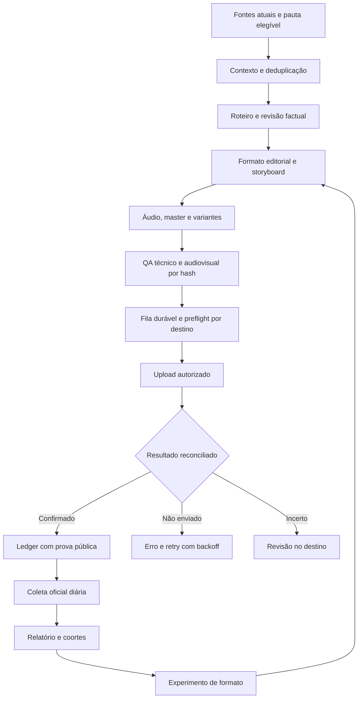

# Plano de execução e handoff — Pulso / YouTube AI

**Versão:** 2.36 · **Revisão documental:** 17/10/2026, 16:35 BRT · **Última leitura operacional:** 15:15 BRT (America/Sao_Paulo)

**Checkout:** /home/servidor/Git/youtube_ai/youtube-automation-agent · **Para:** modelo/engenheiro que retomar a execução

**Fonte de histórico:** [resumo.md](resumo.md) e [plan-historico-ate-2026-10-16.md](docs/archive/plan-historico-ate-2026-10-16.md)

Este é o handoff operacional atual. Comece por este arquivo. O arquivo de histórico conserva integralmente o plano anterior, os critérios detalhados dos 63 objetivos YAI e os checkpoints anteriores. Use o histórico para recuperar decisões/evidências específicas; ele não substitui as verificações de estado descritas aqui.

## 0. Como assumir este projeto

**INSTRUÇÃO MAIS RECENTE DO USUÁRIO — IMPLEMENTAR O ROADMAP:** em 16/10/2026 o usuário retomou expressamente a autorização e pediu que este modelo feche as otimizações deste plano. Seguir os pacotes na ordem, continuar após cada entrega e documentar impedimentos externos sem deixar tarefas locais paradas. A pausa documental de IMP-180 foi revogada por essa instrução posterior.

**Contexto:** o handoff v2 foi entregue em IMP-176. O usuário retomou a implementação integral em 16/10; o estado e os pacotes atualizados abaixo refletem essa retomada. Implementações locais, validação operacional e gates externos permanecem estados distintos.

**Leitura em ordem:** estado (§2) → regras (§3) → arquitetura (§4) → roadmap (§5) → fila executável (§11) → validação (§12). Formatos, contratos de dados, fluxo e protocolo de entrega estão em §§13–16. O catálogo integral de 63 objetivos está no §17. Cada tarefa nova deve apontar para esses IDs; não abrir um segundo backlog concorrente.

**Legenda:** concluído localmente = há evidência de código/teste, sem implicar aceite visual ou operação externa; parcial = entrega existe com critérios faltando; bloqueado externamente = depende de acesso, consentimento ou recurso identificado; decisão pendente = o histórico ainda exige uma decisão de produto. Hipóteses deste documento não são configurações aprovadas.

**Checkpoint histórico — 17/10/2026, 08:38 BRT (supersedido pelos registros das 12:25–13:24):** o job Saúde `auto_2026-10-17T10-29-35-259Z` mantém manifesto `vid_c346f975fb28237de1f3994d.json` com `technicalStatus=passed`, `visualReview=pending` e hashes do master/parte vertical; revisão de quadros já o reprovou por texto fictício, cena alheia e faixa preta. O job Economize `auto_2026-10-17T11-09-57-095Z` falhou às 08:36:51 com `visual_scene_image_coverage_insufficient`; folha das 11 imagens mostra humanos, texto/números inventados e cenas genéricas. Não houve render, manifesto, fila ou publicação. Scheduler PID 1316347 estava em backoff, retry às 08:41:51 BRT; consumidor aguardava vídeo, `pending=0`, `inFlight=false`, cadência 60/dia. O processo seguinte carregaria o prompt visual reforçado e `utils/source-freshness.js`, que estima o dia local da fonte, orienta writer/critic/SEO, rejeita linguagem relativa obsoleta também em metadados e impede cache de roteiro entre datas. Suíte focada pós-patch passou 6/6, lint e diff-check passaram. HyperFrames usage lido às 08:22 (sessão 80%/semana 28%); consultar de novo imediatamente antes de qualquer render. A checagem factual de Saúde foi contra a [matéria da Agência FAPESP](https://agencia.fapesp.br/estudo-sobre-imunidade-metabolismo-e-saude-hormonal-busca-voluntarios/59375), sem implicar aprovação visual.

**Atualização operacional 17/10/2026, 06:34:58 BRT (09:34:58 UTC):** `channel-scheduler.js` está ativo (PID 3255004). A geração automática iniciada às 06:34:22 BRT trabalha no tema `relacionamentos`; ainda não havia master nem item de fila (`pending=0`, `inFlight=false`). O preflight Android falhava porque uma dica do Firefox (`cfr.dismiss`) ocupava a janela ativa e escondia a árvore do Gemini. A dica foi fechada pelo identificador acessível; a árvore voltou a expor o WebView e o campo editável. `utils/gemini-android-image.js` agora descarta esse banner acessível uma vez por checagem. Testes focados passaram 9/9, ESLint dirigido e `git diff --check` passaram. O ciclo automático em curso precisa confirmar a integração real; não iniciar geração paralela. OAuth YouTube foi validado por API oficial em 16/10 às 22:56 BRT; não pedir novo login. A tentativa Kwai Fitness permanece incerta, marker `composer` intacto e SHA preservado; não reenviar.

**Estado operacional vigente — leitura passiva 17/10/2026, 13:29 BRT:** PID 1316347 continua ativo; `data/state/scheduler-health.json` tem heartbeat 13:29, produtor `backoff`, falha `budget_exhausted` às 11:56:52 e próxima tentativa em 21:00:01 BRT. O slot configurado de 12:20:45 foi perdido; consumidor aguarda vídeo, fila `pending=0`, `inFlight=false`, cadência 60/dia em intervalo de 24 min. O único filho direto encontrado é Xvfb, sem produtor de geração. Não reiniciar nem alterar scheduler/fila; antes do retry das 21:00, fazer nova leitura passiva. Enquanto isso, continuar tarefas offline independentes; toda mídia nova continua sujeita a revisão factual, visual e QA por hash antes de qualquer publicação.

**Nota sobre a trilha abaixo:** atualizações operacionais por horário anteriores à fotografia da §2 são registros históricos; podem descrever jobs/sessões que já terminaram. O estado vivo é a tabela §2 e seus checkpoints mais recentes, não a nota cronológica mais próxima acima.

**Atualização operacional 17/10/2026, 07:01:17 BRT (10:01:17 UTC):** o job de Carreira iniciado às 06:54:15 terminou às 06:59:30 como `source_claims_unverified`; o ledger registra `publicationEligible=false`, revisão `rejected` e o hash exato da fonte. O feedback identificou etapas de seleção e detalhes de vagas não sustentados pelo artigo. Não houve imagem, render, fila ou postagem. Ajustei a geração para limitar o roteiro a 90% das palavras da fonte extraída e, após rejeição factual, encurtar a reescrita para no máximo 75%, instruindo remoção integral de alegações sem suporte. `tests/review-response.test.js` passou 13/13, ESLint dirigido e `git diff --check` passaram. O scheduler permanece ativo (PID 3255004), fila vazia, backoff; retry esperado às 07:04:30 BRT. HyperFrames não foi usado neste ciclo.

**Decisão arquitetural:** ADR-0001 foi aceita em 17/10. AgentTube/Express e o Pulso permanecem separados; não há ponte de fila nem migração de estado. YAI-026 foi fechado localmente e README alinhado com o ADR.

**Auditoria de backup 07:02 BRT:** `node --test tests/project-backup.test.js tests/database-backup.test.js` passou 8/8, incluindo WAL, privacidade, validação SHA-256/JSON/SQLite, restauração isolada, traversal/symlink, retenção e recusa com lock ativo. Os casos usam fixtures temporárias. Nenhum snapshot dos dados reais foi criado: o scheduler continua ativo e o runbook requer janela sem escritores e destino externo criptografado. YAI-017 segue parcial até esses gates operacionais.

**Medição de cadência 07:03 BRT:** no dia local 17/10, 00:00–07:03, `scheduler.log` tem 68 inícios, 68 falhas terminais, zero conclusões e zero jobs abertos; os códigos são 53 provider de imagem indisponível, 7 revisão factual, 6 contexto curto e 2 cobertura visual. `api-usage.json` marca 122 chamadas NVIDIA agregadas do sistema, não atribuíveis todas ao scheduler. Atualizei `docs/relatorio-cadencia-capacidade-2026-10-13.md`; não houve alteração na cadência 60/dia. YAI-021 segue parcial, pois a janela foi inteiramente sem conclusões.

**Rastreabilidade Gemini 07:06 BRT:** um job pós-correção anterior atravessou o preflight Android, mas suas tentativas de imagem apareceram como erro genérico `Error`. `utils/gemini-android-image.js` agora converte erros genéricos em tags fixas pela etapa (editor, prompt, geração, download, transferência, validação/salvamento), sem incluir mensagem ou prompt original; `safe-error-tag.js` reconhece as tags. Testes Android/safe-error passaram 20/20, ESLint dirigido e diff-check passaram. O job atual de IA continua na revisão factual após HTTP 503 do Nemotron Nano e timeout do GLM Flash; sem imagens/render/fila.

**Observabilidade do prompt 07:08 BRT:** o log do roteiro agora distingue o alvo efetivo limitado pela fonte do pedido original (por exemplo, `até N (pedido 950)`), evitando afirmar que foi pedido um roteiro de 950 palavras quando o texto-fonte reduz esse teto. Reexecutei revisão-resposta 13/13, ESLint dirigido e diff-check. O ciclo atual começou antes deste ajuste e ainda mostra a mensagem antiga.

**Diagnóstico da rejeição IA 07:11 BRT:** o roteiro sobre o torpedo norte-coreano continha afirmações ausentes da fonte (data do teste vs. data da divulgação KCNA, ausência de intervenção humana, condições controladas, resistência a interceptações e cautela internacional). O revisor especificou a correção. A reescrita não foi gerada: os modelos alternativos tiveram timeout/HTTP 503 e o último fallback falhou; não houve mensagem `roteiro reescrito`. `reviewScriptWithRepair` preservou corretamente a versão rejeitada, mas ocultou a causa da falha. Agora `writeScriptWithNvidia` agrega somente tags seguras de falha e o callback registra que a reescrita não ocorreu; o estado final continua bloqueado. Testes de revisão/error-tag passaram 33/33, ESLint dirigido e diff-check passaram. Próximo retry previsto às 07:14:15 BRT.

**Retenção YAI-018, 07:12 BRT:** ampliei a fixture da limpeza para executar também o ramo `apply:true` dentro de workspace temporário. Com 24 h de carência, remove apenas o master antigo confirmado; mantém os arquivos `unknown`, recentes, em fila e com confirmação de clipe incompatível. Arquivamento/verificação/restauração por hash já tem teste isolado. `node --test tests/disk-cleanup-retention.test.js tests/media-archive.test.js` passou 4/4. Nenhuma mídia do checkout foi removida. YAI-018 continua parcial porque a duração oficial de retenção e um destino externo criptografado seguem sem configuração/decisão operacional.

**Retry 07:14–07:15 BRT:** tema Curiosidades foi bloqueado antes da geração por `source_context_too_short`. A pauta da Fato Pauli tinha 24 palavras extraídas; oito fontes alternativas não sustentaram uma narração. O gate factual evitou usar uma nota insuficiente e o job não gerou mídia. Suíte dirigida de Android, revisão factual, fallback, fontes e retenção passou 59/59; `npm run lint` e `git diff --check` passaram. Próximo retry automático esperado às 07:19:20 BRT; a telemetria de writer factual ainda aguarda um ciclo que alcance a revisão.

**YAI-027, 07:15 BRT (estado daquele checkpoint, supersedido):** os tokens compartilhados entre vídeo/thumbnail, seleção determinística das dez paletas e contraste já haviam passado 9/9. A matriz wide/vertical ainda estava pendente naquele horário; ela passou 20/20 às 12:31, conforme evidências arquivadas abaixo. O aceite estético humano continua separado.

**YAI-001, 07:18 BRT:** o preflight de produção identificou Rhubarb ausente. Instalei a release oficial Linux x86_64 1.14.0 fora do checkout em `~/.local/share/pulso/rhubarb-1.14.0`, com symlink em `~/.local/bin/rhubarb` (caminho já presente no PATH do scheduler). `rhubarb --version` e `npm run preflight -- --json` confirmaram 27 OK, 0 erros, 4 avisos opcionais do perfil neural. Reexecutei `scripts/audit-speech-visemes.js` em trecho existente de áudio de 60 s: SHA-256 `7051c3bb9c893001161cec6b886b74e9be35ead58b7fd106dc1e3c4d8dfa47e9`, 420 cues, 419 transições e todas as sete formas; temporários removidos. O ZIP foi removido. `npm run preflight -- --neural --json` ainda apontou 34 erros no Python padrão: pins ausentes/divergentes, Piper/Faster-Whisper e modelos inexistentes; não há venv no checkout. YAI-001 segue parcial, sem troca de runtime ativo.

**Job Saúde em andamento, leitura 07:40:45 BRT:** pauta Poder360 (1.807 caracteres), roteiro de 245 palavras após reescrita e aprovação por GLM + Nemotron Super; Nano teve 503/invalid. SEO fez fallback por timeout; cinco grupos Edge TTS concluídos; dois prints falharam em branco. 14 imagens de cena estão no cache enquanto o grupo 4 está sendo produzido; revisão visual preliminar encontrou rótulos inventados/texto ilegível em algumas imagens apesar do prompt sem texto. Ainda sem fechamento da etapa, render, master ou fila. Usage HyperFrames consultado às 07:32: conhecido (39% sessão restante, 75% semanal); repetir imediatamente antes do render. Não tocar no Android enquanto o job estiver ativo.

**Retry dinheiro 07:19–07:27 BRT:** a matéria bra1.com.br tinha 3.901 caracteres; roteiro inicial foi reprovado, e a reescrita automática foi produzida após timeout/503 em fallbacks. O GLM rejeitou a versão refeita porque manteve “permissões” onde a fonte dizia “permissionários” e encurtou o dado de “51 encontros corporativos e de negócios”. Nenhuma mídia, render ou publicação foi gerada; o ledger marca `publicationEligible=false`. O feedback ficou no `.meta.json` do cache local para diagnóstico. Reforcei `factRepairGuidance` para exigir substituições literais e formulações citadas exatas. `node --test tests/review-response.test.js tests/script-review.test.js tests/safe-error-tag.test.js` passou 33/33; `npm run lint` e `git diff --check` passaram. Próximo retry às 07:29:35 BRT; verificar se o prompt corrigido é efetivo.

**Atualização operacional 17/10/2026, 06:40:11 BRT (09:40:11 UTC):** o ciclo anterior iniciado às 06:34:22 terminou em `GEMINI_ANDROID_EDITOR_NOT_READY`. A árvore já mostrava WebView e um único `android.widget.EditText`, sem prompt de login; o hint real era `Insira um comando para o Gemini`, ausente do matcher. Incluí essa variante. A checagem read-only do `GeminiAndroidImageGenerator.isAvailable()` passou (`available=true`, sem avisos), sem enviar prompt. Nova geração automática iniciou às 06:40:03 BRT, tema Fitness, saída `data/videos/auto_2026-10-17T09-40-03-827Z.mp4`; às 06:40:11 ainda estava ativa, fila vazia e sem master. Não iniciar outra geração. O piloto HyperFrames foi atualizado pelo CLI de 0.8.162 para 0.8.167 após `upgrade --check`; o `check` obrigatório ainda aguarda janela sem render ativo. `utils/hyperframes-video-renderer.js` continua fixado em 0.8.162 até compatibilidade ser validada.

**Atualização operacional 17/10/2026, 06:57:18 BRT (09:57:18 UTC):** os ciclos de 06:40 e 06:46 falharam antes do render. O de 06:40 chegou à etapa de imagens, mas o gate verificava `EditText.text`, vazio por limitação da árvore do WebView, embora o prompt estivesse visível. Corrigi o gate para exigir ADB Keyboard ativo, broadcast confirmado e editor ainda visível; uma geração Android real passou e baixou PNG horizontal 1376×768 (2.589.741 bytes), removido após validação de formato/dimensão. O job de 06:46 foi parado pelo gate factual (`source_claims_unverified`). Agora o job de 06:54, tema Carreira, gerou roteiro e aguarda fallback de revisão após `z-ai/glm-5.3-flash` exceder o timeout; ainda sem imagem, master, fila ou publicação.

O HyperFrames 0.8.167 passou o `check` do piloto: lint/runtime/motion sem erros, zero findings em nove amostras e contraste WCAG AA 61/61. Atualizei os pins do renderer de produção e do comando `make-video.js`; o teste verifica coerência dos pins. O histórico CLI foi encerrado (registro `b7a71d6b`). `test:ci` passou integralmente após corrigir expectativas antigas de timeout/concurrency em `tests/review-response.test.js` (352 testes principais, blocos adicionais, Chromium, 38 testes Python e framing); `npm run lint` terminou com exit 0. Testes Android/review/HyperFrames dirigidos passaram.

**Snapshot do handoff anterior (16/10/2026, 23:56 BRT; superado):** gerar um master novo usando o provider Android/Firefox já integrado e validado em execução real; inspecionar áudio/vídeo e gates do roteiro antes de qualquer publicação. A integração ADB compartilha `data/android-social-upload.lock`, valida dimensões/orientação, grava PNG atomicamente e limpa somente o download temporário criado por ela. Um smoke integrado real gerou PNG 1376×768 em `/tmp`; não é mídia de produção. O provider reavalia indisponibilidade após 15 s e segue para outro provider disponível após erro. Catálogo autenticado da chave NVIDIA consultado: 81 modelos, nenhum de imagem/Qwen/FLUX. ComfyUI local está parado e reporta GPU `null`; `nvidia-smi` não existe no host. Não chamar Qwen/NVIDIA de fallback funcional até confirmar endpoint e cota que não impliquem custo não autorizado. O catálogo oficial marca Qwen-Image como `Downloadable`; a [API documentada](https://docs.nvidia.com/nim/visual-genai/latest/api/qwen-image.html) corresponde a NIM auto-hospedado, sem confirmação de endpoint gratuito para esta chave. Às 23:56 BRT, o ciclo automático permanecia gerando roteiro: `openai/gpt-oss-20b` respondeu, mas três revisores subsequentes falharam (HTTP 503 e dois timeouts); não havia master, item de fila ou publicação confirmada. Próximos gates: acompanhar o ciclo, concluir revisão factual, produzir master candidato, fazer QA audiovisual e exigir prova de postagem. CI completa e lint passaram na tranche anterior; isso não valida este ciclo em andamento. Preservar tentativas externas `unknown` e não repetir uploads.

**Skills:** NVIDIA Agentes lida em `/home/servidor/.agents/skills/nvidia-agentes/SKILL.md`. Se delegar, usar o fluxo externo OpenCode/NVIDIA autorizado, contexto completo, arquivos exclusivos e revisão local; nenhuma troca silenciosa para provider pago. Antes de editar/renderizar vídeo, ler `hyperframes` e as skills de domínio necessárias. Antes de automatizar Chrome do host, ler `host-chromium-playwright`; senhas, códigos e consentimento são do titular. Para o piloto HyperFrames, ler seu `AGENTS.md` próprio. Não instalar ferramentas apenas para elaborar um plano.

## 1. Resultado que o projeto precisa entregar

Manter um fluxo confiável que:

1. encontra pauta recente e verificável;
2. transforma a pauta em roteiro fiel às fontes, narração e vídeo visualmente consistente;
3. gera versões adequadas a cada plataforma, com variação editorial real;
4. valida mídia, texto, áudio, direitos, duração e formato antes de publicar;
5. publica somente nos destinos que têm conta, sessão e fluxo validados;
6. comprova a publicação no perfil/destino;
7. coleta métricas reais uma vez por dia e aprende com elas sem inventar dados ou conclusões.

A prioridade é voltar a publicar material novo com regularidade e visibilidade de falhas. A quantidade de tentativas não substitui qualidade, validação nem prova pública.

## 2. Estado operacional comprovado

**Estado atual — 17/10/2026, 14:44 BRT:** dois masters Fitness estão públicos e reproduzíveis no YouTube, confirmados pela API oficial no canal `UCT_Scob-q-jUJgfDUaMvejA`: [menopausa e treino](https://www.youtube.com/watch?v=LmhbcYuc9A4) e [resistência à insulina](https://www.youtube.com/watch?v=O7S2y18iuaY), ambos `privacyStatus=public`, `uploadStatus=processed` e `processingStatus=succeeded`. Os manifestos vinculam aprovação ao hash e somente aos masters; Shorts/cortes sem aprovação estão explicitamente bloqueados. Psicologia e Saúde seguem sem escopo visual aprovado. Scheduler user-service ativo (PID 2891743, sem restart), produtor em `backoff` por limite local NVIDIA `200/200`, fila `pending=0`/`inFlight=false`, retry previsto às 21:00:01 BRT. O contador de `data/state/api-usage.json` renova na virada UTC (21:00 BRT); não há evidência de bloqueio de cobrança/quota externa NVIDIA. A API Analytics ainda retorna 403; não há confirmação de views de audiência, somente de que os vídeos estão disponíveis para tocar.

**Continuidade YAI-032 — 17/10/2026, 13:54 BRT:** conferi metadados dos dois MP4s já concluídos, os QA manifests, os caches de roteiro vinculados pelo hash do contexto e seus grupos TTS/SRT; não reproduzi fala nem alterei mídia. Ambos usam `retention-emotions-v23-audience-growth`, Edge TTS e hashes técnicos íntegros. Psicologia tem gancho de 14 palavras, 7 grupos (6 `subtitle-cues-interpolated`, 1 `uniform-estimate`); Fitness tem 8 palavras, 6 grupos (todos `uniform-estimate`). Os dois indicam estruturas distintas (`mecanismo-explicado` e `evidencia-e-limite`), derivadas do tópico exato do prompt armazenado. A evidência agregada está em `docs/evidencias/yai032-runtime-2026-10-17.json`; QA pendente de revisão visual não prova publicação. Implementei a faixa 7–12 como rejeição/feedback antes da revisão remota e como gate final antes de salvar cache/renderizar; cache passou a v24. Manifests futuros guardam estrutura, quantidade de palavras e resumo de provider/cues/método/duração, sem o texto da narração. Não alterei prosódia, rate/pitch, áudio, vídeos, scheduler ou estado de produção. YAI-032 permanece Parcial até evidência pós-v24 e revisão humana de fala/prosódia; alinhamento aqui é interpolação de cues ou estimativa uniforme, nunca alinhamento fonético exato.

**Leitura passiva de capacidade — 17/10/2026, 13:58 BRT:** WhatsWave e llama server responderam HTTP 200 no health/model list, sem inferência. Host: load average 36,66/31,04/25,71, fila `vmstat` 36–38, CPU idle 10–11%, 11 GiB disponíveis e 20 GiB de swap usado; MongoDB WhatsWave marcou 101,50% de CPU. Snapshot atualizado em `docs/whatsapp-capacidade-snapshot-2026-10-17.md`. Esta pressão impede ensaio concorrente seguro; não atribuir carga, não testar latência até janela coordenada e não mexer em containers/atendimento.

**YAI-017/018 — continuidade segura — 17/10/2026, 14:03 BRT:** `findmnt` em modo read-only não encontrou volume persistente externo com indicação reconhecível de criptografia (`/dev/mapper`, `crypt` ou filesystem criptográfico); como o perfil de backup inclui `.env`, não criei cópia operacional em texto claro. Para YAI-018, arquivei/restaurei somente uma cópia temporária do MP4 de integração local, comparando SHA e ffprobe e removendo o scratch; nenhuma mídia de produção foi copiada/apagada. Evidência `docs/evidencias/media-archive-restore-2026-10-17.json`; retenção aprovada/expurgo continuam pendentes.

**YAI-033 — avaliação técnica da demo neural — 17/10/2026, 14:04 BRT:** revisei as folhas de contato horizontal/vertical e a evidência QA já salva. A demo fica aprovada para continuar como prova de conceito de interface/gesto: personagem inteiro, texto legível nas capturas e gestos visualmente distintos; medições de rig/pose passaram. Registrei como ajustes o drift RGB entre contextos WebGL, mouth driven apenas por envelope e falta de avaliação auditiva de naturalidade/prosódia. A ficha `docs/evidencias/avaliacao-demo-neural-2026-10-17.md` distingue essa avaliação técnica da aprovação humana final/publicação; nenhum áudio, asset ou configuração de produção mudou.

**EXEC-11 — inventário de formatos observados — 17/10/2026, 14:06 BRT:** o ledger e os manifestos associados têm três vídeos reais com QA técnico e SHA dos assets válidos, mas somente dois IDs distintos (`direct-answer` 1×, `context-change-result` 2×); todos mantêm `visualReview=pending`. Registrei metadados em `docs/evidencias/format-library-real-sample-2026-10-17.json`. Isso não valida variedade de storyboard, aprovação estética, publicação ou resultado de performance e não inicia experimento.

**Registro histórico — 16/10/2026, 23:40 BRT — provider de imagem e fallback (IMP-20261017-001):** sessão Gemini autenticada usada no Firefox Android. `GeminiAndroidImageGenerator` e `GeminiImageProvider` estão conectados ao gerador animado; o smoke integrado salvou `/tmp/gemini-android-provider-integration.png` em PNG 1376×768. Inspeção visual: composição horizontal coerente, foco legível, sem colagem ou crop; pequena marca pseudo-textual no braço do robô, portanto apenas teste. O código valida proporção antes de aceitar e serializa o emulador com o lock compartilhado. Corrigi a cache de indisponibilidade: falha de autenticação é reavaliada após 15 s, e teste confirma recuperação após o login; erro de geração Android segue para provider alternativo disponível. NVIDIA `GET /v1/models` autenticado retornou 81 modelos e nenhum ID de image/flux/qwen. Não foi feita geração NVIDIA. O endpoint ComfyUI local não responde; `server_info` informa GPU `null` e o host não tem `nvidia-smi`. Fontes: [Qwen-Image NVIDIA](https://build.nvidia.com/qwen/qwen-image), [referência de API Qwen NIM](https://docs.nvidia.com/nim/visual-genai/latest/api/qwen-image.html). Nenhuma confirma endpoint hosted gratuito para a chave atual; não ativar Qwen até existir endpoint/cota confirmado. Geração integrada, 8 testes focados, `npm run test:ci` e `npm run lint` passaram (exit 0), incluindo testes de sistema, navegador headless, framing e Python. A fila leu `pending=0`, `inFlight=false`; nenhuma postagem foi feita.

**Snapshot histórico — 16/10/2026, 22:29 BRT.** Scheduler user-service PID 2332810 estava ativo (`NRestarts=0`); fila vazia (`pending=0`, `inFlight=false`). A geração às 22:28:27 falhou com `visual_image_provider_unavailable`; retry previsto 22:33:27. Tentativa Kwai 14 do job Fitness permaneceu `unknown/attempt_outcome_unknown`, sem reenvio; mídia/marker foram preservados. Redroid sem Play Protect certificado, Firefox Android instalado e callback local por `adb reverse` passou. OAuth YouTube e o estado Gemini foram atualizados em registros posteriores de 16/10; não usar este snapshot como estado atual.

**Registro histórico — 16/10/2026, 22:41 BRT.** Duas sessões OAuth expiraram sem ação e sem alteração dos tokens; uma terceira sessão no emulador aguardava até 23:01. Scheduler tinha fila vazia e geração das 22:38:33 falha em `visual_image_provider_unavailable`. OAuth foi concluído em registro posterior às 22:56; nenhuma sessão deve ser reaberta com base nesta nota.

| Área | Estado observado | Próxima ação |
|---|---|---|
| Scheduler | Leitura passiva às 15:15 BRT: user-service `active`, PID 2891743; journal registra dois restarts no dia (08:09:51 e 14:39:06→14:39:29), nenhum duplicado resultante (canal reconciliado por API com exatamente os dois masters). Produtor `backoff` por `budget_exhausted` (200/200 locais em 17/10 UTC), retry 21:00:01 BRT quando o contador vira 2026-10-18 UTC. Fila `pending=0`, `inFlight=false`; 60/dia e slots de 24 min. Monitor passivo de leitura ativo em scratch até 23:59 BRT. | Deixar o serviço seguir seu backoff; após 21:00, observar o ciclo (primeiro com v24/prompt visual/frescor/thumbnail v4/portrait) sem iniciar geração paralela e auditar o artefato pelo checklist registrado no resumo. |
| Fila e geração | Jobs Psicologia `auto_2026-10-17T11-41-51-044Z` e Fitness `auto_2026-10-17T13-21-39-461Z` concluíram; somente o master Fitness tem aprovação visual/hash publicada. Psicologia e Saúde permanecem sem aprovação visual. O layout portrait foi corrigido e a integração local validada; esse teste não substitui mídia persistida. O gate por arquivo bloqueia Shorts/cortes não aprovados. | Manter escopo de aprovação por hash e aguardar orçamento do provider; revisar cada saída antes do upload. |
| Kwai atual | Tentativa 14 terminou `unknown` após acionar envio sem confirmação. Capturas mostram o compositor, mas não concluem o estado remoto. A consulta ao perfil não conseguiu verificar legenda/data. Marker e mídia permanecem. | Não repetir nem alterar para `confirmed_no_send`; localizar o post ou obter prova conclusiva de não publicação. |
| Mídia Fitness | Hash `0ef90e4c…` preservado; H.264/AAC, 1080×1920/30 fps, 293,933 s, 97.556.025 bytes. Último estado conhecido do ledger/marker: `transcoding`, compositor recuperado com legenda vazia; não foi feita nova reconciliação do estado Android nesta leitura. Resultado remoto da tentativa Kwai permanece `unknown`. | Preservar arquivo/legenda/fonte; reconciliar o estado remoto antes de qualquer retry ou alteração do marker. |
| Último post Kwai confirmado | Job 8afd2254-15c7-4644-926c-763347561342, AI-DLC, 05:26 BRT de 16/10; evidência docs/evidencias/kwai-ai-dlc-publicado-2026-10-16.png. | Não confundir esse post com o Fitness pendente. |
| YouTube | Dois uploads novos confirmados em 17/10: [LmhbcYuc9A4](https://www.youtube.com/watch?v=LmhbcYuc9A4) e [O7S2y18iuaY](https://www.youtube.com/watch?v=O7S2y18iuaY). Consulta oficial às 14:44 confirma canal correto, `public`, `processed` e `succeeded` em ambos. Analytics continua com 403 genérico, sem erro OAuth. | Manter QA visual por ativo; não liberar cortes sem hash aprovado. Diagnosticar acesso à Analytics separadamente. |
| Outras redes | TikTok/Instagram/X sem handler/sessão validada; Telegram não configurado. | Permanecem fora dos destinos ativos. |
| Analytics diário | Implementado e instalado. Timer executou às 09:00 BRT em 17/10 e gravou relatório parcial de 20 posts: 9 YouTube e 9 Shorts têm contadores públicos atuais da API oficial (`simulated=false`), mas Analytics está indisponível por `permission_or_quota_denied`; 2 Kwai não têm coletor oficial. Não há deltas comparáveis nem ranking. Health de scheduler é servido ao dashboard; o coletor preserva versão do formato e `experimentId` explícito. | Relatório `data/reports/performance/2026-10-17.md`; observar próxima execução de 18/10 às 09:00 BRT. Não fazer refresh extra. |
| Fontes e direção visual automática | Auditoria somente leitura às 16:14 BRT: 14/14 feeds configurados retornaram XML válido. A sessão CDP anterior em 9233 não está disponível; o perfil Gemini e os dois perfis Google candidatos falharam na verificação headless. A URL CDP obsoleta foi removida do `.env` (modo 0600). | Feeds acessíveis não dão licença para copiar texto integral. Para voltar a gerar, é necessária sessão Google autorizada no Gemini. O helper `GEMINI_LOGIN_HEADLESS_ONLY=1` não abre janela e falha claramente quando não acha sessão válida. |
| OAuth YouTube sem interromper o desktop | Uma tentativa anterior por `@google-cloud/local-auth` foi cancelada sem gravar tokens. Depois, `scripts/auth-youtube-emulator.js` completou o fluxo no Firefox Android em 16/10 às 22:56 BRT, validou state, scopes e canal contra os vídeos publicados, e salvou tokens privados. A credencial contém refresh token e scope Analytics; access token expirou no ciclo normal. A coleta de 17/10 chegou à API Analytics e recebeu 403 classificado genericamente; sem prova de `invalid_grant` posterior. | Preferência explícita: não abrir janela visível. Manter tokens existentes; investigar configuração/permissão da API Analytics sem consentimento repetido. Não alterar a sessão Kwai. |
| Cadência | VIDEOS_PER_DAY=60 preservado. A sugestão anterior de teto 1/dia era proposta documental, não decisão aprovada. | Resolver YAI-021 com histórico/capacidade; não aplicar redução ou aumento por inferência. |
| Validação | Sessão da tarde de 17/10: `npm run test:ci` passou às 15:50 BRT após a correção de `publication-observability` (falso `unknown` para resultado `não alvo`), com blocos finais QA/OAuth 45/45, dashboard accessibility, Python 38/38, presenter framing horizontal/vertical e Instagram framing; `npm run lint` completo passou às 18:05 e `git diff --check` passou; suítes de publicação/observabilidade 35/35; JSONs de evidência novos parseiam. Manhã de 17/10: CI 13:57 (365/365 principais, 5/5, 19/19, 43/43, 38/38 Python), lint 13:55, YAI-032 focados 30/30, YAI-020 feeds 14/14 + 28/28 (SHA `0fe3f6a7…`), YAI-006–008 direcionados 37/37, render portrait com checker 44/44. SiteCorp (sessão da tarde): core do mascote 25/25, `tsc -b` 0, QA widget staging 2/2 com news tutorial, E2E 10/10, ESLint dirigido 0; chat real público revalidado sem interceptação (2/2 desktop/mobile) com correção `enable_thinking` deployada. | A CI não comprova publicação, métrica Analytics utilizável, geração de mídia v24, alinhamento fonético exato, revisão humana de fala/prosódia nem aceite estético final dos vídeos do canal. O primeiro ciclo v24 (21:00 BRT) ainda precisa ser auditado. |

**Checkpoint de continuidade — 17/10/2026, 12:25 BRT:** o portrait local está integrado e verificado contra mídia real, mas YAI-063 permanece parcial até um job integral pós-patch, cobertura/validação das superfícies por conta real e aceite visual humano. O scheduler segue ativo sem filho produtor; `pending=0`, `inFlight=false`, retry após `budget_exhausted` previsto às 21:00 BRT. Nenhum asset de produção, fila ou publicação foi alterado. Próximo: registrar este checkpoint no resumo e retomar a primeira pendência local independente; preservar os gates externos. `BeginFrame did not run` voltou a aparecer como aviso de captura lenta no render de 4,4 s, que mesmo assim terminou e validou o artefato.

**Checkpoint visual — 17/10/2026, 12:31 BRT:** YAI-036 foi revalidado localmente: `tests/theme-visual-matrix.js` passou 20/20 renders dos dez temas ativos em 16:9 e 9:16. Revisei a folha de contato e arquivei 20 capturas completas, `matrix.json`, contato e instruções em `docs/evidencias/theme-visual-matrix-2026-10-17/`. Cada combinação manteve marca/acento/paleta/presenter, canvas visível, cards/texto dentro dos limites e sem erro de browser. Isto não fecha aprovação estética final nem valida dispositivos/rede reais; nenhuma cor foi recolorida. Próximo ciclo: `git diff --check`, registrar no resumo e avançar a próxima tarefa local ainda viável.

**Checkpoint de thumbnail — 17/10/2026, 12:35 BRT:** usei o template real `buildThumbnailHtml()` com título e imagem de abertura do job Fitness factual/técnico aprovado. `chooseThumbnailHeadline()` aceitou “O QUE MUDA APÓS OS 40”; gerei e inspecionei prévia 1280×720 e versão 320×180 em `docs/evidencias/thumbnail-preview-2026-10-17/`. As 18 regressões de `thumbnail-design`/`thumbnail-art` passaram. Chamada e foto estão relacionadas ao roteiro/vídeo, sem UI falsa. A capa persistida do job não foi substituída; arte dedicada pelo provider atualizado, comparação completa e CTR continuam pendentes. Não houve chamada externa nem publicação.

**Checkpoint visual e de animação — 17/10/2026, 13:10 BRT:** YAI-027 foi concluído localmente: seis testes dos tokens passaram, além da matriz visual 20/20 e inspeção wide/tall já arquivadas; a prévia de thumbnail continua sem substituir a capa do job e sem alegação de CTR. Para YAI-035, auditei base e tema: 17 ossos, pesos normalizados, binds válidos, texturas/UVs/winding/posições preservados e zero triângulos ponte braço-perna. Estendi o QA para as duas primitivas skinned, corrigindo a lacuna de medir apenas a primeira: 491.674 + 8.362 = 500.036 triângulos no runtime, iguais ao relatório serializado. As variantes base/tema × wide/vertical passaram 17 poses e 8 tempos de áudio cada; geometria constante, seeks quentes determinísticos, pose completa repetível no reload, erro rígido <1,4e-15, boca sincronizada ao envelope e zero amostras cortadas em tomadas abertas. Relatórios, oito frames, contato visual, comparação entre contextos e hashes estão em `docs/evidencias/robot-animation-qa-2026-10-17/`. Detectei variação RGB/iluminação em reload wide (230.828 pixels diferentes; RMSE normalizado 0,106316) com máscara alfa igual e pose idêntica; o motivo ainda não foi isolado, portanto mantenho a revisão estética e a avaliação YAI-033 pendentes. QA usa amostragem 1/101 e não prova auto-interseção exaustiva nem visemas fonêmicos. Os seis testes de tokens passaram, `npm run lint` e `node --check` passaram; `git diff --check` será repetido após esta atualização documental. Nenhum asset de produção, fila, conta, publicação ou scheduler foi alterado.

**Checkpoint offline — 17/10/2026, 13:18 BRT:** YAI-034 foi revalidado sem mudar áudio/código: os hashes da locução real `7051c3bb…` e da fixture Piper `b779550a…` conferem; `tests/speech-visemes.test.js` + `tests/speech-viseme-audit.test.js` passaram 9/9; Whisper-name local 3/3; a mesma amostra real de 60 s rodou duas vezes com Rhubarb e manteve 420 cues/419 transições, sete formas e resumo agregado idêntico. Arquivei `revalidation-2026-10-17.json`; classifiquei como Concluído localmente, mantendo validação de voz espontânea, integração SiteCorp e revisão humana pendentes. `tests/hook-structure.test.js` + `tests/narration-timing.test.js` passaram 7/7; YAI-032 continua Parcial porque nenhum artefato pós-revisão v5 demonstra a geração/voz/legenda integrada, e rate/pitch segue intocado sem revisão de amostra. YAI-038 dashboard passou Chromium keyboard/focus/history/command-palette em desktop e viewport 390 px, sem overflow. Ao tentar capturar novas evidências dos componentes de YAI-030, a execução expirou em screenshot após 30 s aguardando a captura; a amostra do host mostrou load average 32,83/33,83/35,81 e Chromium GPU externo a 1.068% CPU (outro processo a 715%), com 9 GiB de RAM disponíveis e espaço suficiente em `/tmp`. Não matei processos nem repeti o teste; YAI-030 segue Parcial por um limite de carga. Próxima tarefa independente: medição passiva compartilhada de capacidade (YAI-041), sem enviar inferência nem reiniciar serviços; validar `git diff --check` após esta atualização.

**Checkpoint de capacidade — 17/10/2026, 13:22 BRT:** executei a medição passiva para YAI-041. Containers `whatswave_backend`, frontend, Mongo, Redis, `llama-cpp` e `pulso-assistant` estavam `Up`; `GET 127.0.0.1:8081/health` e `/v1/models` retornaram 200 e identificam `Fran-Pedra-v13-4B` Q4_K_M (4,326B parâmetros). A porta publicada é 8081→8080 do container; o host 8080 é SearXNG e 8000 é Graphiti MCP, portanto corrigi a leitura de porta sem fazer qualquer chamada de inferência. A carga média às 13:18 foi 24,61/29,74/33,96, fila de execução vmstat 22–27, 11 GiB disponíveis, 20 GiB de swap usado, GPU 3% busy e VRAM 8,56/12,87 GiB; `whatswave_backend` marcou 0,56% CPU/120 MiB e `llama-cpp` 3,316 GiB/17 GiB no instante Docker. Snapshot completo em `docs/whatsapp-capacidade-snapshot-2026-10-17.md`. Não foram enviados prompts/mensagens, nem houve restart, mudança de quotas ou ação no scheduler. YAI-041 continua pendente de janela coordenada para medir TTFT/throughput e concorrência real; saúde HTTP não demonstra latência de atendimento.

### 2.1 Fatos importantes para comunicação

- A tentativa 13 terminou sem envio às 14:13:55; a tentativa 14 acionou o botão, mas permanece `unknown`. O perfil não permitiu confirmar legenda/data nem provar ausência; retry está bloqueado para evitar duplicata.
- Um vídeo local anterior tinha H.264/AAC e resolução esperada, mas a amostra visual estava repetitiva/escura: o log registrou provider Gemini sem login e `imageCount:0`; esse MP4 não foi editado. Superando o snapshot antigo, o job Psicologia terminou às 10:11:59 BRT e o job Fitness terminou às 11:40:36 BRT; ambos têm manifesto técnico, mas nenhum aceite visual nem publicação. Psicologia: master 268,04 s; thumbnail reprovado por UI/mensagens falsas e chamada “PODE NÃO”. Fitness: thumbnail diz “PODE PRECISAR MUDAR DEPOIS DOS 40” e não mostra UI falsa; amostras do master têm cenas de academia/contexto, sem aprovação final. Os cortes 9:16 dos dois jobs ainda usam o layout antigo; o portrait fixado no código não re-renderizou essas mídias. O job Psicologia registrou warning `BeginFrame did not run`, sem impedir o render. Último preflight de ambos bloqueou com `publication_visual_review_required`; não publicar até revisão/artefato correto e aprovação.
- Gemini e OAuth YouTube são autorizações separadas. Nenhuma sessão Gemini válida foi encontrada nos perfis existentes. O OAuth YouTube foi reautorizado e validado em 16/10; a última coleta alcançou a API Analytics, mas recebeu 403 genérico. Preferência do titular: não abrir janela de navegador em primeiro plano; não confundir o emulador Android do Kwai com uma sessão YouTube autorizada.
- O pipeline publica de fato no YouTube e no Kwai quando todos os gates e credenciais estão disponíveis. Kwai tem post recente confirmado; YouTube não tem publicação nova confirmada após a reautorização e ainda requer artefato revisado e confirmação de upload.
- O último post confirmado de Kwai foi em 16/10; o último do YouTube foi em 13/10. A diferença de três dias na janela atual é específica do YouTube.
- Um vídeo local renderizado ou aprovado não é uma postagem. Um clique, HTTP 200 ou retorno do uploader também não basta para marcar como publicado.
- Só classificar como publicado após reconciliar o ledger e localizar o conteúdo no perfil/destino, guardando URL ou evidência equivalente.
- O job Fitness continua com mídia e marker preservados. Tentativa 14 não é `confirmed_no_send`; não repetir até consulta conclusiva no perfil.

## 3. Regras de execução para quem assumir

1. Releia este handoff, o fim de resumo.md, o estado vivo em data/state/ e os arquivos de código da tarefa antes de modificar algo. Não releia o milhão de bytes do histórico inteiro sem necessidade.
2. O checkout já contém muitas mudanças locais anteriores. Não faça reset, checkout destrutivo, limpeza de diretórios, stage, commit ou push. Preserve arquivos de outras tarefas.
3. Nunca imprima, copie para documentação, envie ao modelo ou registre em logs o conteúdo de .env, config/credentials.json, tokens OAuth, chaves ou cookies. Use somente resultados sanitizados.
4. Não altere conta, canal, alvo de publicação, privacidade, quota, limites do provedor ou retenção sem autorização já registrada no histórico. Não use um provedor pago alternativo para contornar uma cota esgotada.
5. Se uma tentativa tiver resultado incerto, reconcilie no destino antes de repetir. Nunca transforme estado unknown em confirmed_no_send por suposição.
6. Não remova mídia até haver estado de publicação confirmado e a política de retenção aplicável. O job atual usa DELETE_AFTER_UPLOAD=0.
7. Não use automação por coordenadas cegas para contornar uma árvore de acessibilidade que falha. Captura de tela e leitura são seguras; publicar exige caminho validado.
8. Não aumente o número de posts para compensar dias perdidos. Não republicar conteúdo antigo nem duplicar o mesmo artefato no mesmo destino.
9. Métrica ausente é null/“indisponível”, nunca zero. Separar dado medido, dado manual, estimativa e recomendação.
10. Manter plan.md e resumo.md atualizados depois de cada etapa relevante. Marcar tarefa concluída apenas com evidência reproduzível.

## 4. Mapa do sistema e onde implementar

| Responsabilidade | Código/estado principal | Notas para integração |
|---|---|---|
| Scheduler produtor/consumer usado na produção animada | scripts/channel-scheduler.js | Processo ativo observado. Gera just-in-time, gerencia slots, fila e tentativas. Não confundir com npm run scheduler. |
| Geração e render animado | scripts/generate-animated-video.js, utils/hyperframes-video-renderer.js, experiments/hyperframes-pulso-pilot/ | O piloto alternativo não é automaticamente o renderer de produção. Preservar o renderer ativo até comparação e QA autorizados. |
| Publicação YouTube | scripts/upload-to-youtube.js | API oficial; exige OAuth válido. |
| Publicação social | scripts/upload-to-socials.js, utils/android-social-publisher.js, utils/kwai-upload-flow.js, utils/kwai-upload-resume.js, scripts/kwai-emulator.js | Handler Android real deste checkout é Kwai. Outros destinos falham fechados até implementação e sessão validadas. |
| Estados e dedupe | data/state/publish-queue.json, topics.json, publications.json, kwai-upload-resume.json, api-usage.json, scheduler.json, theme-rotation.json | JSON de estado mutável. Ler novamente imediatamente antes de qualquer retry ou limpeza. |
| Política de formato | utils/platform-video-policy.js, utils/platform-upload-limits.js, docs/formatos-video-por-rede-2026-10-13.md | Caminho do app, API e Studio web tem limites distintos. Não generalizar regra de uma superfície para outra. |
| Analytics/learning já existente | agents/analytics-optimization-agent.js, utils/channel-learning-engine.js, database/db.js, index.js, dashboard/ | O fluxo Express/SQLite já tem peças de analytics, learning e experimentos. O pipeline animado persiste muito do seu estado em JSON e ainda não está integrado. Inspecionar e reutilizar antes de construir outro coletor ou schema. |
| CI e QA | scripts/run-ci-tests.sh, tests/, npm run lint, npm run test:ci | Rodar as suites focadas após cada mudança e a CI completa ao integrar. QA visual do MP4 requer artefato real; teste unitário não substitui inspeção. |
| Operação | deploy/systemd/, ~/.config/systemd/user/ai-video-scheduler.service, logs/scheduler.log | O bus user foi recuperado e consultado: XDG_RUNTIME_DIR=/run/user/1000, DBUS_SESSION_BUS_ADDRESS=unix:path=/run/user/1000/bus. Confirmar UID no host antes de reutilizar. Evite restart com render/upload/checkpoint ativo. |

Há dois caminhos de produto: o scheduler animado em produção e o app Express/dashboard com banco, revisão de cenas e analytics. O handoff principal trata da publicação animada. Integre os dois caminhos por IDs e contratos existentes; não duplique uma plataforma completa para contornar a lacuna.

## 5. Roadmap ordenado

### Fase 0 — Retomar o evento vivo com segurança (P0)

**Objetivo:** descobrir se a varredura do scheduler já processou o retry Kwai e manter o ledger coerente.

Passos:

1. Atualizar hora local, PID e filhos dos processos; ler publish-queue.json, topics.json, publications.json, kwai-upload-resume.json e o final de logs/scheduler.log.
2. Confirmar se o job Fitness está em tentativa, confirmed_no_send, unknown ou confirmed. Não abrir uma segunda tentativa concorrente.
3. Se não houve tentativa e a janela venceu, deixar o worker normal fazer a varredura. Se executar manualmente, seguir o mesmo preflight e lock do scheduler.
4. Verificar que hash, legenda completa, fonte aprovada, duração e álbum isolado continuam iguais. O marker de resume precisa corresponder ao job.
5. Se publicar, localizar o post no perfil Kwai, registrar URL/ID e evidência pública, confirmar ledger e só então atualizar o resumo. Se falhar antes do envio, guardar causa e screenshot sanitizado; corrigir causa antes de um novo retry.
6. O caminho YouTube deve começar por reautorização interativa, não por tentativa de upload. Verificar conta pelo endpoint channels.list(mine=true) e fazer uma consulta analytics somente leitura. Não imprimir credenciais. Usar CredentialManager.authenticateYouTube com as credenciais existentes e gravação privada/atômica; evitar o helper legado modern-auth.js, que regrava tokens de modo menos conservador; o usuário titular precisa concluir o consentimento Google. Antes de usá-lo, certificar-se de que não existe fluxo/listener ativo nem tentativa concorrente.

**Aceitação:** nenhum post duplicado; estado final e prova pública reconciliados; se não postar, erro claro e próxima ação segura registrados. OAuth só é considerado pronto quando o teste do canal e consulta read-only passam.

### Fase 1 — Recuperar produção estável (P0/P1; depende de Fase 0)

1. Corrigir o abastecimento de pauta elegível para todos os temas ativos. Inspecionar feeds candidatos, frescor, idioma, contexto suficiente, duplicatas, credibilidade e direitos; não desativar revisores/filtros para gerar algo à força.
2. Separar erros por causa: budget_exhausted, no_fresh_topic_candidates, source_context_too_short, reviewer unavailable/rejected, render error e uploader error. Cada falha precisa ter retry/backoff próprio, alerta útil e sem loop quente.
3. Após a renovação NVIDIA, executar uma geração controlada de ponta a ponta. Confirmar que o limite local e o do provedor concordam; a reserva deve ser atômica. Não aumentar NVIDIA_CALLS_PER_DAY.
4. Auditar a unidade de systemd: explicitar a cadência de negócio aprovada e mapear o valor atual 60/dia. Medir throughput, tempo de render, consumo por tentativa e falhas. Reconciliar a autorização registrada em YAI-021 antes de ajustar metas; preservar a configuração 60/dia até essa leitura. A coleta uma vez por dia não define a quantidade de vídeos a publicar.
5. Retomar YouTube apenas depois do OAuth válido, sem republicar os dois vídeos de 13/10. Gerar conteúdo novo e aprovado, confirmar upload e post público.
6. Manter Kwai em publicação Android validada. Não afirmar que Instagram, TikTok, X ou Telegram publicam até haver implementação e validação real por destino.

**Aceitação:** por cinco dias de operação monitorada, uma tentativa de produção por slot com motivo de sucesso/falha legível, fila recuperável, nenhum retry duplicado, nenhuma publicação sem aprovação/evidência, e notificação interna clara quando um dia fica sem vídeo. O alvo diário é monitoramento e disponibilidade de produção; depender de quota/fonte externa deve aparecer como bloqueio, não ser mascarado.

### Fase 2 — Analytics diário real e relatório de desempenho (P1; depende de Fase 0 e OAuth read-only)

**Progresso IMP-174:** coletor e agenda implementados. O AnalyticsOptimizationAgent ganhou caminho estrito compartilhado, sem simulação/LLM; utils/daily-performance.js lê o ledger, aplica identidade de canal, hash do asset, lock, cache diário, refresh com histórico e deltas por conta/intervalo. O JSON diário é a fonte canônica; Markdown é derivado. Consultar [runbook](docs/daily-performance-runbook.md). A execução agendada de 17/10 coletou contadores públicos atuais para 9 vídeos YouTube e 9 Shorts (`simulated=false`), mas a API Analytics recusou todos por `permission_or_quota_denied`; 2 posts Kwai seguem sem coletor oficial. Ajustei `analyticsErrorCode` para preservar causas explícitas seguras (`api_disabled`, `quota_exceeded`, `permission_denied`) em próximas coletas e mantive o código genérico quando o provider não explica o 403; testes cobrem as categorias. Sem deltas comparáveis, ranking ou recomendação. Ainda faltam Analytics autorizado, coletores das demais redes, sete dias de observação e conciliação no Studio; YAI-023 continua parcial.

A coleta diária é requisito central do projeto. Completar a validação real do coletor YouTube existente e avaliar exportação/captura do painel oficial Kwai se não houver API acessível. Uma importação manual pode ajudar a análise, mas não cumpre sozinha o objetivo de coleta automática diária; registrar a cobertura incompleta. Não inventar API privada ou contornar limitações de acesso. O operador técnico deve preparar a integração/importador, evitando transferir trabalho de implementação ao usuário.

#### 2.1 Inventário e fonte canônica

- Mapear os IDs de job/clip do ledger às IDs/URLs públicas por plataforma.
- Reusar o serviço de analytics e as tabelas já presentes no caminho Express/SQLite quando o contrato permitir; preferir adaptação pequena que consuma o ledger da produção animada.
- Escolher um único armazenamento canônico para snapshots. Se a integração SQLite levar mais que a primeira entrega, criar export diário versionado em data/reports/performance/ e documentar a migração sem manter dois bancos concorrentes.
- Guardar horário UTC de observação, exibir BRT, período consultado, origem da métrica e versão do coletor. Requests devem ser read-only e idempotentes.

#### 2.2 Métricas por rede

**YouTube e Shorts, pela YouTube Analytics API:**

- Por vídeo e data: views, engagedViews, estimatedMinutesWatched, averageViewDuration, averageViewPercentage, likes, comments, shares, subscribersGained e subscribersLost, quando suportados pelo relatório.
- impressions, CTR e indicadores de feed/“escolheu assistir” somente para dimensões/formato em que a API ou Studio realmente os fornece; guardar indisponível quando não permitido.
- Consultar retenção curva por vídeo se a implementação existente tiver escopo e endpoint compatíveis; caso contrário manter como dependência, sem fixture apresentada como dado real.
- Registrar se o item é vídeo longo ou Short e manter baselines separados.

**Kwai:**

- Usar Data Center/Post Analysis oficial no perfil autenticado: views, likes, comments, shares, completion rate e janelas de 7/30 dias.
- Até existir API oficial com acesso concedido, registrar captura manual diária com observedAt e responsável/origem. Automatizar somente por API/documentação oficial aprovada.

**TikTok:**

- Para vídeos próprios e públicos, avaliar Display API video.list com o escopo video.list, app aprovado e consentimento da conta. Confirmar no contrato atual quais contadores estão liberados.
- Se o app/escopo ainda não estiver aprovado, registrar bloqueio e usar Studio manualmente, sem automação por sessão ou endpoint privado.

**Instagram:**

- Só integrar Instagram Insights depois de confirmar conta profissional, app Meta, permissões e nomes atuais das métricas no Graph API.
- Fallback temporário: captura do painel oficial Creator/Business, marcada como manual.
- Não habilitar publicação/analytics com scraping do app.

**Outros destinos:** só adicionar fonte depois de confirmar API, consentimento, identidade da conta e definição de métrica. Não somar views de redes diferentes em um ranking comum.

#### 2.3 Contrato mínimo de snapshot

Cada amostra deve ter: platform, identificador opaco de conta, jobId, publicationId, contentId/URL pública, assetSha256, formatId, publishedAt, observedAt, windowStart, windowEnd, origem/API/manual, versão do coletor e métricas disponíveis. Nunca guardar token ou informação individual de espectador.

Campos numéricos opcionais: views, engaged views, impressions, reach, likes, comments, shares, saves, average watch seconds, average percent viewed, completion rate e followers gained/lost. null significa métrica não entregue; não preencher com zero.

Definições:

- Registrar valores cumulativos observados e, separadamente, deltas entre snapshots; conservar correções negativas da plataforma e marcar ajuste.
- Taxa de interação = interações / reach quando reach estiver disponível; caso contrário / views, com o denominador escrito no relatório.
- Completion rate nativa é preferível. Não chamar averageViewDuration / duration de completion nativa; rotular como razão média de duração.
- A idade do post e a janela de coleta devem acompanhar cada ranking. Comparar posts na mesma rede, tipo, faixa de duração e idade aproximada; nunca comparar o total bruto de um post de 2 horas com um de 7 dias.
- Falha de API, dado parcial, manual ou atraso deve aparecer no relatório e não entrar em recomendação como dado completo.

#### 2.4 Agenda e relatório

- Rodar diariamente às **09:00 BRT**, usando timezone America/Sao_Paulo, com lock para impedir duas coletas concorrentes e retomada após restart.
- Gerar relatório legível por data em data/reports/performance/YYYY-MM-DD.md mais snapshot estruturado. No dashboard, expor o mesmo dado depois que o MVP de coleta estiver estável.
- Para cada rede, apresentar: status/frescor da coleta, publicações novas, top 3 por views incrementais, top 3 por engaged views/tempo assistido onde houver, retenção/completion, interações, comparação com baseline e métricas indisponíveis.
- Incluir vídeo campeão do dia como observação descritiva; a frase “este formato venceu” exige amostra comparável. Antes de pelo menos cinco vídeos comparáveis por variante, usar “sinal provisório”; com volume menor, não automatizar mudança no scheduler.
- O relatório deve fechar com uma hipótese concreta para o próximo teste, um fator que será alterado e guardrails editoriais. Sem dado novo, dizer “sem evidência suficiente”, não repetir recomendação antiga como se fosse nova.

**Aceitação:** simular API e falhas em testes; verificar autenticação real read-only; executar pelo menos sete dias de coleta sem duplicata; reconciliar manualmente amostra de YouTube e Kwai; validar que relatório identifica a fonte/janela e não apresenta dados sintéticos como reais.

### Fase 3 — Variação editorial e qualidade visual (P1/P2; depende de Fase 1 e tagging da Fase 2)

Manter o master e gerar cortes próprios. A matriz de duração/codificação por superfície está em [formatos por rede](docs/formatos-video-por-rede-2026-10-13.md); confirmar regras oficiais e limites da conta antes de alterar qualquer perfil.

#### 3.1 Portfólio de formatos para experimento

Marcar cada publicação com formatId e testar formatos, não clones:

1. pergunta clara com resposta/promessa nos primeiros segundos;
2. mito e correção, com qualificação fiel à fonte;
3. explicação em três passos;
4. estudo de caso ou história com começo, contexto e consequência documentada;
5. analogia visual/diagrama animado;
6. pergunta e resposta direta;
7. lista curta com exemplo concreto;
8. explicação em cenas com narrador/mascote e identidade visual da série.

Variáveis de experimento: tipo de gancho, arco narrativo, duração/faixa, densidade visual, presença/posição do mascote, legenda/capa e plataforma. Alterar **uma variável principal por experimento**. Não usar áudio protegido por estar em alta sem licença clara. Não distorcer fatos para aumentar retenção.

#### 3.2 Revisão audiovisual antes do upload

Para cada novo artefato:

- confirmar fonte, hash, citações e correspondência entre roteiro e matéria; manter a revisão editorial independente já existente;
- validar resolução, orientação, proporção, fps, codec, duração e tamanho usando ffprobe e a política da superfície exata;
- inspecionar visualmente começo, meio, fim e transições/cortes; confirmar safe area, rosto/mascote sem cortes, contraste, fontes e legibilidade em tela móvel;
- revisar todas as legendas e números contra a narração/fonte: acentos, timing, margem inferior e sincronismo;
- ouvir início, trecho central e final; checar inteligibilidade, música/SFX, clipping, silêncio e mix conforme o perfil configurado;
- revisar capa/título/caption sem promessa maior que o conteúdo; confirmar crédito/licença dos assets;
- guardar resultado por artefato e assetSha256; não reutilizar QA de outra renderização.

**Aceitação:** cada variante publicada passa gates técnicos e visuais, tem título/legenda próprios, fonte aprovada e identificação rastreável do formato. Rejeição de um gate impede upload e gera causa acionável.

#### 3.3 Regra de reaproveitamento do vencedor

- O relatório pode destacar imediatamente o maior valor observado; isso não prova causalidade do formato.
- Reproduzir uma abordagem como experimento somente após comparar a mesma rede/formato e idade do post, com pelo menos cinco posts por variante quando possível.
- Usar mediana e distribuição, não somente o melhor outlier. Registrar exposição, fonte de tráfego e faixa temporal se disponíveis.
- Promover mudança a default do gerador somente com resultado repetido e sem piora relevante em retenção, qualidade factual, denúncias/feedback ou custo. Preservar controle e reversão.
- Nunca mudar silenciosamente vídeos já publicados.

### Fase 4 — Radar de mercado e tendências (P2; rotina semanal)

- Criar registro semanal de sinais atuais de plataformas e comunidades brasileiras: fonte/link, data, rede, tema, formato observado, evidência, prazo de validade, direitos/risco e ideia de adaptação.
- O TikTok Next 2026 aponta busca por conteúdo mais humano e útil, curiosidade/descobertas e retorno emocional; tratar como hipótese editorial, não fórmula de viralização.
- Em 01/10/2026, o YouTube anunciou prioridade para conteúdo original em Shorts e menor distribuição de reuploads sem contribuição própria. Para este projeto: produzir explicação e narrativa próprias, com fontes, e variar estrutura de verdade. Trocar cor, template ou voz de material alheio não demonstra originalidade. [Comunicado oficial](https://support.google.com/youtube/blog/470890423/prioritizing-original-content-on-shorts?hl=en).
- O Made on YouTube de 23/09/2026 anunciou ferramentas de produção e descoberta. Registrar disponibilidade concreta no canal, região e superfície antes de propor integração; anúncio não significa API liberada. [Resumo oficial](https://blog.youtube/news-and-events/innovation-youtube-era-made-on-viewers-creators/).
- Comparar sinais com dados próprios. Não copiar vídeo, roteiro, personagem ou áudio de terceiros.
- Fazer triagem ao menos semanal, além de acompanhar notícias do dia para a pauta. Expirar sinais temporários e registrar por que foram descartados.
- O radar pode propor formato/gancho; publicação ainda precisa de fonte confiável e revisão factual.

**Aceitação:** a cada semana há uma ficha com referências primárias atuais, três ideias adaptáveis e uma hipótese testável; nenhuma tendência vira regra permanente sem resultado do próprio canal.

### Fase 5 — Fechar o backlog existente (P2/P3, depois de recuperar publicação e medição)

O catálogo original tem 63 objetivos. Os checkpoints preservados não concordam em todos os totais de concluídos; trate os números como snapshots históricos e reconcilie o estado atual antes de fechar qualquer objetivo. O detalhe completo de escopo, dependências, critérios e evidências está em plan-historico-ate-2026-10-16.md. Não reimplementar o que já está marcado como concluído.

Ordem para a parte diretamente relacionada a vídeos:

- YAI-001…010: runtime e dependências, segurança/configuração, orçamento, scheduler, publicação confirmada, dedupe, retry, captions e CI;
- YAI-017…026: backup/retenção, marca/contas, temas/fontes, cadência, formatos, integração de métricas, experimentos, aprendizado aplicado e relação entre pipelines;
- YAI-043…048: observabilidade, alertas, publishers sociais, destinos extras, resumo semanal e pesquisa multirrede;
- YAI-062…063: capa fiel e atraente, formatos próprios e QA por rede.

Depois, retomar os demais grupos sem perder as dependências:

- YAI-027…036 e YAI-057…060: identidade visual, mixagem/SFX, animação, acessibilidade audiovisual e componentes reutilizáveis;
- YAI-011…016, YAI-037…042, YAI-053…056 e YAI-058…061: assistente do site, voz, tutorial, capacidade do modelo e integrações relacionadas;
- YAI-049…052: manutenção documental, dependências, recursos Express e política de posts com baixo desempenho.

O SiteCorp e o assistente flutuante ficam fora do caminho crítico de publicação. Antes de voltar a esse checkout, seguir os gates e o pedido de validação do usuário que estiverem documentados no histórico.

## 6. Mudança de medição que afeta decisões agora

Desde **24/08/2026**, o YouTube conta uma view pública quando a reprodução começa, em todos os formatos. A métrica original de escolha/continuidade permanece como engagedViews no Analytics. Assim, a análise diária precisa registrar views e engaged views/tempo assistido; views brutas sozinhas podem favorecer um formato por exposição inicial sem provar retenção. Consultar também as métricas próprias de Shorts, como escolha de assistir, quando estiverem disponíveis no relatório/Studio do canal. Fonte oficial: [comunicado do YouTube sobre contagem de views](https://support.google.com/youtube/blog/433409976/an-update-to-how-we-count-public-views-across-youtube?hl=en-FO) e [catálogo oficial de métricas da YouTube Analytics API](https://developers.google.com/youtube/analytics/metrics).

O Kwai Creator Center declara em suas ferramentas oficiais Data Center/Post Analysis views, likes, comments, shares, crescimento de seguidores e completion rate em janelas de 7/30 dias. Confirmar o que o perfil concreto oferece antes de escolher automação; referência: [Kwai for Creators — Grow](https://www.kwai.com/creators/grow).

O forecast oficial TikTok Next 2026 descreve três áreas — Reali-TEA, Curiosity Detours e Emotional ROI. Para Pulso, isso sugere testar explicações com contexto humano, descoberta útil e valor claro ao espectador; não copiar uma tendência nem prometer resultado. Referência: [TikTok Next 2026, newsroom oficial](https://newsroom.tiktok.com/apresentando-o-tiktok-next-2026-previso-de-tendncias-do-tiktok-para-profissionais-de-marketing-no-prximo-ano?lang=pt-BR).

Para vídeos próprios do TikTok, avaliar primeiro a [Display API video.list e o escopo video.list](https://developers.tiktok.com/docs/en/tiktok-api-v2-video-list); app aprovado e consentimento da conta são pré-requisitos, não presumidos neste projeto.

## 7. Definição de pronto para o roadmap

O projeto só pode ser apresentado como operacionalmente pronto quando:

- uma pauta atual passou por coleta de fontes, checagem de contexto e revisores independentes sem alegações não sustentadas;
- render e variantes do dia passaram validação técnica e visual individual;
- o scheduler não cria slots impossíveis nem loops de retries e mantém estado após restart;
- cada destino habilitado tem sessão/credenciais testadas e política de mídia própria;
- publicação pode ser reconciliada com URL/ID/evidência pública e duplicatas bloqueadas;
- existe coleta real diária ou um bloqueio explícito por rede, com relatório de frescor, lacunas e vencedores provisórios;
- a experiência não mascara ausência de postagem, dado, autenticação ou quota;
- regressões automatizadas, lint e CI passam;
- plan/resumo refletem fatos medidos e as tarefas restantes, sem marcar bloqueios externos como feitos.

## 8. Comandos seguros para retomar

Executar primeiro as leituras, sem reiniciar ou publicar:

    date '+%Y-%m-%d %H:%M:%S %Z'
    pgrep -af 'channel-scheduler|upload-to-socials|upload-to-youtube|generate-animated-video'
    tail -80 logs/scheduler.log
    node scripts/kwai-emulator.js status

Antes de uma alteração no publisher, consultar as suites focadas existentes para o módulo alterado. Depois de código alterado:

    npm run lint
    npm run test:ci

Use node --check nome-do-arquivo.js e git diff --check quando pertinentes. A CI não substitui inspeção do MP4 real. Antes de restart do scheduler, verificar queue, generation-in-flight.json, checkpoints e processos filhos; não interromper render/upload. Para OAuth YouTube, confirmar que o titular está presente no Chrome dedicado e executar um único fluxo temporário com callback ativo; não iniciar duas sessões em paralelo.

## 9. Bloqueios externos para deixar claros no relatório

- Permissão/configuração da YouTube Analytics API: a coleta de 17/10 recebeu 403 classificado como `permission_or_quota_denied`; logs antigos indicaram API desativada, mas o erro atual não preserva essa causa específica. OAuth/channel/scopes já foram validados; não repetir consentimento sem erro `oauth_invalid_grant` atual.
- Quota diária NVIDIA, sujeita ao limite real do provedor.
- Se as fontes elegíveis faltarem, ampliar descoberta respeitando qualidade e direito de uso; não afrouxar revisão.
- App/permissões/consentimento para analytics TikTok/Instagram e sessões próprias.
- Possível ausência de API oficial de analytics Kwai: até confirmar, captura manual do Creator Center.
- Safari/iOS, leitor de tela e aparelho físico permanecem gates de acessibilidade registrados em YAI-038.
- Runtime neural isolado passa 73 checks com Piper/Whisper instalados. Rechecagem estrita em 17/10 às 14:11: Python padrão falha 32 checks (2 módulos neurais + 30 pins); perfil de produção tem 29 OK/2 avisos opcionais/0 erros. Não trocar o ambiente do serviço durante geração/upload; coordenação e rollback do objetivo YAI-001 seguem pendentes.
- Notificações externas ainda não estão configuradas; até corrigir, relatórios devem ser escritos localmente e o estado de falha deve ficar visível.

## 10. Histórico e origem

O plano anterior foi preservado integralmente em docs/archive/plan-historico-ate-2026-10-16.md. O registro incremental de execuções e checkpoints continua em resumo.md. O estado de código já tinha várias alterações locais antes deste handoff; não atribuir mudanças não revisadas a esta atualização documental.

A atualização pública de views do YouTube e o report TikTok Next 2026 foram consultados em 16/10/2026. As métricas e permissões mudam; revalidar documentação oficial antes da integração de cada API.

## 11. Fila executável para o próximo modelo

**Progresso IMP-177–184 (16/10/2026):** EXEC-02 leitor Android, timeout, parser, confirmação de mídia e recuperação do compositor implementados. Tentativa Kwai 14 continua desconhecida e sem prova pública; não reenviar. Endpoint e painel diários exibem observações reais, saúde por destino, idade/duração, taxas descritivas; legado sem proveniência fica `unverified/partial` e não aparece como métrica observada. Formatos ligados ao roteiro; diretrizes de retenção/valor/CTA têm guardrails para dez nichos; há 70 hipóteses editoriais (sete dias por nicho), sem aumentar agenda. CI final aprovada: 348 Node principais, 5 routing/framing, 13 focados, 38 Python, dashboard accessibility e QA de framing/Instagram; lint completo aprovado. Amostras visuais distintas, métricas reais, QA por hash e confirmação de publicação permanecem gates. Worker social de cinco minutos; backoff e cadência preservados. [Runbook Android](docs/android-ui-reader.md), [runbook analytics](docs/daily-performance-runbook.md), [plano dos dez nichos](docs/plano-experimentos-7-dias-10-nichos.md).

Os itens EXEC abaixo são pacotes de execução dos objetivos YAI existentes, não objetivos novos. A ordem privilegia publicar com segurança, medir e melhorar. Executar assim que as dependências locais estiverem satisfeitas; um bloqueio externo não impede os demais pacotes. As estimativas de esforço devem ser preenchidas após ler o módulo, sem prometer data de conclusão antes dos gates reais.

| Ordem / pacote | Prioridade / vínculo | Dependência | Implementação ou ação concreta | Evidência para encerrar |
|---|---|---|---|---|
| EXEC-01 — Reconciliar estado vivo | P0; 006/007/008 | Nenhuma | Em 20:24 BRT: fila vazia, scheduler ativo. Sob lock, leitura do perfil Kwai listou cinco posts públicos e dois privados mais recentes; Fitness não apareceu, e os itens de 16/10 antecedem a tentativa 14. Não há evidência suficiente para transicionar `unknown` nem reenviar. | Estado documentado sem envio paralelo; permanece aberto até prova conclusiva do resultado remoto. |
| EXEC-02 — Corrigir leitura do editor Kwai | P0; 045/006/008 | EXEC-01 e lock Android livre | Implementado em `utils/android-ui-hierarchy.js`, `scripts/read-android-hierarchy.py`, `scripts/kwai-emulator.js` e `scripts/upload-to-socials.js`: UIAutomator2 isolado, deadline total, parser robusto, preservação do compositor e seleção semântica. Manter hash, caption e marker; verificar resultado do retry real. | Leitor/editor validados com mesma mídia, sem toque em Post. Publicação pública ainda pendente; `unknown` bloqueia retry. |
| EXEC-03 — Recuperar YouTube | P0; 006/023 | OAuth preparado; artefato novo e revisão | Em 17/10, dois masters Fitness aprovados por escopo/hash foram enviados ao canal e a API oficial confirmou ambos públicos e processados: `LmhbcYuc9A4`, `O7S2y18iuaY`. OAuth/canal/scopes continuam válidos; Analytics ainda responde 403 genérico. | Publicação nova comprovada. Falta regularizar Analytics e manter geração/publicação recorrente após orçamento do provider voltar; não solicitar login sem `oauth_invalid_grant` atual. |
| EXEC-04 — Recuperar pauta e orçamento | P0/P1; 004/020/021 | Revisão aprovada e geração real; auditoria local independente | Dois masters Fitness recentes foram concluídos, revisados, publicados e processados. Psicologia e Saúde continuam sem aprovação visual; geração parou em `budget_exhausted`, próximo retry 21:00:01 BRT. Correções de frescor, prompts visuais, thumbnails, gancho e revisão factual permanecem implementadas conforme evidência acima. | Retomar no retry automático; nenhuma pauta sem revisão factual e visual pode entrar no upload. A disponibilidade do provider é o limite externo atual. |
| EXEC-05 — Mostrar dias sem postagem | P1; 043/044/005 | EXEC-01 | Implementado localmente: além do snapshot por destino, `utils/scheduler-runtime-health.js` valida processo/heartbeat, produtor/consumidor, fila, slot configurado, falha e próximo retry; scheduler grava heartbeat a cada 30 s e em transições; endpoint `/api/daily-performance` e dashboard apresentam o estado sem expor caminhos locais. | Testes unitários, CI e lint aprovados. Health card é telemetria local; alertas externos e evidência de postagem real ainda dependem da configuração de destinatários/contas. |
| EXEC-06 — Completar a coleta diária | P1; 023 | EXEC-03 para YouTube real | Parcial implementado: se faltar snapshot do dia anterior, busca observação comparável nos sete relatórios anteriores; exige mesma conta e intervalo até 48 h, exibindo horas e taxa observada por 24 h. A coleta de 17/10 registrou contadores públicos oficiais e não simulados em 9 vídeos YouTube + 9 Shorts; Analytics retornou `permission_or_quota_denied` nos 18. Timer ativo. | Sete dias com Analytics utilizável, cobertura por rede e conciliação no Studio pendentes por permissão/coletor Kwai. Contadores públicos isolados não formam deltas nem conclusão causal. |
| EXEC-07 — Exibir desempenho no dashboard | P1; 023/026/038 | Schema atual; pode usar fixtures isoladas antes do OAuth | Implementado e **validado servido com snapshot real em 17/10 às 17:20 BRT**: app `index.js` em porta efêmera com DB em cópia isolada e API key de smoke; `GET /api/daily-performance` retornou 200 com o snapshot canônico de 17/10 (`status=partial`, 20 posts, zero métricas simuladas) e o browser autenticado leu os mesmos dados pela API do dashboard (18 cards, zero pageerrors); estrutura por post expõe proveniência (`formatId`, `formatProvenance`, `experimentId`, `surfaceId`). Evidência: `docs/evidencias/dashboard-real-smoke-2026-10-17/`. | Avaliação visual estética do titular, Analytics utilizável e cobertura por rede (Kwai sem coletor) seguem pendentes; contadores públicos isolados continuam sem deltas/ranking. |
| EXEC-08 — Tirar dados simulados do caminho decisório | P1; 023/024/025/051 | Inspeção Analytics + learning | Removida geração aleatória/demografia inventada; falha resulta indisponível, ausência mantém null e learning não converte null em zero. A projeção diária oculta legado sem proveniência. Auditoria somente leitura encontrou zero recomendações persistidas, dez relatórios legados com `analytics.simulated=true` e dois snapshots simulados; nenhum registro foi removido. `getRecentAnalytics()` agora exige marcador explícito `simulated:false`, excluindo dados simulados e legado sem classificação do ranking/média/insights. | Teste de regressão cobre linhas observadas, simuladas e não verificadas. CI e lint completos passaram às 20:32 BRT. Importações oficiais manuais continuam fora do fluxo; as linhas legadas seguem preservadas para auditoria, mas não contam como evidência. |
| EXEC-09 — Identificar formatos de ponta a ponta | P1; 022/024/027/063 | Contrato §14 | Implementado localmente: `formatId`, versão, hook, hash de fonte/revisão, seed e QA por hash entram no ledger/manifesta; `VIDEO_EXPERIMENT_ID` passa para ledger, manifestos, snapshots diários, endpoint e painel quando validado. Legados continuam sem proveniência explícita. | Testes verificam o caminho e filtram IDs inválidos. Falta iniciar um experimento real, confirmar uma publicação vinculada e receber suas métricas oficiais; `experimentId` continua nulo até existir experimento aprovado. |
| EXEC-10 — Consolidar QA por artefato | P1; 009/027/028/030/031/036/060/062/063 | EXEC-09 e assets reais | Gate visual compara hash e ativo-alvo em scheduler, retries, uploaders, API YouTube e caminho social. Dois masters Fitness têm aprovação específica e publicação confirmada; Shorts sem aprovação ficam bloqueados. | 20/20 testes focados, `npm run lint` e `npm run test:ci` (exit 0) passaram. Mantém-se Parcial: Psicologia/Saúde sem aprovação e ainda faltam amostra de masters distintos e variação editorial publicada. |
| EXEC-11 — Entregar biblioteca de formatos | P2; 024/027/030/032/062 | EXEC-09/10 | Catálogo de oito estruturas, diretrizes de retenção/utilidade/CTA e guardrails próprios dos dez nichos integrados ao prompt; hipótese selecionada deterministicamente por artefato ou `--format` validado. Plano de sete dias por nicho: [matriz experimental](docs/plano-experimentos-7-dias-10-nichos.md). Inventário read-only achou 3 artefatos com QA técnico/SHA válidos, mas só dois IDs (`direct-answer` 1×; `context-change-result` 2×); os três têm `visualReview=pending`. Evidência: `docs/evidencias/format-library-real-sample-2026-10-17.json`. | Três arquivos existentes não comprovam variação aprovada de storyboard/render, presets por rede ou limites de duração; falta revisão visual e pelo menos um formato distinto adicional. As 70 hipóteses não alteram cadência e não são posts produzidos. |
| EXEC-12 — Medir e reproduzir formatos bons | P2; 024/025 | EXEC-06/09/11 e amostra suficiente | Reusar `utils/growth-experiment-service.js` e `utils/channel-learning-engine.js`; definir hipótese, controle, variável, janela e regra de promoção antes do teste. Comparar coortes e alimentar o scheduler apenas com recomendação elegível. | Relatório distingue maior acesso, sinal provisório e resultado repetido; nenhuma promoção com dados sintéticos/insuficientes; rollback da configuração comprovado. |
| EXEC-13 — Cobrir demais redes | P2; 019/023/045/046 | Conta própria, permissão e handler por destino | Implementar publisher Android e validação por rede conforme decisão existente. Separadamente, integrar Analytics oficial ou importação oficial com proveniência. Kwai não possui coletor no snapshot atual. | Um envio controlado e uma leitura real por rede habilitada, conta/artefato corretos; rede incompleta continua identificada como bloqueada. Facebook/Telegram exigem a decisão histórica. |
| EXEC-14 — Operar radar e recap | P2; 020/047/048 | Fontes acessíveis; recap depende da cadência | Ficha de 17/10 registra dois sinais oficiais datados e três hipóteses com janela/métrica em `docs/pesquisa-virais/relatorio.md`; nenhum post ou recap foi ativado. | Hipóteses continuam não medidas porque Analytics próprio retorna 403; relatório de plataforma não substitui amostra audiovisual nem métrica do canal. Revalidar em 24/10; recap segue condicionado à decisão de agenda. |
| EXEC-15 — Fechar continuidade operacional | P1/P2; 001/017/018/021/026/043/050 | Janela segura e gates de cada YAI | Resolver runtime configurado, backup criptografado/restauração isolada, retenção, logs e ADR dos dois pipelines. Medir cadência e capacidade; preservar configurações até resolver decisões pendentes. | Restore demonstrado sem atingir produção; rollback documentado; quota/configuração/agenda coerentes; nenhuma mídia pendente apagada. |
| EXEC-16 — Fechar frentes complementares | P2/P3; 011–016, 033–042, 051–061 | Dependências do catálogo §17 | Retomar voz neural, WebLLM, SiteCorp, mascote, acessibilidade e Music AI no checkout correto. Separar componentes concluídos dos gates humanos/hardware. | Evidência específica por YAI; não usar teste do vídeo como prova do site, nem fixture de voz como inferência real. |

### 11.1 Correções que merecem atenção na próxima leitura de código

Estas são lacunas observadas ou hipóteses a testar, não falhas já corrigidas:

- **Kwai:** deadline/leitor corrigidos e venv durável `.venv-android-ui` instalado. Crash nativo comprovado em IMP-178, recuperação do compositor validada com modo leve. Falta publicação real após recarga e estabilidade em vários ciclos; não repetir a investigação pelo venv descartável de /tmp.
- **Analytics:** geração aleatória/demografia foram removidas do caminho estrito. Revisar relatórios legados e provar que recomendações antigas não consomem valores simulados.
- **Ranking atual:** delta mostra horas exatas e taxa descritiva/24 h, e a UI ordena pela taxa. Coortes por idade do post, tipo, tema e duração ainda faltam; não chamar esta ordenação de campeão causal.
- **Histórico:** busca observação comparável recente nos sete snapshots anteriores; calcula delta só com mesma conta e intervalo real até 48 h. Não interpola views; cobrir snapshot corrompido/limites com testes.
- **Proveniência do formato:** formato passa pelo roteiro/ledger e snapshot atual pode exibi-lo apenas quando explícito. Hook, experimentId, QA-manifest e vínculo do renderer ainda faltam.
- **Lote legado:** mídia antiga, `unknown` e elegibilidade ausente continuam fora do retry automático. Reconciliar o destino antes de alterar qualquer estado.

## 12. Matriz de testes e validação de integração

### 12.1 Evidência já existente

IMP-182 registra CI completa aprovada: 348 testes Node na suíte principal, 5 de routing/framing, 11 de relatórios/formato, 38 Python, sistema/smoke e QA de dashboard/framing. Lint completo aprovado. Isso não valida dados reais indisponíveis, sete dias de operação, visualização do painel servido nem qualidade de novos vídeos.

O próximo incremento executa testes focados após cada implementação e CI completa após integração de código. Não disparar render ou upload apenas para fabricar evidência.

### 12.2 Gates por mudança

| Área | Suítes existentes para iniciar | Casos que a próxima implementação deve acrescentar ou confirmar |
|---|---|---|
| Kwai/Android | `tests/kwai-ui-wait.test.js`, `tests/kwai-upload-flow.test.js`, `tests/kwai-upload-resume.test.js`, `tests/android-device-lock.test.js`, `tests/android-social-publisher.test.js` | XML vazio/velho/malformado, timeout total, atividade errada, mídia/conta divergentes, concorrência, queda antes/depois de submissão, marker incompatível. |
| Estado/retry | `tests/publication-status.test.js`, `tests/social-publication-state.test.js`, `tests/social-retry.test.js`, `tests/publish-queue-recovery.test.js` | Confirmado não reenvia; unknown exige reconciliação; backoff persiste após restart; um destino falho não repete os demais. |
| Fontes/revisão/quota | `tests/theme-feed-audit.test.js`, `tests/article-context.test.js`, `tests/source-evidence.test.js`, `tests/script-review.test.js`, `tests/api-usage.test.js` | Feed 404/vazio, artigo curto, fonte trocada, dado inventado, revisão incompleta, quota concorrente e virada UTC. |
| Métricas | `tests/daily-performance.test.js` | Zero vs null, mesma conta, janela real, dado tardio, refresh/histórico, JSON corrompido, lock, duas execuções, limites/403/429, grandes contadores, coleta sem posts, dados simulados inelegíveis. |
| Formatos/cortes | `tests/platform-video-policy.test.js`, `tests/instagram-narrative-parts.test.js`, `tests/social-short-routing.test.js`, `tests/social-upload-limits.test.js` | Partes completas, sem palavras perdidas, limite por superfície, Parte n/N, hash/QA da variante, mínimo narrativo e sem corte genérico. |
| Visual/áudio | `tests/scene-plan-captions.test.js`, `tests/scene-visuals.test.js`, `tests/thumbnail-design.test.js`, `tests/audio-sfx.test.js`, `tests/narration-timing.test.js` | Colisão, contraste, legendas, dados de gráfico verificáveis, capa fiel, mix e repetição determinística de seek. Complementar com MP4/áudio reais. |
| Dashboard | `tests/dashboard-accessibility.test.js`, `tests/dashboard-accessibility-browser.js` | Autorização, dados privados, filtros, navegação por teclado, mobile, vazio/bloqueado/parcial/stale, nenhum número simulado como real. |
| Operação | `tests/runtime-preflight.test.js`, `tests/project-backup.test.js`, `tests/database-backup.test.js`, `tests/operator-notifications.test.js`, `tests/alerts.test.js` | Preflight efetivo, restore separado, falha de destino, notificações com dedupe/cooldown e nenhuma mensagem externa na CI. |

Comandos de referência, sempre no checkout do agente:

```bash
# Exemplo de suíte focada; selecionar apenas os módulos alterados.
node --test tests/daily-performance.test.js tests/android-device-lock.test.js

# Integração de código; o script isola estado/DB e suprime credenciais reais.
npm run lint
npm run test:ci
git diff --check
```

**QA real:** registrar caminho, SHA-256, comandos/versões, horários, resultados, frames e limitações. Um screenshot não prova o áudio; ffprobe não prova estética; um teste mockado não prova login; clique no botão não prova publicação. Não somar essas evidências como se fossem intercambiáveis.

## 13. Especificação de qualidade e formatos

### 13.1 Direção visual operacional

Preservar a identidade Pulso e os tokens existentes em `utils/visual-design-tokens.js`, `utils/theme-visuals.js` e `utils/thumbnail-design.js`. Melhorar hierarquia, espaço, ritmo, contexto visual e clareza, evitando recolorir todos os temas ou substituir o mascote por conveniência técnica.

Cada preset deve documentar: paleta, tipografia, escala de títulos/captions, grid, safe areas por plataforma, posição do apresentador, componentes, movimentos, transições, trilha/SFX e exemplo de capa. A safe area deve ser validada com a interface real da rede; não usar uma única margem presumida para todas.

**Rubrica de aceite por artefato (todos obrigatórios):**

1. Promessa inicial clara e coerente com a conclusão; informação relevante aparece desde o início.
2. Texto legível em tamanho de celular; título, fonte e caption não se sobrepõem ao apresentador nem aos controles da rede.
3. Cada gráfico tem dado/fonte verificável; diagrama conceitual é identificado e não inventa medição.
4. Imagens representam o assunto, mantêm crédito/procedência e não cortam o contexto necessário.
5. Animação ajuda a explicar; não produz saltos, quadros vazios, flicker ou oclusão pelo canvas. Começo, transições, meio e fim são inspecionados.
6. Narração natural e inteligível; nomes/números/negações corretos; sem palavras cortadas. Música/SFX não encobrem fala; loudness/picos medidos contra o perfil aprovado, com escuta real.
7. Caption acompanha a fala e preserva o texto. Verificar o limite efetivo de palavras do preset: master e partes narrativas têm caminhos diferentes; não assumir que todos usam oito palavras.
8. Capa e título funcionam em miniatura e não prometem além do roteiro. Revisar YouTube a 320×180 e capa vertical em tamanho de feed.
9. Resultado técnico atende ao perfil da superfície; QA registrado para o hash exato. Qualquer reprovação impede a publicação daquele artefato.

Criar um corpus de referência com os dez temas em 16:9 e 9:16, incluindo texto longo, nome próprio, número, gráfico e imagem contextual. Usar fixtures para regressão e vídeos reais para aprovação audiovisual. Marcar explicitamente quando a avaliação estética final do usuário ainda faltar.

### 13.2 Catálogo editorial proposto

IDs abaixo refletem o contrato implementado em `utils/editorial-formats.js` e enviado ao prompt do roteiro. Isso identifica a estrutura pedida ao modelo, não comprova que cada vídeo final tenha storyboard, cenas ou composição visual distinta; essa validação real permanece pendente.

| formatId proposto | Estrutura | Tratamento visual | Hipótese para medir |
|---|---|---|---|
| `question-payoff` | Pergunta → resposta → evidência → retomada | Pergunta em destaque; exemplo e síntese | Clareza do gancho melhora continuidade inicial. |
| `myth-correction` | Mito contextual → correção → evidência → limite | Comparação sem caricaturar a fonte | Correção contextual gera retenção e compartilhamento. |
| `three-steps` | Objetivo → três etapas → resultado/limites | Progressão numerada e demonstrações | Estrutura previsível facilita conclusão e salvamento. |
| `documented-case` | Contexto → ação observada → consequência | Linha do tempo e evidências documentadas | Contexto concreto aumenta tempo assistido. |
| `visual-analogy` | Conceito → analogia explicitamente hipotética → mecanismo/ressalva | Diagrama animado fiel ao conceito | Visual reduz abandono em conceitos difíceis. |
| `direct-answer` | Conclusão inicial → evidências → limites → implicação | Resposta direta, sem suspense artificial | Resposta imediata melhora continuidade inicial. |
| `short-list` | Dois a quatro pontos com exemplos → síntese | Cards distintos e exemplos da fonte | Exemplos evitam lista superficial. |
| `context-change-result` | Contexto → mudança observada → resultado → limite | Mudança e fonte contextualizadas | Atualidade com contexto supera leitura de manchetes. |

**Execução:** escolher três formatos adequados às pautas disponíveis, produzir amostras, revisar e publicar conforme a cadência existente. Expandir aos demais após QA. Controlar repetição por série/tema e registrar distribuição; percentuais de exploração/explotação só são definidos após baseline e capacidade medidos. Nunca fabricar casos, números ou antes/depois para preencher template.

### 13.3 Perfis atuais a preservar

Os números abaixo descrevem a política editorial do código atual, não limites universais das plataformas. Revalidar documentação/conta antes de alterar.

| Destino | Perfil atual / decisão registrada | Pendência |
|---|---|---|
| YouTube longo | Master horizontal 16:9; narrativa integral | OAuth e publicação nova validada. |
| Shorts | Narrativa vertical 9:16, 60–179 s no preset atual | OAuth, QA individual, métricas separadas do longo. |
| Instagram | Partes verticais completas de 60–179 s, Parte n/N | Handler/sessão real; não confundir alvo editorial com limite do app/API. |
| TikTok | Partes narrativas >60 s; teto editorial atual até 179 s | Handler/sessão e elegibilidade real; duração não garante monetização. |
| Kwai | Narrativa vertical, mínimo 60 s e teto até 299 s | Corrigir leitura do editor; validar mídia, caption e post. |
| X | Narrativa vertical; teto derivado do limite configurado, padrão editorial 139 s | Confirmar tier/superfície e handler. Não assumir capacidade de outra conta. |
| Telegram/Facebook | Sem perfil de produção validado neste snapshot | Decisão de destino, credenciais e implementação. |

O teto efetivo também respeita a configuração e a política de upload. Não mudar duração para perseguir tendência sem preservar narrativa, aprovação editorial e regras anteriores.

## 14. Dados, análise diária e decisão editorial

### 14.1 Contrato existente e evolução

**Hoje:** JSON diário `data/reports/performance/AAAA-MM-DD.json`, `schemaVersion: 1`, campos `collectorVersion`, `reportDate`, `collectedAt`, `timeZone`, `publicationHealth`, `coverage`, `posts`, `status`. Estados globais: `empty`, `observed`, `partial`, `blocked`. Markdown é derivado. Reusar isso no painel; não renomear campos sem migração e teste de compatibilidade.

O post já relaciona publicação, job, destino, conteúdo e artefato quando disponíveis. `assetSha256` pode ser null se o arquivo não existir mais; não fabricar hash. As métricas oficiais incluem origem, horário, status, contadores e dias Analytics. `confirmedAt` não substitui `publishedAt` oficial. IDs de conta devem ser opacos; nunca incluir token ou dados individuais do espectador.

**Extensão a implementar:** `formatId` editorial explícito, `formatVersion`, `experimentId`, `variantId`, hook/estrutura, versão do renderer/preset e referência ao manifesto de QA. Preferir campos opcionais compatíveis ou nova versão com migrador. Histórico sem esses dados fica `unknown`; não adivinhar formato pelo título.

**Proveniência:** manter `observed`, `manual`, `estimated` e `simulated` distinguíveis. Dados simulados ficam fora de produção/learning. Importação oficial manual exige arquivo/evidência, conta, período, responsável técnico, observedAt e hash da origem; dedupe e validação de unidades. Não importar URLs externas arbitrárias pelo dashboard nem aceitar números sem fonte.

### 14.2 Rotina diária desejada

1. Às 09:00 BRT, obter lock, ler inventário confirmado e verificar identidade/escopo uma vez por conta.
2. Consultar APIs autorizadas com limites, timeout e paginação; não usar modelo de linguagem para inventar ou completar contadores.
3. Separar contadores cumulativos observados agora de Analytics por dia Pacific. Registrar disponibilidade efetiva e atrasos.
4. Salvar snapshot privado e atômico; falha de uma rede não apaga as outras. Reexecução do dia usa cache; refresh explícito preserva histórico.
5. Calcular deltas e coortes comparáveis; marcar lacunas e correções negativas. Separar Shorts/longos e redes.
6. Gerar relatório e painel: saúde de publicação, cobertura/frescor, top vídeos, métricas disponíveis, amostra e uma hipótese de teste quando sustentada.
7. Registrar falha/atraso localmente e emitir notificação apenas pelo canal autorizado. Não repetir mensagem a cada refresh.

**Lacuna de postagem:** avaliar por destino contra o último slot esperado na cadência vigente. Mostrar imediatamente o motivo de um slot perdido. Uma checagem diária deve destacar destinos sem confirmação nas últimas 24 h; esse limiar é uma proposta de monitoramento, não uma nova cadência. Para a coleta, propor aviso quando ultrapassar o horário esperado mais uma tolerância configurável; não confundir serviço ativo com dados frescos.

### 14.3 Como selecionar o que repetir

- **Pergunta 1 — qual vídeo teve mais acessos?** Informar maior valor observado por rede, período, idade e definição de view. Em empate/dados faltantes, explicitar.
- **Pergunta 2 — qual formato merece novo teste?** Comparar posts da mesma plataforma/tipo, tema compatível, duração e idade semelhantes. Janelas desejadas: primeira observação diária próxima de 24 h, 72 h e 7 dias; registrar idade exata. Uma coleta diária não mede exatamente 24 h de vida para todos os posts. Não interpolar uma janela exata que não foi observada.
- Usar views incrementais para alcance; engaged views, tempo assistido, retenção e interações como medidas complementares disponíveis. CTR só quando entregue pela fonte correta. Não misturar impressões de anúncios com impressões de thumbnail.
- Começar com mediana, faixa/dispersão e tamanho da amostra. Cinco posts por variante é um mínimo operacional para sair de mera anedota, não prova estatística. Ajustar duração/amostra à variabilidade e registrar quando inconclusivo.
- A/B entre publicações orgânicas distintas tem confundidores de pauta, distribuição e horário; não apresentar como experimento randomizado. Mudar uma variável principal, manter controle e registrar diferenças inevitáveis.
- Exigir melhora repetida, dados completos comparáveis e QA sem regressão para propor default. Definir limiar de melhora e tolerância de regressão antes de observar o resultado; não escolher percentual retrospectivamente.
- Reproduzir estrutura, gancho e ritmo com pauta nova e explicação própria. Não reenviar o mesmo vídeo, copiar roteiro de terceiros nem excluir o pior post automaticamente.

### 14.4 Ficha de experimento

Campos mínimos: ID, objetivo YAI, hipótese, rede/conta, público/tema, controle, variante, única variável principal, métrica primária, métricas de proteção, janela/idade, amostra desejada, IDs de posts, início/fim, evidências, limitações, decisão e rollback.

Estados propostos para adaptar ao serviço existente: rascunho → elegível → em observação → inconclusivo/promissor/rejeitado → adotado/revertido. Não criar outro motor se o serviço atual já cobre essas transições. A recomendação só altera o scheduler dentro da autorização editorial registrada; uma decisão de produto ainda pendente permanece pendente.

## 15. Fluxo alvo, falhas e fronteiras



O diagrama representa o fluxo desejado; não declara que todas as conexões estão implementadas. Não introduzir um novo enum de estado sem mapear `utils/social-publication-state.js`, `utils/publication-status.js` e os registros existentes.

| Falha | Comportamento esperado | O que desbloqueia |
|---|---|---|
| OAuth/conta divergente | Bloquear operações da conta, manter mídia e reportar | Reautorização do titular e leitura da conta correta. |
| Quota esgotada | Respeitar backoff/reset, sem chamar outro provider pago | Renovação comprovada do limite. |
| Fonte/revisor insuficiente | Rejeitar pauta/roteiro com motivo e tentar outra elegível | Fonte melhor ou correção factual revisada. |
| Render/QA reprovado | Não enviar; preservar fontes/checkpoint e gerar diagnóstico | Novo artefato passa QA, com novo hash. |
| Android antes de publicar | Guardar prova de não envio e backoff por causa | Correção validada e retry elegível. |
| Resultado incerto após submissão | Preservar arquivo; sem retry automático | Reconciliação no perfil/canal. |
| Analytics atrasado/parcial | null/status/janela explícitos; manter dados válidos | Fonte disponibiliza os dados. |
| Dia sem postagem | Estado local visível por destino com motivo | Nova publicação confirmada; tentativa não zera a lacuna. |

**Fronteiras:** scheduler animado continua dono da produção ativa; painel consome métricas e configurações por contrato; JSON é canônico para a coleta diária atual. SQLite e learning existentes só recebem dados com IDs/proveniência definidos. A decisão YAI-026 deve registrar essa integração e eventual migração, com compatibilidade e reversão; não migrar silenciosamente todos os estados.

## 16. Protocolo de execução, marcos e handoff

### 16.1 Ciclo de cada tarefa

1. Confirmar escopo, dependências e autorização já existente; ler módulo/testes e regras locais aplicáveis.
2. Capturar estado/diff inicial sem segredos; identificar arquivos exclusivos e preservar mudanças anteriores.
3. Implementar incremento completo e reversível. Se usar worker NVIDIA, brief delimita arquivos, contrato, testes e proíbe deploy/commit/provedor alternativo; revisar resultado de fato.
4. Rodar testes focados, corrigir e validar integração. Novas fixtures não substituem evidência real exigida pelo objetivo.
5. Fazer QA visual/auditivo se o artefato mudou; invalidar aprovações antigas pelo hash.
6. Preparar rollback antes de alterar runtime. Confirmar ausência de render/upload/checkpoint ativo; não reiniciar serviço para simples mudança documental.
7. Registrar no resumo: tarefa, arquivos, razão, comandos/resultados, evidências, bloqueios e próximo passo. Atualizar estado neste plano sem apagar histórico.
8. Avançar à próxima tarefa viável. Encerrar apenas quando as entregas autorizadas estiverem completas ou houver impedimento real documentado para cada restante.

### 16.2 Marcos de entrega

| Marco | Condição verificável |
|---|---|
| M0 — Estado confiável | Tentativa atual reconciliada; última postagem por destino e bloqueios visíveis. |
| M1 — Publicação recuperada | Um conteúdo novo aprovado publicado e comprovado em cada destino habilitado; depois cinco dias de operação observada sem duplicata. Destino bloqueado fica separado. |
| M2 — Medição útil | Coleta/painel integrados, sete dias de dados reais e cobertura reconciliada. Agenda funcionando sem dados não fecha o marco. |
| M3 — Qualidade e variedade | Primeiros três formatos distintos aprovados, biblioteca expandida conforme §13, QA por hash, capas e partes próprias. |
| M4 — Aprendizado demonstrado | Experimento com amostra/janela previstas termina com conclusão ou inconclusivo; promoção só se sustentada. |
| M5 — Continuidade | Backup/restore/rollback comprovados, decisões de cadência/pipelines registradas e demais YAI viáveis encerrados. |

Observações de cinco/sete dias exigem tempo real; testes acelerados não satisfazem esses marcos. Os marcos podem avançar em frentes independentes, respeitando dependências.

### 16.3 Rollback e pendências externas

- Código: preservar diff anterior e registrar arquivos alterados; reverter apenas o incremento próprio, sem reset do checkout.
- Serviço/configuração: cópia privada da configuração anterior, alteração mínima, health check e restauração se falhar. Tokens e credenciais não vão para Git nem relatórios.
- Schema: versão e migração testadas com cópia de dados; manter leitor compatível. Não reescrever o ledger real para fazer teste passar.
- UIAutomator/runtime: ambiente isolado, versões fixadas após validação, opção de voltar ao leitor anterior; não desinstalar componentes compartilhados.
- Publicação: não há rollback por apagar post automaticamente. Se ocorrer erro, preservar prova e registrar ação autorizada por destino.

Para cada bloqueio, registrar causa, última verificação, evidência, responsável pelo desbloqueio e trabalho independente restante. O executor realiza configuração e correções que conseguir. O titular só precisa intervir onde faltam credenciais/consentimento/decisões realmente reservadas no histórico, não para realizar etapas técnicas delegáveis.

### 16.4 Modelo de registro ao concluir uma etapa

```text
Data/hora BRT e UTC:
EXEC / YAI:
Estado anterior → novo estado:
Alterações e arquivos:
Testes (comando, resultado, ambiente isolado ou real):
QA (hash, frames/áudio e limitações):
Produção (destino, job, prova; ou nenhuma operação):
Rollback:
Bloqueios externos:
Próxima tarefa viável:
```

**Relatório final do executor:** concluídos por ID, arquivos, testes executados, vídeos realmente publicados com prova, formatos/QA, estado da coleta diária, aprendizados sustentados e pendências com causa. Evitar “tudo pronto” enquanto houver OAuth, redes não implementadas, dados indisponíveis ou aceite externo pendente.

## 17. Catálogo integral dos 63 objetivos

Esta tabela preserva o escopo, as dependências e os critérios do catálogo histórico. O estado é a última classificação documental recuperada, com deltas explícitos abaixo; não é uma nova certificação de todos os módulos. A fila do §11 define a urgência operacional atual. Consulte a seção do mesmo ID no [histórico integral](docs/archive/plan-historico-ate-2026-10-16.md) para evidências e decisões detalhadas.

**Deltas atuais:** YAI-022 teve as fontes oficiais públicas revalidadas em 17/10 (veja `docs/formatos-video-por-rede-2026-10-13.md`), com os mesmos caps locais; permanece parcial por conta/tier/superfície real e métricas de formatos. YAI-023 tem coletor/timer implementados em IMP-174 e uma coleta real parcial em 17/10: 9 vídeos YouTube e 9 Shorts com contadores públicos da API oficial, Analytics negado por 403 genérico e 2 posts Kwai indisponíveis por falta de coletor; segue parcial, sem deltas comparáveis ou recomendações. YAI-043: `utils/logger.js` configura limites de rotação/retenção para combined/error/componente e `tests/logger-observability.test.js` verifica o limite em fixture; no job Psicologia ativo, o `jobId` correlaciona `generation_process_started` e `generation_started`, mas ainda não há evento terminal nem destino/upload. Segue parcial até evidência terminal por ID. YAI-001: Rhubarb 1.14.0 está instalado, e um `.venv-neural` isolado e persistente, os modelos pinados e um smoke Piper/Whisper em CPU foram validados (73/0/0); o runtime padrão continua com 34 erros e o serviço ativo ainda não foi migrado nem tem rollback operacional demonstrado. YAI-042 foi adiado: não há réplica configurada nem necessidade medida que justifique proxy/armazenamento compartilhado. YAI-046: Telegram permanece desativado e Facebook é expansão condicional a convite/eligibilidade e conta confirmada. YAI-052 foi adiado por falta de métricas comparáveis; YAI-061 foi adiado por falta de atribuição e direção comercial aprovada. Demais conclusões locais não substituem gates externos de cada linha.

| Objetivo | Prioridade histórica | Dependências | Estado documental | Critério de encerramento preservado |
|---|---|---|---|---|
| YAI-001 — Alinhar dependências e preparar áudio reproduzível | P1 | — | Parcial | Revalidação somente leitura em 17/10: perfil de produção 29 OK/2 avisos opcionais/0 erros; perfil neural no `.venv-neural` e cache de modelos 73 OK/0 avisos/0 erros; `pip check` limpo. O perfil neural com Python padrão tem 41 OK/32 erros (2 módulos + 30 pins). Smoke anterior confirmou Piper e Whisper CPU/int8. Não alterar runtime do serviço: janela persistente/rollback ainda pendentes. |
| YAI-002 — Corrigir escopo e erros próprios do ESLint | P1 | — | Concluído | `npm run lint` termina com zero erros e avisos; código próprio continua coberto e as variantes excluem somente bundles gerados. |
| YAI-003 — Fechar configuração insegura da API do painel | P1 | — | Concluído | Bind remoto sem chave falha antes da inicialização e rotas privadas retornam 401/503 conforme configuração; loopback sem chave continua local; teste verifica leitura autenticada, health público e rejeição de configurações/perfis inválidos antes de persistir. |
| YAI-004 — Tornar orçamento de chamadas atômico | P1 | — | Concluído | Concorrência entre processos não passa do limite; reserva antecede HTTP e conta tentativas; corrupção bloqueia uso e preserva o arquivo; testes usam estado temporário e verificam UTC/permissão privada. |
| YAI-005 — Validar scheduler e persistir posição dos temas | P1 | — | Concluído | Reinício mantém o tema seguinte; zero temas e valores não finitos/fora de faixa falham com mensagem clara antes de gerar; recuperação de estado tem fixture offline. |
| YAI-006 — Persistir confirmação verificável por plataforma | P1 | — | Concluído localmente e em produção (15/10 BRT) | Mecanismo: `tests/publication-status.test.js`, `tests/social-publication-state.test.js`, recuperação de fila, retry social e gate visual passaram 37/37 em 17/10; URL/API ou prova estruturada vinculada à plataforma/artefato libera confirmação/limpeza, enquanto `unknown` preserva mídia. Produção: dois masters Fitness confirmados pela API oficial (`videos.list`: canal `UCT_Scob-q-jUJgfDUaMvejA`, `public`/`processed`/`succeeded`, publicados 17:31:37Z e 17:41:19Z) com URL persistida no ledger e aprovação visual vinculada ao SHA do master nos manifests; cortes reprovados permaneceram retidos. Kwai tem post público confirmado em 16/10 (AI-DLC, captura `docs/evidencias/kwai-ai-dlc-publicado-2026-10-16.png`). Telegram segue desativado por decisão registrada. Os destinos ativos têm confirmação verificável real; o caso `unknown` do Kwai Fitness continua preservado sem reenvio, exatamente como o critério exige. |
| YAI-007 — Evitar duplicação após publicação interrompida | P1 | YAI-006 | Concluído localmente e em produção (15/10 BRT) | Mecanismo: as mesmas suítes passaram 37/37 cobrindo intenção durável, recuperação como `unknown`, bloqueio de retry ambíguo e não rebaixamento de confirmação. Produção: o serviço foi reiniciado duas vezes em 17/10 (08:09:51 e 14:39:06→14:39:29, journal user) sem nenhuma duplicata — a playlist de uploads do canal, reconciliada por API às 15:32 BRT, contém exatamente os dois masters novos (`LmhbcYuc9A4` 17:31:37Z, `O7S2y18iuaY` 17:41:19Z) e nenhum upload entre 13/10 e 17/10; os resultados `confirmed` do ledger não foram rebaixados e a fila está limpa. A tentativa Kwai 14 segue `unknown` sem reenvio nem transição de estado: o bloqueio conservador é o comportamento exigido e permanece até reconciliação conclusiva no perfil. |
| YAI-008 — Recuperar falhas das redes além do YouTube | P1 | YAI-006, YAI-007 | Parcial | As mesmas suítes passaram 37/37: retry limitado a rejeição explícita/cota ou falha comprovadamente anterior ao envio, preservando destinos irmãos e artefatos divergentes. QA real de conta/app continua pendente. |
| YAI-009 — Limitar e paginar legendas longas com QA | P1 | — | Concluído localmente | Fonte real e fixture preservam palavras/timing e passam HyperFrames oficial em 16:9/9:16; execução `validateOnly`, sem MP4. |
| YAI-010 — Executar testes do pipeline real na CI com isolamento | P1 | YAI-002 | Concluído | CI isola DB/estado/credenciais/alertas e cobre aplicação, pipeline animado, concorrência, Python e QA Chromium; não escreve no estado real nem envia mensagens. CI remota só fecha com execução remota comprovada. |
| YAI-011 — Cobrir cues, silêncio e seeks dos visemas | P1 | YAI-001 | Concluído | Casos válidos/inválidos, silêncio e seeks repetidos são cobertos offline; aborto encerra helper da tarefa; áudio-fonte e cues continuam rastreáveis por hash. |
| YAI-012 — Ampliar testes da API de voz do mascote | P1 | — | Concluído | Fixtures demonstram 429/Retry-After entre rotas, preservação da resposta textual e término dos processos próprios; limites de áudio/texto são verificados. |
| YAI-013 — Revalidar conversa e gravação reais da versão neural | P1 | YAI-012, YAI-041 | Concluído localmente (16/10 BRT: fluxo real restaurado e revalidado sem interceptação) | Revalidação sem interceptação na homepage pública em desktop 1366×900 e mobile 390×844: conversa real `POST /api/pulso/chat -> 200` com `source:server` (respostas do próprio modelo), voz neural real `POST /api/pulso/speech -> 200` (WAV 4,8–4,9 s via Piper), player com pausa/retomada verificadas, fechamento com cancelamento em áudio ativo, corpo 3D preservado e zero pageerrors. Incluiu correção de causa-raiz descoberta na revalidação: o modelo compartilhado Fran-Pedra-v13-4B é de raciocínio e, com `stream:false`+`max_tokens:256`, entregava `content` vazio (`finish_reason:length`) → servidor 503 → chat público no fallback local desde a troca do modelo; `services/pulso/server.cjs` agora envia `chat_template_kwargs:{enable_thinking:false}` (probe: `stop` com resposta direta em 14 tokens), teste do servidor ganhou asserção (24/24), ESLint 0 e container `pulso-assistant` refeito/recriado sem tocar llama/WhatsWave. Evidência: `docs/evidencias/pulso-chat-real-2026-10-17/`. Gravação por microfone real não re-executada (exige titular presente); evidência de 12/10 do `/transcribe` (Whisper base) segue válida pois o endpoint não mudou. |
| YAI-014 — Revalidar WebLLM após reforço de cancelamento | P1 | — | Concluído localmente (16/10 BRT: fallback e cancelamento revalidados em fluxo real) | Nas execuções pré-correção (chat 503 real), o widget respondeu pelo caminho local com guia estático honestamente identificado em <5 s e zero pageerrors — comportamento exato de incompatibilidade identificada; com a correção do chat, o cancelamento foi exercitado em fluxo real: fechamento do painel com áudio tocando acionou `cancel()` (pausa de áudio, abort de controllers, versão de request) sem erros nas duas viewports. As duas respostas locais do WebLLM real (AMD Vulkan) mantêm a evidência de 12/10, válida porque o bundle público não mudou desde então (`widget.js?v=20261012`); cooldown após 429/503 permanece implementado em `chat-cooldown.mjs` e coberto por testes (24/24). Dispositivos reais e Safari/iOS seguem como gates de YAI-038/055. |
| YAI-015 — Incorporar QA portátil de voz e tutorial | P1 | YAI-012 | Concluído | Um comando documentado executa os quatro casos sem caminhos pessoais fixos; relatório separa fixture de inferência real e guarda screenshots no destino configurado. |
| YAI-016 — Atualizar runbooks de produção e mascote | P1 | YAI-001 | Concluído | Caminhos e comandos correspondem ao código; diferenças vídeo/site/voz local estão explícitas; disponibilidade e validações pendentes não são declaradas concluídas. |
| YAI-017 — Preparar backup, restauração e rollback | P1 | — | Parcial; backup operacional não executado por falta de destino criptografado reconhecível | Testes de fixture de backup/DB estão na CI; inspeção read-only de mounts não encontrou destino persistente com indicação de criptografia. O perfil inclui `.env`/credenciais e não foi copiado para storage em texto claro. Backup real, restore integral do DB/JSON/assets e rollback SiteCorp seguem pendentes; preservar a regra contra `frontend-index-before.html`. |
| YAI-018 — Formalizar retenção e arquivo de masters/fontes | P2 | YAI-006, YAI-007, YAI-017 | Parcial; restore real do arquivo de mídia exercitado em scratch | `tests/disk-cleanup-retention.test.js` + `tests/media-archive.test.js` passaram 4/4. A cópia temporária do MP4 de integração H.264/AAC (4,4 s) foi arquivada, verificada e restaurada com SHA `a45e83a1…`; ffprobe da origem e restauração coincide e o original ficou intacto. Evidência `docs/evidencias/media-archive-restore-2026-10-17.json`. Não foi criado arquivo persistente/criptografado nem aplicada remoção; retenção por classe, prazo e autorização de expurgo continuam pendentes. |
| YAI-019 — Consolidar marca e mapa real de contas | P2 | — | Parcial | Mapa datado identifica conta por destino e temas atendidos; nomes/bios aprovados; handles preservados; alterações públicas ficam para execução autorizada. |
| YAI-020 — Auditar fontes e metadados por tema | P2 | YAI-019 | Parcial; rechecagem de feed 14/14 em 17/10 | Testes de fonte/metadados passaram 28/28; snapshot somente leitura das 14 URLs únicas retornou XML 14/14 em 17/10, gravado em `docs/evidencias/theme-feeds-2026-10-17.json` e resumido em `docs/auditoria-temas-e-metadados.md`. Permanecem direitos/termos de adaptação e armazenamento (ScienceDaily), fontes generalistas/compartilhadas, feeds sem PT-BR, política de tradução e o mapa real de contas/temas YAI-019. Nenhuma URL, habilitação, conta ou identidade foi alterada. |
| YAI-021 — Definir cadência viável e orçamento de operação | P1 | YAI-004 | Parcial; janela recontada 17/10 às 13:47 | No log local 17/10 até 11:56:52: 79 inícios, 76 falhas, 2 conclusões de geração (79,0 e 90,1 min), 1 início sem marcador terminal reconhecido. Health 13:47: processo ativo, fila vazia, `budget_exhausted`, retry 21:00, 60/dia/24 min. Contagens/códigos e limites em `docs/relatorio-cadencia-capacidade-2026-10-13.md`. Sem uso/custo NVIDIA atribuível ou throughput sustentável; nenhuma cadência alterada. Falta janela estável com conclusões, custo/quota por sistema e decisão sobre a meta. |
| YAI-022 — Avaliar formatos e duração por rede | P2 | YAI-019, YAI-023 | Parcial; fontes públicas revalidadas em 17/10 | Limites por superfície, diferenças de conta e limites ainda não publicados foram documentados; controles de full X/limpeza têm fixtures. Falta validar conta/app real e comparar formatos com métricas próprias. |
| YAI-023 — Conectar métricas existentes à produção animada | P2 | YAI-006, YAI-026 | Parcial; coleta oficial de contadores feita em 17/10, Analytics negado | Um vídeo animado possui snapshot real identificado e janela datada; dado ausente/simulado não vira zero nem recomendação; limitações de cada rede são registradas. |
| YAI-024 — Executar e registrar experimentos de conteúdo | P2 | YAI-023 | Parcial | Cada teste tem comparação de um fator, métrica definida antes, dados reais e conclusão ou inconclusivo; não promete viralização; publicação depende do pedido de execução. |
| YAI-025 — Aplicar aprendizado aprovado ao scheduler real | P2 | YAI-023, YAI-024 | Parcial | Somente recomendações aprovadas alteram planejamento; mudança possui métrica/evidência e rollback; simulação insuficiente não orienta produção. |
| YAI-026 — Decidir relação entre os dois pipelines | P2 | — | Concluído localmente (ADR aceita em 17/10) | AgentTube/Express e Pulso têm donos e estados documentados; continuidade separada foi escolhida; README/ADR não sugerem integração implícita nem migração. Adapter futuro exige ADR, ID estável, idempotência, leitura inicial e rollback testado. |
| YAI-027 — Formalizar tokens e consistência visual | P2 | — | Concluído localmente; aceite estético separado | Vídeo e thumbnail importam o mesmo contrato documentado de tokens; `tests/theme-visual-tokens.test.js` e `tests/visual-design-tokens.test.js` passaram 6/6; matriz browser 10 temas × wide/tall passou 20/20 e foi inspecionada. Contraste, identidade do tema, presenter, marca e limites do layout estão registrados em `docs/evidencias/theme-visual-matrix-2026-10-17/`. Prévia fiel de thumbnail em 1280×720/320×180 está em `docs/evidencias/thumbnail-preview-2026-10-17/`; isto não valida CTR nem substitui arte dedicada ou aprovação estética final. |
| YAI-028 — Adicionar SFX com procedência e mixagem | P2 | YAI-027 | Parcial; integridade e nível dos A/B revalidados em 17/10 | `node --test tests/audio-sfx.test.js` passou 6/6; `node scripts/generate-sfx-assets.js --check` conferiu os três WAVs locais e o manifesto/proveniência por SHA. Os A/B existentes foram revalidados: ambos têm 12 s, mono AAC/96 kHz, média −13,9 dB e pico −1,4 dBFS; hashes e resultados em `docs/evidencias/audio-sfx-ab-2026-10-13/revalidation-2026-10-17.json`. Não há clipping observado nessa amostra; escuta humana, mascaramento de fala e um render integral posterior à revisão ainda pendem. |
| YAI-029 — Avaliar bumper e stinger de marca | P3 | YAI-027, YAI-028 | Decisão tomada: adiar criação/adoção (17/10/2026) | Sem Analytics/retenção comparável ou necessidade de marca demonstrada, manter cold open atual e não acrescentar segundos/saudação/stinger repetido. Decisão reversível documentada em `docs/decisao-bumper-stinger-2026-10-17.md`; reabrir com evidência comparável de retenção e objetivo mensurável de reconhecimento. Não alterar ativos ou renderer. |
| YAI-030 — Fechar componentes visuais pendentes | P2 | YAI-027 | Concluído localmente (15/10 BRT: captura pós-ajuste executada); aceite estético humano separado | `PULSO_FRAMING_EVIDENCE_DIR=docs/evidencias/presenter-components-2026-10-17 node tests/presenter-framing.js` passou às 15:42 BRT com o layout portrait corrigido: pagination ≤ limite de palavras, componentes `rotation-cards`/`compare-table`/`checklist`/`timestamp-hud` renderizados, foto integral `contain` com backdrop dedicado (seletor `.img-hero > img`), legendas/diagramas sem oclusão pelo presenter, backward seeks determinísticos. Oito capturas wide/tall arquivadas com SHA-256 e README em `docs/evidencias/presenter-components-2026-10-17/`. A carga anterior que expirava `page.screenshot` caiu (load 4,58/4,37/5,83) e nenhum Chromium concorrente precisou ser interrompido. Contraste AA segue comprovado pelo checker dos renders reais (44/44 portrait, 61/61 piloto). Revisão estética do titular, aparelho físico e leitor de tela continuam fora deste fechamento (gates YAI-038). |
| YAI-031 — Padronizar tratamento e recorte de imagens | P2 | YAI-027 | Parcial; gate de prints reais revalidado em 17/10 | `tests/article-screenshot-quality.test.js`, `tests/scene-plan-components.test.js` e `tests/presenter-framing-policy.test.js` passaram 12/12. O gate atual reavaliou dois screenshots reais locais: Apple/HomeView rejeitado (`file-too-small`, 5.699 bytes) e Typesafe aceito (`content-detected`, 1280×820, cobertura de detalhe 18,69%); hashes e resultados em `docs/evidencias/article-screenshot-quality-2026-10-13/revalidation-2026-10-17.json`. A captura browser atual do enquadramento editorial não foi repetida sob a carga Chromium observada; variedade/crop de fontes reais, revisão visual do 9:16 e aparelho continuam pendentes. |
| YAI-032 — Variar gancho e prosódia com alinhamento explícito | P2 | YAI-009 | Parcial; guardrails locais implementados e runtime v23 auditado em 17/10 | `tests/hook-structure.test.js`, `tests/narration-timing.test.js`, `tests/review-response.test.js` e `tests/video-qa-manifest.test.js` cobrem o limite 7–12, rejeição/feedback do gancho, cinco estruturas, providers e resumo de timing. Dois artefatos v23 pós-inserção das estruturas foram vinculados ao cache por hash e validados: Psicologia (14 palavras, fora da faixa; 6/7 grupos interpolados e um estimado) e Fitness (8 palavras; 6/6 grupos estimados), ambos Edge TTS e SHA técnico íntegro. Corrigi a lacuna: v24 tenta reparo e bloqueia gancho ainda inválido antes de cache/render; QA manifests passam a registrar estrutura, contagem, providers, cues, método de alinhamento e duração, sem fala bruta. Evidência em `docs/evidencias/yai032-runtime-2026-10-17.json`. Não alterar rate/pitch sem revisão humana; aguardar saída v24 para comprovar o gate em runtime. Alinhamento atual é interpolação de legenda ou estimativa uniforme, não fonético exato; voz/prosódia ainda requer escuta humana. |
| YAI-033 — Obter avaliação final da demo neural | P1 | — | Avaliação técnica registrada; aceite humano final pendente | Capturas/QA arquivados revisados em 17/10; demo aprovada somente como prova de conceito de interface/gesto. Ajustes: variação RGB do reload WebGL, boca por envelope (não fonêmica) e ausência de escuta da voz neural. Ficha em `docs/evidencias/avaliacao-demo-neural-2026-10-17.md`. Não ativar voz, mudar rate/pitch, trocar assets ou publicar sem validação final humana; manter estados de implementação/teste/publicação/aprovação separados. |
| YAI-034 — Refinar visemas e nomes próprios em português | P2 | YAI-011, YAI-013, YAI-033 | Concluído localmente; validação de voz/site e revisão humana pendentes | O extrator Rhubarb passou 9/9 testes; o CLI Whisper PT-BR passou 3/3; A/B local do token `FranRadar` segue registrado (49/49 timestamps; WER 10,20%→8,16%, nome exato após dica). A revalidação 17/10 repetiu duas vezes a amostra real de 60 s, 420 cues/419 transições e todas as formas, com JSON agregado idêntico e fonte hash igual; `sampleViseme` volta ao repouso nas pausas. Relatórios em `docs/evidencias/visemes-real-audio-2026-10-13/`. Ainda faltam voz espontânea e revisão humana; integração/dica no ASR do SiteCorp depende do checkout atualmente sob trava concorrente. Não alegar leitura fonética humana ou captura facial. |
| YAI-035 — Ampliar gestos e expressões com auditoria do rig | P2 | YAI-033 | QA técnico local concluído; aceite/avaliação da demo pendentes | Quatro variantes (base/temas × wide/vertical) passaram 17 poses e 8 instantes de áudio cada. Duas primitivas skinned reconciliam 315.191 posições por primitiva e 500.036 triângulos com auditoria estática; nenhuma contagem muda em seeks, âncoras rígidas mantêm distância (erro máx. <1,4e-15), boca/sorriso seguem o envelope, não há amostras cortadas nas tomadas abertas e estado completo da pose coincide no reload. Frames/relatórios/hash estão em `docs/evidencias/robot-animation-qa-2026-10-17/`. A comparação RGB do contexto wide muda entre reloads embora alpha e estado da pose coincidam; fresh context é estável após três capturas e a causa da iluminação ainda não foi isolada. `YAI-033` e avaliação estética humana seguem como gates; dedos não foram articulados separadamente por não serem necessários aos gestos atuais. |
| YAI-036 — Revalidar cores e legibilidade dos dez temas | P2 | YAI-027 | Concluído localmente; aceite estético do titular permanece separado | `tests/theme-visual-matrix.js` passou 20/20 renderizações browser (dez temas ativos × wide/tall), validando contraste ≥4,5:1, acento/paleta do tema, acentos do presenter, marca, canvas visível e limites/overflow dos cards. A folha de contato foi inspecionada; 20 PNGs e JSON/hash estão em `docs/evidencias/theme-visual-matrix-2026-10-17/`. Usa conteúdo/áudio fixture para validar composição, com presenter e código reais; não substitui QA de voz, dispositivo ou aprovação estética final. Nenhuma paleta foi alterada. |
| YAI-037 — Evoluir tutoriais para ações públicas reais | P2 | YAI-013, YAI-038 | Concluído localmente (18/10 BRT: segundo tutorial real implementado e validado); publicação do widget pendente | Implementado o tutorial **news** além do FranRadar: `PulsoWidget.tsx` ganhou `TOUR_TARGETS` (alvo/fallback/label por tutorial), `showTour(kind)` com fallback de navegação e `Spotlight` com label dinâmico; o fallback local classifica `news`; `server.cjs` classifica `tutorial:'news'` para “onde/como + notícias” (sem precedência sobre `compare`), com teste novo (core 25/25). QA staging 2/2 viewspots: spotlight destaca o link real “Notícias” com hole cobrindo o alvo, hit-test sem oclusão, cooldown mantém o pedido local (`serverCalls===1`), Escape fecha e a resposta do guia é confirmada ao reabrir o painel (o tour fecha o painel por design); `tsc -b` 0, build do site ok e E2E `pulso-floating-assistant` 10/10 sem regressão. Servidor reimplantado em paridade: `POST /api/pulso/chat` “Onde posso ver as notícias?” → 200 `{"tutorial":"news","source":"server"}`. Evidência: `docs/evidencias/pulso-news-tutorial-2026-10-17/`. O **widget público** não foi republicado (o bundle atual ignora `news` com segurança); a publicação em janela coordenada e a avaliação estética do titular seguem pendentes. |
| YAI-038 — Validar acessibilidade e compatibilidade das interfaces | P2 | — | Parcial; dashboard local revalidado | `tests/dashboard-accessibility-browser.js` passou em Chromium: skip link/foco, histórico SPA, command palette/modal, accessible names e viewport 390 px sem overflow; suíte estática cobre nomes/foco/contraste e loading status. Safari/iOS, leitores de tela, dispositivos físicos e recusas reais de microfone/autoplay/alternativas do assistente ainda não foram validados. |
| YAI-039 — Medir qualidade e custo do assistente local | P2 | YAI-014 | Validação pendente | Perguntas públicas têm avaliação datada; tempo/download/cache/memória medidos; pesos/persona locais não incluem segredos; guia estático é identificado. |
| YAI-040 — Avaliar ASR/TTS locais opcionais no navegador | P3 | YAI-038, YAI-039 | Decisão tomada: adiar protótipo (17/10/2026) | Nota em `docs/viabilidade-audio-local-browser-2026-10-17.md`: pesos server-side medidos (145.217.532 B Whisper base + 63.201.294 B Piper; ~208,4 MB sem runtime); limitações do browser e ausência de benchmark móvel registradas; manter servidor/fallback atual e não declarar áudio inteiro local. Protótipo só se necessidade offline/sem cota e browsers-alvo forem identificados. O custo de modelos convertidos e latência no browser permanecem sem medição, explicitados como limite da decisão. Nenhum modelo instalado/baixado e nenhum serviço alterado. |
| YAI-041 — Medir capacidade compartilhada com WhatsApp | P1 | — | Parcial; TTFT/throughput unitários medidos em janela ociosa às 15:55 BRT | Ensaio unitário mínimo executado quando a carga caiu para load 4,3–4,6 com atendimento ocioso (backend 0,62%, Mongo 0,50%): três inferências triviais sem persona/clientes em `127.0.0.1:8081` mediram TTFT de 0,097–0,234 s, geração nativa de 104,9 tokens/s (146 tokens em 1.382,5 ms), prompt de 4 tokens em 103,9 ms com prefixo cacheado e speculative decoding 69/76 aceitos; registrado em `docs/whatsapp-capacidade-snapshot-2026-10-17.md`. Nenhum restart/quota/atendimento tocado. Permanecem sem medição: concorrência real com atendimento ativo, prioridade de fila do WhatsWave e VRAM em cadeia longa — ensaio concorrente segue pendente de janela coordenada (consulta ao titular de 13/10 sem resposta) e decisão de quotas do mascote continua exigindo essas evidências. |
| YAI-042 — Preparar limites distribuídos e camada de proxy | P3 | YAI-041 | Decisão tomada: adiar em 17/10/2026 | Não há réplica configurada nem necessidade medida; manter os limites/locks atuais e não acrescentar Redis/proxy por hipótese. Reavaliar antes de qualquer implantação multi-réplica; essa decisão não valida o assistente local nem substitui YAI-041. |
| YAI-043 — Unificar observabilidade sem dados privados | P2 | YAI-006 | Concluído localmente (15/10 BRT: trilha completa por ID com upload confirmado) | Logs correlacionam pauta→geração→render→preflight→upload pelos IDs dos dois jobs publicados em 17/10: `e17ea47c-71e1-4f88-89df-a56cb2e86e1f`/`vid_922f4def87af01b098db2954` registra `social_publish started` → `upload_long youtube attempting` → `confirmed` (com durationMs) → demais destinos `skipped` → `social_publish completed`; o segundo job tem o mesmo percurso confirmado às 17:40:46Z. A API oficial reconciliou o canal com exatamente os dois masters novos (`LmhbcYuc9A4` 17:31:37Z, `O7S2y18iuaY` 17:41:19Z) e nenhum Short adicional — provando que o evento `shorts unknown` era telemetria falsa do resultado literal `não alvo` que `normalizedStatus` não reconhecia. Corrigi `utils/publication-observability.js` para classificar `não alvo` como `skipped` (regressão coberta em `tests/publication-observability.test.js`, 35/35 com as suítes de publicação). Rotação/retenção seguem verificadas; logs continuam sem caminhos de mídia, legendas ou contas. |
| YAI-044 — Concluir configuração e resultado de alertas | P1 | — | Parcial | Mocks de 200/400/500/timeout geram resultado correto; no-op sem configuração permanece; teste real só com autorização de canal/destinatário. |
| YAI-045 — Migrar envios sociais do Playwright para o emulador Android | P1 | YAI-006, YAI-007 | Parcial | TikTok, Instagram, X e Telegram tentam upload apenas pelo emulador configurado; QA headless confirma identidade da conta, arquivo e estado final; falha/incerteza preserva a mídia e não abre Playwright. Login e um envio controlado por destino são testados no emulador após concluir as demais melhorias, sem reiniciar o scheduler durante trabalho ativo. |
| YAI-046 — Decidir Telegram e eventual Facebook | P3 | YAI-019, YAI-006 | Decisão tomada: Telegram desativado; Facebook condicional (17/10/2026) | Telegram permanece desativado, sem bot/conta configurado. Facebook segue como oportunidade aprovada para avaliar somente após convite/elegibilidade e confirmação da Página; publisher/token não estão configurados. Nenhum destino opcional bloqueia limpeza; não publicar até conta, escopo e integração serem validados. |
| YAI-047 — Conectar resumo semanal por tema à agenda | P2 | YAI-020, YAI-021 | Parcial; seleção de fontes e calendário isolável implementados, produção não ativada | `utils/recap-schedule.js` calcula janelas por cadência/tema e marca no máximo uma janela por tema; filtra ledger por tema, aprovação editorial, recência e URL, deduplica e recupera texto integral das matérias. `generate-animated-video.js --recap` agora exige duas fontes distintas publicáveis, título/metadados do tema e evidência textual suficiente; falha fechado sem contexto em vez de inventar resumo genérico. Testes focados 8/8, suíte ampliada 42/42, ESLint dirigido e `npm run lint` completo passaram; `tests/recap-schedule.test.js` foi incorporado ao runner e a CI integral passou em 17/10 às 13:44. O helper de calendário ainda não está conectado ao loop produtor e nenhum recap foi gerado; preservar isso até a decisão explícita de ativação prevista neste objetivo. |
| YAI-048 — Ampliar pesquisa de referências além do YouTube | P2 | — | Parcial; metadados diretos TikTok revalidados em 17/10 | O oEmbed oficial do TikTok retornou HTTP 200 para os dois candidatos e confirmou autor/ID; `@sinifreak` tem título compatível com IA/zumbi, mas sem data/views/engajamento no retorno. `@leosparklife` é tutorial/template e fica fora da amostra. Instagram continua throttled; nenhuma imagem/vídeo foi baixada ou reproduzida. Atualizei ficha e log em `docs/pesquisa-virais/analises/lead-zombie-hug-crossplatform-2026-10.md` e `docs/pesquisa-virais/evidencias/zombie-hug-crossplatform-2026-10-17.jsonl`. Links confirmados não equivalem a observação audiovisual; X/Kwai e métricas first-party seguem sem cobertura. API descrita pela [documentação oficial de embeds TikTok](https://developers.tiktok.com/docs/en/embed-videos). |
| YAI-049 — Manter documentação viva e versionável | P2 | — | Concluído | Toda conclusão cita artefato e validação; resumo é append-only; docs têm estratégia de versionamento escolhida; prioridades históricas mapeadas sem duplicar tarefas. |
| YAI-050 — Resolver avisos moderados e avaliar driver SQLite | P2 | YAI-001, YAI-010 | Concluído localmente | Audit datado e testes mostram correção ou exceção justificada por uso; nenhum override major cego; migração de driver tem ADR, fixture de dados e rollback se adotada. |
| YAI-051 — Validar recursos avançados do fluxo Express | P2 | YAI-001, YAI-002 | Concluído | Matriz por recurso aponta código, teste executado, simulação e dependência externa; nenhum provider pago/comment/post é acionado por audit offline; dependências para integração são explícitas. |
| YAI-052 — Decidir política para posts de baixo desempenho | P3 | YAI-023, YAI-024, YAI-017 | Decisão tomada: adiar em 17/10/2026 | Adiado porque não há Analytics utilizável, deltas comparáveis nem experimento concluído. Não apagar, ocultar ou rebaixar posts por desempenho nesta fase; reconsiderar após YAI-023/024 produzirem evidência própria. Qualquer remoção futura exige backup e autorização explícita por lote. |
| YAI-053 — Renderizar Floating3DAssistant permanentemente no layout | P1 | — | Parcial | Acesso direto/navegação SPA e cada frontend separado exibem corpo 3D; 29 jogos e quatro demos passam em 58 visitas desktop/mobile; homepage de produção carrega sem erro de hooks e usa URL de módulo consistente. |
| YAI-054 — Conectar corpo, animações e chat sem esconder o robô | P1 | YAI-053 | Parcial; voz/pausa/cancelamento reais revalidados em produção às 16/10 BRT | Abrir/fechar mantém robô e histórico durante SPA; hover/toque/clique/mensagem/fala reagem sem deformação/rotação exagerada; Enter/Space e reduced motion funcionam; player, ASR, tutorial e cooldown não regridem. Delta 17/10: no site público, o player de voz real foi exercitado sem interceptação (WAV Piper 4,8–4,9 s, pausa/retomada verificadas no elemento `<audio>`, fechamento com `cancel()` em áudio ativo abortou players/controllers sem pageerrors, corpo 3D preservado) nas viewports desktop/mobile. Escuta humana de naturalidade/prosódia e dispositivos reais seguem pendentes (YAI-033/038). |
| YAI-055 — Limitar consumo e tornar cena 3D web estável | P1 | YAI-053 | Parcial | Uma cena/model load estável entre mensagens e navegação; medição orienta limite de frames/DPR; aba oculta pausa/throttle, erro não quebra página e todos os caminhos liberam recursos; fundo permanece transparente. |
| YAI-056 — Validar mascote flutuante com chat fechado em todas as páginas | P1 | YAI-053, YAI-054, YAI-055 | Parcial | Screenshots em desktop/mobile e páginas dos frontends mostram corpo com chat fechado; jogos/demos avaliados; interação e degradação funcionam; aprovação estética separada. |
| YAI-057 — Entregar código copiável e catálogo de modelos visuais distintos | P1 | —; integração: YAI-056/027 | Concluído | Fontes/GLB/deps/README/exemplo copiados; consumidor Vite compila e roda; catálogo identifica geometrias, tamanho/hash/rig/licença; CSS transparente; clique abre/fecha; sem provider pago. |
| YAI-058 — Definir contrato Music AI ↔ Pulso sem duplicar motores | P2 | — | Concluído localmente | Contrato versionado e exemplo sem geração real demonstram consumo/validação de manifest; fronteiras/arquivos/erros/timing descritos; não declarar adaptação de layout como integração pronta. |
| YAI-059 — Validar vínculo musical com uma geração real autorizada | P2 | YAI-058 | Bloqueado | Gate operacional resolvido explicitamente; artefato real com duração/seed/procedência confirmado, timing/mix/clipe validados; falha/indisponibilidade documentada; nenhuma disputa de GPU. |
| YAI-060 — Reproduzir oclusão de diagramas sob o canvas e corrigir layout | P0 | — | Concluído localmente | Composição atual recuperada e fixture final passam o checker oficial nos dois formatos; sem supressão, sem regressão de framing; MP4 não renderizado. |
| YAI-061 — Decidir produto e promoção comercial por tema | P3 | YAI-019, YAI-023, YAI-029 | Decisão tomada: adiar em 17/10/2026 | Adiado porque não há atribuição de conversão nem direção de produto/conta aprovada. Não inserir afiliados, pixels, links ou bumpers comerciais nesta fase; reabrir quando produto, conta e métrica de conversão tiverem evidência e aprovação explícitas. |
| YAI-062 — Criar thumbnails temáticas de alto apelo e fiéis ao vídeo | P2 | YAI-027, YAI-031 | Parcial; correções de grounding validadas em uma prévia local real; geração dedicada/CTR pendentes | Capa 1280×720 usa imagem contextual e chamada curta separada do título/metadados, preserva negação/incerteza, é legível a 320×180 e não acrescenta fatos. Um artefato real expôs UI fabricada e headline terminada em “pode não”; validator rejeita negação solta e prompt/cache v4 proíbe telas marcadas, mensagens e nomes falsos. Suites thumbnail/art 18/18. Prévia real com `buildThumbnailHtml()` usou título “Menopausa e Treino: O que realmente muda após os 40”, headline validada “O QUE MUDA APÓS OS 40” e imagem de abertura ligada ao vídeo; revisão 1280×720/320×180 registrada em `docs/evidencias/thumbnail-preview-2026-10-17/`. Não alterou assets do job. Falta arte dedicada numa geração posterior ao prompt v4, revisão estética final, publicação e CTR próprio. |
| YAI-063 — Adaptar duração, enquadramento e cenas por plataforma | P1 | YAI-022, YAI-045 | Parcial; enquadramento local integrado, geração integral e aceite pendentes | Psicologia gerou 2 partes Instagram/Shorts/TikTok (145,73 e 122,30 s), 1 Kwai (268,03 s) e 3 X (78,53–102,20 s). Fitness gerou 2 partes Instagram/Shorts/TikTok (110,67 e 149,93 s) e 1 Kwai (260,57 s); X foi omitido com `narrativa ignorada em x: não foi possível dividir o vídeo respeitando os limites narrativos`, falha segura que precisa ficar visível como cobertura parcial. Todos os 11 assets dos dois jobs conferem com seus manifests por SHA/tamanho/duração/ffprobe; masters são 1920×1080/24, cortes 1080×1920/30, H.264/AAC. `assets/scenes/kit.js`/`kit.css` mantêm a foto inteira em primeiro plano e imagem portrait em fundo suavizado. Render real local de 4,4 s com áudio/foto/presenter passou HyperFrames: 44/44 contrastes WCAG AA, zero problemas de layout; screenshot inspecionado, sem aceite estético automático. Suite renderer 11/11, `npm run test:ci`, lint e diff-check passaram às 12:25. Próximo gate: job integral após `budget_exhausted` (retry 21:00 BRT), cobrir X se narrativa permitir, verificar superfícies/contas e obter revisão humana; não publicar os jobs antigos nem esse preview. |

### 17.1 Regra para encerrar e atualizar o catálogo

Para cada YAI, confirmar o critério completo, anexar evidência atual e registrar o delta no resumo. Não reabrir entrega local concluída apenas por falta de acesso externo de outro objetivo; não fechar tarefa parcial porque outra suíte passou. Preservar decisões pendentes de cadência, produto, retenção, conta e aceite visual, resolvendo autonomamente somente o que a autorização existente cobre.

**Checkpoint 17/10/2026, 08:38 BRT:** o job Economize `auto_2026-10-17T11-09-57-095Z` terminou às 08:36:51 com `visual_scene_image_coverage_insufficient`; não houve master, manifesto QA ou entrada na fila. A inspeção da folha das 11 imagens existentes confirmou pessoas em três cenas, texto/números inventados em documentos/anúncios, símbolos falsos e cenas genéricas de cofre/escritório sem relação com a matéria. Esse job usou o código anterior à restrição visual e à checagem de frescor, portanto não valida o prompt atualizado. O scheduler (PID 1316347) permanece ativo, health `producer=backoff`, próxima tentativa às 08:41:51 BRT; queue vazia, 60/dia. A execução integral de `npm run test:ci` posterior à extensão sobre metadados SEO e ao teste determinístico de `critiqueScript` concluiu com exit 0: sistema/pipeline, bloco Node 40/40, Python 38/38, dashboard/browser, framing do apresentador horizontal/vertical, seeks reversos e Instagram. `npm run lint`, suíte focada 6/6 e diff-check passaram após o patch.

**Continuidade — 17/10/2026, 08:42 BRT:** retry iniciado às 08:41:51, job `auto_2026-10-17T11-41-51-044Z` (tema Psicologia, PID 1448878). Feed indica artigo do Olhar Digital com idade de 12h e contexto extraído de 8.000 caracteres; isso estima publicação na sexta local e a correção de frescor deve orientar o roteiro/revisão. O produtor iniciou a etapa de roteiro; ainda não há script salvo, áudio/imagens, master ou QA. Scheduler PID 1316347 ativo, fila vazia, consumidor aguardando vídeo e cadência 60/dia. CI pós-patch terminou com exit 0; lint e 6 testes focados passaram. Próximo: verificar se roteiro/SEO rejeitam referências relativas à data anterior; acompanhar provider/cobertura, revisar imagens por texto/figuras humanas e checar QA/hash se renderizar. Consultar HyperFrames usage somente antes do render; não publicar sem aprovação visual.

**Checkpoint 17/10/2026, 08:55 BRT:** job `auto_2026-10-17T11-41-51-044Z` segue no gerador PID 1448878, etapa de imagens; roteiro aprovado e sem referência relativa obsoleta para fonte estimada em 12h/16-10. SEO dinâmico expirou e usou fallback. Processo iniciou antes do patch que remove as sugestões visuais do redator; cache inclui `g0a`, `g0c`, `g1b`, `g1c`, `g1d`, com timeouts e download ausente em tentativas intermediárias. Sem master/manifesto/fila/publicação. Não acessar Android nem alterar arquivos ativos. `npm run test:ci` terminou com sucesso; focused 15/15; `npm run lint` passou após excluir `.venv-neural/**`; `git diff --check` e sintaxe do runner passaram. YAI-001 tem venv e modelos isolados, preflight 73/0/0, smoke Piper e transcrição Whisper CPU/int8; qualidade textual tem erros próprios e runtime padrão mantém 34 erros. HyperFrames usage 08:55: sessão 88%/12%, semana 29%/71%; repetir imediatamente antes do render.

**Ação recomendada registrada no checkpoint de 08:55 BRT:** acompanhar `auto_2026-10-17T11-41-51-044Z` até estado terminal e inspecionar todas as imagens por hash/folha de contato; o processo usa as notas visuais antigas e não valida a correção. HyperFrames usage à época marcava sessão 88% usada; se iniciar render, consultar de novo imediatamente antes. Manter `visualReview=pending` e bloqueio de publicação. Validar a próxima geração com prompts derivados apenas de tema/seção. YAI-001 aguarda coordenação sem escritores para escolher e validar o runtime ativo/rollback; manter o serviço atual até janela segura. Não tocar manualmente no Android, não alterar 60/dia, não reenviar Kwai `unknown`. EXEC-01 segue sem prova conclusiva; backup real aguarda janela sem writers e destino criptografado.

**Checkpoint 17/10/2026, 09:02 BRT — coleta diária:** o timer iniciou o coletor por volta das 09:00 BRT; o JSON foi gravado às 09:01:06 BRT e registra `collectedAt=2026-10-17T12:00:54.479Z` (09:00:54 BRT). Dos 20 posts confirmados no ledger, 9 YouTube e 9 Shorts receberam contadores públicos atuais da API oficial (`source=youtube_official_apis`, `simulated=false`); todas as consultas Analytics estão `unavailable` com `permission_or_quota_denied`, portanto não há deltas comparáveis, ranking ou aprendizado. Os dois posts Kwai estão `unavailable/official_collector_unavailable`; os demais destinos não têm posts confirmados. Relatório parcial salvo em JSON/Markdown. Nenhuma alteração de credencial, OAuth ou timer; próxima execução prevista 18/10 às 09:00 BRT. O gerador Psicologia PID 1448878 ainda estava ativo em imagens às 09:02, após falhas de timeout/arquivo ausente; job iniciou com o prompt visual anterior, então não valida a correção recém-implementada. Sem MP4, manifesto, fila ou publicação. Android permanece sob lock do produtor.

**Checkpoint 17/10/2026, 09:04 BRT — diagnóstico do Analytics e validação:** o relatório diário foi gravado em `data/reports/performance/2026-10-17.{json,md}`. A linha de coleta registra `permission_or_quota_denied` porque o classificador anterior reduzia todo HTTP 403 à mesma categoria. Logs antigos de 03–07/10 mostravam a mensagem explícita de que a YouTube Analytics API não havia sido usada no projeto ou estava desativada; o snapshot de 17/10 não conserva a resposta detalhada, então não atribuo essa causa à tentativa atual. `utils/youtube-observed-metrics.js` agora reconhece motivos estruturados do Google para API desabilitada, cota e permissão, mantendo fallback genérico; `tests/daily-performance.test.js` cobre essas categorias. A suíte focada passou 14/14, `npm run lint` passou e `git diff --check` passou. A próxima coleta automática usará esse classificador; não fazer refresh concorrente.

**Checkpoint 17/10/2026, 09:06 BRT — conciliação OAuth:** encontrei contradição em linhas atuais do plano: a seção operacional ainda dizia que o OAuth estava inválido e aguardava consentimento, embora o registro de 16/10 às 22:56 confirme fluxo completo, scopes/canal validados e token salvo. Conferi somente metadados do arquivo privado, sem ler/exibir valores de tokens: access token já expirou no ciclo normal, refresh token e os cinco scopes (incluindo `yt-analytics.readonly`) estão presentes. O snapshot 17/10 foi atualizado pela API oficial e a falha Analytics ficou como HTTP 403 genérico, sem evidência de `invalid_grant`. Corrigi as afirmações atuais, a pendência externa e EXEC-03/EXEC-07; não reexecutei OAuth nem alterei credenciais. Às 09:06 o job Psicologia PID 1448878 seguia ativo em imagens; último log registrava falha `4.d/7` por timeout. Não há render, manifesto, fila ou postagem.

**Checkpoint 17/10/2026, 09:08 BRT — regressão completa:** `npm run test:ci` terminou com exit 0 após o ajuste de classificação do Analytics. Passaram `npm test` (49), `test:pipeline` (12), blocos Node 356 + 5 + 19 + 41, dashboard accessibility, Python 38, presenter framing horizontal/vertical e Instagram framing. `npm run lint` já havia passado às 09:04 e o último `git diff --check` passou. Nenhuma falha de teste. Processo de produção segue separado e ativo; estes testes não validam imagens nem publicação.

**Checkpoint 17/10/2026, 09:09 BRT — CI e bloqueio de configuração:** `npm run test:ci` concluiu com exit 0: `npm test` 49, pipeline 12, grupos Node 356/5/19/41, Python 38, accessibility no browser e presenter/Instagram framing. `npm run lint` e `git diff --check` também passaram. A consulta local mostrou `gcloud` não instalado; não há ferramenta/conta administrativa verificada para habilitar a API Analytics. Não instalei ferramenta nem alterei projeto Google. O status de produção continua ativo no scheduler PID 1316347; gerador PID 1448878 chegou ao grupo 5/7 às 09:09, com erros `gemini_android_downloaded_file_missing`/`gemini_android_prompt_input_failed`. Sem render, manifesto, fila ou publicação.

**Checkpoint 17/10/2026, 09:12 BRT — verificação YAI-043:** filtrando somente eventos JSON pelo jobId ativo `1ccb8891-e930-4f30-87fd-274163120398`, `logs/combined.log` contém `generation_process_started` e `generation_started`, ambos `started` e `destination=local_render`; `logs/error.log` não tem erro para esse ID. `utils/logger.js` define rotação de 5 MiB × 5 para combined, 5 MiB × 3 para error e 2 MiB × 3 por componente; `tests/logger-observability.test.js` exercita retenção em diretório temporário e está incluído na CI aprovada. YAI-043 segue parcial enquanto o processo ativo não gera evento terminal por ID e evento de destino.

**Checkpoint 17/10/2026, 09:15 BRT — decisões de roadmap:** apliquei adiamento conservador em YAI-042/046/052/061, conforme critérios que permitem decisão de não adoção/adiamento. Não há réplica configurada ou necessidade medida para YAI-042; Telegram fica desativado e Facebook condicional a convite/elegibilidade e Página confirmada; posts não serão removidos por desempenho sem Analytics comparável; links/pixels/bumpers comerciais não serão ativados sem atribuição e direção aprovada. Atualizei catálogo e deltas no `plan.md`, com rationale append-only em `resumo.md`; nenhum destino, configuração de cadência, post ou ativo foi alterado.

**Ação recomendada (17/10, 09:15 BRT; checkpoint anterior):** acompanhar o job até terminal e revisar imagens após liberação do lock; manter publicação bloqueada. Os estados registrados nessa recomendação foram superados pelo início do render e estão atualizados no checkpoint seguinte.

**Checkpoint operacional (17/10/2026, 09:21 BRT):** o job `auto_2026-10-17T11-41-51-044Z` (PID 1448878; UUID `1ccb8891-e930-4f30-87fd-274163120398`) avançou para render HyperFrames 0.8.167 às 09:19. Em 09:20 o log marcava 404/6.433 frames (28%); ffmpeg VAAPI/GPU escrevia `video-only.mp4` parcial de 11 MiB sob `/dev/shm/.hyperframes-render-hlL6q1`. Não há master, manifesto, item de fila ou evento terminal/destino. A folha de contato existente (hash `660fbb71dd34bba618a8147326d4fdbd6e110de61c4953ec972023d43b1adc4d`) contém telas/telefones e escritórios genéricos sem vínculo visual claro com silenciar notificações de grupos familiares; isso mantém o gate estético fechado mesmo que o render passe. Este job iniciou antes do prompt visual atualizado e não valida a correção. Preservar render/lock Android; não publicar. Próxima ação: aguardar estado terminal, validar master/manifesto/hash, extrair quadros do vídeo final e confirmar que roteiros/legendas continuam coerentes com a fonte. A validação independente da implementação nova depende da próxima geração que carregue o prompt atualizado.


**Revalidação YAI-022 — 17/10/2026, 09:23 BRT:** revisei as páginas oficiais do YouTube (15 min padrão; conta verificada até 256 GB/12 h; Shorts verticais/quadrados até 3 min), X (140 s sem Premium; até 10 min Premium no Android), TikTok (Direct Post exige limite dinâmico por criador e as regras de compartilhamento rejeitam ferramenta de uso somente interno), Kwai (álbum local aceito, sem duração máxima publicada), Telegram (2/4 GB) e Instagram (Help Center HTTP 429). Registrei fontes e a divergência atual entre página inglesa e documentação localizada do YouTube sobre claims de Content ID; mantemos o comportamento conservador sem áudio de terceiros. Nenhum limite, publisher ou destino mudou. YAI-022 segue parcial pela ausência de validação de conta/app e comparação com dados próprios. O render Psicologia continua ativo: às 09:22 estava em 1.405/6.433 quadros (37%), arquivo parcial de 35,5 MiB no `/dev/shm`; não interromper nem publicar.

**Continuidade — 17/10/2026, 09:24 BRT — prompt visual fundamentado:** a revisão do código mostrou que o prompt descartava `imagePrompt` do escritor, mas alimentava o gerador apenas com tema (“Psicologia”) e nomes genéricos de seção (“Abertura”), deixando espaço para cenas genéricas. `utils/scene-image-prompt.js` agora inclui título da fonte e até 300 caracteres da narração revisada da seção, além de tema e seção; valores são limitados, normalizados e sem controles, e as regras contra pessoas, telas, texto e itens não sustentados continuam no construtor de prompt. `scripts/generate-animated-video.js` passa os campos reais; `tests/scene-image-prompt.test.js` cobre grounding, descarte de `imagePrompt`, limites/controles e proibições. Validação dirigida: 4/4 testes, ESLint nos três arquivos, `node --check scripts/generate-animated-video.js` e `git diff --check` passaram. Um primeiro teste expôs limite final maior que o esperado; reduzi a janela da narração e corrigi ESLint `no-control-regex`; resultado final passou. Não repeti CI completa para não disputar recursos com o render do scheduler; ela já havia passado antes desta alteração e será repetida após o job. O processo ativo carregou código anterior e não valida o prompt corrigido. Às 09:24 o render estava em 2.443/6.433 frames (46%), arquivo parcial de 62,3 MiB em `/dev/shm`; sem master/manifesto/fila/postagem. Preservar processo, gate visual e Android.

**Checkpoint de validação — 17/10/2026, 09:25 BRT:** `npm run lint` completo passou com exit 0 após a mudança do prompt visual. O render Psicologia segue ativo; às 09:24 estava em 2.683/6.433 frames (48%), com 68 MiB parciais em `/dev/shm`; sem master/manifesto/fila/postagem. CI completa será executada após a saída do render.

**Checkpoint de produção — 17/10/2026, 09:29 BRT:** render ainda ativo e avançando sem erro explícito; às 09:28 capturava 4.943/6.433 quadros (67%), com arquivo parcial de 131.334.192 bytes (~125 MiB) sob `/dev/shm`. Scheduler PID 1316347 e produtor PID 1448878 continuam ativos; não há master em `data/videos`, manifesto, item de fila ou postagem. Aguardar terminal antes de CI completa e inspeção técnica/visual.

**Checkpoint de render — 17/10/2026, 09:31 BRT:** HyperFrames terminou a captura de 6.433 frames e concluiu `assemble` às 09:31:40. Master horizontal em `data/videos/auto_2026-10-17T11-41-51-044Z.mp4`, 173.380.898 bytes (165,3 MiB), duração reportada 4m28s; thumbnail `data/videos/thumb_auto_2026-10-17T11-41-51-044Z.png` com 803.689 bytes. O processo segue em cortes verticais (13 cenas, 1080×1920/30fps, 3 eventos SFX). O log mostrou captura GPU com aviso `BeginFrame did not run`/capture mais lenta; o master saiu mesmo assim, sem revisão visual ou manifesto/fila/postagem observados. O contato das imagens de entrada é pouco fiel à pauta, então manter publicação bloqueada. Aguardar estado terminal, verificar hash/ffprobe/manifests e revisar quadros horizontal/vertical antes da CI completa.

**Checkpoint de produção — 17/10/2026, 09:39 BRT:** corte vertical chega a 4.043/4.372 frames (76%) às 09:38. Master horizontal tecnicamente validado; o conjunto ainda está em montagem e sem manifesto QA, fila ou postagem. Aguardar terminal antes de revisão completa e CI.

**Checkpoint de QA preliminar — 17/10/2026, 09:33 BRT:** `ffprobe` confirma H.264/AAC, 1920×1080, 24 fps e duração 268,041667 s para o master horizontal; SHA-256 `efe74df8f18b1e06e05596b777cf95815caeb5bda32ee8af677a876c188fe286`. Thumbnail 1280×720, SHA-256 `d1a49b4ec02715f486de45746468bc4223cf5d52a46e0c903aae70bf709d97f2`. Revisão visual do thumbnail: reprovado por interface fabricada com nomes/mensagens inexistentes e headline incompleta (“GRUPO DA FAMÍLIA PODE NÃO”). O vídeo ainda aguarda quadros e versões verticais; contato de cenas segue genericamente relacionado. Render vertical em 572/4.372 frames (32%) às 09:33. Manter `visualReview=rejected`, não enfileirar nem publicar; corrigir headline e arte de thumbnail na próxima geração/revisão local após estudar o contrato.

**Correção de thumbnail — 17/10/2026, 09:36 BRT:** após a inspeção real, confirmei que `isGroundedThumbnailHeadline` aceitava frase terminada em “não”. Acrescentei detecção de terminações negativas soltas e regressão para o caso “GRUPO DA FAMÍLIA PODE NÃO”; a escolha cai para “pode não estar sendo rude”, frase completa e sustentada. A arte gerada agora recebe instrução explícita contra telas, chats, app icons, nomes, cartões/badges e formas humanas, usando aparelho de costas ou tela escura vazia; revisão `v4` muda o hash de prompt e evita cache anterior. Testes `thumbnail-design` + `thumbnail-art` passaram 18/18; ESLint dirigido e `npm run lint` completo passaram. A primeira rodada falhou só porque o identificador v4 perdeu a palavra `source-grounded` esperada pelo teste de estilo; ajustei o identificador mantendo os dois termos e rerodei a suíte verde. Nenhum artefato existente foi sobrescrito. O job Psicologia carregou arte v3 e headline antigos e não valida a correção. Às 09:35 a versão vertical estava em 1.946/4.372 frames (49%); master horizontal passa ffprobe, mas thumbnail segue reprovado. Sem manifesto/fila/postagem.

**Revalidação editorial — 17/10/2026, 13:24 BRT:** reexecutei `assessArticleScreenshot()` nos dois binários locais já documentados, sem acesso de rede nem modificação das fontes. O arquivo Apple/HomeView manteve o SHA anterior e o gate encerrou em `file-too-small` antes de calcular estatísticas; o arquivo Typesafe também manteve SHA e passou como `content-detected`, 1280×820, detalhe 18,69%. Os dados por amostra estão em `docs/evidencias/article-screenshot-quality-2026-10-13/revalidation-2026-10-17.json`. `node --test tests/article-screenshot-quality.test.js tests/scene-plan-components.test.js tests/presenter-framing-policy.test.js` passou 12/12. Atualizei o status YAI-031 sem declarar cobertura de crop final: a captura visual browser continua pendente com Chromium externo em uso alto; dispositivo físico não foi validado. `git diff --check` deve ser repetido após este checkpoint.

**Revalidação de áudio — 17/10/2026, 13:26 BRT:** `node --test tests/audio-sfx.test.js` passou 6/6; `node scripts/generate-sfx-assets.js --check` conferiu por SHA os três SFX de `data/assets/sfx/`. `ffprobe` e `volumedetect` revalidaram os dois recortes A/B existentes em `docs/evidencias/audio-sfx-ab-2026-10-13/`: 12 s cada, mono AAC/96 kHz, média −13,9 dB e pico −1,4 dBFS. Hashes e limites estão em `revalidation-2026-10-17.json`. YAI-028 continua Parcial porque nenhum humano ouviu o A/B nesta sessão e não há render integral posterior ao mixer atual; não afirmar ausência perceptiva de mascaramento. Nenhuma mídia de produção foi reescrita.

**Lead multirrede — 17/10/2026, 13:28 BRT:** a busca pública adicionou a hipótese “zombie hug” com IA a partir de páginas secundárias comerciais. Registrei posts candidatos: Instagram @galahadcreativestudio (`Ddu0fHCoJ6s`) e @damienstraker (`DdwwIyExefk`), mais TikTok @sinifreak (`7691835688706116878`). Os fetches Instagram foram throttled e o TikTok recusado como URL restrita; nenhum vídeo foi observado. Zombie AI reporta snapshots de ~580 mil e ~470 mil curtidas, e AI Zombie Trend Guide reporta ~472 mil curtidas/~6,7 mil comentários para outro post, todos valores secundários sem verificação first-party. Ficha e log JSONL estão em `docs/pesquisa-virais/analises/lead-zombie-hug-crossplatform-2026-10.md` e `docs/pesquisa-virais/evidencias/zombie-hug-crossplatform-2026-10-17.jsonl`. Não salvei mídia nem promovi o lead ao catálogo; a hipótese de corte no pico de ação continua proposta, sem experimento ativado. YAI-048 segue parcial por falta de reprodução e métricas first-party, além de cobertura Kwai/X.

**Validação documental — 17/10/2026, 13:30 BRT:** `git diff --check` passou. Os relatórios JSON novos e o JSONL parseiam; links locais das fichas de YAI-031, YAI-028 e YAI-048 resolvem; `SHA256SUMS.txt` do QA do rig passou 21/21 e `node scripts/generate-sfx-assets.js --check` conferiu 3/3. Nenhum teste de navegador foi repetido devido ao Chromium GPU externo ainda consumir aproximadamente 892% CPU. A captura de YAI-030 permanece pendente.

**Revalidação read-only — YAI-001 — 17/10/2026, 14:09 BRT:** executei `collectReport()` do preflight sem carregar `.env`, instalar pacotes, sintetizar fala ou abrir modelos. O perfil de produção retornou **29 OK, 2 avisos opcionais, 0 erros** (Piper/Faster-Whisper ausentes somente no Python padrão); o perfil neural com `.venv-neural`, cache atual e SHA esperado do Piper retornou **73 OK, 0 avisos, 0 erros**; `pip check` respondeu `No broken requirements found`. Registrei o resultado em `docs/runtime-audio-neural.md` e nesta linha YAI-001. Isso confirma preparação isolada, não ativação no serviço: runtime persistente, janela sem escritores e rollback continuam pendentes.

**Validação documental — 17/10/2026, 14:10 BRT:** `git diff --check` passou; os três arquivos JSON de evidência parseiam, as duas linhas do JSONL viral parseiam, links locais dos novos registros/runbook resolvem e a auditoria de whitespace passou nos arquivos do incremento YAI-032, evidências, plan e resumo. `npm run lint` e `npm run test:ci` completos já haviam passado às 13:55/13:57; desde então o código não mudou, apenas evidências e documentação. Continuar no próximo item independente da fila; não habilitar runtime, tocar no scheduler, inferir no WhatsApp ou publicar.

**YAI-006–008 — revalidação direcionada — 17/10/2026, 14:12 BRT:** `node --test tests/publication-status.test.js tests/social-publication-state.test.js tests/publish-queue-recovery.test.js tests/social-retry.test.js tests/publication-visual-gate.test.js` passou **37/37**. Isso revalida as salvaguardas locais, não substitui conta/app real. A tentativa Kwai 14 continua `unknown`; nenhuma consulta/reclassificação/repetição foi feita.

**EXEC-14 — radar semanal — 17/10/2026, 14:13 BRT:** acrescentei a `docs/pesquisa-virais/relatorio.md` dois sinais de fonte primária: TikTok Next 2026 (descoberta ativa/curiosidade) e anúncio do YouTube Shorts Series (episódios/reprodução sequencial). Registrei três hipóteses adaptáveis, métrica prévia sugerida (`engagedViews/views` e percentual médio assistido), validade de sete dias e limite de direitos. Não observei nem armazenei vídeos de terceiros, não medi hipótese porque Analytics segue 403, e não ativei experimento, agenda ou recap. EXEC-14 avança e permanece parcial.

**Auditoria documental — 17/10/2026, 14:15 BRT:** `git diff --check`, whitespace nos arquivos tocados, parse de JSON/JSONL e resolução dos links locais passaram após as últimas atualizações. `npm run lint`/`npm run test:ci` continuam válidos para o código inalterado (13:55/13:57); os testes direcionados de YAI-006–008 passaram 37/37 às 14:12. Próximos gates na fila: confirmação remota da tentativa Kwai `unknown`, janela autorizada para runtime/backup, Analytics/métricas, além de dispositivos e aceites humanos. Nenhum deles foi contornado por fixture ou suposição.

**Publicação, gate por ativo e motivo do retry — 17/10/2026, 14:44 BRT:** dois masters Fitness estão disponíveis para reprodução; a API oficial confirmou `public` + `processed` + `succeeded` no canal correto: `LmhbcYuc9A4` e `O7S2y18iuaY`. Manifestos `vid_922f4def87af01b098db2954` e `vid_57ee00179e85b436eb11692a` autorizam somente o master por SHA; cortes verticais foram excluídos/reprovados. O escopo por arquivo foi implementado em `utils/video-qa-manifest.js`, `utils/publication-visual-gate.js`, `utils/social-retry.js`, `scripts/channel-scheduler.js`, `scripts/upload-to-youtube.js` e `scripts/upload-to-socials.js`. Testes focados: 20/20; `npm run lint` passou; `npm run test:ci` finalizou com exit 0. O “orçamento” é o limite local do contador de chamadas NVIDIA do projeto: `data/state/api-usage.json` registra 200/200 em 17/10 UTC e o código usa limite padrão 200 chamadas/dia (não há `NVIDIA_CALLS_PER_DAY` sobrescrito no `.env`). Renova à meia-noite UTC, isto é, 21:00 BRT; não confirmei limite externo/billing NVIDIA. Serviço ativo PID 2891743, fila vazia, retry 21:00:01. Próxima ação: acompanhar o retry e revisar cada artefato pelo próprio hash antes de publicar.

**Checkpoint 15:15–15:40 BRT — reconciliação do canal, YAI-043 fechado e telemetria corrigida:** leitura passiva confirmou scheduler PID 2891743 ativo em `backoff` (`budget_exhausted` 200/200, retry 21:00:01 BRT), fila `pending=0`/`inFlight=false`, heartbeat 15:15 BRT, e queda de carga do host (load 4,48/5,23/9,31). A trilha de observabilidade dos dois jobs publicados está completa por ID até `social_publish completed` com `upload_long youtube confirmed`, fechando YAI-043 como concluído localmente. Reconciliação read-only pela API oficial (playlist de uploads do canal, sem exibir credenciais): exatamente dois itens novos em 17/10 (`O7S2y18iuaY` 17:41:19Z e `LmhbcYuc9A4` 17:31:37Z) e nenhum upload entre 13/10 e 17/10 — nenhum Short foi enviado; o evento `shorts unknown` das 17:31:04Z era telemetria falsa porque `normalizedStatus()` não reconhecia a string `não alvo` (resultado do clip Kwai para destino shorts) e caía no fallback `unknown`. Corrigi `utils/publication-observability.js` (regex agora inclui `não alvo`) e adicionei regressão; `node --test` das suítes de publication-observability/status/social-state/observability-ids passou 35/35; ESLint dirigido e `git diff --check` passaram. Nota operacional: uma primeira tentativa de reconciliação chamou por engano `CredentialManager.authenticateYouTube()` (fluxo interativo); com `DISPLAY` vazio nada abriu no desktop, o processo foi encerrado pelo timeout e nenhum token foi reescrito — o padrão read-only correto (`loadCredentials`+`loadTokens`+`AnalyticsOptimizationAgent`) foi usado na consulta final. Probe read-only de `GeminiAndroidImageGenerator.isAvailable()` retornou `available=true` (o `GEMINI_ANDROID_LOGIN_REQUIRED` de 14:42 BRT foi transitório); nenhum prompt foi enviado. Próxima tarefa: captura pendente de YAI-030 com a carga atual reduzida.

**Checkpoint 15:42–16:20 BRT — YAI-030 fechado, CI verde, YAI-006/007 com produção, YAI-041 medido e chat do mascote restaurado (YAI-013/014):** `PULSO_FRAMING_EVIDENCE_DIR=docs/evidencias/presenter-components-2026-10-17 node tests/presenter-framing.js` passou com o layout portrait corrigido; 8 capturas arquivadas com SHA e README — YAI-030 Concluído localmente. `npm run test:ci` completa passou às 15:50 (exit 0; QA/OAuth 45/45, dashboard, Python 38/38, presenter/Instagram framing). Com a reconciliação do canal como evidência real, YAI-006 (confirmação verificável por plataforma: YouTube API 2× + Kwai AI-DLC 16/10) e YAI-007 (dois restarts do scheduler hoje — 08:09:51 e 14:39:06→14:39:29 — sem nenhuma duplicata; playlist contém exatamente os dois masters) passaram a Concluído localmente e em produção. YAI-041: ensaio unitário de latência na janela ociosa (load 4,3–4,6) mediu TTFT 0,097–0,234 s, geração nativa 104,9 tokens/s (146 tokens/1.382,5 ms), prompt 4 tokens em 103,9 ms com prefixo cacheado e speculative decoding 69/76; registrado no snapshot de capacidade — YAI-041 avança para Parcial (concorrência/prioridade reais seguem pendentes de janela coordenada).

**Correção de produção — chat do mascote:** a revalidação sem interceptação (YAI-013) descobriu que `POST /api/pulso/chat` respondia HTTP 503 `{"error":"unavailable","fallback":true}` com o llama ativo: o modelo compartilhado `Fran-Pedra-v13-4B` é de raciocínio e, com `stream:false`+`max_tokens:256`, entrega `content` vazio (`finish_reason:length`, reasoning 810 chars medidos) — o chat público operava no fallback local desde a troca do modelo. Corrigido com `chat_template_kwargs:{enable_thinking:false}` em `site_corp/services/pulso/server.cjs` (probe: `stop`, resposta direta em 14 tokens), asserção nova no teste do servidor (24/24), ESLint 0, imagem refeita e container `pulso-assistant` recriado. Pós-deploy: chat 200 com `source:server` e a revalidação de fluxo real passou 2/2 (desktop/mobile): conversa real, voz neural real (WAV 4,8–4,9 s), pausa/retomada, fechamento com cancelamento em áudio ativo, corpo 3D preservado, zero pageerrors; fallback honesto confirmado nas execuções pré-fix. YAI-013 e YAI-014 Concluídos localmente; evidência em `docs/evidencias/pulso-chat-real-2026-10-17/`. Gravação por microfone real e WebLLM/WebGPU real não re-executados hoje (limitações registradas; bundle inalterado desde 12/10). Nenhum treinamento/llama/WhatsWave foi tocado.
