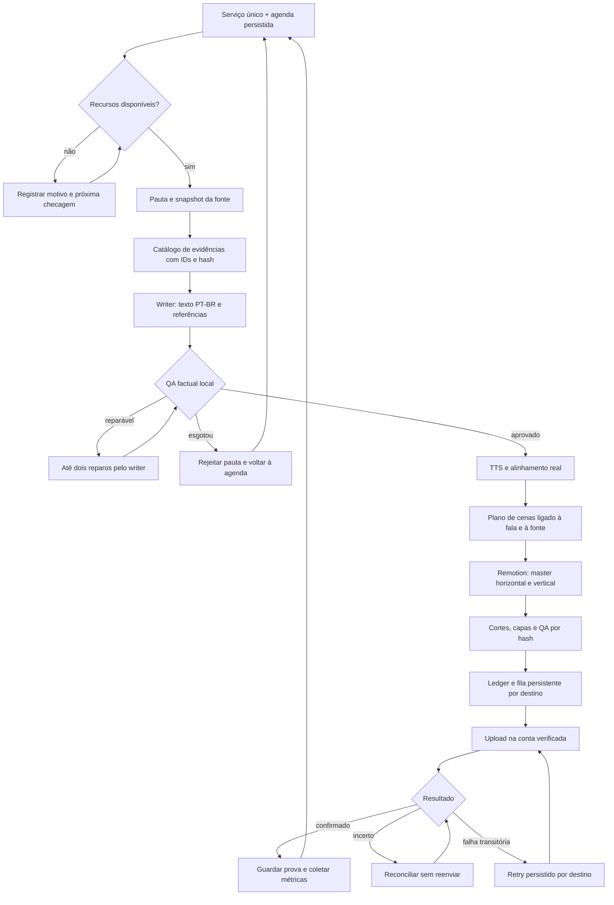

# Workflow autônomo do Pulso: estado, arquitetura e melhorias

**Estado vigente, 02/11/2026 — v2.21.0:** a produção não deve depender de o assistente gerar cenas manualmente. `narrative-scene-author` escala após falha do modelo leve, persiste a decisão e retoma blocos de até quatro frases, com IDs/timeline originais e hashes revalidados. Rascunho inválido e diagnóstico local acompanham o reparo (até dois adicionais por bloco), sem enviar mensagens privadas de exceções de rede a outro provedor. As rotas grandes usam somente credenciais/allowlist já autorizadas ao scheduler; modelos indisponíveis são pulados e seus prazos persistem entre tentativas, com Retry-After respeitado; orçamento compartilhado continua obrigatório. Falha de todas as rotas mantém o job recuperável. Não usar `PULSO_DETERMINISTIC_SCENE_FALLBACK`: metadados sem ilustrações não substituem o padrão aprovado. O serviço existente permanece ativo; às 12:54 BRT a tentativa antiga foi colocada na recuperação persistente e seu filho encerrado, sem iniciar outro scheduler/gerador manual. Retomada automática do mesmo job comprovada às 12:59 BRT; as rotas maiores foram efetivamente tentadas, ainda sem cena aprovada. Testes: 182/182; nenhum novo vídeo/publicação completa comprovado nesta entrega. Capas Android/Nano Banana Pro continuam com integração pendente; algumas rotas premium têm erros de quota/acesso/disponibilidade. Desde v2.21.0, os erros numéricos informam frase/objeto/campo/eixo, valor numérico ou tipo recebido e faixa aceita; o prompt explicita amount obrigatório para scale/rotate e limites de rotação 3D. Corrigir o rascunho usando esse diagnóstico, sem afrouxar limites. Ver [v2.20.0](releases/v2.20.0.md) e [v2.21.0](releases/v2.21.0.md).

**Atualização de método, v2.18.0:** o proprietário aprovou os dois formatos do piloto de reflorestamento e adotou o fluxo Three.js r187 + Remotion com humanos GLB licenciados locais como padrão da autoria recorrente. O catálogo é hash-checked antes do render e a seleção/clip vem do plano alinhado à narração. O benchmark r187 mediu 2min12,4s de trabalho (2min12,7s com espera) do roteiro/áudio congelados a MP4 validado; o piloto de 32s mediu 84,51s horizontal + 86,79s vertical, sem cronômetro único de ponta a ponta. O job `3c962d49-88e0-4da1-a24f-a06f452caf1e`, iniciado às 21:55Z, começou antes da mudança e foi preservado; o primeiro episódio iniciado depois dela é a confirmação operacional pendente. A adoção do método não libera nem altera envios sociais.

A reconciliação roda no worker social existente, mantém cooldown/página em `data/state/reconciliation-*.json`, preserva resultados incertos e jamais usa ausência no perfil como autorização para reenviar. Novas submissões priorizam a página inicial. Capas/QA e reparos continuam automáticos, sem nova aprovação humana por vídeo.

**Cadência em 29/10, 16:17 BRT:** o perfil `PULSO_PIPELINED_PRODUCTION=1` prepara no máximo um próximo episódio durante envio, com gate de recursos e publicadores exclusivos. Um episódio novo sem caches concluiu em 5min24s e foi confirmado automaticamente em YouTube/Shorts/Kwai; a preparação seguinte sobrepôs 51,6 s do envio social, mas falhou por fonte curta. O serviço continua com meta 60 principais/dia/10 temas, um a cada 24 min; capacidade diária e dois ciclos completos consecutivos ainda não comprovados. Writer prefere Gemini com ID normalizado; novos roteiros têm orçamento de 450 palavras (`PULSO_NARRATIVE_WORD_BUDGET`, faixa 150–650), sem cortar aprovados. TTS é solicitado em trechos de até 1.800 bytes, unido por amostras de áudio e validado contra toda a narração; interpolação esparsa fica marcada `mixed`, nunca como limites exatos. Cache incompatível é regenerado na produção e rejeitado em replay. Falhas de voz mantêm job para retry; roteiros sem evidência continuam bloqueados. Slots vencidos persistem após restart; confirmação SD usa ID exato na listagem, sem reenviar. [Medições, testes, provas e limites](evidencias/production-cadence-2026-10-29/README.md).

**Atualização operacional de 29/10/2026 — render junto ao treino:** a pedido do proprietário, a unidade existente usa `deploy/systemd/ai-video-scheduler.service.d/20-training-sharing.conf`: Nice 10, CPUs 22–27, quota de três CPUs, memória de até 6 GiB, heap dos subprocessos até 2 GiB e render sequencial. `PULSO_RENDER_WITH_TRAINING=1` só funciona com o perfil de afinidade/prioridade limitado; exige RAM/swap livres e pelo menos 2 GiB de VRAM livre, sem bloquear apenas pela utilização de compute da GPU. Não esperar o treino terminar nem encerrá-lo. O modo `angle-egl` falhou na criação de contexto WebGL deste host; o serviço passou a usar `angle`, recomendado na [documentação Three do Remotion](https://www.remotion.dev/docs/three). Job de Mistérios já iniciou render com treino ativo; conclusão/QA/publicação devem ser verificadas no cursor atual e nas [evidências](evidencias/android-storage-recovery-2026-10-29/README.md). A pausa de migração não equivale a pausa por treino.

**Atualização de 28/10/2026 — padrão aprovado para todos os próximos vídeos:** a referência de sete cenas em [Pulso novo padrão](https://francoscorporation.ddns.net/remotion-review/previews/pulso-novo-padrao-20261028-v2/) substitui as orientações visuais anteriores onde houver conflito. O serviço deve adaptar as cenas ao assunto e à fala, com robô, movimentos explicativos e mapas ilustrativos quando fizerem sentido. A revisão factual permanece determinística e vinculada à fonte; não exigir revisor LLM nem aprovação humana por vídeo. A migração `narrative-episode-v2` está em andamento e a pausa `data/state/narrative-method-migration.paused` protege a fila e as retentativas. Antes de liberá-la, verificar visualmente correções e seek nos dois formatos, validar um ciclo real e recarregar a unit existente em janela ociosa; a amostra isolada aprovada não é prova da rota integrada. Consultar o cursor mais recente de `plan.md` para o estado e bloqueios operacionais.

**Canário de migração:** o arquivo `data/state/narrative-method-migration-canary.json` permite ao produtor existente tentar um candidato v2 após `notBefore`, sem liberar a publicação. A fila fica limitada a um candidato durante a migração, a pausa administrativa prevalece e falha de disponibilidade do writer espera ao menos 30 minutos. O consumer e as retentativas seguem bloqueados pelo marcador de pausa, e o renderer antigo continua inelegível. Verificar o candidato e os destinos antes de remover a pausa; não confundir tentativa programada com postagem confirmada.

Atualizado em **25/10/2026, America/Sao_Paulo**. Este documento detalha a prioridade de `plan.md` §3.0; **não cria outra fila de tarefas**. Evidências: [implementação e diagnóstico de 22:25 do dia 24](evidencias/workflow-autonomo-2026-10-24/implementation-state.json) e [ativação, estado do scheduler, host e última tentativa](evidencias/workflow-autonomo-2026-10-25/activation-state.json). Os estados abaixo são observações datadas, não monitoramento em tempo real.

## 1. Pedido e decisões permanentes

O proprietário quer produção e envio recorrentes sem precisar chamar um assistente de programação a cada falha. Pediu também melhorias no Remotion e no entendimento da fonte para criar cenas que expliquem a narração. Em seguida, pediu preservar toda essa continuidade na documentação.

- O scheduler deve agendar, verificar recursos, retomar etapas, aplicar QA, publicar e reconciliar resultados por código e estado persistido.
- Modelos podem escrever/reparar roteiro e propor cenas. **Não há LLM revisor rotineiro, agente em loop conferindo o serviço ou aprovação humana por vídeo/capa.** A política permanente está em `config/publication-review-policy.json`.
- Uma falha transitória deve gerar espera e nova tentativa automática. Reprovação factual deve bloquear aquele roteiro, permitir reparo limitado e depois outra pauta. Falha de uma rede não deve bloquear as demais.
- “Autônomo” não significa inventar login, dados pessoais, evidência, números ou confirmação de postagem. Dependências reais da conta ficam registradas por destino; o restante continua.
- Método visual aprovado: GPS v2 / PulsoStory, robô GLB aprovado com fala e gestos, objetos executando a explicação, câmera com motivo e layouts próprios 16:9 e 9:16. Preservar os dez temas, fontes, rig e bibliotecas compartilhadas.
- YouTube longo, Shorts e retries usam **Studio Android**, conforme decisão do proprietário. Não reintroduzir API como fallback. Telegram permanece excluído.

## 2. Estado real: implementado não significa operando

| Camada | Evidência atual | Limite / próximo resultado necessário |
|---|---|---|
| Primeiro episódio no método aprovado | “Como uma IA monta uma resposta — e por que às vezes inventa” publicado em [YouTube](https://youtu.be/YVlMlolFUk8); evidência local por hash | Foi uma entrega específica; não comprova produção universal recorrente |
| Contrato, autor e composição narrativa | `narrative-episode-plan.js`, `narrative-scene-author.js`, `NarrativeEpisode.tsx` e renderer já existem e estão integrados no gerador | Falta concluir E2E da rota integrada e observar ciclo recorrente |
| QA factual | `deterministic-source-evidence-v1`, catálogo v29 por IDs e citação literal; fixtures integradas validam IDs, reordenação, tradução, números/unidades, negação, incerteza e reparo limitado | Heurísticas locais não provam equivalência semântica completa entre narração traduzida e fonte |
| Última execução automática | Depois da ativação, 39 roteiros foram reprovados em `source_claims_unverified`, 7 tentativas não encontraram pauta fresca e 2 tiveram contexto curto; a última chamada terminou em `budget_exhausted` | **Nenhum MP4 aprovado ou upload novo.** A cota atual renova em 26/10 00:00Z (25/10 21:00 BRT); próximo retry está persistido |
| Serviço do produtor | `ai-video-scheduler.service` e `ai-video-scheduler-guard.timer` **active/enabled** às 11:15Z de 25/10; heartbeat renovado, fila `pending=0`, `inFlight=false` | Retry de cota 26/10 00:00:01Z; gate 11:15Z bloqueado por load1 45,43/limite 9,8 e RAM 5,59/6 GiB; falta um ciclo geração → QA → upload |
| Reinício/supervisão | Guard timer enabled/active; usuário com `Linger=yes`; unidade mantém `Restart=always`; backoff é restaurado após restart | O processo fica ativo em espera; cota de API e render gate ainda limitam o próximo job |
| Recursos do host | Probe atual do gate em 25/10 11:15Z: load1 45,43, RAM disponível 5,59 GiB (mínimo 6 GiB), GPU 2%; bloqueado por carga e memória | O gate não chama writer enquanto fechado; reconsulta a cada 30 s quando o producer chegar à etapa de geração. Não encerrar processos de outros projetos |
| Distribuição | YouTube confirmado e Kwai parte 1/6 reconciliada; demais estados abaixo | Não estamos enviando automaticamente para todas as redes |

**Correção de diagnóstico:** o checkpoint das 21:55 dizia que a unit não estava instalada. A consulta havia usado o manager errado/um terminal sem bus de usuário. A unidade existe em `~/.config/systemd/user/`; não reinstalar nem criar outro produtor com base naquele diagnóstico.

O serviço existente foi reativado em 25/10 com as pausas administrativas arquivadas de forma reversível. A espera automática por recursos já foi observada em execução: quando load/RAM voltaram aos limites, o producer retomou chamadas; depois, as reprovações factuais repetidas esgotaram a cota diária da API. A coleta atual encontra o host bloqueado por load e o producer aguardando a cota; ambos os gates serão respeitados automaticamente.

## 3. Fluxo de destino e responsabilidades

O diagrama mostra o fluxo completo. Recuperação com identidade estável, espera local por recursos, filtro de publicação e catálogo literal de evidências por IDs existem no checkout. As fixtures integradas passam; o primeiro ciclo de produção v29 ainda precisa provar geração, QA, render e upload de ponta a ponta.



`scripts/channel-scheduler.js` é o único dono da produção/publicação Pulso. `npm run scheduler` inicia outro sistema, AgentTube/Express/SQLite, conforme [ADR-0001](adr/0001-fronteira-entre-pipelines.md). Não usar esse comando como substituto do serviço de usuário.

### Padrão editorial de vídeo longo (v2.19.0)

O master principal do YouTube é horizontal 16:9, com meta de 950 palavras narradas, mínimo editorial de 850 palavras e validação da duração real de áudio em pelo menos 360 segundos. A seleção automática procura matéria com contexto factual suficiente e descarta pautas curtas em vez de estender a fala com repetição ou fatos genéricos. Em roteiros longos, seis ou mais seções distribuem a explicação; cada frase permanece vinculada a uma ação, transformação ou mudança de câmera no plano de cenas. O render também cria o master vertical 9:16, do qual `makeNarrativeSocialParts` extrai os Shorts e demais cortes verticais.

### Mapa de código existente

| Responsabilidade | Arquivos principais |
|---|---|
| Agenda, producer, consumer e retries | `scripts/channel-scheduler.js`; `utils/generation-retry.js`; `utils/scheduler-runtime-health.js` |
| Tentativa interrompida, pausa e IDs | `utils/generation-attempt.js`; `utils/video-generation-control.js`; `utils/observability-ids.js` |
| Entrada de geração e cache de roteiro | `scripts/generate-animated-video.js` |
| Fonte, cobertura factual, reparo e histórico | `utils/article-context.js`; `utils/deterministic-script-review.js`; `utils/script-repair.js`; `utils/script-review.js` |
| Contrato e autoria visual | `utils/narrative-episode-plan.js`; `utils/narrative-scene-author.js` |
| Render, gate de recursos e checkpoint | `utils/narrative-episode-renderer.js`; `utils/render-timing.js` |
| Composição e apresentador | `experiments/remotion-motion-review/src/NarrativeEpisode.tsx`; `ApprovedRobotPresenter.tsx` no mesmo diretório |
| Cortes, mix e QA | `utils/clip-maker.js`; `utils/audio-mix.js`; [runbook de QA](video-qa-review-runbook.md) |
| Publicação e isolamento de contas | `scripts/upload-to-socials.js`; `utils/android-social-target.js`; adaptadores Studio Android já chamados pelo scheduler |

Renderer declarado no gerador: `remotion-4.0.537-narrative-episode-v1-approved-robot`. Revisão atual de roteiro: `retention-emotions-v27-production-motion-word-timing`. Alterar revisão sem analisar os caches pode regenerar roteiro/TTS desnecessariamente.

### Estado e propriedade dos dados

Os caminhos abaixo usam o `STATE_DIR` padrão `data/state`. Não editar fila/ledger enquanto houver escritores.

| Persistência | Conteúdo / uso |
|---|---|
| `scheduler.json`, `theme-rotation.json` | Agenda e rodízio de temas |
| `scheduler-health.json` | Heartbeat, estado de producer/consumer/fila, falha e prazo de retry; heartbeat antigo não prova serviço vivo |
| `generation-in-flight.json` | `jobId`, saída, tema, formato, pauta e captura da fonte da tentativa |
| `publish-queue.json`, `topics.json` | Fila persistida e ledger operacional; preservar identidade dos arquivos e destinos |
| `narrative-renders/<jobId>.json`, `narrative-render.lock` | Conclusão por proporção e exclusão mútua do renderer |
| `data/reports/narrative-episodes/`, `data/reports/qa/` | Plano/resultado e manifestos de revisão vinculados aos bytes |
| `data/scripts/`, `logs/` | Roteiros, metadados da revisão e logs; não publicar credenciais presentes em ambiente/logs |

## 4. Melhorar a compreensão da fonte: validação local integrada concluída; E2E do writer pendente

**Problema reproduzido no contrato v27:** o prompt exigia que o writer copiasse citações e construísse caminhos como `sections.0.content#1` para todas as frases. Na pauta “No signs of AI payoff outside the tech sector”, contexto de 4.962 caracteres, o mapa veio incompleto (11 evidências para 22 afirmações inicialmente, 14 para 21 ao final). Também houve trecho para a frase errada e citações que não existiam literalmente na fonte. Pedir reparo do mapa inteiro aumentou truncamento e novas inconsistências.

Preservar esse diagnóstico v27 em `data/scripts/ia_no_signs_of_ai_payoff_outside_the_tech_secto-retention-emotions-v27-production-motion-word-timing.json` e `.json.meta.json` (mesmo nome-base). A execução seguinte após o rollout confirmou 39 reprovações factuais no ciclo ativo e a última chamada terminou em esgotamento da cota da API. O writer passou ao contrato v29 por IDs. As fixtures agora exercitam compilação, citações literais, IDs inválidos, contexto alterado, reordenação, tradução, números/unidades, negação, incerteza e reparo limitado; não chamam writer nem comprovam um job real. Dois rascunhos v29 persistidos repetiram `claim_words_not_in_quote`; em 25/10, o feedback/prompt de reparo passou a explicitar o limiar lexical existente, sem relaxar o gate. Testes focados 34/34, ESLint e diff-check passaram; o próximo writer real segue pendente por cota.

**Implementado e validado localmente em 25/10:** `utils/source-evidence-catalog.js` divide o snapshot normalizado em trechos literais imutáveis com IDs `S001…`; o writer devolve IDs por afirmação; o compilador resolve IDs existentes para citações literais; o revisor local mantém seus gates de cobertura, números/unidades, negação, incerteza, causalidade e direção. Cache de roteiro: `retention-emotions-v29-inline-source-evidence`. O teste integrado cobre o fluxo do compilador/reparador/revisor; o teste com writer real permanece pendente por cota de API e gate do host.

1. A captura já conserva URL, título, data/idade e hash do contexto; o catálogo divide esse texto normalizado sem reescrever a fonte.
2. Os IDs são estáveis dentro do snapshot/hash. Cada trecho guarda intervalo de caracteres e contagem de palavras; as citações do verificador são reconstruídas localmente a partir desses offsets.
3. O writer agora escolhe `sourceIds` para o título e cada sentença; um ID ou IDs consecutivos podem sustentar uma afirmação. Os prompts de geração e reparo não pedem que o modelo copie citações extensas.
4. Fixtures locais verificam IDs ausentes/desconhecidos, sequência não contígua, contexto alterado, frases reordenadas, roteiro traduzido, números/unidades, negação e incerteza. O verificador não demonstra equivalência semântica completa entre PT-BR e fonte em outro idioma; o writer real ainda deve concluir um job sob QA.
5. Reaplicar cobertura, números/unidades, nomes, idioma, negação, incerteza, causalidade e escopo. Não substituir prova por simples similaridade de palavras. Registrar a limitação semântica do método; não declarar tradução factual comprovada apenas porque há citação.
6. Reparar somente os blocos reprovados, recompilar o mapa e verificar novamente. Esgotados dois reparos, aposentar a tentativa factual e escolher outra pauta sem renderizar conteúdo não sustentado.
7. Levar as referências aprovadas ao autor de cenas. Cada beat descreve **pergunta → conceito/ator → ação → transformação → consequência**, com restrições e objeto/câmera próprios da pauta. Separar demonstração ilustrativa de observação real; métricas/causalidade nunca podem surgir só para enfeitar a cena.

A revisão v29 força novo cache de roteiro; artefatos v27 permanecem preservados e não são automaticamente aprovados por compatibilidade. O primeiro job real com IDs precisa completar QA factual e visual antes de entrar na fila de publicação.

## 5. Melhorias Remotion pesquisadas e aplicação prevista

Dependências locais estão fixadas em Remotion **4.0.537**, React **19.2.3**, Three **0.186.1**. A pesquisa não implica atualizar versões. Conferir API/CLI instalada antes de adotar opções novas.

| Melhoria proposta | Base / estado atual | Resultado verificável |
|---|---|---|
| Preparar bundle uma vez por job e reutilizar nos dois formatos | Implementado na CLI: um bundle é hashado e ambos os renders usam a mesma pasta; a CLI instalada 4.0.537 reconhece diretório com `index.html` como bundle local | Testes unitários cobrem argumentos e identidade do bundle; medição de render aguarda gate aberto |
| Validar props antes do render | Helper validado pelo renderer e por `calculateMetadata`; preview vazio é explicitamente permitido, job incompleto é rejeitado | Fixtures cobrem aspecto, duração, áudio, robô, paleta e envelope; bundle/render real pendente |
| Progresso, cancelamento e limites | O CLI encerra apenas o grupo do child; renderer compartilha um prazo total entre bundle e os dois aspectos | Testes cobrem deadline total; observar timeout real no próximo job |
| Assets previsíveis e falha identificada | [`delayRender`/`continueRender`/`cancelRender`](https://www.remotion.dev/docs/delay-render) controlam prontidão, erro e timeout de carregamento | Pré-validar arquivos locais; nenhum fetch criativo por frame. Ausência de asset produz falha recuperável identificada |
| Recursos e escrita final | Gate rechecado antes do bundle e de cada aspecto; heap calculado pela memória disponível; output vai para temporário, é validado e promovido por hard link | Helpers/testes passam; bundle e outputs reais ainda precisam de render e inspeção dos dois formatos |
| Retomada e determinismo | Identidade inclui plano, cenas, revisão e hash do bundle; cada aspecto válido conserva SHA/duração | Testes locais de retomada/identidade passam; prova por quadros e seeks do novo renderer aguarda render real |

Estas são escolhas de engenharia propostas a partir das APIs e do código local; não são promessas de desempenho do Remotion. A direção estética permanece narrativa: ações visíveis, enquadramentos variados, robô integrado e legendas legíveis. Consultar a [skill local](../.agents/skills/pulso-motion-design/SKILL.md) antes de alterar motion.

## 6. Recuperação automática a completar

**Implementação e ativação em 25/10:** o serviço do usuário está ativo e o producer mede recursos antes de chamar writer; gate fechado espera e reconsulta sem LLM. Retentativas transitórias preservam `jobId`, arquivo, slot, fonte, seed e `--resume`; timeout encerra só o grupo do job; fila recuperada fora da rota aprovada fica em quarentena preservadora; publicação exige renderer narrativo, manifesto hash-bound e revisão factual. Heap Remotion acompanha a RAM disponível. A reprovação de fonte agora aguarda a virada do dia após até dois reparos, evitando um ciclo de tentativas de writer a cada cinco minutos. Sintaxe e ESLint passaram; testes, render e upload não foram executados nesta atualização.

**Estado atual às 20:12Z:** serviço e guard ativos/enabled; última leitura do health mostra producer em `backoff`, fila vazia e `inFlight=false`. Última geração esgotou a cota em 25/10 07:14Z; retry 26/10 00:00:01Z. Probe do gate bloqueado por load1 14,13/limite 9,8; RAM disponível 9,54 GiB e GPU 0%. Ainda faltam job real v29, bundle/render aprovado e confirmação de upload; não alegar produção/publicação concluída. Evidência: `evidencias/workflow-autonomo-2026-10-25/source-repair-guidance.json`.

Os estados abaixo orientam o acompanhamento operacional. `waiting_resources` e `backoff` são persistidos no health JSON; fixtures locais passam, enquanto o E2E real aguarda a cota e os recursos do host:

| Situação | Comportamento automático exigido |
|---|---|
| `waiting_resources` | Medir load/RAM/swap/GPU/locks, persistir motivo/prazo, esperar e medir de novo sem chamar writer |
| Falha de provider/transporte | Backoff limitado e persistido, distinguir timeout/429/404, evitar repetir endpoint indisponível a cada job; não gastar todas as opções sem diagnóstico |
| `budget_exhausted` | Preservar regra existente: próximo reset UTC + 1 s; reinício não zera prazo |
| Sem pauta fresca | Preservar retry existente de 30 s; respeitar fonte expirada e não transformar notícia antiga em atual |
| Reprovação factual | Até dois reparos; se a revisão continuar rejeitando, persistir espera até o próximo dia UTC e só então tentar outra pauta. Não renderizar conteúdo reprovado |
| Reinício/timeout de render | Mesmo `jobId`, saída, fonte/hash e seed; retomar primeiro estágio inválido, reaproveitar aspectos concluídos válidos |
| Crash do child | Encerrar apenas árvore própria, preservar checkpoint/locks consistentes, agendar recuperação; prazo do processo não altera confirmação remota |
| Rede indisponível | Pendência e prazo por destino; outras redes elegíveis continuam |
| `submitted` / `processing` / `unknown` | Reconciliar conta, conteúdo e prova; não reenviar nem excluir enquanto o resultado for ambíguo |

O retry genérico atual é de cinco minutos. Ajustar classificação por causa sem apagar prazos persistidos nem criar um loop rápido. Supervisão deve continuar por systemd e verificações locais; não criar cron que chame um LLM para consertar o produtor.

## 7. Destinos e limites observados

Estado atualizado em 27/10; revalidar conta/armazenamento/cota antes de cada operação real.

| Destino | Situação conhecida | Continuidade |
|---|---|---|
| YouTube | Episódio IA anterior público via Studio Android; sessão e canal configurado carregados em 27/10 | Gerar/QA e confirmar nova publicação; a reabertura do Chrome ocorre automaticamente se o CDP local não responder. Cota histórica não deve ser presumida atual |
| Shorts | Cortes disponíveis do episódio específico, sem envio comprovado nesta entrega | QA próprio + Studio Android; não herdar confirmação do master |
| Kwai | Parte 1/6 anterior confirmada; identificador `Pulse_New_Ai`, nome de exibição alterado para Pulso IA | Reconciliar rascunho Fitness antes de repetir; confirmar novos envios por conteúdo |
| Instagram | `@pulso_ai_news`, nome Pulso IA e sessão confirmados; handler existente | Resolver armazenamento interno quase cheio e comprovar novo envio; preservar dados pessoais |
| TikTok | Perfil conectado `@rodolfofranco13`, nome Pulso IA; data adulta autorizada; teste privado terminou em rascunho com erro | Reconciliar teste incerto; resolver armazenamento e concluir/validar adaptador candidato antes de habilitá-lo; não repetir resultado ambíguo |
| X | App encerra ao carregar biblioteca `libyoga.so`; perfil não confirmado; handler ausente | Corrigir compatibilidade, verificar sessão/identidade e implementar envio com confirmação |
| Telegram | Excluído por decisão expressa | Não incluir na fila |

Provas: [YouTube](evidencias/ia-como-responde-2026-10-23/youtube-studio-published.json), [Kwai parte 1](evidencias/ia-como-responde-2026-10-23/kwai-part1-reconciliation.json), [verificação de 27/10](evidencias/autonomia-social-2026-10-27/README.md). A disponibilidade de uma conta não comprova publicação. Vídeo, arquivo/variante e destino são contagens diferentes.

## 8. Diagnóstico e rollout do serviço existente

Comandos de **consulta**, a partir de `youtube-automation-agent/`:

```bash
env XDG_RUNTIME_DIR=/run/user/1000 DBUS_SESSION_BUS_ADDRESS=unix:path=/run/user/1000/bus \
  systemctl --user show ai-video-scheduler.service ai-video-scheduler-guard.timer \
  -p Id -p LoadState -p ActiveState -p UnitFileState -p ConditionResult -p MainPID
loginctl show-user servidor -p Linger
node -e "console.log(JSON.stringify(require('./utils/render-timing').probeRenderHardwareGate(), null, 2))"
```

O caminho UID 1000 vale para este host. O serviço executa `/usr/bin/node scripts/channel-scheduler.js`, com `Restart=always`. A cadência configurada de 60/dia **não é capacidade comprovada**. Arquivos de deploy versionáveis ficam em `deploy/systemd/`; a configuração efetiva também contém drop-ins no diretório do usuário.

Pausas administrativas anteriores foram arquivadas reversivelmente em 25/10; `.env` agora tem `PAUSE_VIDEO_GENERATION=0`. Serviço `active/running`, guard ativo. Estado observado em 25/10 20:12Z: cota até 26/10 00:00:01Z; probe fechado por load1 14,13 acima do limite 9,8, com 9,54 GiB disponíveis. Depois do backoff de cota, o producer volta ao gate local de recurso antes de chamar writer. Não despejar `.env` nem ambiente do serviço em relatórios.

**Rollout aplicado de forma reversível:** drop-in e marcador foram renomeados para arquivos `.disabled-20261025T013316Z`; `.env` foi atualizado e sua versão anterior preservada. A unit existente iniciou, o guard continua ativo e a fila estava vazia, portanto não foi necessário mover item para a quarentena. A primeira execução automática retomou, mas os roteiros falharam no QA factual e a última chamada acabou na cota. E2E completo continua pendente; nenhum vídeo novo foi liberado para upload.

Para acompanhar, consultar `scheduler-health.json`, `systemctl --user show ai-video-scheduler.service` e `probeRenderHardwareGate()`. Sob load alto, a etapa `waiting_resources` reconsulta a cada 30 s sem chamada ao writer; em backoff de cota, `producer=backoff` usa o horário persistido e o gate de recursos é conferido antes da próxima geração. Não é necessário iniciar outro scheduler nem chamar um LLM para fazer polling.

Rollback: reter novas publicações, drenar trabalho em andamento, preservar ledger/fila/mídia e restaurar a configuração registrada. Não restaurar silenciosamente o criador visual rejeitado nem reenviar itens incertos.

## 9. Ordem de implementação e prova de conclusão

Este detalhamento corresponde ao cursor de `plan.md` §3.0 (YAI-063, continuidade/cadência YAI-021 e verificações YAI-010); não muda os estados desses IDs por documentação.

1. **Fonte/roteiro — fixtures integradas aprovadas:** cobertura de IDs, literalidade, contexto, ordem, tradução, números/unidades, negação, incerteza e reparo; job do writer real pendente.
2. **Scheduler — regressões aprovadas 16/16:** identidade, retry UTC, recuperação, quarentena e guard. Retry real permanece persistido no serviço ativo.
3. **Remotion — implementação local aprovada por testes/lint:** bundle único, validação de props, deadline total, gate por aspecto, hash de bundle e output atômico. Falta bundle/render real, QA dos dois formatos e seek reverso.
4. **Publicação — regressões focadas 73/73:** filtros, hash-bound QA, confirmação e estados ambíguos. Shorts recentes foram `confirmed_no_send`; não houve nova tentativa nesta continuação.
5. **Operação — pendente por estado externo:** observar retry depois de 26/10 00:00:01Z UTC, esperar load abaixo de 9,8, validar primeiro job v29 e upload confirmado. Manter a mesma unit/guard. Reconciliar Kwai 2–6 e destinos disponíveis; registrar bloqueios IG/TT/X sem contorná-los.

Testes existentes para selecionar conforme o incremento: `deterministic-script-review.test.js`, `script-repair.test.js`, `script-review.test.js`, `generation-attempt.test.js`, `generation-retry.test.js`, `scheduler-guard.test.js`, `narrative-episode-plan.test.js`, `narrative-scene-author.test.js`, `narrative-episode-renderer.test.js`, `publication-visual-gate.test.js` e `social-publication-state.test.js`, em `tests/`. São suítes Node; usar `node --test tests/<arquivo>.test.js` com estado isolado conforme a suíte. Lint/TS da composição: `npm --prefix experiments/remotion-motion-review run lint`. Não disparar testes live nem a suíte inteira por uma alteração documental.

**Critério final de autonomia:** agenda + espera + recuperação + QA + envio/reconciliação funcionam pelo serviço, inclusive após restart, sem um assistente programador pilotando cada etapa. Evidência deve registrar horários, job/arquivo/hash, causa/próxima tentativa e confirmação por destino. Teste verde, heartbeat ou postagem manual isolada não cumprem esse critério.

## 10. Retomada sem perder contexto

Ler `AGENTS.md` → `plan.md` §3.0 → este guia → somente código/evidência do incremento atual. O [guia do primeiro episódio](retomada-linha-narrativa-2026-10-23.md) preserva os artefatos e comandos da migração; seus PIDs e estados antigos não são operação atual. `resumo.md` é histórico, não outra fila.

Ao concluir cada incremento: atualizar cursor e linha pertinentes do plano, matriz de estado deste guia, evidência datada e nota curta no topo do resumo. Marcar explicitamente implementado/testado/renderizado/publicado; registrar falhas sem apagá-las. Preservar alterações locais e arquivos não rastreados. Não usar reset/clean, excluir vídeos de outros projetos ou interromper treinamento para fabricar uma janela de render.
